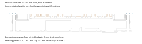

# Amulet lighting preview

Run `just demo` from the repository root. The demo starts at 0.6 m, facing the
front, with indoor light and spiral rainbow. It needs Godot 4 with Forward+
and Metal on macOS:

```sh
brew install --cask godot
just cad
just demo
```

The preview compares the current assembly with two finishes on one continuous
250 × 1.5 mm acrylic front. **The saved FreeCAD model still defines the current
assembly. Select a finish before converting that model or its manufacturing
exports.** Both proposed finishes use the same mounts and a black masked outer
rim on the same sheet.


Columns: current assembly, full mirror coating, clear centre with mirror around
it. Top row: LEDs on. Bottom row: LEDs off. The view, pattern time, brightness,
exposure and environment match within each comparison.

[Watch the six-second Godot finish comparison](../hardware/enclosure/exports/lighting-demo.mp4).
Each finish gets the same two-second pattern segment, indoor light and moving
side-to-front camera path.
The [26-second Godot demo](../hardware/enclosure/exports/amulet-demo.mp4) also
shows a front-hemisphere sweep and all four lighting presets. All demo movie and GIF
frames come from Godot, including their animated LEDs and mirror reflections.

## Looping animations

[Rainbow and centre pulse](../hardware/enclosure/exports/infinity-rainbow.gif) ·
[White infinity pulse](../hardware/enclosure/exports/infinity-pulse.gif) ·
[Colour infinity pulse](../hardware/enclosure/exports/infinity-colour.gif)

Each eight-second loop moves from a 65° side view through the front, across to
the other side and back. Camera position, velocity and LED state join at the
loop boundary. The rainbow loop shows the centre and all rings. The white and
colour loops isolate the cavity rings so the centre cannot hide the repeated
reflections. They use night light, a 0.46 m distance, fixed exposure 1, and assumed
sleeve diffusion 0.30. Their peak emission scale is 6; rainbow peaks at 2 with
the default diffusion 0.65. These are illustration settings, not measurements.

The twelve-second `turntable.gif` now uses a ±70° front sweep, with one complete
rainbow cycle and no rear dwell. It also loops without a camera or colour jump.

## Controls

- Drag to orbit. Right-drag to pan. Use the wheel to change distance. Press `R`
  to reset the view.
- Use Front, ¾, Edge and Rear for fixed angles. Distance buttons select 0.3,
  0.5, 1, 2, 5 or 10 m. The status shows distance from the orbit target, angles,
  pattern time, frame rate and central diffusion.
- Select spiral rainbow, rotating spokes, radial waves, solid R/G/B, white or
  a single-pixel chase through all 494 LEDs. Pause stops pattern time. The four
  switches control the circle, halo, inward ring and outward ring separately.
- Select night, indoor, overcast or bright sun. Ambient intensity and light
  direction remain adjustable. Exposure stays at 1 unless you move its slider.
- Adjust front reflectance and transmission. Moving either control reduces
  the other when needed to keep their sum at or below 1.
- Adjust sleeve transmission, sleeve diffusion and centre diffusion. These
  are assumptions, not measured material values. Scroll the control panel to
  reach the view controls.

Changing the finish preserves camera position, time, light, brightness and
exposure. For a stationary comparison, pause first.

## What the image means

`hardware/enclosure/exports/amulet.glb` is the only generated scene asset.
`scene.json` holds part names, exact native bounds, dimensions, mirror planes,
494 emitting positions and directions, assumptions, and proposed mass values.
The exporter tessellates the saved assembled FreeCAD model in metres, with X
right, Y up and Z toward the front. It never uses print-bed STL translations.
Godot loads the GLB at runtime through `GLTFDocument`.

The cavity shader follows rays between Z=25.5 and Z=36.7 mm. It intersects the
finite annular cavity, central obstruction and cylindrical diffuser boundaries.
The opaque LED strips/carriers terminate rays at these boundaries. Each mirror
reflection reduces the remaining contribution. The shader stops below 0.1%,
after 32 reflections, at an opaque boundary, or when a ray exits the cavity.
The front coating reflects the environment. The cavity does not use screen-space
reflections. The direct sleeves, circle cells and reflected rings use one LED
colour texture, in the CAD pixel order.

The first three patterns use the formulas in `design-v2.md`, in linear RGB.
Each circle cell uses its CAD aperture and LED position. A variable Gaussian
spread approximates the centre diffuser. The sleeve model spreads each LED
across neighbouring angles and height. It treats the dark acrylic as a
transmitting, emitting surface backed by an opaque strip. These are design
approximations; the demo does not model scattering through an acrylic volume,
refraction, polarisation, coating angle response, wavelength response, real
luminance or camera adaptation. It does not simulate firmware power limits.

Default optical assumptions:

| Control | Value |
| --- | ---: |
| Front mirror reflectance / transmission | 0.65 / 0.25 |
| Rear mirror reflectance | 0.94 |
| Clear centre reflectance / transmission | 0.04 / 0.80 |
| Sleeve transmission | 0.40 |
| Sleeve diffusion / centre diffusion | 0.65 / 0.65 |
| LED emission scale / exposure | 2.0 / 1.0 |

The four light presets use relative scene intensities, not measured lux. The
60% FreeCAD display transparency has no role in these values. Keep brightness,
coating, diffusion, fit, strength, dust and thermal tests in the existing
`SC-ENCLOSURE` physical TODOs.

## Single-sheet assembly proposal



The proposal keeps the reflecting plane at Z=36.7 mm and the mirror separation
at 11.2 mm. The sheet ends at Z=38.2 mm. The rear mirror and all three curved
sleeves remain. The outside sleeve ends 1.5 mm lower to fit under the new sheet;
its LED row stays at its current position.

The four revised optical-deck quarters provide six 8 mm diameter bearing lands.
Each land has an integral 6 mm outside-diameter collar with the existing 3.4 mm
M3 clearance bore. The sheet has six 6.4 mm locating holes at the existing
233 mm bolt circle. The 0.2 mm radial clearance is provisional. The collars end
at the sheet's front surface and stop the washers. Clamp load runs from the
washers into the collars, lands, body posts and rear clamp lands.

The continuous sheet replaces the centre snap rim. The concealed circle
boundary remains under the sheet. The same wood grid sits 0.1 mm lower on three
shortened rim feet. This leaves a 0.1 mm gap under the sheet and 0.2 mm above the
LED packages. The sheet limits axial movement without using the wood or LED
packages as a screw-load path. These small tolerance margins need physical
checks with measured stock before manufacturing.

Three small lips capture the rear mirror's outer margin beyond the useful
front aperture. Sleeve shoes replace the six loose adhesive pads. Their supports
stay behind the sleeve emitting surfaces and below the LED bodies. The continuous
front provides the upper axial stop. These features belong to the revised deck
quarters; they do not add another grid or opaque spokes across the mirror view.

Assembly sequence:

1. Print and inspect the four revised optical-deck quarters. Check the six
   collar heights and their common plane. Do not use screw force to flatten a
   warped deck or sheet.
2. Assemble the deck quarters around the rear mirror. Engage its hidden edge
   under the locating lips. Join the existing deck seams and straps.
3. Fit the circle PCB on its concealed seat. Fit the halo, inward and outward
   strips on their existing carriers. Route their leads through the top exits.
4. Fit the halo and inward sleeves onto their captive lower shoes. Fit the
   shortened outside sleeve between the rear lip and front seat. Keep all three
   sleeve seams at the top.
5. Fit the three shortened circle feet and the single wood grid. Confirm the
   LED clearance, sheet gap and cell alignment.
6. Apply the selected coating and the black outer mask to the one sheet. Keep
   the centre diffusion assumption separate from the coating selection.
7. Lower the sheet onto its locating collars. Fit broad washers and the six
   existing body bolts. The washers must stop on the collars. Check that the
   centre remains free of clamp preload before closing the rear.

The sequence is a geometric proposal. It does not establish tool access,
snap force, print strength, washer torque, thermal expansion or service life.

| Changed part set | Current | Proposed |
| --- | ---: | ---: |
| Flat front acrylic pieces | 3 | 1 |
| Centre snap rim | 1 | 0 |
| Loose cavity-sleeve adhesive pads | 6 | 0 |
| Optical-deck quarters | 4 | 4 revised |
| Circle rim feet | 3 | 3 shortened |
| Wood cell grid | 1 | 1, positioned lower |
| Curved sleeves | 3 | 3; outside sleeve shortened |
| Rear mirror | 1 | 1 |
| Total for these sets | 22 | 13 |

The front sheet is about 87.6 g before holes and 87.3 g after the six locating
holes, versus 92.3 g for the current three front acrylic pieces. With the
revised mounts and sleeve, the proposed mechanical subtotal is about 443.5 g,
versus 456.0 g. Both use PETG at 1.27 g/cm³, acrylic at 1.19 g/cm³ and wood at
0.60 g/cm³. The complete generated subtotal and its terms are in `scene.json`.
This is a solid-volume estimate. It excludes coating films, electronics, LED
strips, wiring, fasteners, seals, straps and necklace hardware. The internal
candidate battery adds 190 g. Fewer alignment operations are the main benefit.

## Checks and reproducible outputs

```sh
just demo-check
just demo-benchmark
just cad-check
```

`just demo-check` checks freshness, metadata and LED directions, imports every
named GLB mesh, compares imported bounds with CAD, exercises finish and optical
controls, and checks shared patterns and fixed exposure. On the GPU, 105 ray
cases compare the actual cavity tracing code with an independent unfolded-mirror
reference. The cases include spacing, attenuation, cutoff, the reflection limit,
centre obstruction and edge/rear rays. Rendered channels allow 0.009 absolute
error for framebuffer quantisation.

`just cad` rebuilds the native model, validates CAD, exports the GLB and metadata,
checks the demo, and captures all three finishes under all four lights with LEDs
on and off. It repeats front, 72° steep, edge and rear views. It combines the 96
matched renders into 16 labelled comparison sheets, plus the Godot demo, comparison video, sweep GIF and three blinking GIFs, and
decodes every output. FreeCAD supplies geometry and static engineering views;
Godot is the sole demo video renderer. The freshness manifest includes the demo sources and
outputs. The staged commit hook checks the same inventory. A stale or missing
asset prevents `just demo` and an ordinary direct Godot launch.

The build runs in temporary storage and publishes only after all stages pass.
The internal `--build-validation` mode permits checking that temporary build
before its final manifest exists. Use `just demo` for normal launches.

`just demo-benchmark` measures the actual scene at 1280 × 720 with the control
panel, default indoor light and optics, and an animated spiral. It warms the
renderer, then records 300 frame intervals per finish. It reports the renderer,
driver, GPU, mean, 95th percentile and average frame rate. Run it with other
render jobs stopped. Results describe this preview on that machine, not a
physical amulet.

The runtime import and renderer follow the official Godot documentation:
[GLTFDocument](https://docs.godotengine.org/en/stable/classes/class_gltfdocument.html),
[Forward+ and Metal](https://docs.godotengine.org/en/stable/tutorials/rendering/renderers.html),
and [reflection limits](https://docs.godotengine.org/en/stable/tutorials/3d/environment_and_post_processing.html#screen-space-reflections-ssr).
