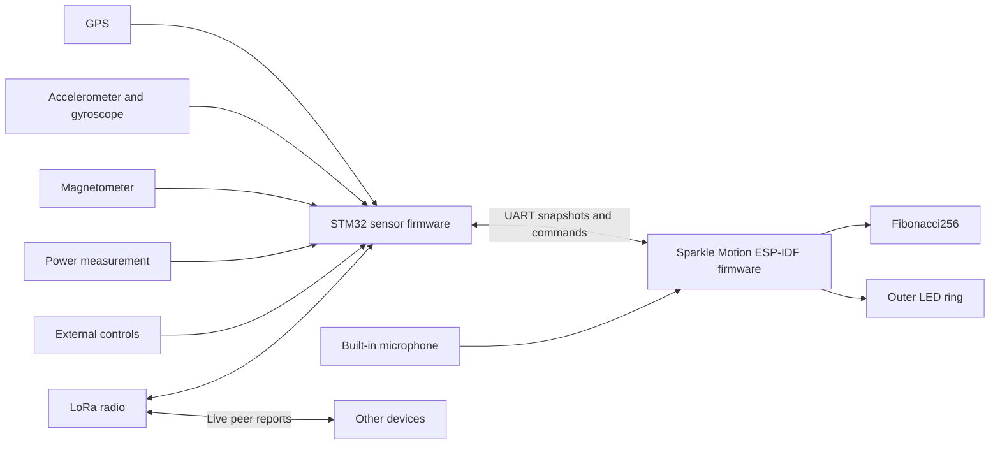

# Smart compass design for Sparkle Motion and STM32

Draft for implementation in a new `smart-compass` project in `musical-lights-rs`.
Design date: 2026-10-09.
Review update: 2026-10-10.

This is a design draft, not a design-complete hardware handoff. The rules below are implementation targets. Numeric sensor and visual limits need bench acceptance. Search for `TODO: SC-` to find unresolved decisions. Each TODO states the evidence needed to close it; an open TODO must not become an undocumented implementation choice.

Build a portable display that shows live radio peers, points north and toward friends, and runs light patterns. Use the existing Fibonacci256 as the main display. Add a dense LED ring around it. Sparkle Motion drives both displays. STM32 owns the GPS, motion sensors, magnetometer, radio, and external controls.

This preserves the two-board plan already started in `musical-stm32`. The new project will reuse useful Rust components. It will have its own firmware entry points and hardware configuration.

## Scope and fixed decisions

| Item | Decision |
| --- | --- |
| Main display | The existing Evil Genius Labs Fibonacci256, with 256 pixels. |
| Outer display | One dense, individually addressable LED ring. Its pixel count follows the finished mechanical design. |
| Display controller | Full Adafruit Sparkle Motion, using Rust and ESP-IDF. |
| Sensor controller | STM32, using Rust and Embassy. Confirm the exact physical board before assigning final pins. |
| Sensor ownership | STM32 reads GPS, accelerometer, gyroscope, magnetometer, and power sensors. It also owns the LoRa radio. |
| Board connection | A wired, bidirectional 3.3 V UART connection. |
| Map mode | A local map of live peers relative to this device. |
| Compass mode | North and bearings to live peers, with one selected peer. |
| Pattern mode | Geometric light patterns, including microphone-reactive patterns. |
| Saved locations | Excluded. No bookmarks, camp pins, place database, location history, or location-save command. |
| Offline use | Navigation, peer exchange, controls, and patterns work without a phone or internet connection. |

Radio, GPS, and peer tracking continue when the display changes mode. Display blanking changes light output only. It does not silently stop location broadcasts.

Street maps, trail maps, routes, text messaging, cloud services, phone applications, clock mode, and flashlight mode are outside the first version. Configuration and calibration can persist. Coordinates cannot persist.

## Existing work and reuse

The inspected Rust source is commit `ae307cd3cb528d252d02918566aee40fb1383243`. The Arduino source is commit `b79be3acf77d0a7e6d13b9dadb4fde4d3abdad96`. These references describe source state, not physical hardware acceptance.

| Existing component | What it contains | Treatment in the new project |
| --- | --- | --- |
| `musical-stm32/src/bin/sensors_for_sparkle.rs` | The intended sensor-board split, two UARTs, shared SPI devices, LSM9DS1 reads, Madgwick processing, and channels to Sparkle Motion. | Reuse device ownership and driver setup after a pin review. GPS and radio tasks contain `todo!()`. Calibration remains unfinished. |
| `musical-stm32/src/sparkle_uart.rs` | UART adapters around the shared encoder and decoder. | Reuse framing and stream handling. Use the new project's message schema. |
| `musical-lights-core/src/message.rs` | Bounded Postcard payloads, CRC-16/IBM-SDLC, COBS encoding, a zero delimiter, and framing tests. The link rate is 115200 baud. | Retain this established framing design. The existing payload lacks fix quality, sample age, heading validity, and complete peer snapshots. |
| `musical-lights-core/src/compass.rs` | Haversine distance and bearing calculations, with tests for cardinal bearings, nearby points, poles, and date-line crossings. | Reuse the mathematics and test cases. The existing API accepts `f32` coordinates and adds its declination argument to the geographic bearing. Do not use that sign convention implicitly in this project. |
| `musical-lights-core/src/orientation.rs` | A defined device frame and orientation classification from gravity or quaternions. | Reuse the frame definition and tests. Orientation classification alone does not supply a compass heading. |
| `musical-adafruit-sparkle-idf/src/main.rs` | RMT output, microphone capture, shared loudness processing, and inactive peer/sensor state. | Reuse the ESP-IDF build pattern, RMT ownership, and audio pipeline. Its active display has 400 pixels in a 20 by 20 net. Sensor UART setup is commented out. |
| `musical-adafruit-sparkle-idf/src/light_profile.rs`, `src/bin/light-check.rs`, and `validation/lights/profile.py` | The active renderer keeps linear colors through brightness mapping, then uses `LedResponse::encode()` for per-channel inverse response and white balance. The current default is explicitly unmeasured. The bench binary and generator support measured profiles. | Retain this output contract for every mode. Give the disc and ring separate response profiles and calibration records. Adapt the bench binary and generator to the two outputs; do not copy the 400-pixel net profile as a measurement of either display. |
| `musical-adafruit-sparkle-idf/src/light_patterns/fibonacci_layout.rs` | Arrays for 256 pixel positions, angles, and radii. | Reuse after physical index and orientation checks. Its X coordinates are mirrored relative to the published Pixelblaze map. Establish one front-view convention. |
| `musical-adafruit-sparkle-idf/src/light_patterns/compass.rs` | A loading check followed by a hue pattern. | Write the actual compass renderer. The current function does not display peer bearings. |
| `musical-lights-core/src/gps.rs`, `radio.rs`, and `lights/networked.rs` | A time alias, a radio TODO, and an empty networked-pattern module. | These are not completed GPS, mesh, or pattern-synchronization implementations. |
| `musical-adafruit-sparkle-embassy` | A 256-pixel output example, sensor initialization, and an SX1262 radio stub. | Use it as a hardware reference. Keep ESP-IDF as the single Sparkle firmware platform for this project. |
| Arduino GPS, radio, compass, and pattern files | NMEA setup, RF95 exchange at 915 MHz, peer colors, an active peer-indexed pattern, automatic battery brightness reduction, and notes about timing and power failures. | Retain peer-indexed composition and battery reduction/recovery as specified below. Do not copy the saved-pin database or the all-peers retransmission schedule. |

The Arduino Fritzing files identify a Feather M0 RFM9x radio board, GPS FeatherWing, motion sensor, and SD hardware. The Rust STM32 manifest and probe runner target STM32F411CE. Its notes also mention Discovery hardware. The actual board must settle that mismatch.

Source references: [STM32 sensor program](https://github.com/BlinkyStitt/musical-lights-rs/blob/ae307cd3cb528d252d02918566aee40fb1383243/musical-stm32/src/bin/sensors_for_sparkle.rs), [UART framing](https://github.com/BlinkyStitt/musical-lights-rs/blob/ae307cd3cb528d252d02918566aee40fb1383243/musical-lights-core/src/message.rs), [compass calculations](https://github.com/BlinkyStitt/musical-lights-rs/blob/ae307cd3cb528d252d02918566aee40fb1383243/musical-lights-core/src/compass.rs), [ESP-IDF design](https://github.com/BlinkyStitt/musical-lights-rs/blob/ae307cd3cb528d252d02918566aee40fb1383243/musical-adafruit-sparkle-idf/DESIGN.md), and [Arduino prototype](https://github.com/BlinkyStitt/smart-compass-v0/tree/b79be3acf77d0a7e6d13b9dadb4fde4d3abdad96).

## System structure



STM32 owns the authoritative local fix, heading, peer table, radio schedule, calibration, and sensor health. It sends complete snapshots to Sparkle Motion. Sparkle Motion owns the display mode, selection, brightness, rendering, and microphone analysis.

The built-in microphone is the one sensor on Sparkle Motion. It serves local pattern rendering and does not enter the navigation or radio path.

Each peripheral has one owner. Interrupt handlers record readiness and wake tasks. They do not parse packets, run fusion, write LEDs, or log large messages. SPI transactions hold the bus only for the actual transfer. Radio transmission time never holds the SPI lock.

## Hardware and wiring

### Sparkle Motion

The full board supplies level-shifted LED outputs, a microphone, and a separate peripheral UART. Proposed assignments use GPIO21 for the disc, GPIO22 for the ring, and GPIO9 TX/GPIO10 RX for STM32. The microphone uses GPIO25, GPIO26, and GPIO33. Keep USB console access separate from the board link. The terminal outputs and GPIO23 are output-only after level shifting. [Adafruit pinouts](https://learn.adafruit.com/adafruit-sparkle-motion/pinouts).

Connect Sparkle TX to STM32 RX and Sparkle RX to STM32 TX. Connect ground. Use the raw 3.3 V UART pins, never an LED terminal. Put both boards on the same switched supply so one UART cannot power the other board through its input protection.

Give the disc and ring separate RMT outputs. A failed disc data connection must not break the ring data chain. Both outputs receive the same frame timestamp and power policy.

### STM32

The current program provides this provisional allocation. It is a source reference, not an approved wiring diagram.

| Function | Current assignment | Required check |
| --- | --- | --- |
| Sparkle UART | USART1, PA10 RX, PB6 TX | Confirm alternate functions and physical access on the selected board. |
| GPS UART | USART2, PA3 RX, PA2 TX, 9600 baud | Confirm GPS voltage and required configuration commands. |
| Shared SPI | SPI1, PA5 clock, PA7 MOSI, PA6 MISO | Check DMA assignments and transaction settings for each device. |
| Accelerometer/gyro select | PA8 | Initialize inactive before enabling SPI. |
| Magnetometer select | PA9 | Initialize inactive before enabling SPI. |
| Radio select | PA14 | Reassign if needed to preserve the board's SWD debug connection. |
| Sensor readiness | PA11 and PA12 | Check sensor output polarity, EXTI configuration, and USB conflicts. |
| Radio interrupt and reset | Not assigned in the current program | Reserve both for an RF95-class module. An SX126x module has different requirements. |
| GPS PPS | Not assigned | Reserve a timer-capable input if synchronized patterns need it. |
| External controls and power measurement | Not assigned | Add these to the final pin table before wiring. |

On STM32F411, PA14 is SWCLK, and PA11/PA12 also carry USB data. Reserve PA13/PA14 for SWD. Move radio select from PA14. Keep sensor readiness off PA11/PA12 if the selected board needs USB. [STM32F411 datasheet](https://www.st.com/resource/en/datasheet/stm32f411ce.pdf).

Confirm the exact radio before choosing a driver. The Arduino prototype uses an RF95/RFM9x interface. The ESP Embassy experiment names SX1262. These are different devices. The first implementation should target one fitted radio, with one driver and one regional configuration.

Retain the LSM9DS1 if that is the available sensor. A replacement sensor requires a driver and calibration review. Do not assume that a newer sensor reports the same axes, units, or interrupt behavior.

Use a dedicated SPI device wrapper for each chip select. Start all selects inactive. Set the correct clock mode and maximum clock rate per transaction. If a sensor holds readiness high, service and clear it correctly; do not let a level-triggered loop run without a bound.

### Display geometry

The linked Fibonacci256 is a 166 mm disc with 256 RGB pixels. Its wire order travels out and back along the board. It is not a rectangular matrix or a simple sequence of points along one spiral. Use a measured index-to-position map. The manufacturer's page includes maps and 5 V connection guidance. [Fibonacci256](https://www.evilgeniuslabs.org/fibonacci256).

The existing ESP-IDF README records these panels as WS2812B with GRB channel order. Confirm that with a red, green, and blue test on the actual disc. Confirm the ring separately.

Define the display frame as viewed from the front: X right, Y up, zero angle at the physical top, and positive display bearing clockwise. Store one mounting rotation and ring direction. Never spread orientation offsets through individual patterns.

Select ring diameter, LED density, and diffuser together. Estimate count with `N = pi * diameter_m * pixels_per_m`. For example, a 180 mm circle at 144 pixels/m contains about 81 pixels. This is a geometry example, not a selected part. Check the strip's bend direction, seam, wiring access, and actual pitch before fixing the count.

## Display modes

### Live peer map

The device sits at the center. Peer distance controls radius. Peer bearing controls angle. The map uses a linear radial scale, so half the displayed range means half the radius. It shows relative positions, not streets or terrain.

Use heading-up as the default: a friend in front appears above the center. Support north-up as a map setting. In north-up, geographic north stays at the physical top. A small heading marker shows the direction the device faces.

If true heading becomes unavailable, change the map to north-up and show a fixed-north cue. Do not keep rotating it from an old heading. If the local position expires, replace peer positions with a GPS-search display. Restore the selected map orientation only after the required inputs recover.

Proposed manual ranges are 100 m, 250 m, 500 m, 1 km, 2 km, and 5 km. Start at 500 m. A range change shows one to six short ring groups, then returns to navigation. No automatic zoom in the first version; a fixed range keeps motion and scale understandable.

For distance `d`, true bearing `B`, heading `H`, and range `R`:

```text
angle = B                  for north-up
angle = wrap(B - H)        for heading-up
radius = min(d / R, 1)
x = radius * sin(angle)
y = radius * cos(angle)
```

Convert angles to radians for trigonometry. Use the same normalized disc geometry for all map calculations. Rasterize a small spot across nearby physical pixels so a marker moves smoothly through the irregular layout. Keep the center marker visible.

Peers beyond the selected range use a distinct edge marker. Do not make them look as if they sit exactly at the range boundary. Peers inside the combined position uncertainty form a near-center marker without a precise bearing.

#### Position uncertainty

Use a horizontal 95% containment radius, in meters, for each receiver estimate. A receiver-specific adapter must document any conversion from its reported confidence to this convention. If the receiver gives HDOP alone, an undocumented confidence, or no tested conversion, report unknown accuracy.

For known local and peer radii `a` and `b`, use `U = a + b`. This is a conservative sum of containment radii, not an independent-error estimate such as a root-sum-square. Two 95% containment statements give a combined containment probability of at least 90% by the union bound; do not label `U` as 95% confidence. Suppress the peer direction when `d <= U`. For example, two 5 m radii suppress a bearing at 8 m and permit a bearing at 20 m. Display distance as approximate in both cases.

If either accuracy is unknown, do not substitute zero or a made-up radius. The map shows the peer in an unknown-position cluster at the center, with the unknown-accuracy cue. Compass mode lists that peer for selection but shows no directional pointer. A fresh report with known accuracy restores normal placement. Stale position rules still take priority. An invalid or expired position never enters this cluster as a usable fix.

> TODO: SC-GPS-ACCURACY — Identify the GPS receiver, its horizontal-accuracy field and confidence, and the conversion to a 95% radius. Validate the adapter against recorded receiver output. Until then, accuracy remains unknown and peer directions stay suppressed.

When markers overlap, show each peer in a stable time sequence at that position. The selected peer gets a recognizable pulse. Preserve peer identity through the sequence. Do not blend several colors into a new apparent peer.

The outer ring shows north and the selected peer's relative bearing in heading-up view. In north-up view, ring markers use the same geographic frame as the disc. Reserve short, temporary status cues for mode and range changes; do not permanently remove a direction sector from the ring.

### Compass

The ring gives the primary north indication and peer directions. The disc shows a broad pointer toward the selected peer. Without a selected valid peer, it shows a north pointer.

Use distinct shapes or rhythms for north, selected peer, other peers, and stale peers. Peer color helps identification, but color is not the only distinction. A selected peer keeps the same color and pulse in map and compass modes.

Peer selection cycles through configured peers in a stable order. Expired peers leave the active selection list. If the selected peer expires, clear the target indication and show the loss cue. Require an Action press to select another peer. Never silently redirect the main pointer to a different person.

Compass north can work without a GPS fix. In that state, show magnetic north and a distinct status cue. True north requires valid declination. Peer pointers require a current local position, a usable peer position, and a valid true heading. A north-up map can still show positions when heading is unavailable.

### Patterns

Provide a small first set: spiral rainbow, rotating spokes, radial waves, a rainbow shared across peers, and microphone-reactive pulses. Use the disc's XY and polar coordinates for geometry. Make the outer ring part of each composition.

#### Preset definitions

Assign preset IDs 0 through 4 in the order below. Default to preset 0. Define `r` as disc radius in `[0, 1]`, `a` as clockwise angle from the top divided by one turn, and `t` as elapsed seconds from pattern entry. Ring pixels use `r = 1` and their mounted angle. `fract(x)` returns `[0, 1)`. `tri(x) = 1 - abs(2 * fract(x) - 1)`.

`rainbow(h)` uses six equal RGB sectors: red, yellow, green, cyan, blue, magenta, then red, with linear interpolation between those linear-sRGB vertices. The maximum channel is 1. All formulas produce linear intent before the common brightness, battery, current-limit, and response stages. There is no additional gamma operation inside a preset.

| ID and preset | Disc function and default timing | Ring function |
| --- | --- | --- |
| 0: Spiral rainbow | `rainbow(fract(a + 2*r - t/8))`; 8 s cycle. | The same function at `r = 1`. |
| 1: Rotating spokes | `rainbow(fract(a - t/8)) * pow(max(0, cos(2*pi*(3*a - 3*t/8))), 8)`; three spokes, 8 s full color/rotation cycle. | The same function at `r = 1`. |
| 2: Radial waves | `rainbow(fract(r - t/8)) * (0.1 + 0.9*tri(2*r - t/4))`; 8 s cycle. | The same function at `r = 1`. |
| 3: Shared rainbow | The composition formula below, with `shared_pattern(u) = rainbow(u)`; 8 s cycle and Unix UTC origin 0. | Continues the local path after disc pixel 255. |
| 4: Audio pulse | Let `e = clamp(max(frame.levels), 0, 1)` from the existing 24-band `VisualGain` -> `DisplaySnapshot<24>` pipeline, sampled at the display timestamp. Use `rainbow(fract(a - t/8)) * e * max(0, 1 - abs(r - e)/0.15)`. Silence produces black; audio activity moves a 0.30-radius-wide pulse outward. | Use `rainbow(fract(a - t/8)) * e`; activity changes ring intensity. |

For preset 0 at the top edge (`a=0, r=1`), frames at `t=0, 2, 4` seconds have hues `0, 0.75, 0.5`. For preset 2 at the center, intensity is 0.1 at `t=0` and 1 at `t=2`. For preset 3 with four peers at trusted phase 0, each device's first disc pixel starts at hues `0, 0.25, 0.5, 0.75` respectively. For preset 4, `e=0.25` lights the disc around radius 0.25 and gives the ring 25% linear intensity; `e=0` lights neither output.

Local presets reset `t` to zero on entry. Shared rainbow uses the clock state below and never resets trusted phase on a mode change. Pattern cycle configuration may scale a preset's time terms by `default_cycle / configured_cycle`; the permitted configured cycle is 2 through 60 seconds. It cannot change the fixed geometry or audio analysis. Navigation and status cues overlay patterns according to the cue table.

> TODO: SC-VISUAL-ACCEPTANCE — Render these defaults and the navigation cue table on the actual disc and ring. Review visibility, motion, brightness, and non-color distinctions with Bryan. Record any changed defaults and example frames here before visual acceptance.

Reuse the production `LoudnessMeter`, `VisualGain`, and time-based display state for audio patterns. Map the shared analysis output onto this disc's geometry. The existing twenty-row net layout does not define the new rendering. Do not replace loudness with independent FFT gains or reset analysis at LED frame boundaries.

Start microphone capture when entering an audio pattern. Stop and release it when leaving audio patterns. Plain patterns work if capture fails. Show a failure cue instead of presenting invented audio activity.

Shared-time geometric patterns use a common phase from GPS time when available. After time loss, continue from a monotonic holdover clock. A later time correction adjusts phase smoothly. Local microphone response remains local; it does not make separate microphones synchronize.

#### Composition across peers

Retain the active Arduino `networkedLights()` behavior: each device shows a different section of one combined pattern. Shared time controls motion; a stable peer slot controls which section the device shows. Matching time alone must not make every device show the same section. [Prototype pattern](https://github.com/BlinkyStitt/smart-compass-v0/blob/b79be3acf77d0a7e6d13b9dadb4fde4d3abdad96/light-patterns-networked.ino).

Sort the configured roster by numeric peer ID. A device's zero-based position in that roster is its pattern slot `k`; the configured roster length is `N`. STM32 sends `k`, `N`, and the roster revision in its snapshots. Never derive these values from the currently reachable peers. An absent device leaves its section empty, so other devices do not jump to new colors or positions.

For this pattern, define one local path: disc indices 0 through 255, followed by ring pixels in clockwise order from the mounted top. Let `L` be that device's disc-plus-ring pixel count and `j` its pixel's index along this path. Use the common preset's cycle period and time origin to calculate `phase(t)` in full cycles:

```text
u = fract((k + j / L) / N + phase(t))
color = shared_pattern(u)
```

Use fractional arithmetic for `j / L`. With four configured peers, slot 1 shows the second quarter of the pattern. If that peer is absent, the other three keep their quarters. Devices with different ring counts still receive equal pattern sections; their pixel counts only change the sampling within a section. For equal `L`, the static mapping equals `(k * L + j) / (N * L)`, which retains the prototype's peer-indexed strip composition.

Every participant must use the same roster revision, preset, cycle period, and time origin. Provision them together. A deliberate roster change starts a new composition revision. Rebooting or losing a radio peer must not change the slot. If roster identity is missing, mark the shared pattern unavailable and keep local patterns available. Do not assign an arbitrary slot.

## LED response calibration

Keep all disc and ring colors in linear sRGB through composition and brightness mapping. This includes navigation markers, status cues, plain patterns, and microphone-reactive patterns. Sparkle applies each output's `LedResponse::encode()` once to convert the final linear intent to RGB bytes, including per-channel inverse response, white balance, and the output drive cap. The driver then applies that output's channel order. Do not add a second gamma or white-balance pass.

Use this output sequence for both displays:

```text
linear composition
  -> user brightness * battery factor * permitted power scale
  -> output-specific LedResponse::encode(linear_color, drive_cap)
  -> output-specific channel order
  -> RMT output
```

Select the permitted power scale from the estimated current of the encoded disc and ring frames before writing either output. If a candidate exceeds the budget, reduce the linear scale and encode a new candidate from the unchanged linear composition. Never feed encoded bytes back through the response curve. This keeps normal dimming in linear light while enforcing the current limit on the actual proposed drive bytes.

Own the profiles in the new Sparkle application's deployment module. Keep one microphone input calibration and separate disc and ring LED response functions. Reuse the shared `LedResponse` type. Extend `validation/lights/profile.py` to generate the named LED profiles from separate measurements. Keep each profile's LED identity, supply voltage, diffuser arrangement, measurement method, and measured/unmeasured state with the deployment data. Configuration references those profile identities; it does not maintain a second copy of the response curves.

Before measurement, use `LedResponse::default()` independently for each display and report it as unmeasured. A measured disc profile does not calibrate the ring. Reject an invalid measured profile instead of silently treating it as valid. Channel-order tests, current-limit measurements, and optical response measurements establish different properties.

Adapt `light-check` to address the disc and ring separately with their actual pixel counts, pins, and channel orders. Retain red, green, blue, and white ramps plus timed pulses. Apply the operational drive caps and total current budget during the full-display checks. The current generator requires at least 17 strictly increasing measured points per channel over drive 0 through 255, plus measured white-balance factors. Obtain those full-range data with a suitable, current-limited small-pixel fixture; do not drive the whole disc and ring at full white to satisfy the generator. Measure the installed optical arrangement before claiming calibrated displayed color.

Compilation of `light-check` does not run it, flash it, or establish calibration. Retain measured input data and meaningful generated deployment profiles with the implementation. Test monotonic response, correct profile selection, black output, drive caps, and one response application. The current shared tests provide a starting point. See the existing [LED response implementation](https://github.com/BlinkyStitt/musical-lights-rs/blob/ae307cd3cb528d252d02918566aee40fb1383243/musical-lights-core/src/lights/color_correction.rs), [bench program](https://github.com/BlinkyStitt/musical-lights-rs/blob/ae307cd3cb528d252d02918566aee40fb1383243/musical-adafruit-sparkle-idf/src/bin/light-check.rs), and [profile generator](https://github.com/BlinkyStitt/musical-lights-rs/blob/ae307cd3cb528d252d02918566aee40fb1383243/validation/lights/profile.py).

## Controls and status

Use two accessible external buttons connected to STM32. Debounce them there and send ordered input events to Sparkle Motion.

| Control | Map | Compass | Patterns |
| --- | --- | --- | --- |
| Mode short press | Advance to Compass | Advance to Patterns | Advance to Map |
| Action short press | Advance range | Advance selected peer | Advance pattern |
| Action hold | Advance brightness level | Advance brightness level | Advance brightness level |
| Mode hold | Toggle display blanking | Toggle display blanking | Toggle display blanking |

Use a 1.5-second hold threshold as an initial setting. A hold must not also trigger a short press. Select map orientation and other setup values through the wired configuration interface. Do not overload normal controls with a location-save gesture.

### Complete control state

STM32 accepts a change only after the input remains stable for 30 ms. Measure hold duration from that accepted press. A release before 1500 ms emits one short event. At 1500 ms, emit one hold event; release emits nothing further. Holds do not repeat. If both buttons overlap, discard pending gestures and wait until both remain released for 30 ms. An already emitted hold cannot be undone by pressing the other button. A button held during boot must first be released; boot never generates an event.

Brightness levels are 5%, 10%, 25%, 50%, and 100% of linear intent. Action hold advances once and wraps from 100% to 5%. The current budget can reduce actual output at every level. Brightness is never zero; blanking is a separate state.

| State and event | Next state and effect |
| --- | --- |
| Visible, Mode short | Map -> Compass -> Patterns -> Map; keep the other UI settings. |
| Visible Map, Action short | Range 100 -> 250 -> 500 -> 1000 -> 2000 -> 5000 -> 100 m. |
| Visible Compass, Action short | Next configured peer with a non-expired position, ordered by numeric ID; wrap. If none qualify, clear selection. An uncertain bearing does not prevent selection. |
| Visible Patterns, Action short | Preset 0 -> 1 -> 2 -> 3 -> 4 -> 0. Skip preset 3 only when roster identity is missing. A microphone fault leaves preset 4 selected, black except for its fault cue. |
| Visible, Action hold | Advance brightness once. |
| Visible, Mode hold | Set blanked; send black to both outputs. Keep navigation and radio active. |
| Blanked, Mode hold | Clear blanked; restore the same mode, range, preset, and brightness. |
| Blanked, either short or Action hold | Consume the event; leave the display blank and the UI settings unchanged. |
| Link unavailable | Retain UI state. Do not invent control input. Apply the link-fault display policy. |
| Shutdown pending | Ignore normal input; the power sequence owns output and restart. |

Factory defaults are Map, 500 m, heading-up, no selected peer, preset 0, 8 s cycle, 25% brightness, and visible output. The durable input transaction described below restores the last committed mode, range, preset, brightness, and blanked state after a Sparkle restart. Store selection as a peer ID only, never its position. Keep its pointer hidden until fresh source data return. If no UI record exists, use factory defaults. Configuration changes use the same validated UI reducer as buttons.

### Navigation glyphs and status cues

These are specified starting visuals, subject to `SC-VISUAL-ACCEPTANCE`. All lengths use the normalized disc radius. Measure angular distances by the shorter arc. Use an antialiased spot with linear falloff `max(0, 1 - distance/0.06)` around each map coordinate. The center marker is a white spot of radius 0.04. A disc pointer is a white or peer-colored shaft from radius 0.15 to 0.70, half-width 0.035, with a triangular head whose tip is at radius 0.90 and whose base spans +/-12 degrees at radius 0.65.

The eight peer palette entries, in linear RGB, are `(1,.15,0)`, `(0,.4,1)`, `(0,1,.3)`, `(1,0,.6)`, `(.7,.3,1)`, `(1,.7,0)`, `(0,1,1)`, and `(.7,.7,.7)`. White is `(1,1,1)`, amber is `(1,.35,0)`, and magenta is `(1,0,1)`. Use the configured color ID consistently. Shapes and timing carry status independently of hue.

| Cue | Shape, intensity, and timing before common output scaling |
| --- | --- |
| True north | White ring segment spanning +/-3 degrees. Steady at 0.35 linear intensity. North disc pointer uses the same intensity. |
| Selected peer | Ring segment +/-5 degrees and map spot or disc pointer. Intensity `0.45 + 0.35*(1+sin(2*pi*t/1.2))/2`; 1.2 s period. |
| Other peer | Ring segment +/-2 degrees or map spot, steady at 0.25. |
| Stale peer | Retain its last map spot or ring segment at 0.15, on for 200 ms then off for 800 ms. Never draw the selected disc pointer. |
| Out of range | Two spots at edge radius 0.95, angles bearing +/-4 degrees; use the peer's ordinary or selected timing. |
| Near or unknown position | Peer spot on a radius-0.08 center cluster, one peer per 600 ms slot, sorted by ID. Unknown accuracy adds a white radius-0.12 outline for the first 150 ms of its slot. No ring direction. |
| GPS search | Amber spot circles at radius 0.50 once per 2 s; peer positions and pointers stay hidden when local position is expired. |
| Magnetic-only north | Amber north segment, 200 ms on / 800 ms off. No true-bearing peer pointer. |
| Heading unreliable | Two amber top-edge spots at +/-12 degrees, 150 ms on at 0 and 300 ms of each 2 s cycle. Suppress affected directions; map falls back to north-up. |
| Radio or microphone fault | Two magenta edge spots, 200 ms on each 4 s cycle. A radio fault leaves valid received positions to age normally. |
| Link lost | Four amber cardinal ring segments, 200 ms on / 800 ms off. Hide all sensor-derived pointers after the 2 s deadline. |
| Low / Critical / unknown power | Bottom ring segment +/-8 degrees, amber; Low 200 ms every 4 s, Critical every 1 s, unknown two 100 ms pulses separated by 100 ms every 2 s. |
| Mode change | One, two, or three white spots at the top of the ring for Map, Compass, or Patterns; show for 600 ms. |
| Range change | One through six white ring groups, equally spaced from the top; 600 ms. |
| Target lost / input fault | Three amber 100 ms pulses, separated by 100 ms; then resume the current fault/state display. |

At ring counts below the angular glyph resolution, light at least one nearest pixel per segment. Use the same mounted front-view transform for every glyph. For ordinary map spots within 0.12 radius of each other, show one peer for each 600 ms slot, sorted by ID; retain each peer's selected/stale rhythm. The center marker remains visible.

If north and a peer occupy overlapping ring sectors, alternate north for 300 ms and that peer for 300 ms. More overlapping peers join the stable ID order after north. Do not mix identities into a new color. Apply output priority: shutdown black, user blank, link loss, GPS-search replacement, then navigation/patterns with power/heading/hardware status. For simultaneous routine status cues, show one 600 ms cue window every 2 s in the order power, heading, radio, microphone; rotate through active cues. Status overlays use at most 0.20 linear intensity and temporarily own only their glyph pixels. Mode/range cues wait until the next free cue window and expire after 2 s. A lost-target cue runs once immediately unless black or link loss overrides it.

Example: with north and the selected peer both at zero degrees, `0..300 ms` shows north, `300..600 ms` shows the selected peer at its pulse intensity, and the sequence repeats. If low power and unreliable heading coexist, the first 600 ms status window shows low power, the window at 2 s shows heading, and the window at 4 s returns to low power. Direction suppression takes effect immediately; it does not wait for a cue window. Blanking suppresses every visual cue.

Keep mode choice explicit. Do not copy the old automatic switch between hanging patterns, flat compass, upside-down clock, and off. Use posture to detect unreliable heading or an unreadable viewing angle, rather than to change mode unexpectedly.

Give every important state a repeatable shape or rhythm: GPS search, magnetic heading only, heading unreliable, radio unavailable, peer stale, sensor-board link lost, and low power. Navigation faults suppress the affected pointer. They must not leave an old solid pointer on screen.

Keep routine health cues brief and dim. A critical power or link fault takes priority over decoration. Verify the palette and rhythms with Bryan, including color-vision accessibility, during the physical display review.

## Position and heading contracts

Use signed latitude and longitude in degrees times 10,000,000 as the project's canonical coordinate representation. This fits `i32` and preserves received precision. Convert to `f64` radians only for calculations. Never infer fix validity from a zero coordinate; the equator and prime meridian are valid locations.

Every position sample has validity, capture time, monotonic age, and an accuracy state. Keep unknown accuracy distinct from zero error. Do not convert HDOP directly to meters without a stated receiver model. Reject invalid coordinate ranges and non-finite sensor results.

Use these conventions throughout the project:

| Quantity | Convention |
| --- | --- |
| Device axes | X right, Y toward the top edge, Z out of the display. |
| Geographic bearing | Degrees clockwise from true north, wrapped to `[0, 360)`. |
| Magnetic heading | Device top direction clockwise from magnetic north. |
| Declination | East-positive. `true_heading = wrap(magnetic_heading + declination)`. |
| Relative peer bearing | `wrap(true_peer_bearing - true_heading)`. |
| Coincident or uncertain nearby position | Distance is available; direction is unavailable. |

For example, magnetic heading 350 degrees and declination +10 degrees give true heading 0 degrees. A peer at true bearing 90 degrees appears to the right. Include this exact sign check in tests.

STM32 applies axis alignment, accelerometer bias, gyro bias, and magnetometer hard-iron and soft-iron calibration before fusion. Use measured sample intervals. Detect missing samples and sensor saturation. A quaternion used for posture does not by itself prove a valid magnetic heading.

Use a tilt-compensated heading and an explicit heading-quality state. Detect weak horizontal magnetic field, large magnetic disturbances, and excessive tilt. GPS course describes travel direction and must not replace the direction the device faces when stationary.

### Heading validity and recovery

Use these initial numeric limits as conservative design targets, then verify them in the assembled device. The age of a heading is the age of its oldest required accelerometer, gyro, or magnetometer sample. A newly transmitted snapshot cannot make that sample younger.

| Quality value | Meaning and entry condition | Output |
| --- | --- | --- |
| 0: Missing | No usable sample, accelerometer/gyro age over 50 ms, or magnetometer/heading age over 200 ms. | No heading-derived direction. |
| 1: Uncalibrated | No accepted calibration for the sensor identity and mounting revision. | No heading-derived direction. |
| 2: Acquiring | Required samples and calibration exist; the 2 s recovery interval is not complete. | No heading-derived direction. |
| 3: Magnetic | All quality checks pass, but valid declination is unavailable. | Magnetic north only. |
| 4: True | All checks pass and valid declination exists. | True north and peer bearings. |
| 5: Disturbed | Calibrated field magnitude is outside 15..80 microtesla, differs from the calibration reference magnitude by over 20%, or its horizontal component is below 10 microtesla. | Suppress heading; map uses north-up. |
| 6: Tilted | Display plane tilt from horizontal exceeds 60 degrees, or the device top vector's horizontal projection is below 0.5 of its length. | Suppress heading. |
| 7: Dynamic | Acceleration magnitude stays outside 0.85..1.15 g for 200 ms. | Suppress heading until motion settles. |

Reject non-finite values and sensor saturation immediately; report Missing with a separate fault bit. Disturbance, tilt, and stale samples invalidate heading immediately. Dynamic entry alone uses the stated 200 ms delay. Evaluate failures in this order: Missing, Uncalibrated, Disturbed, Tilted, Dynamic, Acquiring, Magnetic/True. Retain all concurrent fault bits, even when one quality value wins.

Recovery requires 2 continuous seconds with fresh samples, field magnitude within 15% of the calibration reference, horizontal field at least 12 microtesla, tilt at most 50 degrees, top projection at least 0.6, and acceleration within 0.90..1.10 g. Restart that timer on a failed condition. A lost declination changes True to Magnetic immediately; restoring valid declination changes Magnetic to True without an additional sensor recovery delay. Sparkle independently invalidates heading when transferred sample age passes 200 ms, even if UART snapshots continue.

Heading fault-mask bits are: 0 missing/stale sample, 1 no calibration, 2 field magnitude, 3 weak horizontal field, 4 tilt/projection, 5 dynamic acceleration, 6 saturation/non-finite data. Bits 7..15 are reserved zero. Heading values use centidegrees in `[0,35999]`; invalid values are zero with quality controlling validity. Tilt uses centidegrees in `[0,9000]`. Uncalibrated sensors never produce a valid-looking north pointer.

> TODO: SC-HEADING-LIMITS — Validate these limits and the 10-degree heading acceptance target with the selected sensor, mounting, latitude, LED load, and radio transmission. Record accepted limits in the sensor profile. If the field tests fail, fix placement or revise this policy before accepting heading output.

### Sensor-calibration procedure

Provide a host tool at the planned path `smart-compass/tools/calibrate-sensors.py`. The commands below belong to the wired interface specified later. They are implementation requirements, not commands available in the prototype. Keep calibration sample files free of GPS coordinates and UTC position records.

1. Assemble the final sensor, wiring, battery, disc, ring, diffuser, and enclosure. Put the device on a nonmagnetic fixture away from steel and magnetic objects. Use a dim display with radio transmission paused for collection; keep GPS and UART tasks active. Record sensor identity, full-scale settings, axis mapping, mounting revision, and temperature.
2. Run `calibration start sensors`. STM32 creates one volatile run ID and marks heading Uncalibrated/Acquiring for this run. The wired host drains timestamped raw accelerometer (`m/s^2`), gyro (`rad/s`), and magnetometer (`microtesla`) samples from the calibration stream. No navigation heading is valid during collection.
3. Leave the device stationary for 10 s after a 2 s settling period. Collect at least 1000 gyro samples at 100 Hz. Use the mean as gyro bias. Reject the interval if any axis standard deviation exceeds 0.02 rad/s or acceleration magnitude varies by more than 0.05 g.
4. Hold each of the six device axes vertically up for 5 s, after 1 s settling. Retain at least 300 stable accelerometer samples per pose. For each axis, derive bias from the midpoint of its positive/negative means and scale from `2*9.80665/(positive_mean-negative_mean)`. This calibration is diagonal; the fixed mounting matrix supplies axis alignment. Reject a scale outside 0.8..1.2 or a corrected stationary norm more than 0.03 g from 1 g.
5. Rotate the complete enclosure slowly through all orientations for at least 60 s. Retain at least 2000 distinct magnetometer samples. Split every fifth sample into a holdout set. Fit the remaining samples to `(m-b)^T A (m-b) = 1`, with symmetric positive-definite `A`, using constrained least squares. Set `B0` to the median magnitude of the bias-corrected samples, and `M = B0 * sqrt(A)`. Correct magnetometer readings as `M*(m-b)`. Reject a non-positive-definite fit, matrix condition number above 4, fewer than 12 samples in any of 24 equal-solid-angle bins, or holdout radial RMS error above 5% of `B0` / maximum error above 15%.
6. Preview the candidate without saving. Check north on an independent fixture at 0, 90, 180, and 270 degrees and at +/-30-degree tilt. Repeat at maximum permitted LED load and during radio TX. Every error must fit the 10-degree target. A good sphere fit alone does not prove correct north or immunity to current-induced fields.
7. Run `calibration save <run-id> <candidate-sha256>` only after all checks pass. STM32 atomically stores the coefficient record and increments its calibration revision. Re-enter the 2 s heading recovery state. `calibration cancel <run-id>`, host disconnect for 30 s, or either board restart discards the volatile candidate and restores the previous accepted record. If no record exists, heading remains Uncalibrated. Never auto-save partial results.

The stored coefficient record uses version 1, a hardware-profile ID, sensor/mount revision, sample count, temperature in centidegrees C, and finite little-endian IEEE-754 `f32` values: accelerometer bias `[3]` in m/s^2, accelerometer diagonal scale `[3]` dimensionless, gyro bias `[3]` in rad/s, magnetometer bias `[3]` in microtesla, row-major magnetometer matrix `[9]` dimensionless, and `B0` in microtesla. Include holdout residuals, solver version, and a CRC. Do not store position. Keep the full CSV and solver report as calibration evidence; firmware stores only the accepted record.

> TODO: SC-CALIBRATION-TOOL — Implement and independently test the host solver, equal-area coverage check, candidate record, and raw-sample transport. Specify the transport frames and fixtures in the UART schema before calibration implementation. Validate synthetic ellipsoids and a real enclosure dataset. The current Rust sensor code does not supply this procedure or tool.

Compute declination locally from a versioned magnetic model and valid date and position. WMM2025 is the current model and expires at the end of 2029. Verify the chosen implementation against NOAA test values. Store model identity with calibration metadata, and show magnetic-only status if the model input is unavailable or outside its validity. [NOAA World Magnetic Model](https://www.ncei.noaa.gov/products/world-magnetic-model).

GPS parsing must join date, time, position, and quality from the same measurement epoch. Validate NMEA checksums and hemisphere signs. Represent transmitted timestamps as Unix UTC milliseconds. Keep UTC, GPS time, and monotonic elapsed time distinct. Time-zone settings have no role in navigation.

For pattern synchronization, STM32 publishes a UTC clock anchor, its monotonic age, and an uncertainty estimate in each snapshot. Use PPS when available to establish the anchor. Without PPS, measure receiver and UART delay before claiming synchronization accuracy. Reject large time jumps until the receiver establishes a new valid anchor.

### Clock startup, holdover, and correction

Clock state values are 0 Untrusted, 1 Acquiring, 2 Locked, and 3 Holdover. On cold boot, start Untrusted with uncertainty unknown. Shared rainbow runs at phase zero plus local monotonic elapsed time divided by its cycle. Show the unsynchronized cue as a heading-style double pulse in pattern mode. This startup animation makes no claim of matching another device.

Enter Acquiring after the first checksum-valid, same-epoch date/time anchor with a valid receiver time status. Require five consecutive one-second anchors that agree with elapsed monotonic time within 100 ms, a plausible calendar date in 2020..2099, and a measured UTC uncertainty at most 50 ms before entering Locked. UTC outside the magnetic model's dates may still serve the clock; it cannot produce valid declination. PPS alone supplies a boundary, not its UTC label. Pair it with the receiver's documented sentence epoch. A non-PPS profile must include a measured transport-delay bound; otherwise it cannot enter Locked.

While Locked, treat a UTC innovation above 250 ms as a discontinuity. Stop using the new anchor, enter Acquiring, and require the five-anchor check again. Do not move a displayed phase backward or accept timestamps from an untrusted jump. Ordinary corrections change the presentation clock rate by at most +/-5 ms/s (0.5%) until the offset is below 1 ms; include the residual in the error bound. Use this presentation clock for shared patterns; use the validated UTC anchor and its uncertainty for packet age checks. These are two uses of the same clock estimate, not interchangeable timestamps.

After 3 s without an accepted anchor, enter Holdover. Grow uncertainty by `0.1 ms * elapsed_seconds` (100 ppm assumed drift) plus the last accepted bound. Holdover remains usable for radio timestamp checks only while uncertainty is at most 250 ms and holdover age is at most 30 minutes. Beyond either bound, enter Untrusted; keep the presentation phase continuous but mark it unsynchronized. Returning anchors must pass acquisition again.

On first lock, or correction over 250 ms after reacquisition, fade shared rainbow to black over 300 ms, set presentation phase to trusted UTC, then fade in over 300 ms. Smaller corrections use the stated slew. Do not silently spend minutes showing a wrong synchronized phase. After the fade/slew completes, target at most 100 ms pairwise phase error between two Locked devices. The presentation error bound is the clock uncertainty plus the absolute remaining presentation offset. Mark the pattern synchronized only when that sum is at most 50 ms; continue slewing if necessary. Two independently bounded 50 ms presentation clocks give the 100 ms target. A Locked UTC clock can coexist with an unsynchronized presentation while correction remains in progress.

For packet acceptance with usable local UTC, use `E = local_uncertainty + 250 ms`; 250 ms bounds the source clock permitted by SAMPLE_UTC_VALID. Reject a sample more than `2000 ms + E` in the future. Compute the lower age bound as the greater of transmitted source age and `max(0, local_utc - sample_utc - E)`; use the greater of transmitted age and `max(0, local_utc - sample_utc + E)` for freshness/expiry. Unknown or untrusted source UTC uses transmitted age but cannot establish verified freshness after receiver restart. Never refresh an old position when clock state improves.

> TODO: SC-CLOCK-CHARACTERIZATION — Confirm PPS access, receiver epoch labeling, non-PPS delay bounds if needed, and oscillator drift over temperature. Replace the assumed 100 ppm bound only with measurements. Measure the 100 ms pairwise phase target; until then it is a design target.

Mount the magnetometer away from LED supply loops, the battery, regulators, steel fasteners, speakers, magnetic clasps, and antenna magnets. Calibrate in the assembled enclosure. Test heading while the radio transmits and while LED current changes. Fix physical interference before considering software compensation.

## Peer state and freshness

Start with support for eight configured devices, including self. The prototype group of four fits within this bound. Allocate the peer table from this capacity. Unknown identities cannot evict configured peers.

Each peer record contains identity, configured color, latest position and quality, origin boot counter, sequence number, origin sample time, source age, local receive time, and direct-or-relayed link information. Store records in RAM only.

Initial freshness thresholds assume a five-second source broadcast interval:

| State | Age of position sample | Display behavior |
| --- | --- | --- |
| Fresh | At most 15 seconds | Normal marker or pointer. |
| Stale | More than 15 seconds, at most 60 seconds | Dim, interrupted marker. No solid selected-target pointer. |
| Expired | More than 60 seconds | Remove the position from navigation. Keep only peer availability state. |

A fresh radio heartbeat does not refresh an old position. A relayed copy does not refresh its origin time. Loss of local GPS applies the same age rule to the local reference position. Show degraded position quality during the stale interval, then remove peer bearings and map positions.

Do not extrapolate movement in the first version. Smooth marker drawing over a short bounded interval, but retain the true sample age and uncertainty. A frozen or smoothed marker must not claim a new measurement.

## Radio exchange

Use a small private LoRa peer network. Keep it separate from the wired board protocol. Start with the fitted RF95-class hardware if that is what Bryan retains. Select frequency, antenna, power, spreading factor, bandwidth, and coding rate from the actual module and operating region before field use. The prototype's 915 MHz constant does not establish every deployment setting.

### Packet contents and acceptance

Use radio protocol version 1 with the following fixed 59-byte application packet. Encode integer fields in little-endian order. Bound the driver payload to this size and include driver headers and physical framing when calculating airtime.

| Field | Bytes | Meaning |
| --- | --- | --- |
| Version | 1 | Must equal 1. |
| Group ID | 4 | Configured network identifier. |
| Origin ID | 2 | Device that measured the position. |
| Relay ID | 2 | Device that sent this radio frame. |
| Origin boot counter | 4 | Durable origin session. |
| Sequence | 4 | Increasing report number within the origin session. |
| Sample UTC milliseconds | 8 | Time of the position measurement; validity comes from flags. |
| Sample age milliseconds | 4 | Age at this transmission, including relay residence time. Saturate rather than wrap. |
| Latitude E7 | 4 | Signed degrees times 10,000,000. |
| Longitude E7 | 4 | Signed degrees times 10,000,000. |
| Horizontal accuracy decimeters | 2 | Receiver estimate; 65535 means unknown. |
| Peer color ID | 1 | Index in the configured palette. |
| Fix and health flags | 2 | Position valid, UTC valid, accuracy valid, and defined health states. Reserved bits must be zero. |
| Hop count | 1 | Origin transmits 1; one relay transmits 2. |
| HMAC tag | 16 | Authentication over the preceding 43 bytes. |

An invalid-fix report sets its coordinate and accuracy fields to zero and clears their validity flags. Receivers ignore those fields. Zero remains a valid coordinate when the position-valid flag is set. A relay preserves origin fields and increases sample age by measured elapsed time. With valid UTC, receivers also calculate age from the origin timestamp and use the greater age, allowing for clock uncertainty.

#### Flag allocation

Flags describe the origin, not the relay. Use these exact bit positions in the little-endian `u16` field:

| Bit / mask | Name | Meaning when set |
| --- | --- | --- |
| 0 / `0x0001` | POSITION_VALID | Coordinates describe an accepted position sample; sample age still controls usability. |
| 1 / `0x0002` | SAMPLE_UTC_VALID | Position timestamp comes from a Locked or usable Holdover clock. |
| 2 / `0x0004` | ACCURACY_VALID | Horizontal accuracy is a known 95% radius, in decimeters, rounded upward. |
| 3 / `0x0008` | HEADING_VALID | Heading quality is Magnetic or True. No heading angle is transmitted in this packet. |
| 4 / `0x0010` | MAGNETIC_ONLY | Heading is Magnetic, not True. |
| 5 / `0x0020` | CALIBRATING | Sensor calibration is active; heading cannot be valid. |
| 6 / `0x0040` | BATTERY_LOW | Battery state is Low. |
| 7 / `0x0080` | BATTERY_CRITICAL | Battery state is Critical. |
| 8 / `0x0100` | SHUTDOWN_PENDING | Controlled shutdown has begun. |
| 9 / `0x0200` | SENSOR_FAULT | Motion/magnetic acquisition failed or heading is Missing due to a sensor error. |
| 10 / `0x0400` | GPS_FAULT | GPS task/device failed; a normal search for a fix is not this fault. |
| 11 / `0x0800` | CLOCK_UNTRUSTED | UTC is Untrusted, Acquiring, or outside the usable Holdover bound. |
| 12 / `0x1000` | BATTERY_UNKNOWN | Battery measurement is absent, invalid, or stale. |
| 13 / `0x2000` | RADIO_FAULT | Radio driver/device is unavailable; UART can report this even when radio cannot transmit. |
| 14 / `0x4000` | INPUT_FAULT | Input queue, journal, or epoch reconciliation requires recovery. |
| 15 / `0x8000` | Reserved | Must be zero. |

Require POSITION_VALID for SAMPLE_UTC_VALID and ACCURACY_VALID. Clear timestamp to zero when SAMPLE_UTC_VALID is clear. With a valid position and unknown accuracy, clear ACCURACY_VALID and set accuracy to 65535; a known radius must encode in 1..65534 decimeters. A zero-radius receiver estimate is invalid, not perfect accuracy. With no valid position, set coordinates, accuracy, sample timestamp, and sample age to zero.

MAGNETIC_ONLY requires HEADING_VALID. CALIBRATING or SENSOR_FAULT excludes HEADING_VALID and MAGNETIC_ONLY. BATTERY_LOW, BATTERY_CRITICAL, and BATTERY_UNKNOWN are mutually exclusive. SHUTDOWN_PENDING requires BATTERY_CRITICAL. GPS_FAULT excludes POSITION_VALID. CLOCK_UNTRUSTED excludes SAMPLE_UTC_VALID. Reject forbidden combinations rather than guessing. Heading disturbance/tilt alone does not assert a hardware SENSOR_FAULT; it clears heading validity.

Examples: known-accuracy fix with trusted UTC is `0x0007`; trusted fix with unknown accuracy is `0x0003`; no fix with unknown clock is `0x0800`; a critical-battery known fix is `0x0087`. Reserved bits, `0x0002` without a position, and simultaneous Low/Critical are invalid. A relay can change only relay ID, sample age, hop count, and tag; it must preserve every origin flag.

#### Authenticated radio fixtures

Use the public test key below only for fixtures. The origin example uses group `0x01020304`, origin/relay ID 1, boot/sequence 1, sample UTC 1791590400000 ms, sample age 1000 ms, latitude 377749000 E7, longitude -1224194000 E7, accuracy 50 dm, color 0, flags 7, and hop 1. Python HMAC-SHA-256 and OpenSSL produced the same 16-byte origin tag. These are synthetic samples, not a field capture.

Key (32 public test bytes):

```text
00 01 02 03 04 05 06 07 08 09 0a 0b 0c 0d 0e 0f
10 11 12 13 14 15 16 17 18 19 1a 1b 1c 1d 1e 1f
```

Origin (59 packet bytes):

```text
01 04 03 02 01 01 00 01 00 01 00 00 00 01 00 00
00 00 00 1c 23 a1 01 00 00 e8 03 00 00 08 fe 83
16 30 48 08 b7 32 00 00 07 00 01 03 dc f4 1a 29
b9 b7 97 8c be 40 dd 03 e1 81 db
```

Relay (59 packet bytes):

```text
01 04 03 02 01 01 00 02 00 01 00 00 00 01 00 00
00 00 00 1c 23 a1 01 00 00 b0 04 00 00 08 fe 83
16 30 48 08 b7 32 00 00 07 00 02 1f fc da af 7a
f8 cf d9 01 c8 47 db 94 2b 14 ce
```

The relay fixture changes relay ID to 2, source age to 1200 ms, and hop to 2, then recomputes the tag. All origin fields remain unchanged. Negative flag cases can start from the origin fields, set flags to `0x8007` (reserved), `0x0002` (UTC without position), or `0x00c7` (Low and Critical together), and recompute the public-key tag; each must fail semantic validation even with valid authentication. Flipping a byte without recomputing the tag must instead fail authentication.

> TODO: SC-RADIO-FIXTURES — Port these origin/relay fixtures into the production codec and retain complete negative and unknown-accuracy packets. Verify bounds, tag rejection, and semantic validation independently before fixing the on-air version. The current prototype does not implement this protocol.

Use a reviewed HMAC-SHA-256 implementation with a 16-byte tag over all transmitted application fields. Use constant-time tag verification. A shared group key authenticates group membership; any key holder can impersonate another member. It does not provide individual identity security or hide coordinates. The HMAC construction is defined in [RFC 2104](https://www.rfc-editor.org/rfc/rfc2104).

Provision identities and keys by wire. Keep keys out of source control and diagnostic output. Maintain a durable boot counter and a per-boot sequence to distinguish new sessions from old packets. Commit the boot counter before transmitting. Never wrap either value: advance the durable session before sequence exhaustion, and stop transmission at boot-counter exhaustion. Re-provision an erased identity instead of silently reusing a session.

Reject bad length, unsupported version, wrong group, unknown peer, bad tag, invalid coordinates, excessive hops, duplicate sequence, and older accepted samples before updating peer state. Use trusted UTC to reject expired sample timestamps and implausible future timestamps. When trusted time is unavailable, mark source freshness uncertain and do not present a relayed report as verified fresh.

Replay state lost during a receiver reset limits protection until trusted time returns. State this limit in the protocol tests and device status. CRC on the wired link and radio hardware CRC do not replace authentication.

### Scheduling and relay

Broadcast the device's own latest state every five seconds with a small random timing offset. Receive between transmissions. Do not require GPS lock or a complete group roster to receive traffic. Send a no-fix health report when position is unavailable.

Do not repeat the Arduino schedule where every node sends every peer in a fixed `N * N` cycle. Use one bounded pending slot per origin. A newer report replaces an unsent older report.

Provide bounded store-and-forward for peer reports: at most two radio hops from origin to receiver. A node can relay only a packet with hop count 1. Each relay sends a unique origin/session/sequence at most once, after a random delay. Cancel its pending repeat if it hears an adequate repeat. Preserve origin sample time and sequence, increment hop count and sample age, and recompute the group tag. Suppress expired reports and retain duplicate state through their useful lifetime.

Use channel activity detection when the selected driver supports it, plus random backoff. Backoff has a deadline and cannot block sensor tasks. Do not use per-peer acknowledgments for routine broadcasts; the next source report replaces a lost report.

Reserve the airtime budget for self reports before relays. When the relay budget is full, drop relay work and count the drop. Never let forwarding starve local reports or build an unbounded queue.

Measure the actual packet airtime on the chosen radio settings. Initial offered-load target is below 20% in one collision domain, counting self reports and allowed relays. Calculate `sum(packet_airtime / packet_interval)` for the tested topology. If the group exceeds the budget, change the group limit, interval, or radio settings as one documented configuration. A successful two-device test does not establish an eight-device mesh capacity.

Direct peer exchange is the first radio milestone. Add relay behavior using the same packet contract before calling the mesh complete. Neither milestone promises a distance in meters until field measurements establish it.

## UART contract between boards

Reuse Postcard serialization, CRC-16/IBM-SDLC, COBS, and a zero delimiter from the existing shared implementation. Define the new payload once in shared Rust code. Both firmwares use that schema. Do not accept the old Arduino protobuf or the old sensor-message payload as a second format.

| Message | Direction | Purpose |
| --- | --- | --- |
| Hello | Both | Protocol version, firmware identity, boot session, and capabilities. |
| StateSnapshot | STM32 to Sparkle | Local fix, calibrated heading and quality, complete bounded peer set, pattern slot/count/roster revision, sensor health, battery state/factor/sample age, source sample ages, and UTC clock anchor with uncertainty. |
| InputEvent | STM32 to Sparkle | Ordered button event with event ID. |
| InputAck | Sparkle to STM32 | Highest contiguous input-event ID applied in the current STM32 session. |
| Command | Sparkle to STM32 | Validated configuration or calibration request with command ID. |
| CommandResult | STM32 to Sparkle | Accepted or rejected command and resulting state. |
| Heartbeat | Both | Link health when other traffic is idle. |

### Payload schema and size budget

Use UART schema version 1 with `Envelope { version: u8, message: Message }`. Message variant indices are Hello=0, StateSnapshot=1, InputEvent=2, InputAck=3, Command=4, CommandResult=5, Heartbeat=6. Append variants only after an explicit schema review; never reorder them. The existing musical message enum is a different payload and is not accepted on this link.

In the tables, `b` means one unsigned byte, `L2/L4/L8` means a fixed little-endian 2/4/8-byte array wrapped in a shared semantic newtype, and `B[n]` means a fixed byte array. Signed L fields use two's complement. Postcard serializes those fixed arrays without a length. `V[n,T]` is a bounded vector of at most n items with a Postcard element-count prefix. All small enums use one byte. This keeps the new schema's widths explicit while retaining the established Postcard framing. Ordinary Postcard integer fields would use varints and have different sizes. See the [Postcard wire specification](https://postcard.jamesmunns.com/wire-format.html).

Fields appear in exactly this order. Ages are milliseconds, saturate at the type maximum, and refer to sender capture time. Unknown ages use the maximum. Never transfer an unrelated board uptime as a shared time base. A validity field, not a zero number, controls whether a value exists. Reject unknown enum values, reserved bits, excess vector lengths, inconsistent validity, and trailing payload bytes.

| Structure | Ordered fields and units | Maximum bytes before CRC |
| --- | --- | --- |
| Position | `lat:L4` E7 signed, `lon:L4` E7 signed, `age:L4`, `accuracy:L2` decimeters, `flags:L2` bits 0..2 of radio flags only. Invalid numeric values are zero; valid unknown accuracy is 65535. | 16 |
| Heading | `magnetic:L2`, `true:L2` centidegrees, `age:L2`, `quality:b` 0..7, `faults:L2`, `tilt:L2` centidegrees, `calibration_revision:L4`. Invalid headings are zero. | 15 |
| Clock | `state:b` 0..3, `utc_anchor:L8` Unix ms, `anchor_age:L4`, `uncertainty:L4` ms. Unknown UTC is zero and uncertainty is `u32::MAX`. | 17 |
| Battery | `state:b` Unknown=0/Full=1/OK=2/Low=3/Critical=4, `factor:L2` per mille 0..1000, `pack_mV:L2`, `soc:L2` per mille or 65535 unknown, `age:L2`, `profile_revision:L4`, `shutdown:b` Running=0/Pending=1. Unknown pack voltage is zero. | 14 |
| Peer | `id:L2`, `origin_boot:L4`, `sequence:L4`, `position:Position`, `health:L2` radio flags, `hop:b` 1..2, `rssi:L2` signed tenths of dBm, `snr:b` signed quarters of dB, `color:b` 0..7. RSSI/SNR are for the last received hop; reserved signed minima mean unknown. | 33 |
| Hello | `role:b` STM32=0/Sparkle=1, `boot:L4`, `firmware:B[8]` build identity, `capabilities:L2`, `settings_generation:L4`, `input_epoch:L4`, `input_applied:L4`, `ui_revision:L4`. Sparkle supplies its durable input baseline; STM supplies its retained acknowledged baseline. Non-applicable UI revision is zero. | 33 including envelope |
| StateSnapshot | `boot:L4`, `sequence:L4`, `uptime:L4`, `settings_generation:L4`, `roster_revision:L4`, `local:Position`, `heading:Heading`, `clock:Clock`, `battery:Battery`, `health:L2` radio flags, `slot:b`, `count:b`, `peers:V[7,Peer]` sorted by ID, excluding self. Unavailable slot is 255, count zero. | 320 including envelope |
| InputEvent | `stm_boot:L4`, `input_epoch:L4`, `event_id:L4`, `age:L4`, `event:b` ModeShort=0/ActionShort=1/ModeHold=2/ActionHold=3. | 19 including envelope |
| InputAck | `stm_boot:L4`, `input_epoch:L4`, `applied_through:L4`, `ui_revision:L4`. | 18 including envelope |
| Command | `target_stm_boot:L4`, `client_epoch:L4`, `command_id:L4`, `operation:b`, `expected_generation:L4`, `data:V[384,b]`. See operation rules below. | 405 including envelope |
| CommandResult | `stm_boot:L4`, `client_epoch:L4`, `command_id:L4`, `status:b`, `result_generation:L4`, `data:V[384,b]`. See result rules below. | 405 including envelope |
| Heartbeat | `role:b`, `boot:L4`, `uptime:L4`, `health:L2`. | 13 including envelope |

Hello capability bits are 0 navigation, 1 radio, 2 input journal, 3 calibration collection, 4 controlled shutdown, and 5 local audio. Bits 6..15 are zero. A missing required capability prevents its feature from appearing available. A full snapshot's local validity bits must agree with the corresponding health bits. Peer health and its position flags must also agree. A stale peer stays in the vector until expiry; an expired peer is removed. Availability without a position comes from the roster, not an invented coordinate.

For a payload of `P` bytes, budget `R=P+2` bytes including CRC, then at most `R + floor(R/254) + 2` bytes for COBS and the zero delimiter. The proposed full snapshot is therefore at most 325 encoded bytes; Command/Result at most 410; Hello 37; InputEvent 23; InputAck 22; Heartbeat 17. Keep the absolute frame limit at 512 bytes.

Revise the earlier 256-byte size target: a complete seven-peer snapshot does not fit it. Retain **20 Hz** publication, for at most 6500 bytes/s, about 56.4% of a 115200 baud 8N1 direction's 11520 bytes/s capacity. The 70% traffic ceiling is 8064 bytes/s, leaving 1564 bytes/s for controls and bounded results in the STM32-to-Sparkle direction. Rendering remains 50 Hz and uses bounded interpolation; fresh sensor acquisition remains about 100 Hz. Measure traffic below 70% in each direction. Rate-limit calibration transfer and provisioning bulk data before allowing them to starve snapshots or inputs.

> TODO: SC-UART-FREEZE — Translate these exact ordered structures into the shared production Rust schema and check its Postcard maximum sizes against the base fixtures below. Add negative/boundary fixtures and the calibration stream schema required by `SC-CALIBRATION-TOOL`, with flow control and byte fixtures, before freezing protocol version 1. The base schema and budget above do not yet define that stream.

### Base UART byte fixtures

These complete frames include the envelope, CRC, COBS, and final zero delimiter. The draft structures were serialized with Postcard 1.1.3; decoding recovered the same payloads. This verifies the documented base layout and arithmetic, not either firmware. Port these bytes into production protocol tests rather than generating the expected bytes with the codec under test.

Hello uses STM32 role, boot/settings generation/input epoch 1, firmware bytes `DOCS0001`, capability mask 7, and zero applied baseline/UI revision. The empty snapshot uses boot/sequence/settings generation 1, no roster, invalid local position, Missing heading with age 65535/fault bit 0, Untrusted UTC with unknown uncertainty, Unknown battery at factor 500 with unknown SOC/age, health `0x1800`, slot 255, count zero, and no peers. Other unspecified scalar fields are zero.

The full snapshot uses boot/sequence/settings/roster/calibration/battery-profile revision 1, self at E7 `(0,0)`, age 1000 ms, accuracy 50 dm, local/peer health 7, True heading zero, Locked UTC anchor 1791590400000 ms with 10 ms uncertainty, OK battery factor 900 at 4000 mV/SOC 500, slot 0/count 8, and peers 2..8. Each peer has boot/sequence 1, latitude zero, longitude `id*10000` E7, age 1000 ms, accuracy 50 dm, flags 7, hop 1, RSSI -70.0 dBm, SNR +7.0 dB, and color `id-1`. Other fields are zero. This 320-byte payload encodes to 324 bytes; 325 remains the conservative maximum.

InputEvent is ActionHold ID 41 at age zero in STM boot/input epoch 1. InputAck applies through 41 with UI revision 1. Command is ReadSettings ID 1 in target boot/client epoch 1, expected generation zero, empty data. CommandResult is Busy for that ID, generation 1, empty data. Heartbeat is STM32 boot 1, uptime zero, health `0x1800`.

Hello: payload=33 wire=37

```text
02 01 01 02 01 01 01 0a 44 4f 43 53 30 30 30 31
07 02 01 01 01 02 01 01 01 01 01 01 01 01 01 01
01 03 cc 36 00
```

StateSnapshot-empty: payload=89 wire=93

```text
04 01 01 01 01 01 02 01 01 01 01 01 01 01 02 01
01 01 01 01 01 01 01 01 01 01 01 01 01 01 01 01
01 01 01 01 01 01 01 01 01 01 03 ff ff 02 01 01
01 01 01 01 01 01 01 01 01 01 01 01 01 01 01 01
01 01 05 ff ff ff ff 03 f4 01 01 05 ff ff ff ff
01 01 01 01 01 03 18 ff 01 03 86 7a 00
```

StateSnapshot-seven-peer-fixture: payload=320 wire=324

```text
04 01 01 01 01 01 02 01 01 01 01 01 01 01 02 01
01 01 02 01 01 01 01 01 01 01 01 01 01 01 03 e8
03 01 02 32 02 07 01 01 01 01 01 01 02 04 01 01
01 02 01 01 01 02 02 01 05 1c 23 a1 01 01 01 01
01 01 02 0a 01 01 08 02 84 03 a0 0f f4 01 01 02
01 01 01 01 02 07 01 04 08 07 02 02 01 01 01 02
01 01 01 01 01 01 01 03 20 4e 01 03 e8 03 01 02
32 02 07 02 07 07 01 44 fd 1c 01 03 02 01 01 01
02 01 01 01 01 01 01 01 03 30 75 01 03 e8 03 01
02 32 02 07 02 07 07 01 44 fd 1c 02 04 02 01 01
01 02 01 01 01 01 01 01 01 03 40 9c 01 03 e8 03
01 02 32 02 07 02 07 07 01 44 fd 1c 03 05 02 01
01 01 02 01 01 01 01 01 01 01 03 50 c3 01 03 e8
03 01 02 32 02 07 02 07 07 01 44 fd 1c 04 06 02
01 01 01 02 01 01 01 01 01 01 01 03 60 ea 01 03
e8 03 01 02 32 02 07 02 07 07 01 44 fd 1c 05 07
02 01 01 01 02 01 01 01 01 01 01 01 04 70 11 01
03 e8 03 01 02 32 02 07 02 07 07 01 44 fd 1c 06
08 02 01 01 01 02 01 01 01 01 01 01 01 04 80 38
01 03 e8 03 01 02 32 02 07 02 07 08 01 44 fd 1c
07 64 f9 00
```

InputEvent: payload=19 wire=23

```text
04 01 02 01 01 01 02 01 01 01 02 29 01 01 01 01
01 01 04 03 93 f1 00
```

InputAck: payload=18 wire=22

```text
04 01 03 01 01 01 02 01 01 01 02 29 01 01 02 01
01 01 03 a6 ef 00
```

Command-ReadSettings: payload=20 wire=24

```text
04 01 04 01 01 01 02 01 01 01 02 01 01 01 01 01
01 01 01 01 03 ea ca 00
```

CommandResult-Busy: payload=20 wire=24

```text
04 01 05 01 01 01 02 01 01 01 02 01 01 01 03 04
01 01 01 01 03 4b 42 00
```

Heartbeat: payload=13 wire=17

```text
03 01 06 02 01 01 01 01 01 01 01 01 04 18 65 7d
00
```

### Input journals and restart recovery

An input event is accepted only after STM32 atomically appends it to a durable 32-entry queue and advances its next event ID. The persistent `input_epoch` identifies that queue across STM32 boots; it is not the volatile boot number. Event IDs start at 1 and never wrap. Changing epoch requires explicit reprovisioning with an empty queue and a matching reset of Sparkle's baseline. At exhaustion, refuse more input and report the input fault. Do not reset an epoch because a UART link was lost.

Sparkle keeps one atomic UI record containing the input epoch, highest contiguous applied event ID, UI revision, and complete resulting UI state. For the next event only, compute the state through the controls table, commit this record, then expose the state and ACK it. A duplicate at or below the durable watermark returns the same current ACK without changing UI. A gap returns the current watermark and waits for the missing event. An event from a different epoch causes an input fault and cannot apply automatically. This atomic record is necessary: persisting an ACK separately from brightness permits either a lost press or a duplicate brightness step.

STM32 sends at most the oldest four pending events. Retry after 200 ms, with at most five events per second during a broken link. Remove acknowledged queue entries atomically. Queue saturation stops accepting new gestures and raises input fault; keep existing pending events. It must not silently discard the queue, invent presses, or change the ACK baseline.

On either Hello, exchange the durable epoch and applied baseline before resending. If Sparkle's watermark is ahead of STM32's retained ACK but within the IDs STM32 has issued, STM32 can retire those events. If Sparkle is behind, resend retained events in order. A watermark beyond the highest issued ID, missing history, corrupt journal, or different epoch requires explicit wired recovery; suppress controls and show input fault. A normal restart never resets these baselines.

Example: brightness is 25%, event 41 advances it to 50%, and Sparkle restarts before STM32 receives the ACK. The recovered UI record contains 50% and watermark 41. The next Hello or duplicate event 41 returns ACK 41; brightness stays 50%. If Sparkle crashed before committing the record, it recovers 25%/40 and event 41 applies once. STM32 restart retains the queue and epoch, so the same rule works in the other direction.

> TODO: SC-DURABLE-STORAGE — Select and measure atomic journal storage on both actual boards. Verify write endurance, wear distribution, torn-write recovery, and input-to-light latency. Do not replace the atomic state/watermark transaction with separate flash writes or RAM-only deduplication.

Use latest-value storage for snapshots. Snapshot boot and sequence prevent old data from replacing new state. A complete snapshot replaces the prior peer set, including removals. Preserve ordered inputs and bounded command results independently of snapshot replacement. Never let a stopped display block GPS reception or radio service. Count overruns.

A snapshot older than 500 ms marks navigation degraded. After two seconds without a valid snapshot, clear navigation pointers and show link loss. The current pattern can continue, but STM32 controls remain unavailable until the link returns. Version mismatch gives a visible fault and refuses incompatible commands.

Both boards start independently. STM32 must not wait forever for a Sparkle ping before reading GPS or starting radio service. Sparkle starts with a dim loading display. A board restart repeats Hello and publishes a complete current snapshot.

### Command retry, completion, and restart

One wired client, Sparkle, owns a persistent `client_epoch` and monotonically increasing nonzero command IDs. Neither value changes on ordinary reboot; IDs never wrap. Permit one mutating command in flight. Sparkle saves its pending command before transmission and deletes it only after a terminal response or explicit user cancellation/reconciliation. Retries preserve epoch, ID, operation, and data, while `target_stm_boot` changes to the current Hello boot. STM32 rejects a request for an old boot before execution. A reused ID with different contents is a conflict.

| Operation value | Data and behavior | Completion after STM32 restart |
| --- | --- | --- |
| 0: ReadSettings | Empty data, expected generation zero. Return redacted current settings and generation. | Read again; it has no mutation. |
| 1: ReplaceSettings | One complete validated STM32 settings record, at most 384 bytes; compare-and-swap against `expected_generation`. Never send increment/toggle operations. | Atomically commit settings, new generation, and command completion metadata. Retry returns AlreadyApplied; it cannot write again. |
| 2: BeginCalibration | One byte: Sensors=0. Expected generation zero. Derive run ID from `(client_epoch, command_id)`. One volatile run only. | Return Aborted if the run belonged to the previous boot. Never restart collection from a retry. A new run needs a new command. |
| 3: CancelCalibration | Run ID as two L4 fields. Expected generation zero. Repeated cancellation has no extra effect. | Return Aborted/NotFound; no persistent change. |
| 4: StageCalibration | Run ID followed by the bounded candidate coefficient record. No save. | Return Aborted; the candidate and run are volatile. |
| 5: SaveCalibration | Run ID followed by 32-byte candidate SHA-256, with expected settings generation. | Same atomic commit rule as ReplaceSettings. Restore the committed coefficients, never repeat collection or a write. |
| 6: ReadCommandStatus | Client epoch and command ID as two L4 fields. Expected generation zero. | Return durable completion metadata or Expired/Aborted as below. |

Result status values are OK=0, AlreadyApplied=1, ValidationError=2, GenerationConflict=3, Busy=4, Aborted=5, Expired=6, WrongSession=7, NotFound=8, StorageFault=9. Data for OK ReadSettings is the redacted settings record. OK BeginCalibration returns the 8-byte run ID. OK/AlreadyApplied persistent writes return the 32-byte settings digest. ReadCommandStatus returns original status (one byte), resulting generation (L4), and digest (32 bytes; zero for non-persistent operations). ValidationError returns a field ID (L2) and reason code (one byte: Range=0/Missing=1/Conflict=2/Integrity=3). Other responses have empty data. Never return the group key.

Maintain an 8-entry RAM response cache and a durable ring of the last 32 mutating command outcomes, keyed by client epoch and ID with a request digest. Commit the durable completion record in the same transaction as the changed settings. Maintain a durable high-water ID when recording a terminal mutating outcome. Evict the oldest completion when adding the 33rd. An ID at or below that high-water mark with no retained completion returns Expired and never executes. A rejected mutating request is terminal too; correcting it requires a new ID. Reads do not evict mutation history.

Record Begin/Stage operation identity and original STM32 boot durably before acknowledging their volatile effects. After restart, those operations return Aborted even if an old cached result was OK; they cannot recreate a lost run or candidate. Cancel remains harmless. A committed Save is durable and returns AlreadyApplied regardless of the run's disappearance. The pending client asks ReadCommandStatus, then reads the effective generation/digest before deciding what to show. For an Expired outcome, compare current redacted settings, generation, and public digest with the pending intended result. Report that completion cannot be proved if later changes prevent a match. A public digest cannot prove secret-key application; use the defined key challenge or report Unknown. Do not silently issue a replacement write with a new ID. Storage corruption disables mutations rather than reopening old IDs. An explicit epoch reset also requires no pending transaction.

> TODO: SC-SETTINGS-WIRE — Specify the canonical binary settings/coefficient record, field IDs, digest rules, and maximum size from the complete settings table below. Generate ReplaceSettings, calibration, and error-result byte fixtures. This must close before UART version 1 is frozen; an arbitrary JSON blob is not the board contract.

## Runtime and resource limits

| Work | Initial target | Ownership and failure behavior |
| --- | --- | --- |
| Sensor acquisition | About 100 Hz, aligned with actual device output rates | STM32; timestamp real samples and detect overruns. |
| Heading publication | 20 Hz snapshots | STM32; publish quality and source age with heading. |
| GPS | 1 Hz position, continuous UART draining | STM32; recover sentence boundaries after overflow or malformed input. |
| Radio | Five-second self report plus bounded relay work | STM32; interrupt-driven receive and bounded transmit timeout. |
| Disc and ring | 50 frames/s | Sparkle; latest navigation snapshot, elapsed-time animation. |
| Audio | Existing continuous 48 kHz analysis in audio patterns | Sparkle; preserve sample continuity and report capture failure. |
| Power sampling | About 1 Hz | STM32; filter readings and apply hysteresis. |

These are design targets, not measured performance results. Measure task latency, missed samples, frame time, stack high-water marks, and heap use with every subsystem active.

At an assumed 800 kbit/s, RGB output takes about 30 microseconds per pixel before reset/latch time. The disc takes about 7.68 ms. A 144-pixel example ring takes about 4.32 ms. Sequential output totals about 12 ms plus latch and rendering, within a 20 ms frame only if measured overhead fits. Confirm the actual pixel timing and RMT behavior. Parallel channels must not be assumed to transmit in parallel merely because both exist.

One RGB frame needs `3 * (256 + ring_count)` bytes. Account separately for linear-color buffers, RMT encoding buffers, audio state, task stacks, protocol buffers, and driver allocations. Use fixed peer and packet storage. Record headroom on the selected STM32 and classic ESP32; do not assume PSRAM.

A supervisor checks task progress. Use bounded peripheral timeouts and a limited restart policy. A failed GPS, sensor, or radio marks that component unavailable. It does not fabricate data or reset the whole system indefinitely. A watchdog catches a true loss of progress. Preserve a short reset reason and counters without recording coordinates.

## Power and enclosure

Use a regulated 5 V system supply. Set the Sparkle Motion power-delivery selector to 5 V and prevent accidental selection of 12 V or 20 V. Its pixel supply follows input voltage and its protection is nominally 5 A. These limits apply to the whole supply path, not independently to each output. [Adafruit Sparkle Motion](https://www.adafruit.com/product/6100).

The Fibonacci manufacturer gives 60 mA per pixel as a theoretical full-white maximum: 15.36 A for the disc alone. Full white therefore exceeds the proposed board supply path. [Fibonacci256 power guidance](https://www.evilgeniuslabs.org/fibonacci256).

Set a total current budget before the first bright frame. Subtract measured controller, GPS, sensor, and peak radio demand. Divide the remainder between disc and ring. Enforce the limit after color conversion on the actual output bytes, with a conservative current model for each LED type. Test model error against a meter. Keep hardware protection as well as software limiting.

Start bench work with a low current limit and dim output. A brightness percentage is not a current budget. Bright patterns, a large ring, radio transmission, and GPS acquisition must fit at the same time. The Arduino notes describe crashes around these combinations, but do not establish whether their cause was power, SPI ownership, or interrupt handling.

STM32 reads an appropriate battery gauge or a calibrated supply measurement. Do not reuse the old ten-bit ADC/divider formula without matching the hardware. A USB power bank's regulated 5 V output does not reveal its remaining cell charge; use a real gauge if a remaining-charge display is required.

### Automatic battery output reduction

Retain automatic battery dimming and recovery. STM32 classifies battery state from the selected pack's measurement profile. Sparkle applies the resulting factor to the user's linear brightness before each display's LED response encoding. Apply the same factor to the disc, ring, and status cues in every mode. Keep the user's requested brightness unchanged so recovery can restore it.

| State | Output factor | Prototype voltage reference |
| --- | --- | --- |
| Full | 100% | At least 4.1 V. |
| OK | 90% | At least 3.7 V, below 4.1 V. |
| Low | 75% | At least 3.3 V, below 3.7 V. |
| Critical | 50% | Below 3.3 V; the Arduino name is `BATTERY_DEAD`. |

The voltage column records [the prototype battery measurements](https://github.com/BlinkyStitt/smart-compass-v0/blob/b79be3acf77d0a7e6d13b9dadb4fde4d3abdad96/battery.ino); it is not an approved threshold set for the new supply. Retain the state/factor policy. In v2, the factors scale linear light intent rather than already encoded LED bytes. Never apply these cell-voltage thresholds to a regulated 5 V input or assume that they fit another battery chemistry.

Before implementation, the selected battery profile must define three ordered reduction thresholds, a higher recovery threshold for each boundary, valid measurement limits, and a separate shutdown threshold. Express them in the gauge's calibrated state-of-charge units or in measured loaded pack voltage. Derive the values from the actual pack and regulator limits and the measured discharge curve. Record the numeric values and measurement units with that profile. The battery hardware remains open, so these new hardware-specific values remain a required decision before battery acceptance.

Sample at about 1 Hz. As initial timing targets, require five seconds continuously below a reduction threshold before reducing a state, and thirty seconds above its recovery threshold before increasing a state. Clear the pending transition if its condition stops holding. A brief voltage rise after dimming or ending radio transmission must not restore full output. A validated shutdown condition takes priority without waiting for the dimming delay.

Send the classified state, factor, measurement age, and profile revision in STM32 snapshots. Sparkle changes the applied factor over at most one second and restores only the most recent user brightness, subject to the current limit. Brightness changes during Low or Critical still retain the battery factor. Do not reduce GPS or radio service as a side effect of display dimming.

Before the first valid battery state, or after battery data become older than two seconds, cap the battery factor at 50% and show unknown power state. Keep a stronger existing reduction. A recovered valid reading must satisfy the recovery delay before increasing output. Display blanking and hardware shutdown still override the factor.

The 50% Critical level does not permit operation below the pack's safe limit. At the selected shutdown threshold, run the power sequence below while hardware cell protection remains active. Verify reduction, delayed recovery, stale measurement handling, and shutdown with the final supply hardware.

### Controlled power shutdown

Require a latching supply switch upstream of the regulated system rail, with a physical start button, an STM32-controlled `SYS_HOLD`, and independent hardware undervoltage protection. That switch must disconnect Sparkle, STM32, LEDs, GPS, sensors, and radio together. A second default-off `LED_EN` load switch gates both LED branches during startup and shutdown. Do not assume Sparkle Motion provides this system cutoff. Setting LED bytes to zero is display blanking, not power shutdown.

STM32 owns both control signals. Hardware holds `LED_EN` off during reset and isolates or holds LED data low while pixel power is off. A physical start pulse powers the controllers long enough for STM32 to assert `SYS_HOLD`. STM32 leaves LEDs disabled until power measurements are valid, settings/current limits are accepted, and Sparkle has completed Hello. If any precondition fails, permit diagnostics with LED power off, subject to the pack's safe limit. Neither a UART message nor radio traffic may turn on a latched-off supply.

At a validated shutdown condition:

1. STM32 latches ShutdownPending, rejects new normal controls and writes, stops radio TX, and stops GPS/radio work that is not needed to cut power. It publishes Pending once by UART without waiting for delivery.
2. Sparkle, if reachable, sends black to both outputs within 50 ms of Pending, then stops audio and RMT. It does not start a flash write. Existing atomic records remain recoverable if power interrupts a write already in progress.
3. At 100 ms after Pending, STM32 deasserts `LED_EN` regardless of UART state or any acknowledgment. At or before 250 ms it deasserts `SYS_HOLD`. Hardware cuts the system rail. A hardware undervoltage trip may cut sooner; software must not delay it.

If UART is disconnected, the same STM32 deadlines cut LED and controller power. If STM32 stalls, independent hardware undervoltage protection still cuts power at the pack's safe bound; a firmware watchdog is additional recovery, not cell protection. The chosen circuit must hold off after an undervoltage trip and must not cycle when unloaded battery voltage rises.

Restart requires a physical start press held for 2 s and hardware voltage above the selected re-arm limit. During that boot, keep LEDs and radio TX off until 10 continuous seconds of valid readings exceed the software recovery/re-arm limit. Shut down again immediately if the shutdown condition holds. Charger insertion may recharge the pack but must not automatically restart the display. USB/SWD must not back-power the switched-off rail; the wiring design must isolate or explicitly switch those paths.

> TODO: SC-POWER-CIRCUIT — Select the pack, regulator, latching cutoff, default-off LED switch, and protection parts. Draw the complete circuit with signal polarity, startup latch timing, connector ratings, off-state leakage, USB/SWD isolation, and exact STM32 pins. Record numeric trip/re-arm thresholds and their units from the selected hardware. Until this closes and power-off current is measured, controlled shutdown is an architectural requirement, not a demonstrated mechanism.

### Supply and enclosure acceptance

Battery chemistry, pack size, regulator, charging arrangement, and desired runtime remain physical design choices. Calculate runtime from usable watt-hours and measured average watts. Do not select a pack from LED count alone. Include peak-current tests and low-load power-bank behavior.

Route LED current separately from sensor returns and UART ground. Use rated connectors, strain relief, suitable branch protection, and supply decoupling near each load. Review USB connection and back-power behavior with both programming cables connected.

Check each board's regulator and the radio's peak 3.3 V demand. Do not power the sensor assembly from an arbitrary logic pin. Sparkle Motion supplies LED power routing; the battery design still needs suitable charging, regulation, and cell protection.

Place the GPS antenna toward open sky and clear of the LED PCB where practical. Separate GPS and LoRa antennas from regulators and high-current wiring. Check body obstruction and the final carry position. Preserve access to USB, SWD, power control, and calibration controls.

Give the disc and ring separate diffusion zones so the ring remains readable. Provide heat paths and test the closed enclosure at the maximum permitted sustained load. Dust resistance, moisture resistance, mounting, and viewing angle need physical acceptance tests.

## Configuration and storage

Use versioned settings with bounds and an integrity check. Invalid settings select a safe dim display and disable unconfigured transmissions. One component owns each setting.

| Owner | Persistent values |
| --- | --- |
| STM32 | Device/group identity, group key, peer roster/revision and colors, radio profile, sensor calibration, battery measurement profile and reduction/recovery/shutdown thresholds, boot counter, and sensor hardware profile. |
| Sparkle | Display mounting, ring geometry and channel order, current budgets, user brightness, map range/orientation, pattern preset and cycle, LED response profile identities, and local audio calibration. |

Provision through the wired Sparkle console. Sparkle forwards STM32-owned changes over the command protocol. Return validation errors and read back the effective settings. Atomic writes must survive power loss. Do not erase active configuration before its replacement is valid.

### Wired provisioning interface

Use the Sparkle USB serial console at 115200 baud, 8N1, with newline-terminated UTF-8 commands and JSON responses, one response per command. Bound a command line to 2048 bytes; reject an oversized line through the next newline. Separate diagnostic logs from responses with a different channel or a `log:` prefix. The examples specify the new interface; the Arduino prototype does not provide it.

| Command | Effect |
| --- | --- |
| `status` | Return firmware IDs, both boot sessions, protocol state, faults, settings generations, and pending transaction state. No coordinates or secrets. |
| `config get stm` / `config get sparkle` | Return effective redacted settings, schema version, generation, and public digest. Fail explicitly if the remote board cannot reply. |
| `config begin stm` / `config begin sparkle` | Copy one owner's effective settings into a RAM draft and record its generation. One draft at a time. |
| `config set <path> <JSON-value>` | Validate and change one non-secret draft field. Unknown fields and implicit type conversions are errors. |
| `config secret group_key` | In an STM draft only, prompt for exactly 64 hex digits through non-echo input. Clear the input buffer after staging. Never put the key in a command line, shell history, log, response, or exported settings. |
| `config validate` | Validate the complete draft and cross-field constraints. Return field-specific errors; do not apply. |
| `config commit` | Compare-and-swap the draft against its starting generation, atomically persist/apply, then read back the effective public digest. The STM path uses the persistent Command ID rules. |
| `config status` | Return Pending/Applied/Rejected/Unknown, command identity if forwarded, and confirmed effective generation. |
| `config abort` | Discard an unsent draft. A sent commit must reconcile first; abort cannot promise to undo a completed remote write. |
| `calibration start sensors` | Begin the calibration procedure; return run ID and required collection steps. |
| `calibration preview <run-id> <candidate-file>` | Host tool validates and uploads a candidate; firmware applies it only in volatile preview. The file path is resolved by the host tool, not firmware. |
| `calibration save <run-id> <candidate-sha256>` / `calibration cancel <run-id>` | Save or discard the candidate through the command protocol. |

The host tool consumes the `calibration preview` command and transfers file contents through the planned calibration protocol; all other lines can go directly to the console. Reserve console input exclusively for the host tool while it runs. Do not send a host file path as a board filename.

```text
> config begin sparkle
{"ok":true,"owner":"sparkle","base_generation":7}
> config set ui.brightness_percent 25
{"ok":true,"staged":true}
> config set ui.map_range_m 500
{"ok":true,"staged":true}
> config validate
{"ok":true}
> config commit
{"ok":true,"state":"Applied","generation":8}
> config begin stm
{"ok":true,"owner":"stm","base_generation":3}
> config set identity.device_id 4
{"ok":true,"staged":true}
> config secret group_key
key (input hidden):
{"ok":true,"staged":true,"group_key":"<redacted>"}
```

No commit may span both owners. Provision STM identity/roster/radio first, then Sparkle geometry/current limits, and verify both generations. If forwarding fails before transmission, keep the draft and report NotSent. If it fails after transmission, retain the pending command and report Unknown, not Applied or RolledBack. Reconnect, reconcile its ID/generation/digest, and show the actual result. Do not permit another mutating draft while completion is unknown. A rejected commit leaves the old active settings intact. A generation conflict requires a new draft from a fresh read, not an automatic overwrite.

### Settings schema and validation

All records have `schema_version:u16 = 1`, a nonzero monotonically increasing `generation:u32`, and an integrity check. IDs reference installed, versioned deployment profiles; free-form driver code or unverified constants cannot come from the console. `required` means no operational default: keep that feature disabled until a valid value exists. Reject unknown fields. The table defines semantic settings; `SC-SETTINGS-WIRE` must define their canonical packed representation.

| Owner / path | Type, bounds, default, and validation |
| --- | --- |
| STM `identity.device_id` | `u16`, 1..65534, required; must appear once in roster. 0 and 65535 reserved. |
| STM `identity.group_id` | `u32`, nonzero, required. |
| STM `identity.key_id` / `identity.group_key` | Nonzero public `u32` rotation ID and secret 32 bytes, required; reject an all-zero key. Never read back key bytes. |
| STM `peers.revision` / `peers.roster` | Nonzero `u32`; array of 1..8 `{id:u16,color:u8}` records with unique IDs and colors 0..7, sorted by ID, including self. Every participant shares revision and roster. |
| STM `radio.profile_id` | Required `u16` deployment ID; the installed profile fixes module, region, frequency in Hz, power in dBm, spreading factor, bandwidth in Hz, coding rate, and antenna. No universal defaults from 915 MHz. |
| STM `radio.interval_ms` / `radio.relay_enabled` | `u32` 5000..60000, default 5000; bool default false until direct tests pass. Maximum hops fixed at 2. Every group uses a compatible airtime plan. |
| STM `sensors.profile_id` / `sensors.mount_revision` | Required `u16` profile and nonzero `u32`; profile owns axis matrix, full scales, sample rates, and accepted heading limits. A mount revision change invalidates previous calibration. |
| STM `sensors.calibration` | Optional versioned coefficient record from the procedure; absent means Uncalibrated. Finite coefficients and solver/holdout/fixture checks required. No console override of acceptance bits. |
| STM `gps.profile_id` | Required `u16`; fixes receiver, NMEA epoch rules, accuracy conversion, PPS pairing, and measured timing bound. |
| STM `battery.profile_id` | Required `u16`; fixes measurement source, units, valid range, three ordered reduction thresholds, three higher recovery thresholds, shutdown and re-arm limits, and measurement calibration. Numeric thresholds remain `SC-BATTERY-THRESHOLDS`. No default profile inferred from the prototype. |
| STM `power.profile_id` | Required `u16`; fixes cutoff circuit, control pins/polarity, protection, and re-arm behavior. |
| STM protected journal fields | Boot counter, input epoch/next ID/queue, command high-water/history, and calibration revision are firmware-owned. `config set` cannot edit or erase them. |
| Sparkle `display.profile_id` | Required `u16`; fixes disc layout, ring count 1..512, separate outputs, pixel timing, channel orders RGB/RBG/GRB/GBR/BRG/BGR, and current-model identities. RGB only in v1; RGBW needs an explicit redesign. |
| Sparkle `display.rotation_cdeg` / `display.ring_clockwise` | `u16` 0..35999, default 0; bool default true. One front-view transform. |
| Sparkle `power.total_mA` / `power.reserve_mA` | Required `u16` values; total must fit every component in the actual supply path, including Sparkle's nominal 5 A limit. Reserve must cover measured controller/GPS/radio peak demand and be below total. |
| Sparkle `power.disc_mA` / `power.ring_mA` | Required `u16` branch caps; positive sum must not exceed total minus reserve. Reject absent current models or impossible budgets. |
| Sparkle `power.disc_drive_cap` / `power.ring_drive_cap` | `u8` 1..255, default 128 for dim bench bring-up; still subject to the measured current limit. |
| Sparkle `ui.mode` / `ui.blanked` | enum Map/Compass/Patterns, default Map; bool default false. Persist through the atomic UI record. |
| Sparkle `ui.brightness_percent` | enum 5/10/25/50/100, default 25. Same values as controls. |
| Sparkle `ui.map_range_m` / `ui.map_orientation` | enum 100/250/500/1000/2000/5000, default 500; enum HeadingUp/NorthUp, default HeadingUp. |
| Sparkle `ui.selected_peer_id` | Optional configured `u16`, default none. Never stores the peer's fix. |
| Sparkle `pattern.preset` / `pattern.cycle_ms` | `u8` 0..4, default 0; `u32` 2000..60000, default 8000. Shared preset cycle and origin must match every device. |
| Sparkle `pattern.time_origin_utc_ms` | `u64`, fixed 0 in v1; not an editable arbitrary local epoch. |
| Sparkle `led.disc_profile_id` / `led.ring_profile_id` | Separate installed `u16` IDs, initially explicit unmeasured defaults. Reject missing or invalid measured profiles. |
| Sparkle `audio.input_profile_id` | Installed `u16` identity for one microphone calibration; unmeasured default allowed with explicit status. No independent frequency gain settings. |

Configuration generation, coefficient integrity, and public digest must describe the actual committed record. Compute the public digest over a canonical redacted record that includes `key_id` but excludes key bytes; it proves agreement on public settings, not disclosure or correctness of a secret. Key provisioning must also verify a public-test challenge/response between group devices before field use.

> TODO: SC-PROVISIONING-TOOL — Implement the console parser, non-echo secret entry, host calibration transfer, complete settings codecs, and redacted readback. Specify the key challenge/response test and its fixtures. Verify disconnect-before-send, lost-response, generation-conflict, both-board restart, and key-redaction behavior before calling provisioning usable.

No SD card is required for the first version. Do not copy the EDB database, saved-pin messages, pin counts, GPS logs, or raw NMEA logging. Keep navigation and peer coordinates in RAM. Diagnostic counters may persist; diagnostic location traces do not.

## New project layout

Create the implementation later in a feature worktree of `musical-lights-rs`. Use the preferred external worktree drive when it is mounted and writable. Keep this design step separate from firmware scaffolding and flashing.

Proposed layout:

```text
musical-lights-rs/
  smart-compass/
    README.md
    DESIGN.md
    sparkle-idf/       ESP-IDF application, board setup, RMT, audio adapters
    stm32/             Embassy application, sensors, GPS, radio, storage
  musical-lights-core/
    src/smart_compass/  bounded protocol, navigation math, peer policy,
                       display geometry and reusable rendering calculations
```

Follow the repository rule that hardware-reusable calculations belong in `musical-lights-core`. Keep peripheral drivers and executors in the two applications. Keep shared code compatible with the existing `no_std` and `libm` configurations.

Give both firmware packages their own manifests, lockfiles, toolchain files, board configuration, and documented build commands. Add them to the root exclusion list as needed, following the existing independent firmware layout. Extend `validation/validate.py`, change detection, and firmware CI so the new packages actually run.

Use the current ESP-IDF project's coordinated pins as the starting build stack: ESP-IDF `v6.1`, toolchain `esp-1.98.1.0`, and the manifest's exact ESP crate revisions. Recheck those inputs when implementation starts. Carry the relevant build, capture, and LED patterns into the new application without copying its 400-pixel net assumptions.

Reuse the STM32 UART and sensor code selectively. Replace its incomplete entry-point behavior in the new application. Keep the existing musical firmware programs intact. Do not add aliases, compatibility payloads, or a second active navigation path to preserve the prototype wire format.

## Implementation and acceptance sequence

1. **Confirm hardware and contracts.** Resolve the design and part-selection TODOs for the first subsystem. Identify the actual STM32 board, radio, GPS, sensor, ring, and supply. Complete the pin and shutdown circuit diagrams. Freeze the settings/coefficient codecs, calibration stream, protocol fixtures, input/command journals, coordinate/quality/clock rules, power limits, and numeric battery thresholds before their implementation. Keep remaining physical acceptance TODOs visible.
2. **Bring up the two displays.** Flash only the new Sparkle application. Verify each disc index, ring direction, channel order, mounting transform, dim startup, and total current limiting. Adapt `light-check` and profile generation for both outputs. Verify unmeasured status until each output has its own accepted measurements. Show synthetic markers at all cardinal directions.
3. **Connect the boards.** Implement Hello, snapshots, input events, commands, and heartbeat. Verify partial UART reads, corrupt frames, disconnects, independent resets, version mismatch, and bounded queues. Synthetic input remains explicitly a bench source.
4. **Complete sensor and GPS acquisition.** Use real GPS and calibrated sensor readings. Verify capture age, no-fix behavior, tilt compensation, declination sign, and heading quality in the enclosure. Confirm radio service cannot block sensor reads.
5. **Exchange direct peer reports.** Use at least two real radios. Verify authentication, no-fix reports, duplicate rejection, origin restart, sample expiry, and measured airtime. Demonstrate map and compass modes with real positions.
6. **Complete bounded relay.** Use at least three devices in a controlled topology where the endpoint cannot receive the origin directly. Verify hop limits, duplicate suppression, source-age preservation, relay limits, and recovery after a relay leaves.
7. **Complete patterns and controls.** Validate plain, peer-indexed, and audio patterns, microphone lifecycle, mode changes, brightness, blanking, and shared-time holdover. Confirm stable pattern slots when a peer leaves or restarts, including devices with different ring counts. Confirm all navigation services continue in pattern mode.
8. **Run combined and field acceptance.** Exercise bright permitted patterns, radio TX/RX, GPS acquisition, sensor fusion, control input, and both displays together. Measure power, thermal behavior, queue/stack headroom, radio delivery, and heading disturbance. Verify battery reduction and recovery with the selected thresholds. Measure and validate each installed LED response profile. Then test walking peers and body-obstructed antennas outdoors.

### Required automated checks

Test navigation with independent reference vectors: cardinal directions, short distances, signed coordinates, date-line crossings, coincident points, and declination signs. Test true-north and heading-up screen transforms separately from LED wire order.

Test the actual protocol boundary: fixed byte fixtures, every read split, malformed COBS, bad CRC/tag, truncation, oversized frames, unsupported versions, invalid IDs, stale/future timestamps, boot-counter transitions, duplicates, and queue saturation. Assert that a malformed frame cannot contaminate the next valid one. Verify every assigned radio flag, every forbidden flag combination, unknown accuracy, zero coordinates, and reserved-bit rejection. Verify maximum-size snapshots and measured per-direction bandwidth with command/calibration traffic.

Test peer expiry without receive traffic, local GPS expiry, link loss, marker overlap, off-scale peers, missing accuracy, and power-limit enforcement for both displays together. Test the uncertainty sum, its exact equality boundary, and unknown-accuracy suppression in both navigation modes. Run shared-core tests across the affected feature matrix and locked builds for both new firmwares.

Inject power loss at every input-journal and command-transaction boundary on both boards. Cover the applied-brightness/lost-ACK example, an STM32 restart with pending events, a full 32-event queue, input epoch mismatch, cache eviction, a completed write with lost result, generation conflict, aborted calibration, corrupt storage, and secret-key reconciliation. Check flash state as well as returned ACKs; two successful in-memory retries do not prove restart behavior.

Drive the controls table with boundary timings at 29/30 ms and 1499/1500 ms, long holds, overlapping buttons, all blanked-state events, startup-held buttons, wrap rules, and every persisted UI field. Compare pattern sample values and timed glyph frames against the formulas, including overlapping north/peer markers and simultaneous faults.

Test heading with stopped samples while snapshots continue, exact age/field/tilt boundaries, saturation, uncalibrated startup, recovery timer interruption, and declination loss. Test calibration fitting with independent synthetic ellipsoids, bad coverage, bad six-pose data, rejected candidates, cancel, and restart. Test clock cold boot, five-anchor acquisition, PPS epoch mismatch, holdover uncertainty growth, expiry, small slews, large jumps, and reacquisition fades.

Test peer-indexed composition with a fixed roster, missing peers, noncontiguous IDs, device restarts, deliberate roster revisions, and different ring counts. For equal pixel counts, compare the normalized slot mapping with the prototype's combined-strip mapping. Do not let live peer count change composition slots.

Test every battery reduction and recovery boundary, hysteresis, both delay timers, user brightness changes while dimmed, invalid/stale measurements, shutdown priority, and both displays together. Test that LED response and white balance apply once, that each output uses its own profile, and that current limiting evaluates encoded candidates without reapplying response to encoded bytes. Retain explicit unmeasured status and reject malformed measured data.

### Required physical evidence

| Area | Acceptance evidence |
| --- | --- |
| LED mapping | Every pixel index matches the front-view map; red, green, blue, north, and ring direction checks pass. |
| LED response | Disc and ring have separate measured profiles for their installed optical arrangements, or explicit unmeasured status. Ramps and pulses use the correct output profile; generated values match the retained measurement data. |
| Shared patterns | At least two devices show different, correct sections of one timed pattern. Removing or restarting a third configured peer leaves the remaining slots unchanged. |
| Navigation geometry | Known cardinal placements appear in the correct sector in both map orientations and compass mode. |
| Heading | Initial target is within 10 degrees on a nonmagnetic fixture, including approximately 30-degree tilt. Radio and LED load changes must stay within that total target. Log the actual errors. |
| Position | Display uncertainty from the receiver or show it as unknown. Compare walking peer separations with an independent reference; do not claim better accuracy than the measurements support. |
| Freshness | Stop peer transmission, lose local GPS, and disconnect UART separately. The correct marker degrades and disappears at its specified deadline. |
| Radio | Record payload, modulation, antenna, topology, delivery ratio, and sample age for direct and relayed cases. Measure the four-device group first, then the eight-device capacity target. |
| Timing | Measure 50-frame/s display operation and sensor continuity under combined load. Capture missed frames and overflows rather than relying on an average FPS counter. |
| Power | No brownout at the permitted LED limit during peak TX and GPS acquisition. Measured current and component temperatures remain within the selected hardware ratings. |
| Battery dimming | The selected hardware's recorded thresholds produce 100%/90%/75%/50% factors on both displays, with hysteresis and delayed recovery. Load changes do not cause oscillation. User brightness survives reduction/recovery, and the safe shutdown limit takes priority. |
| Power shutdown | Measure all switched loads off after the 250 ms software deadline, including GPS/radio/controllers; repeat with UART disconnected. With STM32 stalled, verify the independent hardware undervoltage trip at its specified threshold. Record off-state current, manual re-arm, LED-data isolation, and USB/SWD back-power checks. Black LEDs alone do not pass. |
| Calibration and clock | Retain an accepted enclosure calibration dataset/solver report and cardinal/tilt/load errors. Measure clock drift and pairwise shared-pattern phase error through acquisition, holdover, and recovery. |
| Controls and visuals | Review all button states, preset samples, cue timing, overlap handling, unknown-accuracy cluster, and blanking on the actual disc and ring. Record accepted values rather than treating these initial visuals as approved. |
| Recovery | Either board can restart alone. GPS/radio/sensor faults have visible states and bounded recovery. Navigation never displays stale state as fresh after restart. |
| Persistence | Power-cycle after walking and exchanging peers. No coordinates or saved locations return from storage. Settings and calibration do return. |

Local tests establish software behavior. CI establishes builds and automated checks. Flashing establishes installation. Only the physical tests establish sensor, radio, power, optical, and field behavior.

## TODO register and design-completion gates

Search `TODO: SC-` for open work. Resolve the design/part-selection items before implementing the affected subsystem. Bench acceptance items can close during bring-up, with the affected feature explicitly unaccepted until they pass. Remove an inline TODO only when the document contains the decision and evidence needed to replace it.

| Open item | Owner and evidence required to close |
| --- | --- |
| **TODO: SC-BOARD-PINS** | Hardware: identify the actual STM32 board/part, memory, clocks, probe, and exposed pins. Publish the complete pin table, including moved PA14 radio select, radio IRQ/reset, GPS PPS, buttons, measurement, SYS_HOLD, and LED_EN. Preserve SWD. |
| **TODO: SC-RADIO-HARDWARE** | Hardware/radio: choose RF95/RFM9x or SX1262, one driver, operating region, antenna, and modulation/power profile. Record measured airtime and an eight-device load calculation. |
| **TODO: SC-GPS-ACCURACY** | GPS: identify receiver/antenna, exact output fields, confidence conversion, and unknown-accuracy behavior. Record receiver examples and validation. |
| **TODO: SC-SENSOR-HARDWARE** | Hardware/sensors: confirm LSM9DS1 or replacement, full scales/rates, axis matrix, mount revision, interrupt polarity, and field isolation. |
| **TODO: SC-RING-GEOMETRY** | Hardware/display: select diameter, density, exact count, RGB protocol, timing, channel order, seam, direction, and diffuser. Verify mounted mapping and frame time. |
| **TODO: SC-POWER-CIRCUIT** | Hardware/power: select pack, regulator, latching shutdown and LED switches, charging, cell protection, re-arm circuit, and USB/SWD isolation. Publish schematic and measured shutdown/off-current evidence. |
| **TODO: SC-BATTERY-THRESHOLDS** | Power: record valid measurement limits, three numeric reduction/recovery boundaries, shutdown and re-arm limits, units, calibration, and loaded discharge evidence for the selected pack. No prototype-voltage default. |
| **TODO: SC-CURRENT-MODEL** | Display/power: measure controller reserve and both LED current models; choose supply/branch budgets and verify limiter error, brownout margin, closed-enclosure temperatures, and required runtime. |
| **TODO: SC-LED-MEASUREMENTS** | Display: adapt light-check/profile generation and retain separate disc/ring optical response and white-balance measurements. Keep unmeasured status until accepted. |
| **TODO: SC-HEADING-LIMITS** | Sensors: accept or revise the numeric quality/recovery limits using cardinal, tilt, radio, and LED-load tests in the final enclosure. |
| **TODO: SC-CALIBRATION-TOOL** | Sensors/host: implement and validate collection, constrained solver, coverage and holdout checks, coefficient codec, preview/save/cancel, and raw calibration transport. |
| **TODO: SC-CLOCK-CHARACTERIZATION** | GPS/timing: establish PPS epoch pairing or bounded non-PPS latency, oscillator drift, uncertainty, and measured pairwise phase error. |
| **TODO: SC-UART-FREEZE** | Shared protocol: finalize calibration transport, verify schema sizes with the production types, and freeze complete valid/invalid message fixtures and per-direction bandwidth. The base payload draft is insufficient for calibration transfer. |
| **TODO: SC-RADIO-FIXTURES** | Shared protocol: retain independent authenticated packet/relay/invalid-flag fixtures before protocol 1 field tests. |
| **TODO: SC-SETTINGS-WIRE** | Shared protocol/storage: define the exact binary settings and coefficient records, field IDs, digests, and bounded operation/result fixtures. |
| **TODO: SC-DURABLE-STORAGE** | Both firmwares: select atomic storage, allocate journals/cache, and measure endurance, torn-write recovery, and control latency. Demonstrate no duplicate or silently lost accepted event across either restart. |
| **TODO: SC-PROVISIONING-TOOL** | Host/firmware: implement the complete console and secret-entry flow, key test, effective readback, and remote completion reconciliation. |
| **TODO: SC-VISUAL-ACCEPTANCE** | Display/Bryan: review actual navigation glyphs, overlap/cue priorities, pattern formulas, audio activity, controls, brightness, and accessibility. Update the specified defaults with accepted values. |
| **TODO: SC-ENCLOSURE** | Hardware/Bryan: accept button access, carry orientation, antenna clearance, diffusion, heat paths, strain relief, moisture/dust needs, and service access. |

### Review coverage

| Review concern | Design treatment and remaining gate |
| --- | --- |
| Complete UART payloads | Ordered field/type/unit/enum tables and worst-case byte budget; calibration stream and packed settings remain explicit SC-UART-FREEZE / SC-SETTINGS-WIRE gates. |
| Radio flags | Assigned all bits, origin meanings, reserved mask, and forbidden combinations; SC-RADIO-FIXTURES gates the packet freeze. |
| Input recovery | Durable STM32 queue plus atomic Sparkle UI/watermark record, Hello reconciliation, and lost-ACK example; storage proof remains SC-DURABLE-STORAGE. |
| Command recovery | Persistent ID scope, one mutation in flight, bounded RAM/durable history, eviction, generation/digest reconciliation, and per-operation restart results. |
| Actual shutdown | Required latching supply and LED switches, signal owner, UART-independent deadlines, hardware cutoff, and manual restart; selected circuit remains SC-POWER-CIRCUIT. |
| Heading quality | Numeric age, field, tilt, dynamic-motion, priority, and recovery rules; hardware acceptance remains SC-HEADING-LIMITS. |
| Sensor calibration | Collection, solver equations, units/record, holdout/fixture checks, save/cancel/restart procedure; tool and transport remain SC-CALIBRATION-TOOL. |
| Controls | Complete defaults, brightness levels/wrap, debounce/hold/repetition, simultaneous input, blanked behavior, and durable state. |
| Glyphs and cues | Geometry, linear colors, intensity/timing, overlap order, fault priority, and timed examples; physical approval remains SC-VISUAL-ACCEPTANCE. |
| Position uncertainty | 95% per-receiver convention, summed radii with stated combined confidence, equality boundary, and explicit unknown fallback in both navigation modes. |
| Pattern definitions | All five spatial/time/color/ring functions, audio activity source, cycle defaults, and example values. |
| Clock behavior | Startup, acquisition, trust, holdover drift/expiry, small slew, large-jump fade, and phase-error target; measurements remain SC-CLOCK-CHARACTERIZATION. |
| Wired provisioning | Commands/responses, semantic settings schema, safe secret entry, atomic apply/save, and failed-forwarding outcomes; tools/packed codec remain SC-PROVISIONING-TOOL / SC-SETTINGS-WIRE. |

The two-board split, live peer map, Fibonacci256, outer ring, three modes, and exclusion of saved locations remain fixed. This review update records the missing design work and its completion gates. It does not claim firmware, protocol-freeze, or physical acceptance.
