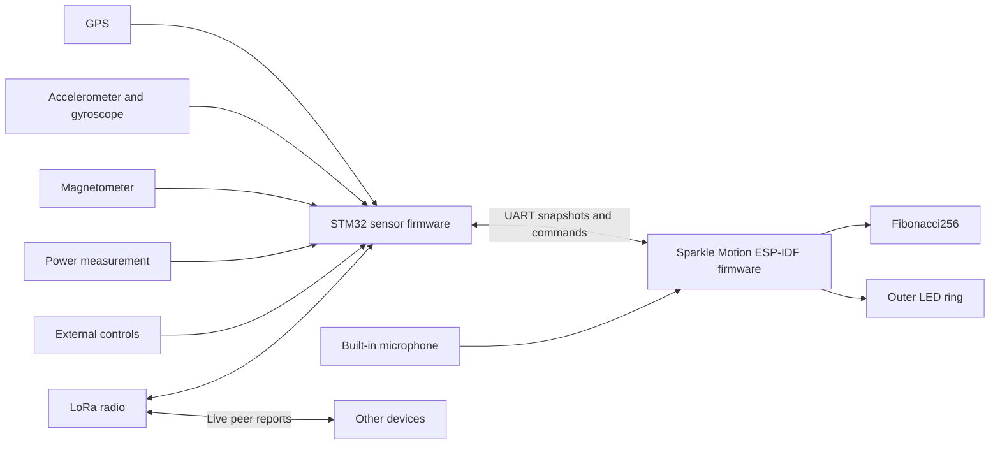

# Smart compass design for Sparkle Motion and STM32

Draft for implementation in a new `smart-compass` project in `musical-lights-rs`.
Design date: 2026-10-09.

Build a portable display that shows live radio peers, points north and toward friends, and runs light patterns. Use the existing Fibonacci256 as the main display. Add a dense LED ring around it. Sparkle Motion drives both displays. STM32 owns the GPS, motion sensors, magnetometer, radio, and external controls.

This preserves the two-board plan already started in `musical-stm32`. The new project will reuse useful Rust components. It will have its own firmware entry points and hardware configuration.

## Scope and fixed decisions

| Item | Decision |
| --- | --- |
| Main display | The existing Evil Genius Labs Fibonacci256, with 256 pixels. |
| Outer display | One dense, individually addressable LED ring. Its pixel count follows the finished mechanical design. |
| Display controller | Full Adafruit Sparkle Motion, using Rust and ESP-IDF. |
| Sensor controller | STM32, using Rust and Embassy. Confirm the exact physical board before assigning final pins. |
| Sensor ownership | STM32 reads GPS, accelerometer, gyroscope, magnetometer, and power sensors. It also owns the LoRa radio. |
| Board connection | A wired, bidirectional 3.3 V UART connection. |
| Map mode | A local map of live peers relative to this device. |
| Compass mode | North and bearings to live peers, with one selected peer. |
| Pattern mode | Geometric light patterns, including microphone-reactive patterns. |
| Saved locations | Excluded. No bookmarks, camp pins, place database, location history, or location-save command. |
| Offline use | Navigation, peer exchange, controls, and patterns work without a phone or internet connection. |

Radio, GPS, and peer tracking continue when the display changes mode. Display blanking changes light output only. It does not silently stop location broadcasts.

Street maps, trail maps, routes, text messaging, cloud services, phone applications, clock mode, and flashlight mode are outside the first version. Configuration and calibration can persist. Coordinates cannot persist.

## Existing work and reuse

The inspected Rust source is commit `ae307cd3cb528d252d02918566aee40fb1383243`. The Arduino source is commit `b79be3acf77d0a7e6d13b9dadb4fde4d3abdad96`. These references describe source state, not physical hardware acceptance.

| Existing component | What it contains | Treatment in the new project |
| --- | --- | --- |
| `musical-stm32/src/bin/sensors_for_sparkle.rs` | The intended sensor-board split, two UARTs, shared SPI devices, LSM9DS1 reads, Madgwick processing, and channels to Sparkle Motion. | Reuse device ownership and driver setup after a pin review. GPS and radio tasks contain `todo!()`. Calibration remains unfinished. |
| `musical-stm32/src/sparkle_uart.rs` | UART adapters around the shared encoder and decoder. | Reuse framing and stream handling. Use the new project's message schema. |
| `musical-lights-core/src/message.rs` | Bounded Postcard payloads, CRC-16/IBM-SDLC, COBS encoding, a zero delimiter, and framing tests. The link rate is 115200 baud. | Retain this established framing design. The existing payload lacks fix quality, sample age, heading validity, and complete peer snapshots. |
| `musical-lights-core/src/compass.rs` | Haversine distance and bearing calculations, with tests for cardinal bearings, nearby points, poles, and date-line crossings. | Reuse the mathematics and test cases. The existing API accepts `f32` coordinates and adds its declination argument to the geographic bearing. Do not use that sign convention implicitly in this project. |
| `musical-lights-core/src/orientation.rs` | A defined device frame and orientation classification from gravity or quaternions. | Reuse the frame definition and tests. Orientation classification alone does not supply a compass heading. |
| `musical-adafruit-sparkle-idf/src/main.rs` | RMT output, microphone capture, shared loudness processing, and inactive peer/sensor state. | Reuse the ESP-IDF build pattern, RMT ownership, and audio pipeline. Its active display has 400 pixels in a 20 by 20 net. Sensor UART setup is commented out. |
| `musical-adafruit-sparkle-idf/src/light_profile.rs`, `src/bin/light-check.rs`, and `validation/lights/profile.py` | The active renderer keeps linear colors through brightness mapping, then uses `LedResponse::encode()` for per-channel inverse response and white balance. The current default is explicitly unmeasured. The bench binary and generator support measured profiles. | Retain this output contract for every mode. Give the disc and ring separate response profiles and calibration records. Adapt the bench binary and generator to the two outputs; do not copy the 400-pixel net profile as a measurement of either display. |
| `musical-adafruit-sparkle-idf/src/light_patterns/fibonacci_layout.rs` | Arrays for 256 pixel positions, angles, and radii. | Reuse after physical index and orientation checks. Its X coordinates are mirrored relative to the published Pixelblaze map. Establish one front-view convention. |
| `musical-adafruit-sparkle-idf/src/light_patterns/compass.rs` | A loading check followed by a hue pattern. | Write the actual compass renderer. The current function does not display peer bearings. |
| `musical-lights-core/src/gps.rs`, `radio.rs`, and `lights/networked.rs` | A time alias, a radio TODO, and an empty networked-pattern module. | These are not completed GPS, mesh, or pattern-synchronization implementations. |
| `musical-adafruit-sparkle-embassy` | A 256-pixel output example, sensor initialization, and an SX1262 radio stub. | Use it as a hardware reference. Keep ESP-IDF as the single Sparkle firmware platform for this project. |
| Arduino GPS, radio, compass, and pattern files | NMEA setup, RF95 exchange at 915 MHz, peer colors, an active peer-indexed pattern, automatic battery brightness reduction, and notes about timing and power failures. | Retain peer-indexed composition and battery reduction/recovery as specified below. Do not copy the saved-pin database or the all-peers retransmission schedule. |

The Arduino Fritzing files identify a Feather M0 RFM9x radio board, GPS FeatherWing, motion sensor, and SD hardware. The Rust STM32 manifest and probe runner target STM32F411CE. Its notes also mention Discovery hardware. The actual board must settle that mismatch.

Source references: [STM32 sensor program](https://github.com/BlinkyStitt/musical-lights-rs/blob/ae307cd3cb528d252d02918566aee40fb1383243/musical-stm32/src/bin/sensors_for_sparkle.rs), [UART framing](https://github.com/BlinkyStitt/musical-lights-rs/blob/ae307cd3cb528d252d02918566aee40fb1383243/musical-lights-core/src/message.rs), [compass calculations](https://github.com/BlinkyStitt/musical-lights-rs/blob/ae307cd3cb528d252d02918566aee40fb1383243/musical-lights-core/src/compass.rs), [ESP-IDF design](https://github.com/BlinkyStitt/musical-lights-rs/blob/ae307cd3cb528d252d02918566aee40fb1383243/musical-adafruit-sparkle-idf/DESIGN.md), and [Arduino prototype](https://github.com/BlinkyStitt/smart-compass-v0/tree/b79be3acf77d0a7e6d13b9dadb4fde4d3abdad96).

## System structure



STM32 owns the authoritative local fix, heading, peer table, radio schedule, calibration, and sensor health. It sends complete snapshots to Sparkle Motion. Sparkle Motion owns the display mode, selection, brightness, rendering, and microphone analysis.

The built-in microphone is the one sensor on Sparkle Motion. It serves local pattern rendering and does not enter the navigation or radio path.

Each peripheral has one owner. Interrupt handlers record readiness and wake tasks. They do not parse packets, run fusion, write LEDs, or log large messages. SPI transactions hold the bus only for the actual transfer. Radio transmission time never holds the SPI lock.

## Hardware and wiring

### Sparkle Motion

The full board supplies level-shifted LED outputs, a microphone, and a separate peripheral UART. Proposed assignments use GPIO21 for the disc, GPIO22 for the ring, and GPIO9 TX/GPIO10 RX for STM32. The microphone uses GPIO25, GPIO26, and GPIO33. Keep USB console access separate from the board link. The terminal outputs and GPIO23 are output-only after level shifting. [Adafruit pinouts](https://learn.adafruit.com/adafruit-sparkle-motion/pinouts).

Connect Sparkle TX to STM32 RX and Sparkle RX to STM32 TX. Connect ground. Use the raw 3.3 V UART pins, never an LED terminal. Put both boards on the same switched supply so one UART cannot power the other board through its input protection.

Give the disc and ring separate RMT outputs. A failed disc data connection must not break the ring data chain. Both outputs receive the same frame timestamp and power policy.

### STM32

The current program provides this provisional allocation. It is a source reference, not an approved wiring diagram.

| Function | Current assignment | Required check |
| --- | --- | --- |
| Sparkle UART | USART1, PA10 RX, PB6 TX | Confirm alternate functions and physical access on the selected board. |
| GPS UART | USART2, PA3 RX, PA2 TX, 9600 baud | Confirm GPS voltage and required configuration commands. |
| Shared SPI | SPI1, PA5 clock, PA7 MOSI, PA6 MISO | Check DMA assignments and transaction settings for each device. |
| Accelerometer/gyro select | PA8 | Initialize inactive before enabling SPI. |
| Magnetometer select | PA9 | Initialize inactive before enabling SPI. |
| Radio select | PA14 | Reassign if needed to preserve the board's SWD debug connection. |
| Sensor readiness | PA11 and PA12 | Check sensor output polarity, EXTI configuration, and USB conflicts. |
| Radio interrupt and reset | Not assigned in the current program | Reserve both for an RF95-class module. An SX126x module has different requirements. |
| GPS PPS | Not assigned | Reserve a timer-capable input if synchronized patterns need it. |
| External controls and power measurement | Not assigned | Add these to the final pin table before wiring. |

On STM32F411, PA14 is SWCLK, and PA11/PA12 also carry USB data. Reserve PA13/PA14 for SWD. Move radio select from PA14. Keep sensor readiness off PA11/PA12 if the selected board needs USB. [STM32F411 datasheet](https://www.st.com/resource/en/datasheet/stm32f411ce.pdf).

Confirm the exact radio before choosing a driver. The Arduino prototype uses an RF95/RFM9x interface. The ESP Embassy experiment names SX1262. These are different devices. The first implementation should target one fitted radio, with one driver and one regional configuration.

Retain the LSM9DS1 if that is the available sensor. A replacement sensor requires a driver and calibration review. Do not assume that a newer sensor reports the same axes, units, or interrupt behavior.

Use a dedicated SPI device wrapper for each chip select. Start all selects inactive. Set the correct clock mode and maximum clock rate per transaction. If a sensor holds readiness high, service and clear it correctly; do not let a level-triggered loop run without a bound.

### Display geometry

The linked Fibonacci256 is a 166 mm disc with 256 RGB pixels. Its wire order travels out and back along the board. It is not a rectangular matrix or a simple sequence of points along one spiral. Use a measured index-to-position map. The manufacturer's page includes maps and 5 V connection guidance. [Fibonacci256](https://www.evilgeniuslabs.org/fibonacci256).

The existing ESP-IDF README records these panels as WS2812B with GRB channel order. Confirm that with a red, green, and blue test on the actual disc. Confirm the ring separately.

Define the display frame as viewed from the front: X right, Y up, zero angle at the physical top, and positive display bearing clockwise. Store one mounting rotation and ring direction. Never spread orientation offsets through individual patterns.

Select ring diameter, LED density, and diffuser together. Estimate count with `N = pi * diameter_m * pixels_per_m`. For example, a 180 mm circle at 144 pixels/m contains about 81 pixels. This is a geometry example, not a selected part. Check the strip's bend direction, seam, wiring access, and actual pitch before fixing the count.

## Display modes

### Live peer map

The device sits at the center. Peer distance controls radius. Peer bearing controls angle. The map uses a linear radial scale, so half the displayed range means half the radius. It shows relative positions, not streets or terrain.

Use heading-up as the default: a friend in front appears above the center. Support north-up as a map setting. In north-up, geographic north stays at the physical top. A small heading marker shows the direction the device faces.

If true heading becomes unavailable, change the map to north-up and show a fixed-north cue. Do not keep rotating it from an old heading. If the local position expires, replace peer positions with a GPS-search display. Restore the selected map orientation only after the required inputs recover.

Proposed manual ranges are 100 m, 250 m, 500 m, 1 km, 2 km, and 5 km. Start at 500 m. A range change shows one to six short ring groups, then returns to navigation. No automatic zoom in the first version; a fixed range keeps motion and scale understandable.

For distance `d`, true bearing `B`, heading `H`, and range `R`:

```text
angle = B                  for north-up
angle = wrap(B - H)        for heading-up
radius = min(d / R, 1)
x = radius * sin(angle)
y = radius * cos(angle)
```

Convert angles to radians for trigonometry. Use the same normalized disc geometry for all map calculations. Rasterize a small spot across nearby physical pixels so a marker moves smoothly through the irregular layout. Keep the center marker visible.

Peers beyond the selected range use a distinct edge marker. Do not make them look as if they sit exactly at the range boundary. Peers inside the combined position uncertainty form a near-center marker without a precise bearing.

When markers overlap, show each peer in a stable time sequence at that position. The selected peer gets a recognizable pulse. Preserve peer identity through the sequence. Do not blend several colors into a new apparent peer.

The outer ring shows north and the selected peer's relative bearing in heading-up view. In north-up view, ring markers use the same geographic frame as the disc. Reserve short, temporary status cues for mode and range changes; do not permanently remove a direction sector from the ring.

### Compass

The ring gives the primary north indication and peer directions. The disc shows a broad pointer toward the selected peer. Without a selected valid peer, it shows a north pointer.

Use distinct shapes or rhythms for north, selected peer, other peers, and stale peers. Peer color helps identification, but color is not the only distinction. A selected peer keeps the same color and pulse in map and compass modes.

Peer selection cycles through configured peers in a stable order. Expired peers leave the active selection list. If the selected peer expires, clear the target indication and show the loss cue. Require an Action press to select another peer. Never silently redirect the main pointer to a different person.

Compass north can work without a GPS fix. In that state, show magnetic north and a distinct status cue. True north requires valid declination. Peer pointers require a current local position, a usable peer position, and a valid true heading. A north-up map can still show positions when heading is unavailable.

### Patterns

Provide a small first set: spiral rainbow, rotating spokes, radial waves, a rainbow shared across peers, and microphone-reactive pulses. Use the disc's XY and polar coordinates for geometry. Make the outer ring part of each composition.

Reuse the production `LoudnessMeter`, `VisualGain`, and time-based display state for audio patterns. Map the shared analysis output onto this disc's geometry. The existing twenty-row net layout does not define the new rendering. Do not replace loudness with independent FFT gains or reset analysis at LED frame boundaries.

Start microphone capture when entering an audio pattern. Stop and release it when leaving audio patterns. Plain patterns work if capture fails. Show a failure cue instead of presenting invented audio activity.

Shared-time geometric patterns use a common phase from GPS time when available. After time loss, continue from a monotonic holdover clock. A later time correction adjusts phase smoothly. Local microphone response remains local; it does not make separate microphones synchronize.

#### Composition across peers

Retain the active Arduino `networkedLights()` behavior: each device shows a different section of one combined pattern. Shared time controls motion; a stable peer slot controls which section the device shows. Matching time alone must not make every device show the same section. [Prototype pattern](https://github.com/BlinkyStitt/smart-compass-v0/blob/b79be3acf77d0a7e6d13b9dadb4fde4d3abdad96/light-patterns-networked.ino).

Sort the configured roster by numeric peer ID. A device's zero-based position in that roster is its pattern slot `k`; the configured roster length is `N`. STM32 sends `k`, `N`, and the roster revision in its snapshots. Never derive these values from the currently reachable peers. An absent device leaves its section empty, so other devices do not jump to new colors or positions.

For this pattern, define one local path: disc indices 0 through 255, followed by ring pixels in clockwise order from the mounted top. Let `L` be that device's disc-plus-ring pixel count and `j` its pixel's index along this path. Use the common preset's cycle period and time origin to calculate `phase(t)` in full cycles:

```text
u = fract((k + j / L) / N + phase(t))
color = shared_pattern(u)
```

Use fractional arithmetic for `j / L`. With four configured peers, slot 1 shows the second quarter of the pattern. If that peer is absent, the other three keep their quarters. Devices with different ring counts still receive equal pattern sections; their pixel counts only change the sampling within a section. For equal `L`, the static mapping equals `(k * L + j) / (N * L)`, which retains the prototype's peer-indexed strip composition.

Every participant must use the same roster revision, preset, cycle period, and time origin. Provision them together. A deliberate roster change starts a new composition revision. Rebooting or losing a radio peer must not change the slot. If roster identity is missing, mark the shared pattern unavailable and keep local patterns available. Do not assign an arbitrary slot.

## LED response calibration

Keep all disc and ring colors in linear sRGB through composition and brightness mapping. This includes navigation markers, status cues, plain patterns, and microphone-reactive patterns. Sparkle applies each output's `LedResponse::encode()` once to convert the final linear intent to RGB bytes, including per-channel inverse response, white balance, and the output drive cap. The driver then applies that output's channel order. Do not add a second gamma or white-balance pass.

Use this output sequence for both displays:

```text
linear composition
  -> user brightness * battery factor * permitted power scale
  -> output-specific LedResponse::encode(linear_color, drive_cap)
  -> output-specific channel order
  -> RMT output
```

Select the permitted power scale from the estimated current of the encoded disc and ring frames before writing either output. If a candidate exceeds the budget, reduce the linear scale and encode a new candidate from the unchanged linear composition. Never feed encoded bytes back through the response curve. This keeps normal dimming in linear light while enforcing the current limit on the actual proposed drive bytes.

Own the profiles in the new Sparkle application's deployment module. Keep one microphone input calibration and separate disc and ring LED response functions. Reuse the shared `LedResponse` type. Extend `validation/lights/profile.py` to generate the named LED profiles from separate measurements. Keep each profile's LED identity, supply voltage, diffuser arrangement, measurement method, and measured/unmeasured state with the deployment data. Configuration references those profile identities; it does not maintain a second copy of the response curves.

Before measurement, use `LedResponse::default()` independently for each display and report it as unmeasured. A measured disc profile does not calibrate the ring. Reject an invalid measured profile instead of silently treating it as valid. Channel-order tests, current-limit measurements, and optical response measurements establish different properties.

Adapt `light-check` to address the disc and ring separately with their actual pixel counts, pins, and channel orders. Retain red, green, blue, and white ramps plus timed pulses. Apply the operational drive caps and total current budget during the full-display checks. The current generator requires at least 17 strictly increasing measured points per channel over drive 0 through 255, plus measured white-balance factors. Obtain those full-range data with a suitable, current-limited small-pixel fixture; do not drive the whole disc and ring at full white to satisfy the generator. Measure the installed optical arrangement before claiming calibrated displayed color.

Compilation of `light-check` does not run it, flash it, or establish calibration. Retain measured input data and meaningful generated deployment profiles with the implementation. Test monotonic response, correct profile selection, black output, drive caps, and one response application. The current shared tests provide a starting point. See the existing [LED response implementation](https://github.com/BlinkyStitt/musical-lights-rs/blob/ae307cd3cb528d252d02918566aee40fb1383243/musical-lights-core/src/lights/color_correction.rs), [bench program](https://github.com/BlinkyStitt/musical-lights-rs/blob/ae307cd3cb528d252d02918566aee40fb1383243/musical-adafruit-sparkle-idf/src/bin/light-check.rs), and [profile generator](https://github.com/BlinkyStitt/musical-lights-rs/blob/ae307cd3cb528d252d02918566aee40fb1383243/validation/lights/profile.py).

## Controls and status

Use two accessible external buttons connected to STM32. Debounce them there and send ordered input events to Sparkle Motion.

| Control | Map | Compass | Patterns |
| --- | --- | --- | --- |
| Mode short press | Advance to Compass | Advance to Patterns | Advance to Map |
| Action short press | Advance range | Advance selected peer | Advance pattern |
| Action hold | Advance brightness level | Advance brightness level | Advance brightness level |
| Mode hold | Toggle display blanking | Toggle display blanking | Toggle display blanking |

Use a 1.5-second hold threshold as an initial setting. A hold must not also trigger a short press. Select map orientation and other setup values through the wired configuration interface. Do not overload normal controls with a location-save gesture.

Keep mode choice explicit. Do not copy the old automatic switch between hanging patterns, flat compass, upside-down clock, and off. Use posture to detect unreliable heading or an unreadable viewing angle, rather than to change mode unexpectedly.

Give every important state a repeatable shape or rhythm: GPS search, magnetic heading only, heading unreliable, radio unavailable, peer stale, sensor-board link lost, and low power. Navigation faults suppress the affected pointer. They must not leave an old solid pointer on screen.

Keep routine health cues brief and dim. A critical power or link fault takes priority over decoration. Verify the palette and rhythms with Bryan, including color-vision accessibility, during the physical display review.

## Position and heading contracts

Use signed latitude and longitude in degrees times 10,000,000 as the project's canonical coordinate representation. This fits `i32` and preserves received precision. Convert to `f64` radians only for calculations. Never infer fix validity from a zero coordinate; the equator and prime meridian are valid locations.

Every position sample has validity, capture time, monotonic age, and an accuracy state. Keep unknown accuracy distinct from zero error. Do not convert HDOP directly to meters without a stated receiver model. Reject invalid coordinate ranges and non-finite sensor results.

Use these conventions throughout the project:

| Quantity | Convention |
| --- | --- |
| Device axes | X right, Y toward the top edge, Z out of the display. |
| Geographic bearing | Degrees clockwise from true north, wrapped to `[0, 360)`. |
| Magnetic heading | Device top direction clockwise from magnetic north. |
| Declination | East-positive. `true_heading = wrap(magnetic_heading + declination)`. |
| Relative peer bearing | `wrap(true_peer_bearing - true_heading)`. |
| Coincident or uncertain nearby position | Distance is available; direction is unavailable. |

For example, magnetic heading 350 degrees and declination +10 degrees give true heading 0 degrees. A peer at true bearing 90 degrees appears to the right. Include this exact sign check in tests.

STM32 applies axis alignment, accelerometer bias, gyro bias, and magnetometer hard-iron and soft-iron calibration before fusion. Use measured sample intervals. Detect missing samples and sensor saturation. A quaternion used for posture does not by itself prove a valid magnetic heading.

Use a tilt-compensated heading and an explicit heading-quality state. Detect weak horizontal magnetic field, large magnetic disturbances, and excessive tilt. GPS course describes travel direction and must not replace the direction the device faces when stationary.

Compute declination locally from a versioned magnetic model and valid date and position. WMM2025 is the current model and expires at the end of 2029. Verify the chosen implementation against NOAA test values. Store model identity with calibration metadata, and show magnetic-only status if the model input is unavailable or outside its validity. [NOAA World Magnetic Model](https://www.ncei.noaa.gov/products/world-magnetic-model).

GPS parsing must join date, time, position, and quality from the same measurement epoch. Validate NMEA checksums and hemisphere signs. Represent transmitted timestamps as Unix UTC milliseconds. Keep UTC, GPS time, and monotonic elapsed time distinct. Time-zone settings have no role in navigation.

For pattern synchronization, STM32 publishes a UTC clock anchor, its monotonic age, and an uncertainty estimate in each snapshot. Use PPS when available to establish the anchor. Without PPS, measure receiver and UART delay before claiming synchronization accuracy. Reject large time jumps until the receiver establishes a new valid anchor.

Mount the magnetometer away from LED supply loops, the battery, regulators, steel fasteners, speakers, magnetic clasps, and antenna magnets. Calibrate in the assembled enclosure. Test heading while the radio transmits and while LED current changes. Fix physical interference before considering software compensation.

## Peer state and freshness

Start with support for eight configured devices, including self. The prototype group of four fits within this bound. Allocate the peer table from this capacity. Unknown identities cannot evict configured peers.

Each peer record contains identity, configured color, latest position and quality, origin boot counter, sequence number, origin sample time, source age, local receive time, and direct-or-relayed link information. Store records in RAM only.

Initial freshness thresholds assume a five-second source broadcast interval:

| State | Age of position sample | Display behavior |
| --- | --- | --- |
| Fresh | At most 15 seconds | Normal marker or pointer. |
| Stale | More than 15 seconds, at most 60 seconds | Dim, interrupted marker. No solid selected-target pointer. |
| Expired | More than 60 seconds | Remove the position from navigation. Keep only peer availability state. |

A fresh radio heartbeat does not refresh an old position. A relayed copy does not refresh its origin time. Loss of local GPS applies the same age rule to the local reference position. Show degraded position quality during the stale interval, then remove peer bearings and map positions.

Do not extrapolate movement in the first version. Smooth marker drawing over a short bounded interval, but retain the true sample age and uncertainty. A frozen or smoothed marker must not claim a new measurement.

## Radio exchange

Use a small private LoRa peer network. Keep it separate from the wired board protocol. Start with the fitted RF95-class hardware if that is what Bryan retains. Select frequency, antenna, power, spreading factor, bandwidth, and coding rate from the actual module and operating region before field use. The prototype's 915 MHz constant does not establish every deployment setting.

### Packet contents and acceptance

Use radio protocol version 1 with the following fixed 59-byte application packet. Encode integer fields in little-endian order. Bound the driver payload to this size and include driver headers and physical framing when calculating airtime.

| Field | Bytes | Meaning |
| --- | --- | --- |
| Version | 1 | Must equal 1. |
| Group ID | 4 | Configured network identifier. |
| Origin ID | 2 | Device that measured the position. |
| Relay ID | 2 | Device that sent this radio frame. |
| Origin boot counter | 4 | Durable origin session. |
| Sequence | 4 | Increasing report number within the origin session. |
| Sample UTC milliseconds | 8 | Time of the position measurement; validity comes from flags. |
| Sample age milliseconds | 4 | Age at this transmission, including relay residence time. Saturate rather than wrap. |
| Latitude E7 | 4 | Signed degrees times 10,000,000. |
| Longitude E7 | 4 | Signed degrees times 10,000,000. |
| Horizontal accuracy decimeters | 2 | Receiver estimate; 65535 means unknown. |
| Peer color ID | 1 | Index in the configured palette. |
| Fix and health flags | 2 | Position valid, UTC valid, accuracy valid, and defined health states. Reserved bits must be zero. |
| Hop count | 1 | Origin transmits 1; one relay transmits 2. |
| HMAC tag | 16 | Authentication over the preceding 43 bytes. |

An invalid-fix report sets its coordinate and accuracy fields to zero and clears their validity flags. Receivers ignore those fields. Zero remains a valid coordinate when the position-valid flag is set. A relay preserves origin fields and increases sample age by measured elapsed time. With valid UTC, receivers also calculate age from the origin timestamp and use the greater age, allowing for clock uncertainty.

Use a reviewed HMAC-SHA-256 implementation with a 16-byte tag over all transmitted application fields. Use constant-time tag verification. A shared group key authenticates group membership; any key holder can impersonate another member. It does not provide individual identity security or hide coordinates. The HMAC construction is defined in [RFC 2104](https://www.rfc-editor.org/rfc/rfc2104).

Provision identities and keys by wire. Keep keys out of source control and diagnostic output. Maintain a durable boot counter and a per-boot sequence to distinguish new sessions from old packets. Commit the boot counter before transmitting. Never wrap either value: advance the durable session before sequence exhaustion, and stop transmission at boot-counter exhaustion. Re-provision an erased identity instead of silently reusing a session.

Reject bad length, unsupported version, wrong group, unknown peer, bad tag, invalid coordinates, excessive hops, duplicate sequence, and older accepted samples before updating peer state. Use trusted UTC to reject expired sample timestamps and implausible future timestamps. When trusted time is unavailable, mark source freshness uncertain and do not present a relayed report as verified fresh.

Replay state lost during a receiver reset limits protection until trusted time returns. State this limit in the protocol tests and device status. CRC on the wired link and radio hardware CRC do not replace authentication.

### Scheduling and relay

Broadcast the device's own latest state every five seconds with a small random timing offset. Receive between transmissions. Do not require GPS lock or a complete group roster to receive traffic. Send a no-fix health report when position is unavailable.

Do not repeat the Arduino schedule where every node sends every peer in a fixed `N * N` cycle. Use one bounded pending slot per origin. A newer report replaces an unsent older report.

Provide bounded store-and-forward for peer reports: at most two radio hops from origin to receiver. A node can relay only a packet with hop count 1. Each relay sends a unique origin/session/sequence at most once, after a random delay. Cancel its pending repeat if it hears an adequate repeat. Preserve origin sample time and sequence, increment hop count and sample age, and recompute the group tag. Suppress expired reports and retain duplicate state through their useful lifetime.

Use channel activity detection when the selected driver supports it, plus random backoff. Backoff has a deadline and cannot block sensor tasks. Do not use per-peer acknowledgments for routine broadcasts; the next source report replaces a lost report.

Reserve the airtime budget for self reports before relays. When the relay budget is full, drop relay work and count the drop. Never let forwarding starve local reports or build an unbounded queue.

Measure the actual packet airtime on the chosen radio settings. Initial offered-load target is below 20% in one collision domain, counting self reports and allowed relays. Calculate `sum(packet_airtime / packet_interval)` for the tested topology. If the group exceeds the budget, change the group limit, interval, or radio settings as one documented configuration. A successful two-device test does not establish an eight-device mesh capacity.

Direct peer exchange is the first radio milestone. Add relay behavior using the same packet contract before calling the mesh complete. Neither milestone promises a distance in meters until field measurements establish it.

## UART contract between boards

Reuse Postcard serialization, CRC-16/IBM-SDLC, COBS, and a zero delimiter from the existing shared implementation. Define the new payload once in shared Rust code. Both firmwares use that schema. Do not accept the old Arduino protobuf or the old sensor-message payload as a second format.

| Message | Direction | Purpose |
| --- | --- | --- |
| Hello | Both | Protocol version, firmware identity, boot session, and capabilities. |
| StateSnapshot | STM32 to Sparkle | Local fix, calibrated heading and quality, complete bounded peer set, pattern slot/count/roster revision, sensor health, battery state/factor/sample age, source sample ages, and UTC clock anchor with uncertainty. |
| InputEvent | STM32 to Sparkle | Ordered button event with event ID. |
| InputAck | Sparkle to STM32 | Highest contiguous input-event ID applied in the current STM32 session. |
| Command | Sparkle to STM32 | Validated configuration or calibration request with command ID. |
| CommandResult | STM32 to Sparkle | Accepted or rejected command and resulting state. |
| Heartbeat | Both | Link health when other traffic is idle. |

Publish snapshots at 20 Hz. Snapshot sequence and boot session prevent an old frame from replacing new state. A complete snapshot replaces the previous peer set, including removals. Transfer ages relative to the sender snapshot; the receiver adds local elapsed time. Do not compare unrelated board uptime values as if they share one clock.

Target a complete encoded snapshot of at most 256 bytes, with an absolute frame bound of 512 bytes. At 20 Hz, a 256-byte snapshot uses 5120 bytes/s. A 115200 baud 8N1 link carries about 11520 bytes/s per direction. Keep measured traffic below 70% of capacity, including input events and command responses. If the schema cannot meet that budget, revise the snapshot rate or baud rate explicitly.

Use latest-value storage for snapshots. Preserve ordered input events and command results in bounded queues. Retain unacknowledged input events in a bounded window and resend them; Sparkle applies each event ID once. Never let a stopped display block GPS reception or radio service. Count overruns. An exhausted event window causes a visible input fault and resynchronization; it must not synthesize extra button presses.

A snapshot older than 500 ms marks navigation degraded. After two seconds without a valid snapshot, clear navigation pointers and show link loss. The current pattern can continue, but STM32 controls remain unavailable until the link returns. Version mismatch gives a visible fault and refuses incompatible commands.

Both boards start independently. STM32 must not wait forever for a Sparkle ping before reading GPS or starting radio service. Sparkle starts with a dim loading display. A board restart repeats Hello and publishes a complete current snapshot.

Retry commands with the same command ID. STM32 must not execute a calibration or persistent configuration write twice after a lost response. The protocol specification must define the bounded response cache and behavior across restart.

## Runtime and resource limits

| Work | Initial target | Ownership and failure behavior |
| --- | --- | --- |
| Sensor acquisition | About 100 Hz, aligned with actual device output rates | STM32; timestamp real samples and detect overruns. |
| Heading publication | 20 Hz snapshots | STM32; publish quality with heading. |
| GPS | 1 Hz position, continuous UART draining | STM32; recover sentence boundaries after overflow or malformed input. |
| Radio | Five-second self report plus bounded relay work | STM32; interrupt-driven receive and bounded transmit timeout. |
| Disc and ring | 50 frames/s | Sparkle; latest navigation snapshot, elapsed-time animation. |
| Audio | Existing continuous 48 kHz analysis in audio patterns | Sparkle; preserve sample continuity and report capture failure. |
| Power sampling | About 1 Hz | STM32; filter readings and apply hysteresis. |

These are design targets, not measured performance results. Measure task latency, missed samples, frame time, stack high-water marks, and heap use with every subsystem active.

At an assumed 800 kbit/s, RGB output takes about 30 microseconds per pixel before reset/latch time. The disc takes about 7.68 ms. A 144-pixel example ring takes about 4.32 ms. Sequential output totals about 12 ms plus latch and rendering, within a 20 ms frame only if measured overhead fits. Confirm the actual pixel timing and RMT behavior. Parallel channels must not be assumed to transmit in parallel merely because both exist.

One RGB frame needs `3 * (256 + ring_count)` bytes. Account separately for linear-color buffers, RMT encoding buffers, audio state, task stacks, protocol buffers, and driver allocations. Use fixed peer and packet storage. Record headroom on the selected STM32 and classic ESP32; do not assume PSRAM.

A supervisor checks task progress. Use bounded peripheral timeouts and a limited restart policy. A failed GPS, sensor, or radio marks that component unavailable. It does not fabricate data or reset the whole system indefinitely. A watchdog catches a true loss of progress. Preserve a short reset reason and counters without recording coordinates.

## Power and enclosure

Use a regulated 5 V system supply. Set the Sparkle Motion power-delivery selector to 5 V and prevent accidental selection of 12 V or 20 V. Its pixel supply follows input voltage and its protection is nominally 5 A. These limits apply to the whole supply path, not independently to each output. [Adafruit Sparkle Motion](https://www.adafruit.com/product/6100).

The Fibonacci manufacturer gives 60 mA per pixel as a theoretical full-white maximum: 15.36 A for the disc alone. Full white therefore exceeds the proposed board supply path. [Fibonacci256 power guidance](https://www.evilgeniuslabs.org/fibonacci256).

Set a total current budget before the first bright frame. Subtract measured controller, GPS, sensor, and peak radio demand. Divide the remainder between disc and ring. Enforce the limit after color conversion on the actual output bytes, with a conservative current model for each LED type. Test model error against a meter. Keep hardware protection as well as software limiting.

Start bench work with a low current limit and dim output. A brightness percentage is not a current budget. Bright patterns, a large ring, radio transmission, and GPS acquisition must fit at the same time. The Arduino notes describe crashes around these combinations, but do not establish whether their cause was power, SPI ownership, or interrupt handling.

STM32 reads an appropriate battery gauge or a calibrated supply measurement. Do not reuse the old ten-bit ADC/divider formula without matching the hardware. A USB power bank's regulated 5 V output does not reveal its remaining cell charge; use a real gauge if a remaining-charge display is required.

### Automatic battery output reduction

Retain automatic battery dimming and recovery. STM32 classifies battery state from the selected pack's measurement profile. Sparkle applies the resulting factor to the user's linear brightness before each display's LED response encoding. Apply the same factor to the disc, ring, and status cues in every mode. Keep the user's requested brightness unchanged so recovery can restore it.

| State | Output factor | Prototype voltage reference |
| --- | --- | --- |
| Full | 100% | At least 4.1 V. |
| OK | 90% | At least 3.7 V, below 4.1 V. |
| Low | 75% | At least 3.3 V, below 3.7 V. |
| Critical | 50% | Below 3.3 V; the Arduino name is `BATTERY_DEAD`. |

The voltage column records [the prototype battery measurements](https://github.com/BlinkyStitt/smart-compass-v0/blob/b79be3acf77d0a7e6d13b9dadb4fde4d3abdad96/battery.ino); it is not an approved threshold set for the new supply. Retain the state/factor policy. In v2, the factors scale linear light intent rather than already encoded LED bytes. Never apply these cell-voltage thresholds to a regulated 5 V input or assume that they fit another battery chemistry.

Before implementation, the selected battery profile must define three ordered reduction thresholds, a higher recovery threshold for each boundary, valid measurement limits, and a separate shutdown threshold. Express them in the gauge's calibrated state-of-charge units or in measured loaded pack voltage. Derive the values from the actual pack and regulator limits and the measured discharge curve. Record the numeric values and measurement units with that profile. The battery hardware remains open, so these new hardware-specific values remain a required decision before battery acceptance.

Sample at about 1 Hz. As initial timing targets, require five seconds continuously below a reduction threshold before reducing a state, and thirty seconds above its recovery threshold before increasing a state. Clear the pending transition if its condition stops holding. A brief voltage rise after dimming or ending radio transmission must not restore full output. A validated shutdown condition takes priority without waiting for the dimming delay.

Send the classified state, factor, measurement age, and profile revision in STM32 snapshots. Sparkle changes the applied factor over at most one second and restores only the most recent user brightness, subject to the current limit. Brightness changes during Low or Critical still retain the battery factor. Do not reduce GPS or radio service as a side effect of display dimming.

Before the first valid battery state, or after battery data become older than two seconds, cap the battery factor at 50% and show unknown power state. Keep a stronger existing reduction. A recovered valid reading must satisfy the recovery delay before increasing output. Display blanking and hardware shutdown still override the factor.

The 50% Critical level does not permit operation below the pack's safe limit. At the selected shutdown threshold, blank both displays and perform the defined power shutdown while hardware cell protection remains active. Verify reduction, delayed recovery, stale measurement handling, and shutdown with the final supply hardware.

### Supply and enclosure acceptance

Battery chemistry, pack size, regulator, charging arrangement, and desired runtime remain physical design choices. Calculate runtime from usable watt-hours and measured average watts. Do not select a pack from LED count alone. Include peak-current tests and low-load power-bank behavior.

Route LED current separately from sensor returns and UART ground. Use rated connectors, strain relief, suitable branch protection, and supply decoupling near each load. Review USB connection and back-power behavior with both programming cables connected.

Check each board's regulator and the radio's peak 3.3 V demand. Do not power the sensor assembly from an arbitrary logic pin. Sparkle Motion supplies LED power routing; the battery design still needs suitable charging, regulation, and cell protection.

Place the GPS antenna toward open sky and clear of the LED PCB where practical. Separate GPS and LoRa antennas from regulators and high-current wiring. Check body obstruction and the final carry position. Preserve access to USB, SWD, power control, and calibration controls.

Give the disc and ring separate diffusion zones so the ring remains readable. Provide heat paths and test the closed enclosure at the maximum permitted sustained load. Dust resistance, moisture resistance, mounting, and viewing angle need physical acceptance tests.

## Configuration and storage

Use versioned settings with bounds and an integrity check. Invalid settings select a safe dim display and disable unconfigured transmissions. One component owns each setting.

| Owner | Persistent values |
| --- | --- |
| STM32 | Device/group identity, group key, peer roster/revision and colors, radio profile, sensor calibration, battery measurement profile and reduction/recovery/shutdown thresholds, boot counter, and sensor hardware profile. |
| Sparkle | Display mounting, ring geometry and channel order, current budgets, user brightness, map range/orientation, pattern preset and cycle, LED response profile identities, and local audio calibration. |

Provision through the wired Sparkle console. Sparkle forwards STM32-owned changes over the command protocol. Return validation errors and read back the effective settings. Atomic writes must survive power loss. Do not erase active configuration before its replacement is valid.

No SD card is required for the first version. Do not copy the EDB database, saved-pin messages, pin counts, GPS logs, or raw NMEA logging. Keep navigation and peer coordinates in RAM. Diagnostic counters may persist; diagnostic location traces do not.

## New project layout

Create the implementation later in a feature worktree of `musical-lights-rs`. Use the preferred external worktree drive when it is mounted and writable. Keep this design step separate from firmware scaffolding and flashing.

Proposed layout:

```text
musical-lights-rs/
  smart-compass/
    README.md
    DESIGN.md
    sparkle-idf/       ESP-IDF application, board setup, RMT, audio adapters
    stm32/             Embassy application, sensors, GPS, radio, storage
  musical-lights-core/
    src/smart_compass/  bounded protocol, navigation math, peer policy,
                       display geometry and reusable rendering calculations
```

Follow the repository rule that hardware-reusable calculations belong in `musical-lights-core`. Keep peripheral drivers and executors in the two applications. Keep shared code compatible with the existing `no_std` and `libm` configurations.

Give both firmware packages their own manifests, lockfiles, toolchain files, board configuration, and documented build commands. Add them to the root exclusion list as needed, following the existing independent firmware layout. Extend `validation/validate.py`, change detection, and firmware CI so the new packages actually run.

Use the current ESP-IDF project's coordinated pins as the starting build stack: ESP-IDF `v6.1`, toolchain `esp-1.98.1.0`, and the manifest's exact ESP crate revisions. Recheck those inputs when implementation starts. Carry the relevant build, capture, and LED patterns into the new application without copying its 400-pixel net assumptions.

Reuse the STM32 UART and sensor code selectively. Replace its incomplete entry-point behavior in the new application. Keep the existing musical firmware programs intact. Do not add aliases, compatibility payloads, or a second active navigation path to preserve the prototype wire format.

## Implementation and acceptance sequence

1. **Confirm hardware and contracts.** Identify the actual STM32 board, radio, GPS, sensor, ring, and supply. Complete the pin table. Fix packet widths, coordinate conventions, freshness policy, power limits, and numeric battery thresholds with hysteresis. Produce a reviewed wiring diagram.
2. **Bring up the two displays.** Flash only the new Sparkle application. Verify each disc index, ring direction, channel order, mounting transform, dim startup, and total current limiting. Adapt `light-check` and profile generation for both outputs. Verify unmeasured status until each output has its own accepted measurements. Show synthetic markers at all cardinal directions.
3. **Connect the boards.** Implement Hello, snapshots, input events, commands, and heartbeat. Verify partial UART reads, corrupt frames, disconnects, independent resets, version mismatch, and bounded queues. Synthetic input remains explicitly a bench source.
4. **Complete sensor and GPS acquisition.** Use real GPS and calibrated sensor readings. Verify capture age, no-fix behavior, tilt compensation, declination sign, and heading quality in the enclosure. Confirm radio service cannot block sensor reads.
5. **Exchange direct peer reports.** Use at least two real radios. Verify authentication, no-fix reports, duplicate rejection, origin restart, sample expiry, and measured airtime. Demonstrate map and compass modes with real positions.
6. **Complete bounded relay.** Use at least three devices in a controlled topology where the endpoint cannot receive the origin directly. Verify hop limits, duplicate suppression, source-age preservation, relay limits, and recovery after a relay leaves.
7. **Complete patterns and controls.** Validate plain, peer-indexed, and audio patterns, microphone lifecycle, mode changes, brightness, blanking, and shared-time holdover. Confirm stable pattern slots when a peer leaves or restarts, including devices with different ring counts. Confirm all navigation services continue in pattern mode.
8. **Run combined and field acceptance.** Exercise bright permitted patterns, radio TX/RX, GPS acquisition, sensor fusion, control input, and both displays together. Measure power, thermal behavior, queue/stack headroom, radio delivery, and heading disturbance. Verify battery reduction and recovery with the selected thresholds. Measure and validate each installed LED response profile. Then test walking peers and body-obstructed antennas outdoors.

### Required automated checks

Test navigation with independent reference vectors: cardinal directions, short distances, signed coordinates, date-line crossings, coincident points, and declination signs. Test true-north and heading-up screen transforms separately from LED wire order.

Test the actual protocol boundary: fixed byte fixtures, every read split, malformed COBS, bad CRC/tag, truncation, oversized frames, unsupported versions, invalid IDs, stale/future timestamps, boot-counter transitions, duplicates, and queue saturation. Assert that a malformed frame cannot contaminate the next valid one.

Test peer expiry without receive traffic, local GPS expiry, link loss, marker overlap, off-scale peers, missing accuracy, and power-limit enforcement for both displays together. Test command retries without duplicate writes. Run shared-core tests across the affected feature matrix and locked builds for both new firmwares.

Test peer-indexed composition with a fixed roster, missing peers, noncontiguous IDs, device restarts, deliberate roster revisions, and different ring counts. For equal pixel counts, compare the normalized slot mapping with the prototype's combined-strip mapping. Do not let live peer count change composition slots.

Test every battery reduction and recovery boundary, hysteresis, both delay timers, user brightness changes while dimmed, invalid/stale measurements, shutdown priority, and both displays together. Test that LED response and white balance apply once, that each output uses its own profile, and that current limiting evaluates encoded candidates without reapplying response to encoded bytes. Retain explicit unmeasured status and reject malformed measured data.

### Required physical evidence

| Area | Acceptance evidence |
| --- | --- |
| LED mapping | Every pixel index matches the front-view map; red, green, blue, north, and ring direction checks pass. |
| LED response | Disc and ring have separate measured profiles for their installed optical arrangements, or explicit unmeasured status. Ramps and pulses use the correct output profile; generated values match the retained measurement data. |
| Shared patterns | At least two devices show different, correct sections of one timed pattern. Removing or restarting a third configured peer leaves the remaining slots unchanged. |
| Navigation geometry | Known cardinal placements appear in the correct sector in both map orientations and compass mode. |
| Heading | Initial target is within 10 degrees on a nonmagnetic fixture, including approximately 30-degree tilt. Radio and LED load changes must stay within that total target. Log the actual errors. |
| Position | Display uncertainty from the receiver or show it as unknown. Compare walking peer separations with an independent reference; do not claim better accuracy than the measurements support. |
| Freshness | Stop peer transmission, lose local GPS, and disconnect UART separately. The correct marker degrades and disappears at its specified deadline. |
| Radio | Record payload, modulation, antenna, topology, delivery ratio, and sample age for direct and relayed cases. Measure the four-device group first, then the eight-device capacity target. |
| Timing | Measure 50-frame/s display operation and sensor continuity under combined load. Capture missed frames and overflows rather than relying on an average FPS counter. |
| Power | No brownout at the permitted LED limit during peak TX and GPS acquisition. Measured current and component temperatures remain within the selected hardware ratings. |
| Battery dimming | The selected hardware's recorded thresholds produce 100%/90%/75%/50% factors on both displays, with hysteresis and delayed recovery. Load changes do not cause oscillation. User brightness survives reduction/recovery, and the safe shutdown limit takes priority. |
| Recovery | Either board can restart alone. GPS/radio/sensor faults have visible states and bounded recovery. Navigation never displays stale state as fresh after restart. |
| Persistence | Power-cycle after walking and exchanging peers. No coordinates or saved locations return from storage. Settings and calibration do return. |

Local tests establish software behavior. CI establishes builds and automated checks. Flashing establishes installation. Only the physical tests establish sensor, radio, power, optical, and field behavior.

## Decisions still needed before implementation

| Decision | Source evidence and consequence |
| --- | --- |
| Exact STM32 board | Current code targets F411CE; notes mention Discovery. The part determines pins, memory, clocks, flash storage, and probe setup. |
| Exact radio module | Arduino uses RF95/RFM9x; an Embassy stub uses SX1262. Select the fitted hardware and antenna before finishing the driver and interrupt pins. |
| GPS module and PPS access | The prototype uses an Adafruit GPS FeatherWing with NMEA. Confirm the available module, antenna connection, accuracy fields, and PPS wiring. |
| Sensor assembly | Current code uses LSM9DS1. Confirm the breakout, mounting axes, readiness pins, and physical separation from current paths. |
| Ring construction | Diameter, density, count, protocol, color order, and bend direction determine geometry, frame time, current, and enclosure size. |
| Supply and runtime | Choose pack, regulator, current rating, charging method, and runtime target using combined-load measurements. |
| Battery thresholds | The pack and gauge/measurement circuit determine numeric reduction, recovery, and shutdown thresholds. Record measured values and units before accepting automatic battery dimming. The prototype voltages are historical references. |
| Disc and ring response measurements | Keep explicit unmeasured defaults until separate response and white-balance measurements match the selected LEDs, supply, and installed diffusion. Adapt the existing bench and generator tools for both outputs. |
| Final controls and enclosure | Confirm button placement, carry orientation, diffuser, antenna positions, access, and environmental needs. |

The two-board split, live peer map, Fibonacci256 main display, outer ring, three modes, and exclusion of saved locations are settled. The remaining hardware details must resolve from the actual parts before implementation can establish a final pin map or field performance.
