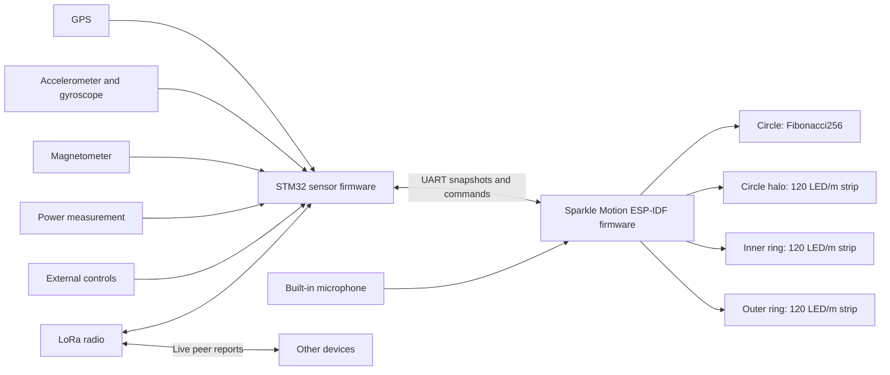

# Smart compass design for Sparkle Motion and STM32

Draft for implementation in a new `smart-compass` project in `musical-lights-rs`.
Design date: 2026-10-09.
Review update: 2026-10-11.

This document specifies the MVP software, board interfaces, and provisional native FreeCAD assembly. It does not establish firmware or physical-device acceptance. Three hardware facts remain open: the ring specification, battery measurement values, and final mounting. Search for `TODO: SC-` to find them. The completion table separates those facts from specified implementation work and physical validation.

Build a portable display that shows live radio peers, points north and toward friends, and runs light patterns. Use the existing Fibonacci256 as the main display. Add a circle halo, an inner ring, and an outer ring made from 120 LED/m strips. Sparkle Motion drives all four displays. STM32 owns the GPS, motion sensors, magnetometer, radio, and external controls.

This preserves the two-board plan already started in `musical-stm32`. The new project will reuse useful Rust components. It will have its own firmware entry points and hardware configuration.

## Scope and fixed decisions

| Item | Decision |
| --- | --- |
| Circle | The existing Evil Genius Labs Fibonacci256, with 256 pixels. Use “circle” only for this display. |
| Circle halo | A separate 120 LED/m strip immediately outside the circle, facing outward into the infinity mirror. It does not rename the inner ring. |
| Inner ring | An individually addressable 120 LED/m strip formed into the inner ring around the circle. |
| Outer ring | An individually addressable 120 LED/m strip formed into the outer ring. Each ring's exact pixel count follows its fitted length. |
| Display controller | Full Adafruit Sparkle Motion, using Rust and ESP-IDF. |
| Sensor controller | STM32F411CEU6 BlackPill, using Rust and Embassy; 512 KiB flash and 128 KiB RAM. |
| Sensor ownership | STM32 reads GPS, accelerometer, gyroscope, magnetometer, and power sensors. It also owns the LoRa radio. |
| Board connection | A wired, bidirectional 3.3 V UART connection. |
| Battery ownership | BlackPill reads battery voltage through a divider on PA4 and classifies it. Sparkle applies the factor from each snapshot and uses the unknown-power cap if the measurement or link expires. |
| Mechanical use | A large round necklace pendant, inspired by Flavor Flav, that Bryan can lift and hold face up to read the map. |
| Power path | The custom battery supply powers Sparkle Motion. Sparkle Motion powers the BlackPill and its peripheral rail. Charging and protection belong to the provided power hardware. |
| Map mode | A local map of live peers relative to this device. |
| Compass mode | North and bearings to live peers, with one selected peer. |
| Pattern mode | Geometric light patterns, including microphone-reactive patterns. |
| Saved locations | Excluded. No bookmarks, camp pins, place database, location history, or location-save command. |
| Offline use | Navigation, peer exchange, controls, and patterns work without a phone or internet connection. |

Radio, GPS, and peer tracking continue when the display changes mode. Display blanking changes light output only. It does not silently stop location broadcasts.

Street maps, trail maps, routes, text messaging, cloud services, phone applications, clock mode, and flashlight mode are outside the first version. Configuration and calibration can persist. Coordinates cannot persist.

## Existing work and reuse

The inspected Rust source is commit `ae307cd3cb528d252d02918566aee40fb1383243`. The Arduino source is commit `b79be3acf77d0a7e6d13b9dadb4fde4d3abdad96`. These references describe source state, not physical hardware acceptance.

| Existing component | What it contains | Treatment in the new project |
| --- | --- | --- |
| `musical-stm32/src/bin/sensors_for_sparkle.rs` | The intended sensor-board split, two UARTs, shared SPI devices, LSM9DS1 reads, Madgwick processing, and channels to Sparkle Motion. | Reuse device ownership and driver setup after a pin review. GPS and radio tasks contain `todo!()`. Calibration remains unfinished. |
| `musical-stm32/src/sparkle_uart.rs` | UART adapters around the shared encoder and decoder. | Reuse framing and stream handling. Use the new project's message schema. |
| `musical-lights-core/src/message.rs` | Bounded Postcard payloads, CRC-16/IBM-SDLC, COBS encoding, a zero delimiter, and framing tests. The link rate is 115200 baud. | Retain this established framing design. The existing payload lacks fix quality, sample age, heading validity, and complete peer snapshots. |
| `musical-lights-core/src/compass.rs` | Haversine distance and bearing calculations, with tests for cardinal bearings, nearby points, poles, and date-line crossings. | Reuse the mathematics and test cases. The existing API accepts `f32` coordinates and adds its declination argument to the geographic bearing. Do not use that sign convention implicitly in this project. |
| `musical-lights-core/src/orientation.rs` | A defined device frame and orientation classification from gravity or quaternions. | Reuse the frame definition and tests. Orientation classification alone does not supply a compass heading. |
| `musical-lights-core/src/sensor_mount.rs` and `docs/sensor-mounting.md` | Separate validated accelerometer, gyro, and magnetometer mounting transforms, including signed-axis and quaternion forms. Reviewed at Rust commit `c83f772f220e4a695ab50650af81636494aa73ad`. | Apply native-frame calibration first, then each sensor's mounting transform once. Reuse `SensorMount` and `ImuMounts` instead of adding another axis-conversion implementation. |
| `musical-adafruit-sparkle-idf/src/main.rs` | RMT output, microphone capture, shared loudness processing, and inactive peer/sensor state. | Reuse the ESP-IDF build pattern, RMT ownership, and audio pipeline. Its active display has 400 pixels in a 20 by 20 net. Sensor UART setup is commented out. |
| `musical-adafruit-sparkle-idf/src/light_profile.rs`, `src/bin/light-check.rs`, and `validation/lights/profile.py` | The active renderer keeps linear colors through brightness mapping, then uses `LedResponse::encode()` for per-channel inverse response and white balance. The current default is explicitly unmeasured. The bench binary and generator support measured profiles. | Retain this output contract for every mode. Give the circle, halo, inner ring, and outer ring separate response profiles and calibration records. Adapt the bench binary and generator to the four outputs; do not copy the 400-pixel net profile as a measurement of any display. |
| `musical-adafruit-sparkle-idf/src/light_patterns/fibonacci_layout.rs` | Arrays for 256 pixel positions, angles, and radii. | Reuse after physical index and orientation checks. Its X coordinates are mirrored relative to the published Pixelblaze map. Establish one front-view convention. |
| `musical-adafruit-sparkle-idf/src/light_patterns/compass.rs` | A loading check followed by a hue pattern. | Write the actual compass renderer. The current function does not display peer bearings. |
| `musical-lights-core/src/gps.rs`, `radio.rs`, and `lights/networked.rs` | A time alias, a radio TODO, and an empty networked-pattern module. | These are not completed GPS, mesh, or pattern-synchronization implementations. |
| `musical-adafruit-sparkle-embassy` | A 256-pixel output example, sensor initialization, and an SX1262 radio stub. | Use it as a hardware reference. Keep ESP-IDF as the single Sparkle firmware platform for this project. |
| Arduino GPS, radio, compass, and pattern files | NMEA setup, RF95 exchange at 915 MHz, peer colors, an active peer-indexed pattern, automatic battery brightness reduction, and notes about timing and power failures. | Retain peer-indexed composition and battery reduction/recovery as specified below. Do not copy the saved-pin database or the all-peers retransmission schedule. |

The Arduino Fritzing files identify a Feather M0 RFM9x radio board, Ultimate GPS FeatherWing, LSM9DS1 breakout, and SD hardware. The STM32 notes describe Discovery development hardware and BlackPill final hardware. The manifest and probe runner already target STM32F411CE. Bryan confirmed BlackPill and Sparkle Motion for this design. Use the RF95/SX1276 radio family, GPS FeatherWing NMEA interface, and LSM9DS1 as the MVP baseline. The integrated Feather radio is a source reference, not an assertion that its whole board plugs into BlackPill.

`debug/calibrate-sensors` already describes MotionCal collection and exports LSM9DS1 samples. Reuse its collection steps, not its unchecked `*1000` serial scaling or SD save path. The new host procedure below uses explicit SI units and wired coefficient storage. [Existing calibration sketch](debug/calibrate-sensors/calibrate-sensors.ino), [shared sensor mounting](https://github.com/BlinkyStitt/musical-lights-rs/blob/c83f772f220e4a695ab50650af81636494aa73ad/musical-lights-core/src/sensor_mount.rs).

Source references: [STM32 sensor program](https://github.com/BlinkyStitt/musical-lights-rs/blob/ae307cd3cb528d252d02918566aee40fb1383243/musical-stm32/src/bin/sensors_for_sparkle.rs), [UART framing](https://github.com/BlinkyStitt/musical-lights-rs/blob/ae307cd3cb528d252d02918566aee40fb1383243/musical-lights-core/src/message.rs), [compass calculations](https://github.com/BlinkyStitt/musical-lights-rs/blob/ae307cd3cb528d252d02918566aee40fb1383243/musical-lights-core/src/compass.rs), [ESP-IDF design](https://github.com/BlinkyStitt/musical-lights-rs/blob/ae307cd3cb528d252d02918566aee40fb1383243/musical-adafruit-sparkle-idf/DESIGN.md), and [Arduino prototype](https://github.com/BlinkyStitt/smart-compass-v0/tree/b79be3acf77d0a7e6d13b9dadb4fde4d3abdad96).

## System structure



STM32 owns the authoritative local fix, heading, peer table, radio schedule, calibration, and sensor health. It sends complete snapshots to Sparkle Motion. Sparkle Motion owns the display mode, selection, brightness, rendering, and microphone analysis.

The built-in microphone is the one sensor on Sparkle Motion. It serves local pattern rendering and does not enter the navigation or radio path.

Each peripheral has one owner. Interrupt handlers record readiness and wake tasks. They do not parse packets, run fusion, write LEDs, or log large messages. SPI transactions hold the bus only for the actual transfer. Radio transmission time never holds the SPI lock. The flash-maintenance exception below explicitly invalidates navigation while code fetch can stall.

## Hardware and wiring

### Sparkle Motion

The full board supplies level-shifted LED outputs, a microphone, and a separate peripheral UART. Assign GPIO21/SIG1 to the circle, GPIO22/SIG2 to the inner ring, GPIO19/SIG3 to the outer ring, GPIO23/D23 to the circle halo, and GPIO9 TX/GPIO10 RX to STM32. The microphone uses GPIO25, GPIO26, and GPIO33. Keep USB console access separate from the board link. The terminal outputs and GPIO23 are output-only after level shifting. [Adafruit pinouts](https://learn.adafruit.com/adafruit-sparkle-motion/pinouts).

Connect Sparkle GPIO9 TX to BlackPill PA10 RX, and Sparkle GPIO10 RX to BlackPill PB6 TX. Connect ground. Connect Sparkle's regulated 3.3 V output to BlackPill 3V3 and its peripheral 3.3 V rail. Budget the complete external branch within Sparkle's published 500 mA peak rating. The LED VOUT terminals follow the input voltage; they are not this logic supply. The provided power hardware supplies the voltage required by the fitted LEDs. Pack, charger, and regulator selection are outside this design update. Check the two programming connections during wiring acceptance. [Power and logic pins](https://learn.adafruit.com/adafruit-sparkle-motion/pinouts).

Give the circle, halo, inner ring, and outer ring separate RMT outputs. GPIO23 is a documented fourth 5 V level-shifted output on the logic header, not a fourth terminal block. Add a keyed, strain-relieved halo data connector and a separately fused/rated supply branch within the common power budget. Do not daisy-chain their data. A failed data connection on one display must not break any remaining data chain. All four outputs receive the same frame timestamp and power policy.

The full Sparkle Motion has no documented battery-voltage sensing circuit. Plugging the battery supply into its power connector does not connect battery voltage to an ADC. Its exposed GPIO27 analog input uses ADC2 and cannot read while Wi-Fi runs. Select the already available BlackPill ADC rather than adding an I2C ADC or gauge to Sparkle. Battery voltage travels over one sense wire plus the shared ground; classified state travels in the existing snapshots. [Sparkle pins and power inputs](https://learn.adafruit.com/adafruit-sparkle-motion/pinouts), [manufacturer schematics](https://github.com/adafruit/Adafruit-Sparkle-Motion-PCB).

### STM32

Use this BlackPill pin allocation in the new application. It retains the two existing UARTs and SPI bus, moves radio select off SWCLK, and reserves USB and SWD. All inputs and outputs use 3.3 V logic.

| Function | MVP assignment | Configuration |
| --- | --- | --- |
| Sparkle UART | USART1, PA10 RX, PB6 TX, AF7 | 115200 baud, 8N1; DMA2 stream 2/channel 4 RX and stream 7/channel 4 TX. |
| GPS UART | USART2, PA3 RX, PA2 TX, AF7 | 9600 baud, 8N1; DMA1 stream 5/channel 4 RX and stream 6/channel 4 TX. |
| Shared SPI | SPI1, PA5 SCK, PA6 MISO, PA7 MOSI, AF5 | Blocking bounded transfers under one bus mutex; no SPI DMA allocation. Mode 0, at most 4 MHz. |
| LSM9DS1 accelerometer/gyro select | PA8 | Active low; inactive before enabling SPI. |
| LSM9DS1 magnetometer select | PA9 | Active low; inactive before enabling SPI. |
| Radio select / DIO0 / reset | PB0 / PB5 / PB12 | CS active low; DIO0 rising EXTI5; reset active low. |
| Accel/gyro readiness / magnetic readiness | PB10 / PB1 | Active-high data-ready, rising EXTI10/EXTI1; latched until the sample read clears readiness. |
| GPS PPS | PA0, TIM2 CH1, AF1 | Rising-edge timer capture at 1 MHz; extend timer wrap into the monotonic clock. |
| GPS enable | PB7 | FeatherWing EN high disables GPS; hold low during ordinary operation. |
| Mode / Action buttons | PB13 / PB14 | Pull-ups; switches connect to ground, active low. |
| Battery measurement | PA4, ADC1 IN4 | Calibrated battery-sense input; measurement tap and scale remain a hardware TODO. |
| Debug and reserved pins | PA13/PA14; PA11/PA12; PH0/PH1; PC14/PC15 | Preserve SWD, USB, HSE, and LSE respectively. PC13 remains the board indicator. |

Use an 84 MHz system clock from the BlackPill 25 MHz HSE and PLL. Use a monotonic hardware timer independent of task scheduling. The firmware linker reserves the flash journal described below. Probe with `STM32F411CEUx`; do not flash a smaller-memory part with this layout. [STM32F411 pin, DMA, clock, and memory definitions](https://www.st.com/resource/en/datasheet/stm32f411ce.pdf).

Use LSM9DS1 accelerometer and gyro output at 119 Hz, with +/-4 g and +/-245 degrees/s full scale; use the magnetometer at 80 Hz and +/-4 gauss. Publish only new samples with their capture times. Configure ready pins for the stated active-high behavior and clear them by reading the complete sample. Calibration transports use m/s^2, rad/s, and microtesla. Final sensor mounting uses the shared per-sensor transforms and the enclosure mounting revision.

Use an RF95/SX1276 module with SPI CS, DIO0, and reset as above. SX1262 is outside this MVP hardware profile. Reusing the existing SPI driver setup does not imply that the unfinished Rust radio task is complete.

Use a dedicated SPI device wrapper for each chip select. Start all selects inactive. Set the correct clock mode and maximum clock rate per transaction. If a sensor holds readiness high, service and clear it correctly; do not let a level-triggered loop run without a bound.

### Display geometry

The linked Fibonacci256 is a 166 mm circle with 256 RGB pixels. Its wire order travels out and back along the board. It is not a rectangular matrix or a simple sequence of points along one spiral. Use a measured index-to-position map. The manufacturer's page includes maps and 5 V connection guidance. [Fibonacci256](https://www.evilgeniuslabs.org/fibonacci256).

The existing ESP-IDF README records these panels as WS2812B with GRB channel order. Confirm that with a red, green, and blue test on the actual circle. Confirm each ring separately.

Define the display frame as viewed from the front: X right, Y up, zero angle at the physical top, and positive display bearing clockwise. Store one shared mounting rotation and a separate direction for each ring. Each installed ring profile records its seam offset from the physical top. Never spread orientation offsets through individual patterns.

All three strip rings use 120 LED/m. Keep the established names: circle means Fibonacci256; the inner ring faces inward at the outside of the mirror cavity; the outer ring faces outward through the side wall. The new **circle halo** wraps just outside the circle and emits outward into the mirror cavity. These are planning values, not measured cut lengths.

| Part | Provisional count | Nominal strip length | Zero-gap pitch diameter | CAD pitch diameter with 3 mm seam |
| --- | --- | --- | --- | --- |
| Circle | 256 | Existing PCB | 166 mm PCB diameter | Not applicable |
| Circle halo | 64 | 533.3 mm | 169.8 mm | 170.7 mm |
| Inner ring | 84 | 700.0 mm | 222.8 mm | 223.8 mm |
| Outer ring | 90 | 750.0 mm | 238.7 mm | 239.7 mm |

For pitch `p = 1000/120` mm, nominal cut length is `L = N*p`. With measured length `L_actual` and seam gap `g`, fitted pitch diameter is `(L_actual + g)/pi`. Pitch diameter differs from the carrier, LED face, diffuser, and case diameters. Each installed profile records those dimensions, actual pixel angles, seam offset, and direction. If the cut interval contains several LEDs, select compatible counts before cutting. Leave service slack at each connector. Keep one top seam per ring; do not distribute its gap between every LED.

Wrap strips around cylindrical supports in their normal bend plane. Each support touches the strip's back. The **inner ring faces the circle**, the **halo faces outward from the circle**, and the **outer ring faces outside**. All keep the same front-view bearing convention. Halo and inner strips sit at Z=26.1..36.1 mm between the mirrors. Their curved 1 mm acrylic bands span Z=25.6..36.6, with 0.8 mm nominal LED clearance and 0.25 mm locating clearance. The outer row sits at Z=14.95..24.95 mm, centered at Z=19.95 in the 33.5 mm tall outside diffuser. It is a single row behind a broad surface, as Bryan selected. The structural barrel sits behind that row; no side ports or opaque outer skirt interrupt it. The curved outside wall uses black LED-diffusing acrylic without mirror film: nominal 246 mm inside diameter, 250 mm outside diameter and 2 mm thickness, with about 1.0 mm LED clearance. Use a light-transmitting black grade. One 250 × 1.5 mm front sheet has a clear centre, two-way mirror ring and black masked rim. The selected CAD uses 13 whole printed pieces on a 300 mm bed, with separate rear service screws; see the [enclosure assembly and print guide](hardware/enclosure/README.md). Uniform full-height illumination and RGB transmission need a later optical sample. [Strip mounting guidance](https://learn.adafruit.com/adafruit-neopixel-uberguide/neopixel-strips).

Use the infinity mirror only around the circle. A rear full mirror faces forward; the front two-way annulus faces rearward. Reflecting surfaces remain 11.2 mm apart. The visible front annulus now spans radii 85.5..110.5 mm: **25 mm radial width**. The continuous front removes the separate circle snap retainer. The halo's nominal LED faces reach radius 87.5 mm, leaving about 22.2 mm to the inward ring's LED faces. Preserve at least 20 mm visible front mirror width. The two curved diffuser bands leave 18.63 mm radial cavity between them; they cover the radial LED faces and do not lie flat across the front mirror. Keep wood, opaque spokes, and diffuser film off the front view. The hidden annular floor and circle seat support the center behind the rear mirror; the continuous sheet retains the optical stack on printed compression stops, outside the wood and LED load paths. The halo lights the center edge and its mirror repetitions to support the floating appearance. This is a geometric design, not proof of the perceived effect. [Adafruit mirror arrangement](https://learn.adafruit.com/make-it-glow-neopixel-and-led-diffusion-tips-tricks/infinity-mirrors).

> TODO: SC-RING-GEOMETRY — Measure all three strips before closing this item. Start at 64 halo/84 inner/90 outer pixels and 170.7/223.8/239.7 mm pitch diameters with provisional 3 mm seams. Record cut rules, length, width, coating/thickness, package depth, bend limits, pad clearance, fitted diameters/counts, RGB part/protocol, timing, channel order, seam offset and index direction. Keep the 25 mm mirror view and centered outside row when fitting measured parts. Geometry completion needs measurements and a mounting/section drawing. Keep chases, RGB, four-output timing and optical tests in deferred physical acceptance.

## Display modes

### Live peer map

The device sits at the center. Peer distance controls radius. Peer bearing controls angle. The map uses a linear radial scale, so half the displayed range means half the radius. It shows relative positions, not streets or terrain.

Use heading-up as the default: a friend in front appears above the center. Support north-up as a map setting. In north-up, geographic north stays at the physical top. A small heading marker shows the direction the device faces.

If true heading becomes unavailable, change the map to north-up and show a fixed-north cue. Do not keep rotating it from an old heading. If the local position expires, replace peer positions with a GPS-search display. Restore the selected map orientation only after the required inputs recover.

Proposed manual ranges are 100 m, 250 m, 500 m, 1 km, 2 km, and 5 km. Start at 500 m. A range change shows one to six short ring groups, then returns to navigation. No automatic zoom in the first version; a fixed range keeps motion and scale understandable.

For distance `d`, true bearing `B`, heading `H`, and range `R`:

```text
angle = B                  for north-up
angle = wrap(B - H)        for heading-up
radius = min(d / R, 1)
x = radius * sin(angle)
y = radius * cos(angle)
```

Convert angles to radians for trigonometry. Use the same normalized circle geometry for all map calculations. Rasterize a small spot across nearby physical pixels so a marker moves smoothly through the irregular layout. Keep the center marker visible.

Peers beyond the selected range use a distinct edge marker. Do not make them look as if they sit exactly at the range boundary. Peers inside the combined position uncertainty form a near-center marker without a precise bearing.

#### Position uncertainty

Use a horizontal 95% containment radius, in meters, for each receiver estimate. A receiver-specific adapter must document any conversion from its reported confidence to this convention. If the receiver gives HDOP alone, an undocumented confidence, or no tested conversion, report unknown accuracy.

For known local and peer radii `a` and `b`, use `U = a + b`. This is a conservative sum of containment radii, not an independent-error estimate such as a root-sum-square. Two 95% containment statements give a combined containment probability of at least 90% by the union bound; do not label `U` as 95% confidence. Suppress the peer direction when `d <= U`. For example, two 5 m radii suppress a bearing at 8 m and permit a bearing at 20 m. Display distance as approximate in both cases.

If either accuracy is unknown, place the peer at the distance and bearing calculated from the valid coordinates and mark the result approximate. Compass mode permits the approximate peer pointer when heading and both positions are otherwise usable. Do not substitute zero uncertainty, invent a radius, or move the peer to the center merely because accuracy is unknown. Exact coincident coordinates still have no bearing. Known uncertainty still suppresses a bearing at `d <= U`; invalid and expired positions still suppress navigation. Unknown accuracy changes marker shape, not its peak intensity.

Use the GPS FeatherWing's MTK NMEA interface at 1 Hz and 9600 baud. Enable RMC, GGA, and GSA; validate checksums and join RMC/GGA by their matching UTC second, using the RMC date. GSA has no timestamp: attach its HDOP only as a diagnostic when it arrives within 500 ms of that GGA, otherwise leave HDOP unknown. Never let GSA arrival refresh position age. HDOP is a dimensionless diagnostic, not a radius. Retain it as optional hundredths in the host status diagnostics, with 65535 meaning unknown. The older PA6H output list does not include GST, so this baseline works with accuracy unknown. It remains useful for approximate navigation. [FeatherWing receiver information](https://learn.adafruit.com/adafruit-ultimate-gps-featherwing/downloads), [PA6H message list](https://cdn-shop.adafruit.com/datasheets/GlobalTop-FGPMMOPA6H-Datasheet-V0A.pdf).

Parse a same-epoch GST sentence if the fitted receiver emits it. For documented horizontal Gaussian standard deviations, use `r95 = sqrt(-2*ln(0.05)) * max(sigma_major, sigma_minor)`; the multiplier is about 2.448. This is a conservative modeled 95% circular bound, not a measured guarantee. Reject non-finite/non-positive deviations and a missing epoch match. A vendor field such as `hAcc` needs a documented confidence conversion before setting ACCURACY_VALID; an undocumented estimate remains diagnostic only. Round a supported radius upward to decimeters. Saturated radii above 65534 dm become unknown rather than under-reporting error. The UART and radio keep the existing optional radius convention. [Example receiver GST field definitions](https://content.u-blox.com/sites/default/files/documents/u-blox-X20-HPG-2.02_InterfaceDescription_UBXDOC-304424225-19967.pdf).

When markers overlap, show each peer in a stable time sequence at that position. The selected peer gets the specified side ticks. Preserve peer identity through the sequence. Do not blend several colors into a new apparent peer.

Both rings use the same physical angular north and selected-peer bearings in heading-up view. The inner mirror ring supplies the front-view cues; the outward ring repeats them around the edge and need not be visible from directly in front. In north-up view, ring markers use the same geographic frame as the circle. Reserve short, temporary status cues for mode and range changes; do not permanently remove a direction sector from either ring.

### Compass

Both rings give the primary north indication and peer directions at the same mounted bearings. The circle shows a broad pointer toward the selected peer. Without a selected valid peer, it shows a north pointer.

Use distinct shapes or rhythms for north, selected peer, other peers, and stale peers. Peer color helps identification, but color is not the only distinction. A selected peer keeps the same color and side-tick timing in map and compass modes.

Peer selection cycles through configured peers in a stable order. Expired peers leave the active selection list. If the selected peer expires, clear the target indication and show the loss cue. Require an Action press to select another peer. Never silently redirect the main pointer to a different person.

Compass north can work without a GPS fix. In that state, show magnetic north and a distinct status cue. True north requires valid declination. Peer pointers require a current local position, a usable peer position, and a valid true heading. A north-up map can still show positions when heading is unavailable.

### Patterns

Provide a small first set: spiral rainbow, rotating spokes, radial waves, a rainbow shared across peers, and microphone-reactive pulses. Use the circle's XY and polar coordinates for geometry. Make all three rings part of each composition.

#### Preset definitions

Assign preset IDs 0 through 4 in the order below. Default to preset 0. Define `r` as circle radius in `[0, 1]`, `a` as clockwise angle from the top divided by one turn, and `t` as elapsed seconds from pattern entry. For presets 0, 1, 2, and 4, all three rings use the same angular function at their own mounted pixel angles; ring pixels use `r = 1`. This keeps the existing perimeter pattern on all three rings. Preset 3 uses the ordered path below. `fract(x)` returns `[0, 1)`. `tri(x) = 1 - abs(2 * fract(x) - 1)`.

`rainbow(h)` uses six equal RGB sectors: red, yellow, green, cyan, blue, magenta, then red, with linear interpolation between those linear-sRGB vertices. The maximum channel is 1. All formulas produce linear intent before the common brightness, battery, current-limit, and response stages. There is no additional gamma operation inside a preset.

| ID and preset | Circle function and default timing | Function for all three rings |
| --- | --- | --- |
| 0: Spiral rainbow | `rainbow(fract(a + 2*r - t/8))`; 8 s cycle. | The same function at `r = 1`. |
| 1: Rotating spokes | `rainbow(fract(a - t/8)) * pow(max(0, cos(2*pi*(3*a - 3*t/8))), 8)`; three spokes, 8 s full color/rotation cycle. | The same function at `r = 1`. |
| 2: Radial waves | `rainbow(fract(r - t/8)) * (0.1 + 0.9*tri(2*r - t/4))`; 8 s cycle. | The same function at `r = 1`. |
| 3: Shared rainbow | The composition formula below, with `shared_pattern(u) = rainbow(u)`; 8 s cycle and Unix UTC origin 0. | Halo pixels follow circle pixel 255; inner-ring pixels follow the last halo pixel; outer-ring pixels follow the last inner-ring pixel. |
| 4: Audio pulse | Let `e = clamp(max(frame.levels), 0, 1)` from the existing 24-band `VisualGain` -> `DisplaySnapshot<24>` pipeline, sampled at the display timestamp. Use `rainbow(fract(a - t/8)) * e * max(0, 1 - abs(r - e)/0.15)`. Silence produces black; audio activity moves a 0.30-radius-wide pulse outward. | Use `rainbow(fract(a - t/8)) * e`; activity changes ring intensity. |

For preset 0 at the top edge (`a=0, r=1`), frames at `t=0, 2, 4` seconds have hues `0, 0.75, 0.5`. For preset 2 at the center, intensity is 0.1 at `t=0` and 1 at `t=2`. For preset 3 with four peers at trusted phase 0, each device's first circle pixel starts at hues `0, 0.25, 0.5, 0.75` respectively. For preset 4, `e=0.25` lights the circle around radius 0.25 and gives all three rings 25% linear intensity; `e=0` lights no output.

Local presets reset `t` to zero on entry. Shared rainbow uses the clock state below and never resets trusted phase on a mode change. Pattern cycle configuration may scale a preset's time terms by `default_cycle / configured_cycle`; the permitted configured cycle is 2 through 60 seconds. It cannot change the fixed geometry or audio analysis. Navigation and status cues overlay patterns according to the cue table.

The preset formulas and cue table are the MVP defaults. Physical visual review is a validation task, not an unanswered design decision. Record measured visibility and any accepted revision after rendering them on the actual circle and all three rings.

Reuse the production `LoudnessMeter`, `VisualGain`, and time-based display state for audio patterns. Map the shared analysis output onto this circle's geometry. The existing twenty-row net layout does not define the new rendering. Do not replace loudness with independent FFT gains or reset analysis at LED frame boundaries.

Start microphone capture when entering an audio pattern. Stop and release it when leaving audio patterns. Plain patterns work if capture fails. Show a failure cue instead of presenting invented audio activity.

Shared-time geometric patterns use a common phase from GPS time when available. After time loss, continue from a monotonic holdover clock. A later time correction adjusts phase smoothly. Local microphone response remains local; it does not make separate microphones synchronize.

#### Composition across peers

Retain the active Arduino `networkedLights()` behavior: each device shows a different section of one combined pattern. Shared time controls motion; a stable peer slot controls which section the device shows. Matching time alone must not make every device show the same section. [Prototype pattern](https://github.com/BlinkyStitt/smart-compass-v0/blob/b79be3acf77d0a7e6d13b9dadb4fde4d3abdad96/light-patterns-networked.ino).

Sort the configured roster by numeric peer ID. A device's zero-based position in that roster is its pattern slot `k`; the configured roster length is `N`. STM32 sends `k`, `N`, and the roster revision in its snapshots. Never derive these values from the currently reachable peers. An absent device leaves its section empty, so other devices do not jump to new colors or positions.

For this pattern, define one local path: circle indices 0 through 255, followed by halo pixels, inner-ring pixels, and then outer-ring pixels, each in clockwise order from the mounted top. Use the inverse of each ring's fitted seam/direction transform to obtain physical indices. Let `L = 256 + halo_count + inner_ring_count + outer_ring_count` be that device's total pixel count and `j` its pixel's index along this path. Use the common preset's cycle period and time origin to calculate `phase(t)` in full cycles:

```text
u = fract((k + j / L) / N + phase(t))
color = shared_pattern(u)
```

Use fractional arithmetic for `j / L`. With four configured peers, slot 1 shows the second quarter of the pattern. If that peer is absent, the other three keep their quarters. Devices with different ring counts still receive equal pattern sections; their pixel counts only change the sampling within a section. For equal `L`, the static mapping equals `(k * L + j) / (N * L)`, which retains the prototype's peer-indexed strip composition.

Every participant must use the same roster revision, preset, cycle period, and time origin. Provision them together. A deliberate roster change starts a new composition revision. Rebooting or losing a radio peer must not change the slot. If roster identity is missing, mark the shared pattern unavailable and keep local patterns available. Do not assign an arbitrary slot.

## LED response calibration

Keep colors for the circle and all three rings in linear sRGB through composition and brightness mapping. This includes navigation markers, status cues, plain patterns, and microphone-reactive patterns. Sparkle applies each output's `LedResponse::encode()` once to convert the final linear intent to RGB bytes, including per-channel inverse response, white balance, and the output drive cap. The driver then applies that output's channel order. Do not add a second gamma or white-balance pass.

Use this output sequence for all four displays:

```text
linear composition
  -> user brightness * battery factor * permitted power scale
  -> output-specific LedResponse::encode(linear_color, drive_cap)
  -> output-specific channel order
  -> RMT output
```

Select the permitted power scale from the estimated current of the encoded frames for all four outputs before writing any output. If a candidate exceeds the budget, reduce the linear scale and encode a new candidate from the unchanged linear composition. Never feed encoded bytes back through the response curve. This keeps normal dimming in linear light while enforcing the current limit on the actual proposed drive bytes.

Own the profiles in the new Sparkle application's deployment module. Keep one microphone input calibration and separate circle, halo, inner-ring, and outer-ring LED response functions. Reuse the shared `LedResponse` type. Extend `validation/lights/profile.py` to generate the named LED profiles from separate measurements. Keep each profile's LED identity, supply voltage, diffuser arrangement, measurement method, and measured/unmeasured state with the deployment data. Configuration references those profile identities; it does not maintain a second copy of the response curves.

Before measurement, use `LedResponse::default()` independently for each display and report it as unmeasured. A measured circle profile does not calibrate any strip ring. A measured halo profile does not calibrate the inner ring: they see different optical paths. A measured inner-ring profile does not calibrate the outer ring, even when the strips have the same part number. Reject an invalid measured profile instead of silently treating it as valid. Channel-order tests, current-limit measurements, and optical response measurements establish different properties.

Adapt `light-check` to address the circle, halo, inner ring, and outer ring separately with their actual pixel counts, pins, and channel orders. Retain red, green, blue, and white ramps plus timed pulses. Apply the operational drive caps and total current budget during the full-display checks. The current generator requires at least 17 strictly increasing measured points per channel over drive 0 through 255, plus measured white-balance factors. Obtain those full-range data with a suitable, current-limited small-pixel fixture; do not drive the whole circle and all three rings at full white to satisfy the generator. Measure the installed optical arrangement before claiming calibrated displayed color.

Compilation of `light-check` does not run it, flash it, or establish calibration. Retain measured input data and meaningful generated deployment profiles with the implementation. Test monotonic response, correct profile selection, black output, drive caps, and one response application. The current shared tests provide a starting point. See the existing [LED response implementation](https://github.com/BlinkyStitt/musical-lights-rs/blob/ae307cd3cb528d252d02918566aee40fb1383243/musical-lights-core/src/lights/color_correction.rs), [bench program](https://github.com/BlinkyStitt/musical-lights-rs/blob/ae307cd3cb528d252d02918566aee40fb1383243/musical-adafruit-sparkle-idf/src/bin/light-check.rs), and [profile generator](https://github.com/BlinkyStitt/musical-lights-rs/blob/ae307cd3cb528d252d02918566aee40fb1383243/validation/lights/profile.py).

## Controls and status

Use two accessible external buttons connected to STM32. Debounce them there and send ordered input events to Sparkle Motion.

| Control | Map | Compass | Patterns |
| --- | --- | --- | --- |
| Mode short press | Advance to Compass | Advance to Patterns | Advance to Map |
| Action short press | Advance range | Advance selected peer | Advance pattern |
| Action hold | Advance brightness level | Advance brightness level | Advance brightness level |
| Mode hold | Toggle display blanking | Toggle display blanking | Toggle display blanking |

Use a 1.5-second hold threshold as an initial setting. A hold must not also trigger a short press. Select map orientation and other setup values through the wired configuration interface. Do not overload normal controls with a location-save gesture.

### Complete control state

STM32 accepts a change only after the input remains stable for 30 ms. Measure hold duration from that accepted press. A release before 1500 ms emits one short event. At 1500 ms, emit one hold event; release emits nothing further. Holds do not repeat. If both buttons overlap, discard pending gestures and wait until both remain released for 30 ms. An already emitted hold cannot be undone by pressing the other button. A button held during boot must first be released; boot never generates an event.

Brightness levels are 5%, 10%, 25%, 50%, and 100% of linear intent. Action hold advances once and wraps from 100% to 5%. The current budget can reduce actual output at every level. Brightness is never zero; blanking is a separate state.

| State and event | Next state and effect |
| --- | --- |
| Visible, Mode short | Map -> Compass -> Patterns -> Map; keep the other UI settings. |
| Visible Map, Action short | Range 100 -> 250 -> 500 -> 1000 -> 2000 -> 5000 -> 100 m. |
| Visible Compass, Action short | Next configured peer with a non-expired position, ordered by numeric ID; wrap. If none qualify, clear selection. An uncertain bearing does not prevent selection. |
| Visible Patterns, Action short | Preset 0 -> 1 -> 2 -> 3 -> 4 -> 0. Skip preset 3 only when roster identity is missing. A microphone fault leaves preset 4 selected, black except for its fault cue. |
| Visible, Action hold | Advance brightness once. |
| Visible, Mode hold | Set blanked; send black to all four outputs. Keep navigation and radio active. |
| Blanked, Mode hold | Clear blanked; restore the same mode, range, preset, and brightness. |
| Blanked, either short or Action hold | Consume the event; leave the display blank and the UI settings unchanged. |
| Link unavailable | Retain UI state. Do not invent control input. Apply the link-fault display policy. |

Factory defaults are Map, 500 m, heading-up, no selected peer, preset 0, 8 s cycle, 25% brightness, and visible output. The durable input transaction described below restores the last committed mode, range, preset, brightness, and blanked state after a Sparkle restart. Store selection as a peer ID only, never its position. Keep its pointer hidden until fresh source data return. If no UI record exists, use factory defaults. Configuration changes use the same validated UI reducer as buttons.

### Navigation glyphs and status cues

These are the specified MVP visuals. Apply every ring glyph and its timing to all three rings at the same mounted bearing; sample each ring independently at its actual pixel angles. All lengths use the normalized circle radius. Measure angular distances by the shorter arc. Use an antialiased spot with linear falloff `max(0, 1 - distance/0.06)` around each map coordinate. The center marker is a white spot of radius 0.04. A circle pointer is a white or peer-colored shaft from radius 0.15 to 0.70, half-width 0.035, with a triangular head whose tip is at radius 0.90 and whose base spans +/-12 degrees at radius 0.65.

The eight peer palette entries, in linear RGB, are `(1,.15,0)`, `(0,.4,1)`, `(0,1,.3)`, `(1,0,.6)`, `(.7,.3,1)`, `(1,.7,0)`, `(0,1,1)`, and `(.7,.7,.7)`. White is `(1,1,1)`, amber is `(1,.35,0)`, and magenta is `(1,0,1)`. Use the configured color ID consistently. Shapes and timing carry status independently of hue.

| Cue | Shape, intensity, and timing before common output scaling |
| --- | --- |
| True north | White ring segment spanning +/-3 degrees. Steady at 0.35 linear intensity. North circle pointer uses the same intensity. |
| Selected peer | Ring segment +/-5 degrees and map spot or circle pointer; peak linear intensity 0.50. Add two short side ticks at bearing +/-9 degrees, on for 150 ms each 1.2 s. Keep the main marker steady while fresh. |
| Other peer | Ring segment +/-2 degrees or map spot, steady at peak linear intensity 0.50. |
| Stale peer | Retain its map glyph or ring segment at the same 0.50 peak, on for 200 ms then off for 800 ms. Never draw the selected circle pointer. |
| Out of range | Two spots at edge radius 0.95, angles bearing +/-4 degrees; use the peer's ordinary or selected timing. |
| Known uncertainty includes center | Peer spot on a radius-0.08 center cluster, one peer per 600 ms slot, sorted by ID. No ring direction or selected circle pointer. |
| Unknown accuracy | Keep the calculated map location. Replace its filled spot with a hollow outline of radius 0.06 and half-width 0.015. On each ring, use two +/-2-degree segments centered at bearing +/-5 degrees, with a dark center. Draw the selected compass arrow as an outline of half-width 0.015, with no filled shaft. Use the same 0.50 peak as a known-accuracy peer. |
| GPS search | Amber spot orbits at radius 0.50 once per 2 s; peer positions and pointers stay hidden when local position is expired. |
| Magnetic-only north | Amber north segment, 200 ms on / 800 ms off. No true-bearing peer pointer. |
| Heading unreliable | Two amber top-edge spots at +/-12 degrees, 150 ms on at 0 and 300 ms of each 2 s cycle. Suppress affected directions; map falls back to north-up. |
| Radio or microphone fault | Two magenta edge spots, 200 ms on each 4 s cycle. A radio fault leaves valid received positions to age normally. |
| Link lost | Four amber cardinal ring segments, 200 ms on / 800 ms off. Hide all sensor-derived pointers after the 2 s deadline. |
| Low / Critical / unknown power | Bottom ring segment +/-8 degrees, amber; Low 200 ms every 4 s, Critical every 1 s, unknown two 100 ms pulses separated by 100 ms every 2 s. |
| Mode change | One, two, or three white spots at the top of each ring for Map, Compass, or Patterns; show for 600 ms. |
| Range change | One through six white ring groups, equally spaced from the top; 600 ms. |
| Target lost / input fault | Three amber 100 ms pulses, separated by 100 ms; then resume the current fault/state display. |

For each ring independently, at counts below the angular glyph resolution, light at least one nearest pixel per segment. If an unknown-accuracy pair collapses to one ring pixel, use two 100 ms on intervals starting at 0 and 200 ms of each 1 s cycle, at the same 0.50 peak. Stale gating still masks the complete glyph. Apply the hollow spot shape to each out-of-range edge spot when accuracy is unknown. Use the same mounted front-view transform for every glyph. For ordinary map spots within 0.12 radius of each other, show one peer for each 600 ms slot, sorted by ID; retain each peer's selected/stale rhythm. The center marker remains visible.

Determine angular overlap from the specified glyph sectors once and use the same peer/north slot schedule on all three rings, even if their pixel counts differ. If north and a peer occupy overlapping ring sectors, alternate north for 300 ms and that peer for 300 ms. More overlapping peers join the stable ID order after north. Do not mix identities into a new color. Apply output priority: user blank, link loss, GPS-search replacement, then navigation/patterns with power/heading/hardware status. For simultaneous routine status cues, show one 600 ms cue window every 2 s in the order power, heading, radio, microphone; rotate through active cues. Status overlays use at most 0.20 linear intensity and temporarily own only their glyph pixels. Mode/range cues wait until the next free cue window and expire after 2 s. A lost-target cue runs once immediately unless blanking or link loss overrides it.

Example: with north and the selected peer both at zero degrees, `0..300 ms` shows north and `300..600 ms` shows the peer at intensity 0.50; repeat. Unknown accuracy replaces the peer segment with the paired segments in its slot. Selected side ticks run on their own 1.2 s clock. Stale timing masks the whole peer glyph, including side ticks, without changing the peak. If low power and unreliable heading coexist, the first 600 ms status window shows low power, the window at 2 s shows heading, and the window at 4 s returns to low power. Direction suppression takes effect immediately; it does not wait for a cue window. Blanking suppresses every visual cue.

Keep mode choice explicit. Do not copy the old automatic switch between hanging patterns, flat compass, upside-down clock, and off. Use posture to detect unreliable heading or an unreadable viewing angle, rather than to change mode unexpectedly.

Give every important state a repeatable shape or rhythm: GPS search, magnetic heading only, heading unreliable, radio unavailable, peer stale, sensor-board link lost, and low power. Navigation faults suppress the affected pointer. They must not leave an old solid pointer on screen.

Keep routine health cues brief and dim. A critical power or link fault takes priority over decoration. Verify the palette and rhythms with Bryan, including color-vision accessibility, during the physical display review.

## Position and heading contracts

Use signed latitude and longitude in degrees times 10,000,000 as the project's canonical coordinate representation. This fits `i32` and preserves received precision. Convert to `f64` radians only for calculations. Never infer fix validity from a zero coordinate; the equator and prime meridian are valid locations.

Every position sample has validity, capture time, monotonic age, and an accuracy state. Keep unknown accuracy distinct from zero error. Do not convert HDOP directly to meters without a stated receiver model. Reject invalid coordinate ranges and non-finite sensor results.

Use these conventions throughout the project:

| Quantity | Convention |
| --- | --- |
| Device axes | X right, Y toward the top edge, Z out of the display. |
| Geographic bearing | Degrees clockwise from true north, wrapped to `[0, 360)`. |
| Magnetic heading | Device top direction clockwise from magnetic north. |
| Declination | East-positive. `true_heading = wrap(magnetic_heading + declination)`. |
| Relative peer bearing | `wrap(true_peer_bearing - true_heading)`. |
| Coincident or uncertain nearby position | Distance is available; direction is unavailable. |

For example, magnetic heading 350 degrees and declination +10 degrees give true heading 0 degrees. A peer at true bearing 90 degrees appears to the right. Include this exact sign check in tests.

STM32 applies accelerometer bias/scale, gyro bias, and magnetometer hard-iron/soft-iron calibration in each sensor's native frame. It then applies the corresponding shared `ImuMounts` transform once before fusion. Use measured sample intervals. Detect missing samples and sensor saturation. A quaternion used for posture does not by itself prove a valid magnetic heading.

Use a tilt-compensated heading and an explicit heading-quality state. Detect weak horizontal magnetic field, large magnetic disturbances, and excessive tilt. GPS course describes travel direction and must not replace the direction the device faces when stationary.

### Heading validity and recovery

Use these initial numeric limits as conservative design targets, then verify them in the assembled device. The age of a heading is the age of its oldest required accelerometer, gyro, or magnetometer sample. A newly transmitted snapshot cannot make that sample younger.

| Quality value | Meaning and entry condition | Output |
| --- | --- | --- |
| 0: Missing | No usable sample, accelerometer/gyro age over 50 ms, or magnetometer/heading age over 200 ms. | No heading-derived direction. |
| 1: Uncalibrated | No accepted calibration for the sensor identity and mounting revision. | No heading-derived direction. |
| 2: Acquiring | Required samples and calibration exist; the 2 s recovery interval is not complete. | No heading-derived direction. |
| 3: Magnetic | All quality checks pass, but valid declination is unavailable. | Magnetic north only. |
| 4: True | All checks pass and valid declination exists. | True north and peer bearings. |
| 5: Disturbed | Calibrated field magnitude is outside 15..80 microtesla, differs from the calibration reference magnitude by over 20%, or its horizontal component is below 10 microtesla. | Suppress heading; map uses north-up. |
| 6: Tilted | Display plane tilt from horizontal exceeds 60 degrees, or the device top vector's horizontal projection is below 0.5 of its length. | Suppress heading. |
| 7: Dynamic | Acceleration magnitude stays outside 0.85..1.15 g for 200 ms. | Suppress heading until motion settles. |

Reject non-finite values and sensor saturation immediately; report Missing with a separate fault bit. Disturbance, tilt, and stale samples invalidate heading immediately. Dynamic entry alone uses the stated 200 ms delay. Evaluate failures in this order: Missing, Uncalibrated, Disturbed, Tilted, Dynamic, Acquiring, Magnetic/True. Retain all concurrent fault bits, even when one quality value wins.

Recovery requires 2 continuous seconds with fresh samples, field magnitude within 15% of the calibration reference, horizontal field at least 12 microtesla, tilt at most 50 degrees, top projection at least 0.6, and acceleration within 0.90..1.10 g. Restart that timer on a failed condition. A lost declination changes True to Magnetic immediately; restoring valid declination changes Magnetic to True without an additional sensor recovery delay. The 50 ms inertial limits apply at STM32 acquisition/publication. Sparkle holds a computed heading for at most 200 ms including link transport; it does not claim to acquire new inertial samples. A Missing quality in any snapshot suppresses it immediately. Sparkle independently invalidates the held heading at that 200 ms age even if snapshots continue.

Heading fault-mask bits are: 0 missing/stale sample, 1 no calibration, 2 field magnitude, 3 weak horizontal field, 4 tilt/projection, 5 dynamic acceleration, 6 saturation/non-finite data. Bits 7..15 are reserved zero. Heading values use centidegrees in `[0,35999]`; invalid values are zero with quality controlling validity. Tilt uses centidegrees in `[0,9000]`. Uncalibrated sensors never produce a valid-looking north pointer.

Validate these specified limits and the 10-degree heading target with the fitted sensor, mounting, latitude, LED load, and radio transmission. Record results in the sensor profile. This is physical acceptance work; it does not leave the validity policy to the implementer.

### Sensor-calibration procedure

Provide a host tool at the planned path `smart-compass/tools/calibrate-sensors.py`. The commands below belong to the wired interface specified later. They are implementation requirements, not commands available in the prototype. Keep calibration sample files free of GPS coordinates and UTC position records.

1. Assemble the final sensor, wiring, battery, circle, all three rings, diffusers, and enclosure. Put the device on a nonmagnetic fixture away from steel and magnetic objects. Use a dim display with radio transmission paused for collection; keep GPS and UART tasks active. Record sensor identity, full-scale settings, axis mapping, mounting revision, and temperature.
2. Run `calibration start sensors`. STM32 creates one volatile run ID and marks heading Uncalibrated/Acquiring for this run. The wired host drains timestamped raw accelerometer (`m/s^2`), gyro (`rad/s`), and magnetometer (`microtesla`) samples from the calibration stream. No navigation heading is valid during collection.
3. Leave the device stationary for 10 s after a 2 s settling period. Collect at least 1000 gyro samples at 100 Hz. Use the mean as gyro bias. Reject the interval if any axis standard deviation exceeds 0.02 rad/s or acceleration magnitude varies by more than 0.05 g.
4. Hold each of the six native accelerometer axes vertically up, following the host tool's mounting instructions, for 5 s, after 1 s settling. Retain at least 300 stable accelerometer samples per pose. For each axis, derive bias from the midpoint of its positive/negative means and scale from `2*9.80665/(positive_mean-negative_mean)`. This calibration is diagonal; the fixed mounting matrix supplies axis alignment. Reject a scale outside 0.8..1.2 or a corrected stationary norm more than 0.03 g from 1 g.
5. Rotate the complete enclosure slowly through all orientations for at least 60 s. Retain at least 2000 distinct magnetometer samples. Split every fifth sample into a holdout set. Fit the remaining samples to `(m-b)^T A (m-b) = 1`, with symmetric positive-definite `A`, using constrained least squares. Set `B0` to the median magnitude of the bias-corrected samples, and `M = B0 * sqrt(A)`. Correct magnetometer readings as `M*(m-b)`. Reject a non-positive-definite fit, matrix condition number above 4, fewer than 12 samples in any of 24 equal-solid-angle bins, or holdout radial RMS error above 5% of `B0` / maximum error above 15%.
6. Preview the candidate without saving. Check north on an independent fixture at 0, 90, 180, and 270 degrees and at +/-30-degree tilt. Repeat at maximum permitted LED load and during radio TX. Every error must fit the 10-degree target. A good sphere fit alone does not prove correct north or immunity to current-induced fields.
7. Run `calibration save <run-id> <candidate-sha256>` only after all checks pass. STM32 atomically stores the coefficient record and increments its calibration revision. Re-enter the 2 s heading recovery state. `calibration cancel <run-id>`, host disconnect for 30 s, or either board restart discards the volatile candidate and restores the previous accepted record. If no record exists, heading remains Uncalibrated. Never auto-save partial results.

The stored coefficient record uses version 1, a hardware-profile ID, sensor/mount revision, sample count, temperature in centidegrees C (use -32768 when unavailable), and finite little-endian IEEE-754 `f32` values: accelerometer bias `[3]` in m/s^2, accelerometer diagonal scale `[3]` dimensionless, gyro bias `[3]` in rad/s, magnetometer bias `[3]` in microtesla, row-major magnetometer matrix `[9]` dimensionless, and `B0` in microtesla. Include holdout residuals, solver version, and a CRC. Do not store position. Keep the full CSV and solver report as calibration evidence; firmware stores only the accepted record.

### Host calibration algorithm and record

Implement the planned Python tool with NumPy, SciPy, and pyserial. Collect through the UART `CalibrationBatch` message and the wired stream command below. Samples retain native sensor axes; the tool uses the installed mounting transforms to tell the operator which face to hold up. Preview rotates calibrated samples into the body frame through the same shared transforms used by normal fusion. Do not use MotionCal's integer wire units as SI values.

Use `scipy.optimize.least_squares`, method `trf`, linear loss, `ftol=xtol=gtol=1e-10`, and `max_nfev=10000` for the stated ellipsoid residual `q_i = (m_i-b)^T A (m_i-b)-1`. Parameterize `A = L*L^T`; `L` is lower triangular with positive diagonals represented by exponentials. Initialize `b` to per-axis medians and `A` to diagonal `1/(3*variance_i)`. Reject zero variance, solver failure, non-finite results, and the stated condition/residual limits. Compute the symmetric matrix square root with `numpy.linalg.eigh`; reject non-positive eigenvalues. A calibration determines field shape and bias; `B0` uses the stated scale convention, not an independent absolute field measurement. [SciPy solver](https://docs.scipy.org/doc/scipy/reference/generated/scipy.optimize.least_squares.html).

For the 24 equal-area coverage bins, normalize corrected magnetometer vectors, split Z into four intervals `[-1,-0.5)`, `[-0.5,0)`, `[0,0.5)`, `[0.5,1]`, and split azimuth into six 60-degree intervals starting at +X. Clamp exact endpoint values to the last bin. Use training samples for bin occupancy and held-out samples only for residual acceptance. Require at least 12 training samples per bin. Reject a collection with any stream overrun or unexplained sequence gap; retain the report and repeat collection. Sort by capture order before selecting every fifth sample as holdout. Do not silently remove high-error samples to pass a fit.

The coefficient codec below is exactly 120 bytes. `F4` is four little-endian bytes holding a finite IEEE-754 `f32`, not a Postcard variable-length integer. Reject unknown versions and trailing data.

| Ordered coefficient fields | Bytes |
| --- | --- |
| `schema:L2=1`, `sensor_profile:L2`, `mount_revision:L4`, `calibration_revision:L4`, `mag_sample_count:L4`, `temperature:L2` signed centidegrees C | 18 |
| `accel_bias:[3,F4]`, `accel_scale:[3,F4]`, `gyro_bias:[3,F4]`, `mag_bias:[3,F4]`, `mag_matrix:[9,F4]`, `B0:F4` | 88 |
| `holdout_rms:F4`, `holdout_max:F4` in microtesla; `solver:L2=1`; `crc:L4` | 14 |

CRC is CRC-32/ISO-HDLC over the first 116 bytes. Candidate SHA-256 covers all 120 bytes including CRC. Calibration revision is the current accepted revision plus one, or 1 for first calibration; reject overflow. Stage checks profile/mount identity, units, coefficient bounds, finite values, matrix conditioning, residual limits, CRC, and revision. Save also requires a matching active run and exact candidate SHA-256. The manual cardinal/tilt/load fixture check remains an operator acceptance step; a stored coefficient does not prove that the operator performed it. The planned solver's independent tests include transformed spheres, known biases, poor coverage, singular matrices, malformed records, rejected preview, cancel, and restart.

Compute declination locally from a versioned magnetic model and valid date and position. WMM2025 is the current model and expires at the end of 2029. Verify the chosen implementation against NOAA test values. Store model identity with calibration metadata, and show magnetic-only status if the model input is unavailable or outside its validity. [NOAA World Magnetic Model](https://www.ncei.noaa.gov/products/world-magnetic-model).

GPS parsing must join date, time, position, and quality from the same measurement epoch. Validate NMEA checksums and hemisphere signs. Represent transmitted timestamps as Unix UTC milliseconds. Keep UTC, GPS time, and monotonic elapsed time distinct. Time-zone settings have no role in navigation.

For pattern synchronization, STM32 publishes a UTC clock anchor, its monotonic age, and an uncertainty estimate in each snapshot. Use PPS when available to establish the anchor. Without PPS, measure receiver and UART delay before claiming synchronization accuracy. Reject large time jumps until the receiver establishes a new valid anchor.

### Clock startup, holdover, and correction

Clock state values are 0 Untrusted, 1 Acquiring, 2 Locked, and 3 Holdover. On cold boot, start Untrusted with uncertainty unknown. Shared rainbow runs at phase zero plus local monotonic elapsed time divided by its cycle. Show the unsynchronized cue as a heading-style double pulse in pattern mode. This startup animation makes no claim of matching another device.

Enter Acquiring after the first checksum-valid, same-epoch date/time anchor with a valid receiver time status. Require five consecutive one-second anchors that agree with elapsed monotonic time within 100 ms, a plausible calendar date in 2020..2099, and a measured UTC uncertainty at most 50 ms before entering Locked. UTC outside the magnetic model's dates may still serve the clock; it cannot produce valid declination. PPS alone supplies a boundary, not its UTC label. Pair it with the receiver's documented sentence epoch. A non-PPS profile must include a measured transport-delay bound; otherwise it cannot enter Locked.

While Locked, treat a UTC innovation above 250 ms as a discontinuity. Stop using the new anchor, enter Acquiring, and require the five-anchor check again. Do not move a displayed phase backward or accept timestamps from an untrusted jump. Ordinary corrections change the presentation clock rate by at most +/-5 ms/s (0.5%) until the offset is below 1 ms; include the residual in the error bound. Use this presentation clock for shared patterns; use the validated UTC anchor and its uncertainty for packet age checks. These are two uses of the same clock estimate, not interchangeable timestamps.

After 3 s without an accepted anchor, enter Holdover. Grow uncertainty by `0.1 ms * elapsed_seconds` (100 ppm assumed drift) plus the last accepted bound. Holdover remains usable for radio timestamp checks only while uncertainty is at most 250 ms and holdover age is at most 30 minutes. Beyond either bound, enter Untrusted; keep the presentation phase continuous but mark it unsynchronized. Returning anchors must pass acquisition again.

On first lock, or correction over 250 ms after reacquisition, fade shared rainbow to black over 300 ms, set presentation phase to trusted UTC, then fade in over 300 ms. Smaller corrections use the stated slew. Do not silently spend minutes showing a wrong synchronized phase. After the fade/slew completes, target at most 100 ms pairwise phase error between two Locked devices. The presentation error bound is the clock uncertainty plus the absolute remaining presentation offset. Mark the pattern synchronized only when that sum is at most 50 ms; continue slewing if necessary. Two independently bounded 50 ms presentation clocks give the 100 ms target. A Locked UTC clock can coexist with an unsynchronized presentation while correction remains in progress.

For packet acceptance with usable local UTC, use `E = local_uncertainty + 250 ms`; 250 ms bounds the source clock permitted by SAMPLE_UTC_VALID. Reject a sample more than `2000 ms + E` in the future. Compute the lower age bound as the greater of transmitted source age and `max(0, local_utc - sample_utc - E)`; use the greater of transmitted age and `max(0, local_utc - sample_utc + E)` for freshness/expiry. Unknown or untrusted source UTC uses transmitted age but cannot establish verified freshness after receiver restart. Never refresh an old position when clock state improves.

Use the FeatherWing PPS output on PA0; it is an exposed 3.3 V signal. Profile 1 pairs each captured rising edge with RMC/GGA UTC from the same receiver second; require a stable one-to-one association during the five-anchor acquisition, and reject a sentence delayed into the next PPS interval. The receiver profile bounds this association before declaring Locked. PPS capture exists in the design; receiver epoch labeling, the assumed 100 ppm drift bound, and the 100 ms phase target need physical timing measurements. Until those pass, publish the measured uncertainty or remain Acquiring, rather than declaring an unmeasured lock. [GPS PPS and EN pins](https://learn.adafruit.com/adafruit-ultimate-gps-featherwing/pinouts).

Mount the magnetometer away from LED supply loops, the battery, regulators, steel fasteners, speakers, magnetic clasps, and antenna magnets. Calibrate in the assembled enclosure. Test heading while the radio transmits and while LED current changes. Fix physical interference before considering software compensation.

## Peer state and freshness

Start with support for eight configured devices, including self. The prototype group of four fits within this bound. Allocate the peer table from this capacity. Unknown identities cannot evict configured peers.

Each peer record contains identity, configured color, latest position and quality, origin boot counter, sequence number, origin sample time, source age, local receive time, and direct-or-relayed link information. Store records in RAM only.

Initial freshness thresholds assume a five-second source broadcast interval:

| State | Age of position sample | Display behavior |
| --- | --- | --- |
| Fresh | At most 15 seconds | Normal marker or pointer. |
| Stale | More than 15 seconds, at most 60 seconds | Dim, interrupted marker. No solid selected-target pointer. |
| Expired | More than 60 seconds | Remove the position from navigation. Keep only peer availability state. |

A fresh radio heartbeat does not refresh an old position. A relayed copy does not refresh its origin time. Loss of local GPS applies the same age rule to the local reference position. Show degraded position quality during the stale interval, then remove peer bearings and map positions.

Do not extrapolate movement in the first version. Smooth marker drawing over a short bounded interval, but retain the true sample age and uncertainty. A frozen or smoothed marker must not claim a new measurement.

## Radio exchange

Use a small private LoRa peer network. Keep it separate from the wired board protocol. Use the RF95/SX1276 family with an external 915 MHz antenna and profile 1: 915000000 Hz, +13 dBm, SF7, 250000 Hz bandwidth, coding rate 4/5, explicit header, eight-symbol preamble, payload CRC enabled, and sync word 0x12. This selects one US 915 MHz development profile, not a worldwide deployment claim. Start with relays disabled. The board adapter owns DIO0 RX-done/TX-done mapping and bounded TX/RX recovery.

### Packet contents and acceptance

Use radio protocol version 1 with the following fixed 59-byte application packet. Encode integer fields in little-endian order. Bound the driver payload to this size and include driver headers and physical framing when calculating airtime.

| Field | Bytes | Meaning |
| --- | --- | --- |
| Version | 1 | Must equal 1. |
| Group ID | 4 | Configured network identifier. |
| Origin ID | 2 | Device that measured the position. |
| Relay ID | 2 | Device that sent this radio frame. |
| Origin boot counter | 4 | Durable origin session. |
| Sequence | 4 | Increasing report number within the origin session. |
| Sample UTC milliseconds | 8 | Time of the position measurement; validity comes from flags. |
| Sample age milliseconds | 4 | Age at this transmission, including relay residence time. Saturate rather than wrap. |
| Latitude E7 | 4 | Signed degrees times 10,000,000. |
| Longitude E7 | 4 | Signed degrees times 10,000,000. |
| Horizontal accuracy decimeters | 2 | Receiver estimate; 65535 means unknown. |
| Peer color ID | 1 | Index in the configured palette. |
| Fix and health flags | 2 | Position valid, UTC valid, accuracy valid, and defined health states. Reserved bits must be zero. |
| Hop count | 1 | Origin transmits 1; one relay transmits 2. |
| HMAC tag | 16 | Authentication over the preceding 43 bytes. |

An invalid-fix report sets its coordinate and accuracy fields to zero and clears their validity flags. Receivers ignore those fields. Zero remains a valid coordinate when the position-valid flag is set. A relay preserves origin fields and increases sample age by measured elapsed time. With valid UTC, receivers also calculate age from the origin timestamp and use the greater age, allowing for clock uncertainty.

#### Flag allocation

Flags describe the origin, not the relay. Use these exact bit positions in the little-endian `u16` field:

| Bit / mask | Name | Meaning when set |
| --- | --- | --- |
| 0 / `0x0001` | POSITION_VALID | Coordinates describe an accepted position sample; sample age still controls usability. |
| 1 / `0x0002` | SAMPLE_UTC_VALID | Position timestamp comes from a Locked or usable Holdover clock. |
| 2 / `0x0004` | ACCURACY_VALID | Horizontal accuracy is a known 95% radius, in decimeters, rounded upward. |
| 3 / `0x0008` | HEADING_VALID | Heading quality is Magnetic or True. No heading angle is transmitted in this packet. |
| 4 / `0x0010` | MAGNETIC_ONLY | Heading is Magnetic, not True. |
| 5 / `0x0020` | CALIBRATING | Sensor calibration is active; heading cannot be valid. |
| 6 / `0x0040` | BATTERY_LOW | Battery state is Low. |
| 7 / `0x0080` | BATTERY_CRITICAL | Battery state is Critical. |
| 8 / `0x0100` | Reserved | Must be zero; MVP has no software-controlled cutoff. |
| 9 / `0x0200` | SENSOR_FAULT | Motion/magnetic acquisition failed or heading is Missing due to a sensor error. |
| 10 / `0x0400` | GPS_FAULT | GPS task/device failed; a normal search for a fix is not this fault. |
| 11 / `0x0800` | CLOCK_UNTRUSTED | UTC is Untrusted, Acquiring, or outside the usable Holdover bound. |
| 12 / `0x1000` | BATTERY_UNKNOWN | Battery measurement is absent, invalid, or stale. |
| 13 / `0x2000` | RADIO_FAULT | Radio driver/device is unavailable; UART can report this even when radio cannot transmit. |
| 14 / `0x4000` | INPUT_FAULT | Input queue, journal, or epoch reconciliation requires recovery. |
| 15 / `0x8000` | Reserved | Must be zero. |

Require POSITION_VALID for SAMPLE_UTC_VALID and ACCURACY_VALID. Clear timestamp to zero when SAMPLE_UTC_VALID is clear. With a valid position and unknown accuracy, clear ACCURACY_VALID and set accuracy to 65535; a known radius must encode in 1..65534 decimeters. A zero-radius receiver estimate is invalid, not perfect accuracy. With no valid position, set coordinates, accuracy, sample timestamp, and sample age to zero.

MAGNETIC_ONLY requires HEADING_VALID. CALIBRATING or SENSOR_FAULT excludes HEADING_VALID and MAGNETIC_ONLY. BATTERY_LOW, BATTERY_CRITICAL, and BATTERY_UNKNOWN are mutually exclusive. GPS_FAULT excludes POSITION_VALID. CLOCK_UNTRUSTED excludes SAMPLE_UTC_VALID. Reject forbidden combinations rather than guessing. Heading disturbance/tilt alone does not assert a hardware SENSOR_FAULT; it clears heading validity.

Examples: known-accuracy fix with trusted UTC is `0x0007`; trusted fix with unknown accuracy is `0x0003`; no fix with unknown clock is `0x0800`; a critical-battery known fix is `0x0087`. Reserved bits, `0x0002` without a position, and simultaneous Low/Critical are invalid. A relay can change only relay ID, sample age, hop count, and tag; it must preserve every origin flag.

#### Authenticated radio fixtures

Use the public test key below only for fixtures. Reserved flag mask is `0x8100`; reject either reserved bit. The origin example uses group `0x01020304`, origin/relay ID 1, boot/sequence 1, sample UTC 1791590400000 ms, sample age 1000 ms, latitude 377749000 E7, longitude -1224194000 E7, accuracy 50 dm, color 0, flags 7, and hop 1. Python HMAC-SHA-256 and OpenSSL produced the same 16-byte origin tag. These are synthetic samples, not a field capture.

Key (32 public test bytes):

```text
00 01 02 03 04 05 06 07 08 09 0a 0b 0c 0d 0e 0f
10 11 12 13 14 15 16 17 18 19 1a 1b 1c 1d 1e 1f
```

Origin (59 packet bytes):

```text
01 04 03 02 01 01 00 01 00 01 00 00 00 01 00 00
00 00 00 1c 23 a1 01 00 00 e8 03 00 00 08 fe 83
16 30 48 08 b7 32 00 00 07 00 01 03 dc f4 1a 29
b9 b7 97 8c be 40 dd 03 e1 81 db
```

Relay (59 packet bytes):

```text
01 04 03 02 01 01 00 02 00 01 00 00 00 01 00 00
00 00 00 1c 23 a1 01 00 00 b0 04 00 00 08 fe 83
16 30 48 08 b7 32 00 00 07 00 02 1f fc da af 7a
f8 cf d9 01 c8 47 db 94 2b 14 ce
```

The relay fixture changes relay ID to 2, source age to 1200 ms, and hop to 2, then recomputes the tag. All origin fields remain unchanged. Negative flag cases can start from the origin fields, set flags to `0x8007` (reserved), `0x0002` (UTC without position), or `0x00c7` (Low and Critical together), and recompute the public-key tag; each must fail semantic validation even with valid authentication. Flipping a byte without recomputing the tag must instead fail authentication.

#### Complete radio boundary fixtures

UnknownAccuracy is valid: coordinates/time are unchanged, accuracy is 65535, and flags are 0x0003. Its marker is approximate, not suppressed. The next five packets have valid public-key authentication but invalid flags; reject them before peer state changes. BadTag changes latitude byte 29 without changing its tag, so authentication fails. A 58-byte prefix of Origin is the exact truncated-packet fixture and fails length validation.

UnknownAccuracy (59 packet bytes):

```text
01 04 03 02 01 01 00 01 00 01 00 00 00 01 00 00
00 00 00 1c 23 a1 01 00 00 e8 03 00 00 08 fe 83
16 30 48 08 b7 ff ff 00 03 00 01 95 a3 3d a5 11
0d 9b c5 81 5d eb b3 96 9b 84 8a
```

Reserved15 (59 packet bytes):

```text
01 04 03 02 01 01 00 01 00 01 00 00 00 01 00 00
00 00 00 1c 23 a1 01 00 00 e8 03 00 00 08 fe 83
16 30 48 08 b7 32 00 00 07 80 01 28 28 92 a0 26
02 46 35 05 b9 0b ef 3e fe c0 e6
```

Reserved8 (59 packet bytes):

```text
01 04 03 02 01 01 00 01 00 01 00 00 00 01 00 00
00 00 00 1c 23 a1 01 00 00 e8 03 00 00 08 fe 83
16 30 48 08 b7 32 00 00 07 01 01 2a 0c 38 89 c4
25 64 5e 76 05 8d 3a 84 1f f3 6e
```

UtcWithoutPosition (59 packet bytes):

```text
01 04 03 02 01 01 00 01 00 01 00 00 00 01 00 00
00 00 00 1c 23 a1 01 00 00 e8 03 00 00 08 fe 83
16 30 48 08 b7 32 00 00 02 00 01 0e 66 6e bc 54
00 fe fb f8 a0 6c cf ff 64 10 1f
```

LowAndCritical (59 packet bytes):

```text
01 04 03 02 01 01 00 01 00 01 00 00 00 01 00 00
00 00 00 1c 23 a1 01 00 00 e8 03 00 00 08 fe 83
16 30 48 08 b7 32 00 00 c7 00 01 b1 cd 9e c6 dd
45 7f 8b 11 a5 be c2 ba 8c 31 88
```

GpsFaultWithPosition (59 packet bytes):

```text
01 04 03 02 01 01 00 01 00 01 00 00 00 01 00 00
00 00 00 1c 23 a1 01 00 00 e8 03 00 00 08 fe 83
16 30 48 08 b7 32 00 00 07 04 01 e0 64 ae 74 e0
a3 1f f0 96 90 52 f1 6b 75 0f f7
```

BadTag (59 packet bytes):

```text
01 04 03 02 01 01 00 01 00 01 00 00 00 01 00 00
00 00 00 1c 23 a1 01 00 00 e8 03 00 00 09 fe 83
16 30 48 08 b7 32 00 00 07 00 01 03 dc f4 1a 29
b9 b7 97 8c be 40 dd 03 e1 81 db
```

Retain the complete valid and negative fixtures above as expected bytes in the future production codec. Tag verification and semantic validation are separate checks. These document fixtures do not establish radio-driver or field behavior.

Use a reviewed HMAC-SHA-256 implementation with a 16-byte tag over all transmitted application fields. Use constant-time tag verification. A shared group key authenticates group membership; any key holder can impersonate another member. It does not provide individual identity security or hide coordinates. The HMAC construction is defined in [RFC 2104](https://www.rfc-editor.org/rfc/rfc2104).

Provision identities and keys by wire. Keep keys out of source control and diagnostic output. Maintain a durable boot counter and a per-boot sequence to distinguish new sessions from old packets. Commit the boot counter before transmitting. Never wrap either value: advance the durable session before sequence exhaustion, and stop transmission at boot-counter exhaustion. Re-provision an erased identity instead of silently reusing a session.

Reject bad length, unsupported version, wrong group, unknown peer, bad tag, invalid coordinates, excessive hops, duplicate sequence, and older accepted samples before updating peer state. Use trusted UTC to reject expired sample timestamps and implausible future timestamps. When trusted time is unavailable, mark source freshness uncertain and do not present a relayed report as verified fresh.

Replay state lost during a receiver reset limits protection until trusted time returns. State this limit in the protocol tests and device status. CRC on the wired link and radio hardware CRC do not replace authentication.

### Scheduling and relay

Broadcast the device's own latest state every five seconds with a small random timing offset. Receive between transmissions. Do not require GPS lock or a complete group roster to receive traffic. Send a no-fix health report when position is unavailable.

Do not repeat the Arduino schedule where every node sends every peer in a fixed `N * N` cycle. Use one bounded pending slot per origin. A newer report replaces an unsent older report.

Provide bounded store-and-forward for peer reports: at most two radio hops from origin to receiver. A node can relay only a packet with hop count 1. Each relay sends a unique origin/session/sequence at most once, after a random delay. Cancel its pending repeat if it hears an adequate repeat. Preserve origin sample time and sequence, increment hop count and sample age, and recompute the group tag. Suppress expired reports and retain duplicate state through their useful lifetime.

Use channel activity detection when the selected driver supports it, plus random backoff. Backoff has a deadline and cannot block sensor tasks. Do not use per-peer acknowledgments for routine broadcasts; the next source report replaces a lost report.

Reserve the airtime budget for self reports before relays. When the relay budget is full, drop relay work and count the drop. Never let forwarding starve local reports or build an unbounded queue.

Use four RF95 driver-header bytes, as in the prototype: TO=0xff, FROM=0, ID=0, FLAGS=0. The Rust adapter emits/strips these four bytes before the 59-byte application packet; they carry no identity authority. [RF95 framing](https://www.airspayce.com/mikem/arduino/RadioHead/classRH__RF95.html). A 59-byte application packet therefore uses 63 LoRa payload bytes. At the selected SF7/BW250/CR4/5 settings, eight-symbol preamble, explicit header, CRC on, and low-data-rate optimization off, the calculated airtime is 59.008 ms. Eight devices sending once per 5 s offer 9.44% airtime. Permit at most one relay transmission per device per 5 s in addition to its self report: the eight-device ceiling becomes 18.88%, below the 20% target. Drop excess relay work, never self reports. Choose an initial self-report phase uniformly in 0..5000 ms, independent of GPS phase. Use later self jitter uniformly in +/-250 ms; relay backoff uniformly in 100..500 ms, with a 1 s deadline, duplicate cancellation, and CAD before TX. Busy CAD retries after uniform 20..100 ms backoff until the deadline. Check measured airtime, including the actual driver's header, against this calculation. If it differs, reduce relay tokens or lengthen the common report interval before field use. A two-device success does not establish eight-device capacity.

Direct peer exchange is the first radio milestone. Add relay behavior using the same packet contract before calling the mesh complete. Neither milestone promises a distance in meters until field measurements establish it.

## UART contract between boards

Reuse Postcard serialization, CRC-16/IBM-SDLC, COBS, and a zero delimiter from the existing shared implementation. Define the new payload once in shared Rust code. Both firmwares use that schema. Do not accept the old Arduino protobuf or the old sensor-message payload as a second format.

| Message | Direction | Purpose |
| --- | --- | --- |
| Hello | Both | Protocol version, firmware identity, boot session, and capabilities. |
| StateSnapshot | STM32 to Sparkle | Local fix, calibrated heading and quality, complete bounded peer set, pattern slot/count/roster revision, sensor health, battery state/factor/sample age, source sample ages, and UTC clock anchor with uncertainty. |
| InputEvent | STM32 to Sparkle | Ordered button event with event ID. |
| InputAck | Sparkle to STM32 | Highest contiguous input-event ID applied in the current STM32 session. |
| Command | Sparkle to STM32 | Validated configuration or calibration request with command ID. |
| CommandResult | STM32 to Sparkle | Accepted or rejected command and resulting state. |
| Heartbeat | Both | Link health when other traffic is idle. |
| CalibrationBatch | STM32 to Sparkle | Bounded native-frame raw sensor samples for the active host calibration run. |

### Payload schema and size budget

Use UART schema version 1 with `Envelope { version: u8, message: Message }`. Message variant indices are Hello=0, StateSnapshot=1, InputEvent=2, InputAck=3, Command=4, CommandResult=5, Heartbeat=6, CalibrationBatch=7. Append variants only after an explicit schema review; never reorder them. The existing musical message enum is a different payload and is not accepted on this link.

In the tables, `b` means one unsigned byte, `L2/L4/L8` means a fixed little-endian 2/4/8-byte array wrapped in a shared semantic newtype, and `B[n]` means a fixed byte array. Signed L fields use two's complement. Postcard serializes those fixed arrays without a length. `V[n,T]` is a bounded vector of at most n items with a Postcard element-count prefix. All small enums use one byte. This keeps the new schema's widths explicit while retaining the established Postcard framing. Ordinary Postcard integer fields would use varints and have different sizes. See the [Postcard wire specification](https://postcard.jamesmunns.com/wire-format.html).

Fields appear in exactly this order. Ages are milliseconds, saturate at the type maximum, and refer to sender capture time. Unknown ages use the maximum. Never transfer an unrelated board uptime as a shared time base. A validity field, not a zero number, controls whether a value exists. Reject unknown enum values, reserved bits, excess vector lengths, inconsistent validity, and trailing payload bytes. Before any effect, re-encode the decoded bounded payload and require byte equality with the received payload; apply the same check to nested settings/coefficient records. This rejects noncanonical LEB128 counts and ignored trailing bytes even if a decoder accepts them.

| Structure | Ordered fields and units | Maximum bytes before CRC |
| --- | --- | --- |
| Position | `lat:L4` E7 signed, `lon:L4` E7 signed, `age:L4`, `accuracy:L2` decimeters, `flags:L2` bits 0..2 of radio flags only. Invalid numeric values are zero; valid unknown accuracy is 65535. | 16 |
| Heading | `magnetic:L2`, `true:L2` centidegrees, `age:L2`, `quality:b` 0..7, `faults:L2`, `tilt:L2` centidegrees, `calibration_revision:L4`. Invalid headings are zero. | 15 |
| Clock | `state:b` 0..3, `utc_anchor:L8` Unix ms, `anchor_age:L4`, `uncertainty:L4` ms. Unknown UTC is zero and uncertainty is `u32::MAX`. | 17 |
| Battery | `state:b` Unknown=0/Full=1/OK=2/Low=3/Critical=4, `factor:L2` per mille 0..1000, `pack_mV:L2`, `soc:L2` per mille or 65535 unknown, `age:L2`, `profile_revision:L4`. Unknown pack voltage is zero. | 13 |
| Peer | `id:L2`, `origin_boot:L4`, `sequence:L4`, `position:Position`, `health:L2` radio flags, `hop:b` 1..2, `rssi:L2` signed tenths of dBm, `snr:b` signed quarters of dB, `color:b` 0..7. RSSI/SNR are for the last received hop; reserved signed minima mean unknown. | 33 |
| Hello | `role:b` STM32=0/Sparkle=1, `boot:L4`, `firmware:B[8]` build identity, `capabilities:L2`, `settings_generation:L4`, `input_epoch:L4`, `input_applied:L4`, `ui_revision:L4`. Sparkle supplies its durable input baseline; STM supplies its retained acknowledged baseline. Non-applicable UI revision is zero. | 33 including envelope |
| StateSnapshot | `boot:L4`, `sequence:L4`, `uptime:L4`, `settings_generation:L4`, `roster_revision:L4`, `local:Position`, `heading:Heading`, `clock:Clock`, `battery:Battery`, `health:L2` radio flags, `slot:b`, `count:b`, `peers:V[7,Peer]` sorted by ID, excluding self. Unavailable slot is 255, count zero. | 319 including envelope |
| InputEvent | `stm_boot:L4`, `input_epoch:L4`, `event_id:L4`, `age:L4`, `event:b` ModeShort=0/ActionShort=1/ModeHold=2/ActionHold=3. | 19 including envelope |
| InputAck | `stm_boot:L4`, `input_epoch:L4`, `applied_through:L4`, `ui_revision:L4`. | 18 including envelope |
| Command | `target_stm_boot:L4`, `client_epoch:L4`, `command_id:L4`, `operation:b`, `expected_generation:L4`, `data:V[384,b]`. See operation rules below. | 405 including envelope |
| CommandResult | `stm_boot:L4`, `client_epoch:L4`, `command_id:L4`, `status:b`, `result_generation:L4`, `data:V[384,b]`. See result rules below. | 405 including envelope |
| Heartbeat | `role:b`, `boot:L4`, `uptime:L4`, `health:L2`. | 13 including envelope |
| RawSample | `captured_at:L4` ms within the indicated STM boot, `valid:b` nonzero mask, bits 0 accel/1 gyro/2 mag, then `accel:[3,F4]`, `gyro:[3,F4]`, `mag:[3,F4]` in m/s^2, rad/s, microtesla. Bits 3..7 zero; absent vectors contain positive zero bytes. | 41 |
| CalibrationBatch | `stm_boot:L4`, `run_id:B[8]`, `batch_sequence:L4`, `overrun_samples:L4`, `samples:V[8,RawSample]`, 1..8 samples in capture order. | 351 including envelope |

Hello capability bits are 0 navigation, 1 radio, 2 input journal, 3 calibration collection, and 5 local audio. Bit 4 and bits 6..15 are reserved zero. A missing required capability prevents its feature from appearing available. A full snapshot's local validity bits must agree with the corresponding health bits. Peer health and its position flags must also agree. A stale peer stays in the vector until expiry; an expired peer is removed. Availability without a position comes from the roster, not an invented coordinate.

For a payload of `P` bytes, budget `R=P+2` bytes including CRC, then at most `R + floor(R/254) + 2` bytes for COBS and the zero delimiter. The full snapshot is therefore at most 324 encoded bytes; Command/Result at most 410; Hello 37; InputEvent 23; InputAck 22; Heartbeat 17; CalibrationBatch 356. Keep the absolute frame limit at 512 bytes. The 405/410-byte Command/Result limits are envelope bounds with a 384-byte data vector; the largest defined v1 operation is Write STM at 220 data bytes (241 payload/245 wire), and ReadSettings at 188 data bytes (209 payload/213 wire). Oversized operation data is rejected even when the envelope fits.

Revise the earlier 256-byte size target: a complete seven-peer snapshot does not fit it. Retain **20 Hz** publication, for at most 6480 bytes/s, exactly 56.25% of a 115200 baud 8N1 direction's 11520 bytes/s capacity. The 70% traffic ceiling is 8064 bytes/s, leaving 1584 bytes/s for controls and bounded results in the STM32-to-Sparkle direction. Rendering remains 50 Hz and uses bounded interpolation; fresh sensor acquisition remains about 100 Hz. Measure traffic below 70% in each direction. Rate-limit calibration transfer and provisioning bulk data before allowing them to starve snapshots or inputs.

### Calibration flow and bandwidth

On BeginCalibration, use an 8-byte run ID: client epoch L4 followed by command ID L4. Reserve this run until Save/Cancel, a 30 s host timeout, or either board restart. The host sends `calibration stream <run-id> on` after Begin; Sparkle starts the bounded raw stream through operation 9. Snapshot rate becomes 5 Hz while calibration is active, including preview. Sampling/fusion ownership remains on STM32; the display continues at 50 Hz and shows calibration status instead of valid heading.

Build raw records at up to 100 Hz from newly acquired native samples. Mark each component present only when it is new since the last record; missing components are zero. The record timestamp is the monotonic capture time of that collection record; ordinary heading keeps its independent per-component sample timestamps. Send batches of eight, or flush a partial batch after 80 ms. Batch sequence starts at 1 and never wraps. Record age/ordering uses the indicated boot and cannot cross a reboot. A four-batch RAM queue holds unsent collection records. If full, drop the oldest unsent batch, increment cumulative `overrun_samples` by the number dropped, and keep acquisition running. The host rejects incomplete collection.

A full raw frame is at most 356 wire bytes. At 100 records/s and eight per batch this is 4450 bytes/s. Five maximum snapshots add 1620 bytes/s, for 6070 bytes/s total, leaving 1994 bytes/s below the 8064-byte/s ceiling for inputs and command results. Bound the complete STM transmit stream with an 8064-byte/s token bucket, burst capacity 512 bytes. Inputs/results and scheduled snapshots have priority over raw batches. Partial batches consume the same bucket; the full-batch calculation is not permission to send short batches without a limit. Sparkle forwards accepted batches as console events, with an eight-batch queue; its own overflow also invalidates collection.

A changed Sparkle boot in Hello cancels an active volatile calibration run on STM32 and restores the accepted coefficients. STM32 restart does the same locally. Reconcile any already committed Save before reporting Aborted. Operation 9 disable or the active host disconnect timeout stops collection forwarding. A valid console stream-control or keepalive renews the host lease at least once per 5 s. Cancel/restart restores 20 Hz snapshots; successful Save ends the run and also restores 20 Hz. Protocol implementation must use the documented fixed arrays and bounded vectors, assert maximum sizes, and retain the fixtures below as independent expected bytes. This document freezes one payload contract; it does not claim that either firmware implements it.

### Base UART byte fixtures

These complete frames include the envelope, CRC, COBS, and final zero delimiter. The draft structures were serialized with Postcard 1.1.3; decoding recovered the same payloads. This verifies the documented base layout and arithmetic, not either firmware. Port these bytes into production protocol tests rather than generating the expected bytes with the codec under test.

Hello uses STM32 role, boot/settings generation/input epoch 1, firmware bytes `DOCS0001`, capability mask 7, and zero applied baseline/UI revision. The empty snapshot uses boot/sequence/settings generation 1, no roster, invalid local position, Missing heading with age 65535/fault bit 0, Untrusted UTC with unknown uncertainty, Unknown battery at factor 500 with unknown SOC/age, health `0x1800`, slot 255, count zero, and no peers. Other unspecified scalar fields are zero.

The full snapshot uses boot/sequence/settings/roster/calibration/battery-profile revision 1, self at E7 `(0,0)`, age 1000 ms, accuracy 50 dm, local health 15/peer health 7, True heading zero, Locked UTC anchor 1791590400000 ms with 10 ms uncertainty, OK battery factor 900 at 4000 mV/SOC 500, slot 0/count 8, and peers 2..8. Each peer has boot/sequence 1, latitude zero, longitude `id*10000` E7, age 1000 ms, accuracy 50 dm, flags 7, hop 1, RSSI -70.0 dBm, SNR +7.0 dB, and color `id-1`. Other fields are zero. This 319-byte payload encodes to 323 bytes; 324 remains the conservative maximum.

InputEvent is ActionHold ID 41 at age zero in STM boot/input epoch 1. InputAck applies through 41 with UI revision 1. Command is ReadSettings ID 1 in target boot/client epoch 1, expected generation zero, empty data. CommandResult is Busy for that ID, generation 1, empty data. Heartbeat is STM32 boot 1, uptime zero, health `0x1800`.

Hello: payload=33 wire=37

```text
02 01 01 02 01 01 01 0a 44 4f 43 53 30 30 30 31
07 02 01 01 01 02 01 01 01 01 01 01 01 01 01 01
01 03 cc 36 00
```

StateSnapshot-empty: payload=88 wire=92

```text
04 01 01 01 01 01 02 01 01 01 01 01 01 01 02 01
01 01 01 01 01 01 01 01 01 01 01 01 01 01 01 01
01 01 01 01 01 01 01 01 01 01 03 ff ff 02 01 01
01 01 01 01 01 01 01 01 01 01 01 01 01 01 01 01
01 01 05 ff ff ff ff 03 f4 01 01 05 ff ff ff ff
01 01 01 01 03 18 ff 01 03 73 da 00
```

StateSnapshot-seven-peer-fixture: payload=319 wire=323

```text
04 01 01 01 01 01 02 01 01 01 01 01 01 01 02 01
01 01 02 01 01 01 01 01 01 01 01 01 01 01 03 e8
03 01 02 32 02 07 01 01 01 01 01 01 02 04 01 01
01 02 01 01 01 02 02 01 05 1c 23 a1 01 01 01 01
01 01 02 0a 01 01 08 02 84 03 a0 0f f4 01 01 02
01 01 01 02 0f 01 04 08 07 02 02 01 01 01 02 01
01 01 01 01 01 01 03 20 4e 01 03 e8 03 01 02 32
02 07 02 07 07 01 44 fd 1c 01 03 02 01 01 01 02
01 01 01 01 01 01 01 03 30 75 01 03 e8 03 01 02
32 02 07 02 07 07 01 44 fd 1c 02 04 02 01 01 01
02 01 01 01 01 01 01 01 03 40 9c 01 03 e8 03 01
02 32 02 07 02 07 07 01 44 fd 1c 03 05 02 01 01
01 02 01 01 01 01 01 01 01 03 50 c3 01 03 e8 03
01 02 32 02 07 02 07 07 01 44 fd 1c 04 06 02 01
01 01 02 01 01 01 01 01 01 01 03 60 ea 01 03 e8
03 01 02 32 02 07 02 07 07 01 44 fd 1c 05 07 02
01 01 01 02 01 01 01 01 01 01 01 04 70 11 01 03
e8 03 01 02 32 02 07 02 07 07 01 44 fd 1c 06 08
02 01 01 01 02 01 01 01 01 01 01 01 04 80 38 01
03 e8 03 01 02 32 02 07 02 07 08 01 44 fd 1c 07
01 e9 00
```

InputEvent: payload=19 wire=23

```text
04 01 02 01 01 01 02 01 01 01 02 29 01 01 01 01
01 01 04 03 93 f1 00
```

InputAck: payload=18 wire=22

```text
04 01 03 01 01 01 02 01 01 01 02 29 01 01 02 01
01 01 03 a6 ef 00
```

Command-ReadSettings: payload=20 wire=24

```text
04 01 04 01 01 01 02 01 01 01 02 01 01 01 01 01
01 01 01 01 03 ea ca 00
```

CommandResult-Busy: payload=20 wire=24

```text
04 01 05 01 01 01 02 01 01 01 02 01 01 01 03 04
01 01 01 01 03 4b 42 00
```

Heartbeat: payload=13 wire=17

```text
03 01 06 02 01 01 01 01 01 01 01 01 04 18 65 7d
00
```

### Input journals and restart recovery

An input event is accepted only after STM32 atomically appends it to a durable 32-entry queue and advances its next event ID. The persistent `input_epoch` identifies that queue across STM32 boots; it is not the volatile boot number. Event IDs start at 1 and never wrap. Changing epoch requires explicit reprovisioning with an empty queue and a matching reset of Sparkle's baseline. At exhaustion, refuse more input and report the input fault. Do not reset an epoch because a UART link was lost.

Sparkle keeps one atomic UI record containing the input epoch, highest contiguous applied event ID, UI revision, and complete resulting UI state. For the next event only, compute the state through the controls table, advance UI revision and Sparkle settings generation, update the settings CRC, commit this record, then expose the state and ACK it. This also applies to a consumed blanked-state event. A configuration draft therefore conflicts if an intervening accepted input changed its generation. Boot counters and command-ID reservation alone do not change settings generation. Refuse new inputs/writes on revision or generation exhaustion; never wrap. A duplicate at or below the durable watermark returns the same current ACK without changing UI. A gap returns the current watermark and waits for the missing event. An event from a different epoch causes an input fault and cannot apply automatically. This atomic record is necessary: persisting an ACK separately from brightness permits either a lost press or a duplicate brightness step.

STM32 sends at most the oldest four pending events. Retry after 200 ms, with at most five events per second during a broken link. Remove acknowledged queue entries atomically. Queue saturation stops accepting new gestures and raises input fault; keep existing pending events. It must not silently discard the queue, invent presses, or change the ACK baseline.

On either Hello, exchange the durable epoch and applied baseline before resending. If Sparkle's watermark is ahead of STM32's retained ACK but within the IDs STM32 has issued, STM32 can retire those events. If Sparkle is behind, resend retained events in order. A watermark beyond the highest issued ID, missing history, corrupt journal, or different epoch requires explicit wired recovery; suppress controls and show input fault. A normal restart never resets these baselines.

Example: brightness is 25%, event 41 advances it to 50%, and Sparkle restarts before STM32 receives the ACK. The recovered UI record contains 50% and watermark 41. The next Hello or duplicate event 41 returns ACK 41; brightness stays 50%. If Sparkle crashed before committing the record, it recovers 25%/40 and event 41 applies once. STM32 restart retains the queue and epoch, so the same rule works in the other direction.

### Atomic storage on the selected boards

Use internal flash on both boards; this MVP does not require SD or external nonvolatile memory. Persist only settings, accepted controls, command recovery metadata, and counters. Coordinates, raw NMEA, live peers, and calibration sample traces never enter these records.

On Sparkle, reserve a 256 KiB ESP-IDF NVS partition `nvs_sc`, namespace `sc_v1`, key `state`. Store one blob containing the complete Sparkle settings/UI record, boot counter, input epoch/applied watermark/UI revision, client epoch/next-unallocated command ID, and optional pending command. The pending command stores its ID, operation, expected generation, and bounded data; target STM boot is obtained from Hello, not persisted as request identity. Add a monotonic L8 storage transaction and CRC-32/ISO-HDLC to the blob. Limit it to 1024 bytes. Update that one blob with `nvs_set_blob`, call `nvs_commit`, then read back and validate before exposing UI or returning an ACK. NVS manages its flash pages; do not independently persist brightness and applied-event IDs. An interrupted new blob must recover the previous or complete new blob. A corrupt record or NVS initialization error disables mutations and reports StorageFault; never auto-erase an acknowledged input baseline to recover space. [ESP-IDF NVS recovery contract](https://docs.espressif.com/projects/esp-idf/en/stable/esp32/api-reference/storage/nvs_flash.html).

On BlackPill, reserve sectors 6 and 7: `0x08040000..0x0805ffff` and `0x08060000..0x0807ffff`, 128 KiB each. Firmware occupies `0x08000000..0x0803ffff`, at most 256 KiB, with a linker assertion against overlap. Each sector starts with one 4096-byte header page, followed by 31 aligned 4096-byte journal slots. The header contains magic `SCS1`, format L2=1, reserved L2=0, sector generation L8, CRC L4 over the first 16 bytes, erased padding, and an activation L4 at offset 4092. Sector generations never wrap. A header becomes authoritative only when its first checkpoint is valid and the activation word reads back as zero. A slot stores magic `SCJ1` (4 bytes), format L2=1, payload length L2 (at most 4000), transaction L8, CRC L4, payload, erased `0xff` padding, and a final aligned commit L4 at offset 4092. CRC-32/ISO-HDLC covers the first 16 header bytes plus exactly the payload. Program the final commit word from `0xffffffff` to zero only after writing and reading back the header/payload/CRC. ACK or expose a transaction only after the commit word also reads back correctly; a first checkpoint in a new sector also requires the sector activation described below. Transaction IDs never wrap.

Each payload is a complete checkpoint, in this order: schema L2=1, boot L4, input epoch L4, next input ID L4, retained ACK L4, client epoch L4, command high-water L4, calibration revision L4, stored STM settings `V[219,b]` (empty only before initial provisioning), pending input events `V[32,JournalEvent]`, and completion history `V[32,Outcome]`. JournalEvent is event ID L4, capture boot L4, capture uptime L4, event b (13 bytes). Outcome is client epoch L4, command ID L4, operation b, terminal status b, originating STM boot L4, result generation L4, request digest B[32], public result digest B[32] (82 bytes). The maximum checkpoint is 3293 bytes. Input age after a different capture boot is unknown; it never changes whether an accepted pending event must apply.

Scan both sector headers on boot. Select the valid activated sector with the greatest sector generation, then the greatest valid committed transaction in that sector. Ignore an older/inactive sector, including a partially erased retired sector; it is not a fallback for a corrupt newer active record. An erased slot or partial nonzero commit is uncommitted and cannot prove acceptance; skip it and never program over its partial contents. In the selected active sector, a zero slot commit with bad CRC/format is corruption: report StorageFault and disable mutations, rather than silently rolling back an acknowledged state. Increment/commit the boot counter before Hello or radio TX. An all-erased device first commits an unprovisioned checkpoint with boot 1, input epoch 0, next input ID 1, empty settings/queue/history, client epoch 1, and zero baselines. It can then answer Hello and wired provisioning; controls and radio TX remain disabled until configured and paired. No valid checkpoint on non-erased storage requires explicit recovery.

When one sector fills, write an unactivated header with generation plus one into the erased alternate sector, then write/commit its first complete checkpoint. Keep the old active sector intact. Read back the checkpoint and header, then program/read back the new header activation word to zero. Only now may that sector acknowledge a new transaction. The greater activated generation is the recovery authority, even if both headers still appear active. Erase the retired old sector, verify every byte is erased, and use it at the next rollover. Power loss before activation selects the old sector; after activation it selects the new sector, including during a partial erase of the old one. Every write, including an input append, ACK retirement, settings replacement, or terminal command outcome, produces one complete new checkpoint. The settings and their completion outcome therefore have one commit point.

F411 flash erasure can stall code fetch. Treat rollover as bounded storage maintenance, not uninterrupted sensing. Before erase, invalidate heading, publish a fresh maintenance snapshot, finish TX, and stop accepting new button gestures. Keep GPS reception in an 8192-byte DMA ring. After erase, count UART/radio overflows, resynchronize packet boundaries, require new sensor samples and the ordinary 2 s heading recovery, and require both buttons released before accepting gestures. Sparkle applies the normal 500 ms/2 s snapshot deadlines while STM32 is unavailable; local patterns continue. Allow at most 5 s for maintenance; a failed erase or verification reports StorageFault and stops mutations. Use a 6 s watchdog timeout so the 5 s maintenance bound is explicit. This pause applies only to flash maintenance, not routine SPI or radio operations. Measure it and record flash wear; no endurance or latency claim follows from this storage selection.

For the first paired provisioning, initialize both input epochs to 1 with empty queues and zero watermarks before enabling controls. Later epoch changes require deliberate wired reprovisioning of both records with empty queues. Never use provisioning to discard valid pending events. If storage is corrupt, retain its image and restore a verified checkpoint, or explicitly report that accepted history cannot be recovered; ordinary restart is not a reason to reset it.

Build a snapshot immediately before its UART transmission, using source ages at that capture. Sparkle adds `10 * received_frame_bytes / 115200` seconds of serialization time, a 5 ms RX-service bound, and elapsed local time since reception before testing source freshness. The RX task must service pending data within 5 ms; normal UART idle time is not a violation. A detected longer pending-data service delay invalidates navigation until timely current snapshots return. Advance a clock anchor by the known serialization duration and include the 5 ms service bound in its uncertainty. Include this link contribution in shared-pattern phase acceptance. Measure the service bound on the target; it is a requirement, not established timing evidence. Raw calibration samples retain their STM boot/capture timestamps rather than adopting the host arrival time.

Use latest-value storage for snapshots. Snapshot boot and sequence prevent old data from replacing new state. A complete snapshot replaces the prior peer set, including removals. Preserve ordered inputs and bounded command results independently of snapshot replacement. Never let a stopped display block GPS reception or radio service. Count overruns.

A snapshot older than 500 ms marks navigation degraded. After two seconds without a valid snapshot, clear navigation pointers and show link loss. The current pattern can continue, but STM32 controls remain unavailable until the link returns. Version mismatch gives a visible fault and refuses incompatible commands.

Both boards start independently. STM32 must not wait forever for a Sparkle ping before reading GPS or starting radio service. Sparkle starts with a dim loading display. A board restart repeats Hello and publishes a complete current snapshot.

### Command retry, completion, and restart

One wired client, Sparkle, owns a persistent `client_epoch` and monotonically increasing nonzero command IDs. Neither value changes on ordinary reboot; IDs never wrap. Permit one mutating command in flight. Sparkle saves its pending command before transmission and deletes it only after a terminal response or explicit user cancellation/reconciliation. Retries preserve epoch, ID, operation, and data, while `target_stm_boot` changes to the current Hello boot. Reserve command IDs in blocks of 256 by atomically advancing a durable next-unallocated ID before using a block. After restart, skip its unused tail. Reads and lease renewals use IDs from that block without a flash write per poll; mutating commands still persist their complete pending request before sending. Stop allocating before overflow. STM32 rejects a request for an old boot before execution. A reused ID with different contents is a conflict.

| Operation value | Data and behavior | Completion after STM32 restart |
| --- | --- | --- |
| 0: ReadSettings | Empty data, expected generation zero. Return redacted current settings and generation. | Read again; it has no mutation. |
| 1: ReplaceSettings | One complete validated STM32 settings record, at most 384 bytes; compare-and-swap against `expected_generation`. Never send increment/toggle operations. | Atomically commit settings, new generation, and command completion metadata. Retry returns AlreadyApplied; it cannot write again. |
| 2: BeginCalibration | One byte: Sensors=0. Expected generation zero. Derive run ID from `(client_epoch, command_id)`. One volatile run only. | Return Aborted if the run belonged to the previous boot. Never restart collection from a retry. A new run needs a new command. |
| 3: CancelCalibration | Run ID as two L4 fields. Expected generation zero. Repeated cancellation has no extra effect. | Return Aborted/NotFound; no persistent change. |
| 4: StageCalibration | Run ID followed by the bounded candidate coefficient record. No save. | Return Aborted; the candidate and run are volatile. |
| 5: SaveCalibration | Run ID followed by 32-byte candidate SHA-256, with expected settings generation. | Same atomic commit rule as ReplaceSettings. Restore the committed coefficients, never repeat collection or a write. |
| 6: ReadCommandStatus | Client epoch and command ID as two L4 fields. Expected generation zero. | Return durable completion metadata or Expired/Aborted as below. |
| 7: KeyCheck | Public nonce `B[16]`; expected generation zero. Return key ID L4 and a 16-byte HMAC challenge response. | Read again with a new nonce; no mutation. |
| 8: ReadGpsDiagnostics | Empty data, expected generation zero. Return profile L2, HDOP L2 in hundredths, GST age L4, PPS age L4 in ms, parse errors L4, and RX overruns L4. Unknown ages/HDOP use the type maximum. | Read again; no mutation or coordinates. |
| 9: CalibrationStream | Run ID B[8], enabled b=0/1; expected generation zero. An enable/keepalive renews the 30 s lease. | Aborted for a previous-boot run; never recreate it. |
| 10: ReadCalibrationPreview | Run ID B[8], expected generation zero. Return candidate SHA-256 B[32] and Heading (47 bytes); NotFound before a candidate exists. | Aborted for a previous-boot run. |
| 11: InitializeInputs | Input epoch L4=1, expected generation zero. Initial pairing only; requires provisioned identity, no accepted inputs, empty queue, next input ID 1, and ACK 0. Refuse an existing different epoch or any accepted history. Successful pairing returns empty data and retains the settings generation. | Reconcile the durable result; retry of epoch 1 with empty initial history is harmless. |

Result status values are OK=0, AlreadyApplied=1, ValidationError=2, GenerationConflict=3, Busy=4, Aborted=5, Expired=6, WrongSession=7, NotFound=8, StorageFault=9. Data for OK ReadSettings is the redacted settings record. OK BeginCalibration returns the 8-byte run ID. OK/AlreadyApplied ReplaceSettings and SaveCalibration return the 32-byte settings digest. KeyCheck returns key ID plus tag (20 bytes); ReadGpsDiagnostics returns the 20-byte structure above; CalibrationStream and InitializeInputs return empty data. ReadCalibrationPreview returns the 47-byte record above and cannot make navigation valid. ReadCommandStatus returns original status (one byte), resulting generation (L4), and digest (32 bytes; zero for non-persistent operations). ValidationError returns a field ID (L2) and reason code (one byte: Range=0/Missing=1/Conflict=2/Integrity=3). Other responses have empty data. Busy, WrongSession, and StorageFault are nonterminal for a mutation: retain its pending request and reconcile or retry the same ID. ValidationError and GenerationConflict become terminal only after their outcome is durable; if that cannot commit, return StorageFault instead. Expired prevents re-execution but does not prove a past write completed; retain unresolved pending intent until reconciliation. Never return the group key.

Maintain an 8-entry RAM response cache and a durable ring of the last 32 mutating command outcomes, keyed by client epoch and ID with a request digest. Commit the durable completion record in the same transaction as the changed settings. Maintain a durable high-water ID when recording a terminal mutating outcome. Evict the oldest completion when adding the 33rd. An ID at or below that high-water mark with no retained completion returns Expired and never executes. A rejected mutating request is terminal too; correcting it requires a new ID. Reads and CalibrationStream do not evict mutation history. CalibrationStream is an idempotent volatile lease operation tied to an existing run; it is not a persistent setting or accepted control event.

Record Begin/Stage operation identity and original STM32 boot durably before acknowledging their volatile effects. After restart, those operations return Aborted even if an old cached result was OK; they cannot recreate a lost run or candidate. Cancel remains harmless. A committed Save is durable and returns AlreadyApplied regardless of the run's disappearance. The pending client asks ReadCommandStatus, then reads the effective generation/digest before deciding what to show. For an Expired outcome, compare current redacted settings, generation, and public digest with the pending intended result. Report that completion cannot be proved if later changes prevent a match. A public digest cannot prove secret-key application; use the defined key challenge or report Unknown. Do not silently issue a replacement write with a new ID. Storage corruption disables mutations rather than reopening old IDs. An explicit epoch reset also requires no pending transaction.

### Canonical settings and command data

Use the same fixed-width L2/L4/L8/F4 encodings as the UART tables. Bool is one byte 0/1. Optional is a one-byte Postcard tag None=0/Some=1 followed by the value when present. Vectors carry the normal unsigned LEB128 count; enforce the stated bounds before allocation. Fixed byte arrays have no count. Every settings record ends with CRC-32/ISO-HDLC in L4 over all preceding record bytes. Reject trailing bytes, unknown versions, invalid tags, and noncanonical counts. CRC detects corruption; it does not authenticate USB or UART configuration.

| Record | Ordered fields | Maximum bytes including record CRC |
| --- | --- | --- |
| Stored STM | `schema:L2=1`, `generation:L4`, `device_id:L2`, `group_id:L4`, `key_id:L4`, `key:B[32]`, `roster_revision:L4`, `roster:V[8,RosterEntry]`, `radio_profile:L2`, `interval_ms:L4`, `relay_enabled:b`, `sensor_profile:L2`, `mount_revision:L4`, `gps_profile:L2`, `battery_profile:L2`, `calibration:Option<CoefficientRecord>`, `crc:L4`. RosterEntry is ID L2 then color b. | 219 |
| Write STM | Stored STM order, but replace `key:B[32]` with `key_update:Option<B[32]>`. None retains the installed key and requires unchanged key ID. Some replaces the key. First provisioning requires Some. | 220 |
| Public STM | Stored STM order, but replace key bytes with `key_present:b`. Never return key bytes or a key hash in settings readback. | 188 |
| Sparkle | `schema:L2=1`, `generation:L4`, `display_profile:L2`, `rotation_cdeg:L2`, `halo_clockwise:b`, `inner_ring_clockwise:b`, `outer_ring_clockwise:b`, `total_mA:L2`, `reserve_mA:L2`, `circle_mA:L2`, `halo_mA:L2`, `inner_ring_mA:L2`, `outer_ring_mA:L2`, `circle_drive_cap:b`, `halo_drive_cap:b`, `inner_ring_drive_cap:b`, `outer_ring_drive_cap:b`, `mode:b` Map=0/Compass=1/Patterns=2, `blanked:b`, `brightness_percent:b` literal 5/10/25/50/100, `range:b` indices 0..5 for the control table ranges, `orientation:b` HeadingUp=0/NorthUp=1, `selected_peer:Option<L2>`, `preset:b`, `cycle_ms:L4`, `time_origin:L8=0`, `circle_response:L2`, `halo_response:L2`, `inner_ring_response:L2`, `outer_ring_response:L2`, `audio_profile:L2`, `crc:L4`. | 64 |

Write STM generation must equal `expected_generation+1`; first provisioning uses expected 0 and result 1. Reject generation overflow. Resolve key_update, validate the complete settings and installed profiles, then generate the Stored and Public records locally. ReplaceSettings may retain the identical accepted calibration or clear it when sensor identity/mount changes; it cannot introduce different coefficients. Stage/SaveCalibration is the sole path for new coefficients. Saving calibration increments settings generation and calibration revision atomically. ReadSettings returns Public STM; Sparkle console readback returns the Sparkle record's fields. An unprovisioned STM returns NotFound/generation 0, and `config begin stm` creates a generation-0 draft with required fields missing rather than inventing identity or keys.

Public digest is SHA-256 of ASCII `SC-PUBLIC-V1` followed by a zero byte, owner byte STM=0/Sparkle=1, and the complete canonical public record including its CRC. Request digest is SHA-256 of ASCII `SC-REQUEST-V1`, zero byte, client epoch L4, command ID L4, operation b, expected generation L4, and the canonical data vector including its length. Exclude target STM boot so retry after reboot preserves identity. Store request digests internally; do not export them for secret-bearing commands. A public digest intentionally cannot prove that a key was installed; use KeyCheck.

ValidationError field IDs are fixed: 0 whole record; STM 1 device ID, 2 group ID, 3 key ID, 4 key update, 5 roster revision, 6 roster, 7 radio profile, 8 interval, 9 relay enable, 10 sensor profile, 11 mount revision, 12 GPS profile, 13 battery profile, 14 calibration. Sparkle IDs 0x1001..0x101d follow its field order from display_profile through audio_profile, inclusive. ID 0x1100 denotes schema/version, 0x1101 generation, 0x1102 record CRC, 0x1103 run ID, 0x1104 candidate SHA-256. The existing reason values Range=0/Missing=1/Conflict=2/Integrity=3 remain authoritative. An unsupported operation is ValidationError field 0/reason Range. The fixtures below bind byte layout and integrity; firmware still needs to enforce the semantic settings table.

### Settings, calibration, and operation fixtures

All values here are synthetic. Profile ID 1 denotes the specified development profile; these bytes are not calibration measurements. The coefficient fixture uses sensor/mount/calibration revision 1, 2000 magnetic samples, unknown temperature, zero biases, unit accelerometer scales and magnetic matrix, B0=50 microtesla, holdout RMS=1/max=3 microtesla, solver 1. Its SHA-256 is `310db271410ddac3f280c137b948e6cc048d11ea6499378b7c17f91492eb52e0`.

The settings fixture provisions device 1, group 0x01020304, key ID 1 with the public fixture key, roster revision 1 with only self/color 0, radio/sensor/mount/GPS profile 1, 5000 ms direct reports, absent battery profile 0, no calibration, and generation 1. Public STM substitutes key_present=1. Its public digest is `b5eb54b932906488e5c954ea4d7263310f1f453114984ceabb0c4319809b3363`. The Sparkle fixture has profile IDs 1, no rotation, clockwise halo, inner and outer rings, current caps total/reserve/circle/halo/inner/outer=2500/500/1000/250/375/375 mA, drive caps 128, and the ordinary UI defaults. These caps are fixture values, not a rating of the supplied pack. It is 62 bytes with no selected peer; 64 is the maximum with a selected ID.

CoefficientRecord: record=120

```text
01 00 01 00 01 00 00 00 01 00 00 00 d0 07 00 00
00 80 00 00 00 00 00 00 00 00 00 00 00 00 00 00
80 3f 00 00 80 3f 00 00 80 3f 00 00 00 00 00 00
00 00 00 00 00 00 00 00 00 00 00 00 00 00 00 00
00 00 00 00 80 3f 00 00 00 00 00 00 00 00 00 00
00 00 00 00 80 3f 00 00 00 00 00 00 00 00 00 00
00 00 00 00 80 3f 00 00 48 42 00 00 80 3f 00 00
40 40 01 00 04 2d ba 87
```

WriteSTM-one-peer: record=79

```text
01 00 01 00 00 00 01 00 04 03 02 01 01 00 00 00
01 00 01 02 03 04 05 06 07 08 09 0a 0b 0c 0d 0e
0f 10 11 12 13 14 15 16 17 18 19 1a 1b 1c 1d 1e
1f 01 00 00 00 01 01 00 00 01 00 88 13 00 00 00
01 00 01 00 00 00 01 00 00 00 00 90 82 83 73
```

PublicSTM-one-peer: record=47

```text
01 00 01 00 00 00 01 00 04 03 02 01 01 00 00 00
01 01 00 00 00 01 01 00 00 01 00 88 13 00 00 00
01 00 01 00 00 00 01 00 00 00 00 c6 3f ec df
```

SparkleSettings-default: record=62

```text
01 00 01 00 00 00 01 00 00 00 01 01 01 c4 09 f4
01 e8 03 fa 00 77 01 77 01 80 80 80 80 00 00 19
02 00 00 00 40 1f 00 00 00 00 00 00 00 00 00 00
01 00 01 00 01 00 01 00 01 00 05 95 54 cd
```

The operation examples use target STM boot/client epoch 1. IDs 2..12 are fixture identities, not a script to run in sequence: Begin ID 3 creates run `0100000003000000`; Stage ID 4 and Save ID 5 refer to that run, with Save expecting settings generation 1. Cancel and preview examples are alternate scenarios. ReplaceSettings ID 2 expects generation 0. KeyCheck ID 8 uses nonce bytes 00..0f, group/key IDs above, and result generation 1. ValidationError returns field 1/reason Range. The one-record batch uses capture time 1000 ms, all three valid bits, acceleration `(0,0,9.80665)`, gyro zero, and magnetic field `(20,0,40)` in SI units; sequence is 1 and overruns are zero. The full eight-record batch maximum is 351 payload/356 wire bytes.

Command-ReplaceSettings: payload=99 wire=103

```text
04 01 04 01 01 01 02 01 01 01 02 02 01 01 02 01
01 01 01 03 4f 01 02 01 01 01 02 01 06 04 03 02
01 01 01 01 02 01 21 01 02 03 04 05 06 07 08 09
0a 0b 0c 0d 0e 0f 10 11 12 13 14 15 16 17 18 19
1a 1b 1c 1d 1e 1f 01 01 01 03 01 01 01 02 01 03
88 13 01 01 02 01 02 01 01 01 02 01 01 01 01 07
90 82 83 73 20 dd 00
```

Command-BeginCalibration: payload=21 wire=25

```text
04 01 04 01 01 01 02 01 01 01 02 03 01 01 02 02
01 01 01 02 01 03 a7 3d 00
```

Command-StageCalibration: payload=149 wire=153

```text
04 01 04 01 01 01 02 01 01 01 02 04 01 01 02 04
01 01 01 04 80 01 01 01 01 02 03 01 01 02 01 02
01 02 01 01 01 02 01 01 01 03 d0 07 01 01 02 80
01 01 01 01 01 01 01 01 01 01 01 01 01 03 80 3f
01 03 80 3f 01 03 80 3f 01 01 01 01 01 01 01 01
01 01 01 01 01 01 01 01 01 01 01 01 01 01 01 01
01 03 80 3f 01 01 01 01 01 01 01 01 01 01 01 01
01 03 80 3f 01 01 01 01 01 01 01 01 01 01 01 01
01 03 80 3f 01 03 48 42 01 03 80 3f 01 04 40 40
01 07 04 2d ba 87 1d 55 00
```

Command-SaveCalibration: payload=60 wire=64

```text
04 01 04 01 01 01 02 01 01 01 02 05 01 01 03 05
01 01 01 03 28 01 01 01 02 03 01 01 23 31 0d b2
71 41 0d da c3 f2 80 c1 37 b9 48 e6 cc 04 8d 11
ea 64 99 37 8b 7c 17 f9 14 92 eb 52 e0 f1 37 00
```

Command-CancelCalibration: payload=28 wire=32

```text
04 01 04 01 01 01 02 01 01 01 02 06 01 01 02 03
01 01 01 03 08 01 01 01 02 03 01 01 03 1e b7 00
```

Command-ReadCommandStatus: payload=28 wire=32

```text
04 01 04 01 01 01 02 01 01 01 02 07 01 01 02 06
01 01 01 03 08 01 01 01 02 05 01 01 03 30 89 00
```

Command-KeyCheck: payload=36 wire=40

```text
04 01 04 01 01 01 02 01 01 01 02 08 01 01 02 07
01 01 01 02 10 12 01 02 03 04 05 06 07 08 09 0a
0b 0c 0d 0e 0f 1c 12 00
```

CommandResult-KeyCheck: payload=40 wire=44

```text
04 01 05 01 01 01 02 01 01 01 02 08 01 01 01 02
01 01 01 03 14 01 01 01 13 a8 bb 32 4a 75 e4 c8
6d 2e 60 cd 2a 19 b6 cd 4b ed 62 00
```

Command-ReadGpsDiagnostics: payload=20 wire=24

```text
04 01 04 01 01 01 02 01 01 01 02 09 01 01 02 08
01 01 01 01 03 9b 82 00
```

Command-CalibrationStream: payload=29 wire=33

```text
04 01 04 01 01 01 02 01 01 01 02 0a 01 01 02 09
01 01 01 03 09 01 01 01 02 03 01 01 04 01 b2 12
00
```

Command-ReadCalibrationPreview: payload=28 wire=32

```text
04 01 04 01 01 01 02 01 01 01 02 0b 01 01 02 0a
01 01 01 03 08 01 01 01 02 03 01 01 03 90 da 00
```

Command-InitializeInputs: payload=24 wire=28

```text
04 01 04 01 01 01 02 01 01 01 02 0c 01 01 02 0b
01 01 01 03 04 01 01 01 03 c1 a3 00
```

CommandResult-ValidationError: payload=23 wire=27

```text
04 01 05 01 01 01 02 01 01 01 02 02 01 01 02 02
01 01 01 03 03 01 01 03 8c c8 00
```

CalibrationBatch-one: payload=64 wire=68

```text
04 01 07 01 01 01 02 01 01 01 02 03 01 01 02 01
01 01 01 01 01 01 04 01 e8 03 01 02 07 01 01 01
01 01 01 01 05 0a e8 1c 41 01 01 01 01 01 01 01
01 01 01 01 01 01 03 a0 41 01 01 01 01 01 05 20
42 40 9a 00
```

Negative UART fixtures derive from the complete frames above. This makes the changed bytes and expected rejection explicit without requiring a second codec to generate expected bytes.

| Fixture | Exact change or input | Expected result |
| --- | --- | --- |
| Bad CRC | Heartbeat byte offset 15 changes 0x7d to 0x7c; retain delimiter. | CRC rejection, no health update. |
| Truncated COBS | Bytes `05 01 00`. | Malformed COBS; next complete valid frame still decodes. |
| Unknown version | Decode Heartbeat, change payload byte 0 to 2, recompute CRC/COBS. | Version rejection, no fallback parser. |
| Unknown variant | Decode Heartbeat, change payload byte 1 to 8, recompute CRC/COBS. | Payload rejection. |
| Trailing data | Append payload byte 0 to decoded Heartbeat, recompute CRC/COBS. | Payload rejection despite valid CRC. |
| Oversized frame | 513 consecutive 0x01 bytes followed by zero, then valid Heartbeat. | Drop through delimiter; decode the next frame. |
| Noncanonical count | In ReplaceSettings, replace its one-byte data count 0x4f with 0xcf 0x00, recompute framing. | Reject the overlong LEB128 count. |

## Runtime and resource limits

| Work | Initial target | Ownership and failure behavior |
| --- | --- | --- |
| Sensor acquisition | About 100 Hz, aligned with actual device output rates, outside bounded flash maintenance | STM32; timestamp real samples and detect overruns. |
| Heading publication | 20 Hz snapshots | STM32; publish quality and source age with heading. |
| GPS | 1 Hz position, continuous UART draining | STM32; recover sentence boundaries after overflow or malformed input. |
| Radio | Five-second self report plus bounded relay work | STM32; interrupt-driven receive and bounded transmit timeout. |
| Circle and all three rings | 50 frames/s | Sparkle; latest navigation snapshot, elapsed-time animation. |
| Audio | Existing continuous 48 kHz analysis in audio patterns | Sparkle; preserve sample continuity and report capture failure. |
| Power sampling | About 1 Hz | STM32; filter readings and apply hysteresis. |

These are design targets, not measured performance results. Measure task latency, missed samples, frame time, stack high-water marks, and heap use with every subsystem active.

At an assumed 800 kbit/s, RGB output takes about 30 microseconds per pixel before reset/latch time. The circle takes about 7.68 ms. The provisional 84-pixel inner ring and 90-pixel outer ring take about 2.52 ms and 2.70 ms. Sequential output totals about 12.90 ms plus three latch intervals and rendering, within a 20 ms frame only if measured overhead fits. Recalculate with the fitted counts and actual protocols. Confirm pixel timing and RMT behavior; three channels do not establish parallel transmission.

One RGB frame needs `3 * (256 + inner_ring_count + outer_ring_count)` bytes; at the per-ring limit of 512, this is 3840 bytes. Account separately for linear-color buffers, RMT encoding buffers, audio state, task stacks, protocol buffers, and driver allocations. Use fixed peer and packet storage. Record headroom on the selected STM32 and classic ESP32; do not assume PSRAM.

A supervisor checks task progress. Use bounded peripheral timeouts and a limited restart policy. A failed GPS, sensor, or radio marks that component unavailable. It does not fabricate data or reset the whole system indefinitely. A watchdog catches a true loss of progress. Preserve a short reset reason and counters without recording coordinates.

## Power and enclosure

The supplied battery system powers Sparkle Motion. Sparkle Motion powers BlackPill from its regulated 3.3 V output. BlackPill and its GPS, radio, and sensors share that logic rail. Keep its external peak demand within the published 500 mA limit. The provided supply must also match the voltage requirements of the circle and all three rings. Sparkle's LED VOUT follows its input; its internal logic regulator does not regulate LED power. The CAD fits one protected factory 1S 10 Ah LiPo candidate, nominal 80 × 65 × 20 mm, plus a separate Pololu U3V70F5 fixed 5 V boost. It also reserves a reinforced, capped rear entry for an external belt pack. USB battery banks are excluded after reported flicker/protection trips. Prefer Adafruit where suitable; the sourced LiPo/regulator are provisional exceptions because reviewed Adafruit packs have capacity or discharge-lead limits. Use a provisional 1.25 A total 5 V cap for four-hour sizing; capacity, useful brightness and transients remain unmeasured. See [battery fit and power options](hardware/enclosure/battery-options.md). [Sparkle power pins](https://learn.adafruit.com/adafruit-sparkle-motion/pinouts).

The Fibonacci manufacturer gives 60 mA per pixel as a theoretical full-white maximum: 15.36 A for the circle alone. Sparkle's nominal 5 A power path cannot provide that. Set one total budget and separate branch caps before bright operation. Subtract controller, GPS, sensor, and peak radio demand before allocating LED current. [Fibonacci256 power guidance](https://www.evilgeniuslabs.org/fibonacci256).

Use a conservative unmeasured RGB model during dim bring-up: `I_pixel_mA = 1 + 20*(R+G+B)/255` for encoded bytes, including the black idle allowance. Use a configured controller reserve of at least 500 mA. Before any frame, ensure the total and each branch budget can cover their idle loads. If they cannot, refuse display operation and report the invalid budget. Starting branch and total caps come from the supplied hardware ratings; do not infer them from brightness percentage. Replace the provisional model only with measured values that still bound the observed current. Model validation, brownout tests, and temperature checks are acceptance tasks rather than unknown algorithms.

Sparkle's published input path and resettable fuse are 5 A total; that is not 5 A per output. Its 3.3 V output is separate and supplies 500 mA peak. A 1 A light budget can be useful in a wearable. The current conservative model reserves 994 mA for all LED idle loads and controllers, so it cannot establish useful brightness at a 1 A total cap. Measure actual idle, average and peak loads before revising that bound. Keep 1 A among the commissioning comparisons. A raw high-discharge 18650/26650 cell's current rating does not establish a complete holder/BMS/connector/cable rating or a regulated 5 V supply. [Sparkle ratings](https://learn.adafruit.com/adafruit-sparkle-motion/pinouts).

If measured demand later requires LED power injection, branch the regulated 5 V source through separately fused LED feeds and share ground/data with Sparkle. Keep LED current out of the logic regulator. Do not parallel independent supplies. Account for every branch in the common limit and retain the pixels' specified voltage. Direct raw-cell operation of 5 V displays is outside this baseline.

Apply the common power scale to unchanged linear colors, then encode candidate bytes with the output-specific response. Sum all four candidates' estimated current plus the controller reserve. Choose the greatest scale in `[0,1]` that fits the total and branch caps, using 12 bisection steps and a final downward check of the chosen candidate. Never increase above user brightness or the battery factor. If rounding leaves a violation, take at most 12 further halving steps, then use black; if black fails, refuse display operation and report the budget fault. Keep hardware protection active.

### Battery voltage interface

Use BlackPill PA4 (`ADC1_IN4`) with two divider resistors and a 100 nF filter capacitor. Put these parts beside BlackPill. This is the MVP measurement circuit; it does not require a separate ADC or fuel-gauge module. The battery still powers Sparkle first, and Sparkle still supplies BlackPill's 3.3 V rail.

```text
Protected, switched battery + -- R_top --+-- PA4 / ADC1_IN4
                                        |
                                   R_bottom and 100 nF
                                      in parallel
                                        |
Battery - / shared ground --------------+-- BlackPill GND
```

Take the sense voltage after battery protection and the physical power switch, but before any boost/buck regulator. Never bypass the pack's protection. A single series resistor does not scale a high battery voltage; both divider resistors are required. Do not use Sparkle's regulated 3.3 V output as the measurement source. A regulated USB power-bank output also cannot indicate cell discharge; if that is the only accessible output, leave battery state Unknown until the supplied hardware provides a usable measurement interface. Do not open or modify a sealed pack as part of this plan.

Select the divider after recording maximum charged voltage, transient allowance, and minimum operating VDDA. Use `V_pin = V_pack * R_bottom/(R_top + R_bottom)` and include resistor tolerances. Keep the worst-case pin voltage below both the ADC input limit and `0.9 * VDDA_min`. Keep the divider's Thevenin resistance at most 10 kohm. Choose resistor power/voltage ratings for the maximum source voltage. A 100 kohm top/10 kohm bottom pair is an arithmetic example only: it gives nominal gain 11 and about 2.18 V at 24 V. These are not fitted values or an assumption about the pack. Record the actual resistor pair and calibrated gain in `SC-BATTERY-THRESHOLDS`.

The sense tap must turn off when the logic supply turns off. Check startup, cutoff, and both programming connections so the sense line cannot power an unpowered MCU through its input protection. If the supplied switch cannot meet that condition, resolve the sense isolation with the power wiring before connecting PA4. This wiring constraint does not add a software-controlled power-off feature. Route the sense wire away from LED supply loops and connect its ground near BlackPill's analog ground return.

Use the F411 12-bit ADC with VREFINT supply correction, a 480-cycle sample time, and a 21 MHz ADC clock from the specified 84 MHz clock divided by four. Leave PA4 in analog mode without pulls. Respect ADC/reference startup times; after power-on wait at least `10 * (R_top || R_bottom) * C` before the first burst. Take 16 conversions spaced at 1 ms and use the midpoint of the two central sorted readings as the median. Sample VREFINT in the same burst and use the device's factory reference calibration. Bound conversion waits; invalid reference data, timeout, saturation, or values outside the installed profile's valid range produce Unknown. The battery profile supplies `pack_mV = round(adc_pin_mV * gain + offset_mV)` with finite positive gain and a signed offset. Publish one measurement each second. State-of-charge stays unknown in this voltage-only MVP; voltage is not a percentage display. [STM32F411 ADC, pin, and reference limits](https://www.st.com/resource/en/datasheet/stm32f411ve.pdf).

### Automatic battery output reduction

Retain automatic battery dimming and recovery. STM32 owns classification; Sparkle applies its factor to the user's linear brightness before each display's LED response encoding. Apply the same factor to circle, all three rings, and status cues in every mode. Keep the requested brightness unchanged.

| State | Output factor | Arduino single-cell reference |
| --- | --- | --- |
| Full | 100% | At least 4.1 V. |
| OK | 90% | At least 3.7 V, below 4.1 V. |
| Low | 75% | At least 3.3 V, below 3.7 V. |
| Critical | 50% | Below 3.3 V; the Arduino name is `BATTERY_DEAD`. |

These voltages document the existing behavior, not the supplied pack's thresholds. Record three increasing loaded-pack voltage boundaries and three higher recovery boundaries in the battery profile, in mV. Recovery boundary 0 must be below reduction boundary 1, and recovery boundary 1 below reduction boundary 2, so hysteresis bands cannot overlap. The profile also defines the valid ADC/pack range, sense gain/offset, and the power hardware's stated limits. [Prototype battery code](https://github.com/BlinkyStitt/smart-compass-v0/blob/b79be3acf77d0a7e6d13b9dadb4fde4d3abdad96/battery.ino).

Measure at 1 Hz. Require five continuous seconds below the applicable boundary before reducing output; jump directly to the indicated lower state if several boundaries are crossed. Increase one state at a time only after thirty continuous seconds above its recovery boundary; reset that timer after each increase. Clear a pending transition when its condition stops holding. A brief voltage rise after dimming or radio TX must not restore full output.

Send state, factor, measurement age, and profile revision in every snapshot. Sparkle ramps the applied factor over at most one second. User brightness changes retain the factor. Before a valid reading, or after its age exceeds two seconds, cap the factor at 50% and show unknown power. Keep a stronger existing reduction. On first acquisition, require thirty continuous seconds of valid measurements, then select the initial state using the reduction bands. After stale/invalid data, require thirty continuous seconds of valid measurements before releasing the unknown-state cap. Retain the previous valid classification internally, apply its ordinary reduction/recovery rules during that interval, and restore the factor of the resulting state; never treat missing data as a newly full battery. During that recovery the transmitted state remains Unknown and its factor remains at most 50%.

STM32 derives radio battery flags from the same classification. Full/OK set none of Low/Critical/Unknown; the other three states set exactly their corresponding flag. Snapshot factors are Full=1000, OK=900, Low=750, Critical=500 per mille; Unknown is at most 500. Reject inconsistent state/factor/health combinations. Sparkle never reclassifies voltage. It adds frame serialization time, the 5 ms RX-service allowance, and local elapsed time to the reported measurement age. Heartbeats and repeated snapshots do not make an old measurement fresh. A UART failure or either-board restart clears the usable measurement and applies the Unknown cap; accepted fresh snapshots restore it only through the classification/recovery rules. Battery profile and thresholds belong to STM32 settings. Sparkle needs no battery measurement driver or extra power-status message.

> TODO: SC-BATTERY-THRESHOLDS — Confirm the supplied protected 1S LiPo candidate, boost, charger, connector, fuse, physical switch and decoupling from the sourced power comparison. Record maximum charged voltage, protected/switched sense point before regulation, cutoff/startup behavior, actual PA4 resistors/ratings, measurement gain/offset, valid range, and numeric reduction/recovery pairs. Keep acquisition and classification on BlackPill; Sparkle applies its factor. The raw-pack interface makes voltage measurement possible but does not supply an installed calibrated profile. Retain profile 0 / Unknown until then. Close circuit values and wiring; defer meter calibration, loaded discharge, external-cable voltage drop, transient/protection-trip, unpowered-pin, thermal and four-hour brightness/runtime checks.

### Power-off behavior

MVP firmware provides dimming and display blanking. It does not claim to disconnect system power. Full power-off and battery protection belong to the provided power hardware. There is no `SYS_HOLD`, `LED_EN`, shutdown latch, or automatic firmware re-arm requirement. Do not advertise a controlled-shutdown capability in Hello. Radio bit 8 is reserved zero. Display blanking keeps ordinary GPS and radio service active.

A physical power interruption uses the atomic storage recovery rules. Test that accepted inputs and committed settings survive that interruption. If later hardware supplies a controllable cutoff, design its control and restart sequence as a separate feature before advertising it.

### Supply and enclosure acceptance

Route LED current separately from sensor returns and UART ground. Use rated connectors, strain relief, and decoupling. Check actual logic-rail peaks and programming connections. Measure total current, temperature, startup, black-to-bright transitions, brownout margin and protection trips with peak TX/GPS acquisition. The runtime target is **four hours of bright animated patterns**, with all four displays and ordinary GPS/radio service. Measure input watts and usable energy at the intended pattern mix; include reserve, aging, conversion and cable losses.

The provisional 37 Wh raw LiPo candidate at 85% assumed efficiency provides 31.45 Wh output. At the provisional 5 V / 1.25 A total cap, four hours needs 25 Wh output, leaving 6.45 Wh of calculated reserve before additional losses. This is 5.03 calculated hours before reserve, not measured runtime or brightness. Commission total/reserve/circle/halo/inner/outer caps at **1250/500/400/80/120/150 mA** initially, with normal drive and battery factors. The protocol's 2500 mA total fixture remains illustrative. Sustained 5 V / 2.5 A needs 50 Wh output / 58.8 Wh cell energy for four hours at the same efficiency assumption; the selected candidate cannot provide that. See [battery fit, power and external-cable options](hardware/enclosure/battery-options.md).

Support an **external belt battery** as an alternative to carrying the pack on the neck. Keep the same protected/switched **1S raw input, 4.2 V maximum**, and the boost in the pendant. Run a paired, fused lead up the necklace and down to a closed padded belt carrier. Restrain it separately from the load-bearing webbing; leave shoulder and pendant service loops and select a keyed disconnect with tested snag-release behavior. A belt fuse/master disconnect protects the whole cable; retain the pendant physical switch. The rear entry uses a provisional 12 mm bore at (43,84), a 20 mm sealing land and a blanking-plug envelope. Adafruit PG-7 gland 762 is the fit reference; full gland/nut/jacket dimensions remain TODOs. The current master shows the internal pack and capped entry. External assembly removes the pack and replaces the blank with the selected gland. The belt carrier remains a separate design task. [Adafruit gland](https://www.adafruit.com/product/762).

Start cable sizing with flexible 18 AWG conductors; measure the final route and jacket. A 1.5 m one-way run has about 0.063 ohm of nominal conductor resistance before connectors, giving about 0.15 V drop and 0.38 W loss at 2.45 A. Near empty, this can push the boost below its 2.9 V operating input. Measure at the pendant and exclude unusable energy from runtime. Larger conductors may require a larger gland. Factory protected high-discharge 18650 or 26650 packs remain candidates; select actual cells/protection/charger and complete-path ratings rather than assuming a vaping cell rates its holder. Do not plug a 2S pack into the 1S input. A future belt-regulated 5 V interface needs separate keyed wiring and a defined measurement route before use.

### Necklace enclosure and mounting concept

Use a large round pendant inspired by Flavor Flav, with the circle centered, a circle halo, an inward mirror ring, and an outward side ring. It hangs facing outward and Bryan can lift it into a face-up reading position. Keep mode selection manual. A hanging, nearly vertical display exceeds the current heading tilt limit: heading-up navigation becomes unavailable and Map uses north-up. Lifting it face up permits heading acquisition under the ordinary quality/recovery rules. Do not infer a forward body heading from a vertical display-top vector. Pattern mode continues while hanging.

The native FreeCAD model uses a **250 mm outside diameter and 38.5 mm body depth**. Rear guards add 2.85 mm before hardware. One 250 × 1.5 mm front sheet has a clear centre, a mirror-coated ring and a black masked rim. The rear mirror and all three curved diffusers remain. Whole deck, barrel and rear prints replace quarter panels and glue straps. The removable PETG rear has a 1 mm skin, 1.6 × 2 mm ribs, 2 mm seal/clamp lands and integral board/battery/hatch mounts. Six separate rear screws permit electronics service without releasing the optical stack. The protected 80 × 65 × 20 mm pack and boost retain their existing locations. Dimensions and physical strength remain provisional.

Track mass with every model or battery change. The generated [parts manifest](hardware/enclosure/exports/parts.json) supplies the current solid-volume estimates; the [enclosure guide](hardware/enclosure/README.md#current-weight-estimate) records their basis and subtotals. The candidate pack adds 190 g. The estimates include printed PETG, acrylic and wood at an unmeasured 0.60 g/cm³, and exclude films, electronics, LED strips, wires, fasteners, gland/plug, seals, straps and necklace. Moving the pack to a belt changes pendant mass, not total carried mass. Weigh the completed pendant, necklace and belt assembly separately before suspension acceptance.

| Assembly area | Native construction and placement |
| --- | --- |
| Front face | One 4 mm wood grid defines all 256 cells. It has 0.6 mm nominal LED clearance and 0.5 mm clearance below the continuous front sheet. Three rim spacers and compliant rim pads retain it without screw preload. No second full grid or centre snap rim. Six existing body M3 bolts clamp the frame through printed compression stops. |
| Outer front border | Black mask on the same 250 × 1.5 mm sheet, from radius 110.5 to 125 mm. Clear centre to radius 83; rear-facing two-way coating from 83 to 110.5 mm. Six 6.6 mm holes fit over 6 mm printed collars. Metal washers stop 0.3 mm above the sheet; compliant washers restrain it. Cut `front-sheet.svg`; use `front-coating.svg` only as a finish map. |
| Floating circle | PCB rests on a concealed perimeter seat. Three 2 × 4 × 3.6 mm printed rim spacers support the wood at LED-clear positions. Tack them to the wood rim for service. No guessed PCB holes. The support joins the floor behind the mirror. A 64-pixel outward halo at 170.7 mm pitch diameter lights its edge; the useful mirror view starts at radius 85.5 mm. |
| Mirror and rings | 25 mm useful front annulus and unchanged 11.2 mm mirror separation. The 64-pixel halo and inward 84-pixel ring use 1 mm curved sleeves, 0.8 mm nominal LED clearance, 11 mm height and a 1 mm top seam. Integral shoes and locating cuffs replace adhesive pads. The keyed rear mirror lifts out after the sleeves. The sleeve faces leave 18.63 mm radial cavity space. The 90-pixel outside row centres at Z=19.95 behind the 33.5 mm tall sleeve, with 246/250 mm inside/outside diameters. Three barrel seats retain that sleeve during rear service. Stock, forming, diffusion and fit remain physical tasks. |
| Printed rear and battery | One whole print forms the removable 249 mm rear with continuous 1 mm skin, ribs, clamp lands, integral board feet and hatch posts. One 84 × 69 mm cradle gives an 82 × 67 mm clear pocket for the protected BatterySpace CU-MM109 1S 10 Ah LiPo candidate, nominal 80 × 65 × 20 mm / 190 g, centered at (0,-33). Two 10 mm straps, insulating padding, a left lead exit and 2.5 mm top reserve retain it. Pack Z=3.5–23.5; reserved top Z=26; circle underside Z=27. A Pololu U3V70F5 15.2 × 40.6 × 4.6 mm boost fits at (72,-28). Disconnect the pack for external charging; connect one factory pack at a time. A reinforced, capped rear entry supports the optional belt pack. See the [sourced power comparison](hardware/enclosure/battery-options.md). |
| Rear vents | Four 6 mm through-holes at X=+/-95, Y=+/-30 mm. Nominal 16 mm diameter, 0.2 mm adhesive ePTFE patches cover them outside. Separate 20 x 20 mm guards provide 1.5 mm standoff and two turned air paths. Air must cross a membrane; a guard alone is not a dust filter. Exact membrane and adhesive remain part of `SC-ENCLOSURE`. |
| Rear controls/service | Mode and Action at X=-35/+35, Y=100 mm; physical latching power control at X=35, Y=-100. Nominal 16 mm flexible covers seal the 8.4 mm bores. A 38 x 18 mm rear service opening at (48,54) has a 46 x 26 mm cover, two M2 screws and a 0.35 mm compressed gasket. Route a retained USB service extension there; remove the rear for board reset/SWD. Switch actuation and actual plugs remain fit work. |
| Suspension | Two replaceable 5 mm PETG brackets, printed flat, each with a 12 × 4 mm rounded webbing slot at (±82,62), 11 mm-radius slot pad and 14 mm webs. Each joins the nearest M3 body bolt plus an independent M3 anchor at (±97,48). The independent anchor uses a ribbed barrel boss and accessible captured M3 hex nut. Slot clearances in the rear are 16 × 8 mm; separate covered access holes reach the anchors. Replaceable sewn 10 mm webbing loops and closed metal rings carry necklace wear. The frame and screws carry the load; the removable skin and PCBs do not. Independent screws retain the brackets during rear removal. Support the pendant during service. See the [load path and repair sequence](hardware/enclosure/README.md#assembly-and-repair). |
| Sensors/antenna | Keep the upper-left IMU mount and upper GPS placeholder. Record final axis transforms and tilted GPS/antenna mount. Use an internal insulated RF antenna for this baseline; no open side antenna passage. If reception requires an external antenna, design a sealed feedthrough before cutting the case. |
| Wiring/seals | Pair LED supply/return and keep them away from IMU/UART. Seal lead gaps, sleeve seams, sheet lips, rear joint, nut-access holes and penetrations with removable seals. Whole prints remove glued quarter seams. Bond the outer LED strip only below the deck/barrel joint; leave its upper margin free for deck removal. Retain wire service slack and unplug connectors before removing the rear. Keep the hatch gasket and control covers intact. |

The black masked front rim and the curved outside diffuser have separate optical functions. The rim stays opaque; the outside sleeve transmits LED light without mirror film. The 2 mm side-wall stock remains provisional. Specify light-transmitting dark acrylic and match all three sleeves. Their shared 60% FreeCAD display transparency is not measured transmission. The outside forming reference is about 778.1 × 33.5 mm with a 1 mm top seam; allow for forming and trim after cooling. The [isolated diffuser view](hardware/enclosure/exports/diffusers.png) shows all three sleeves. Validate stock, forming, fit and transmission under `SC-ENCLOSURE`.

Burning Man identifies playa dust as alkaline and conductive. Replace the open lattice with this covered body; ordinary mesh or a decorative louver does not establish fine-dust protection. Use a selected particulate-blocking membrane with documented airflow and an adhesive that fits the sheet/printed material. The membrane vents provide breathing and pressure equalization; do not assume they remove the LED heat. The Fibonacci manufacturer reports closed-case heat problems. Keep heat, sound pickup, dust ingress, seal service, membrane clogging and optical tests deferred. The CAD has no IP rating and does not establish cooling, dust exclusion, or a four-hour runtime. [Burning Man electrical guidance](https://burningman.org/black-rock-city/preparation/camping-tips/electrical-safety/), [membrane vent guidance](https://www.gore.com/products/protective-adhesive-vents-electronic-outdoor-enclosures), [Fibonacci enclosure notes](https://www.evilgeniuslabs.org/fibonacci256).

### CAD tool and model handoff

The actual master is [hardware/enclosure/smart-compass.FCStd](hardware/enclosure/smart-compass.FCStd), built with FreeCAD 1.1.4. Its native spreadsheet, sketches, extrusions, and Boolean solids remain editable without persistent Python feature proxies. See [the CAD instructions and assembly sequence](hardware/enclosure/README.md). [Official FreeCAD project](https://github.com/FreeCAD/FreeCAD).

The saved `Parameters` spreadsheet owns dimensions after the initial build. Save and close the model, then run `just cad` to regenerate and check the native model, STEP/STL/cut/section exports, images and animations. The command builds in temporary storage and writes `hardware/enclosure/exports-manifest.json` only after all checks pass. `just cad-check` verifies source/model/export hashes without opening FreeCAD. Run `just install-hooks` once per checkout to enable the commit hook, which checks the staged files and rejects stale or partially staged CAD outputs. The [CAD build instructions](hardware/enclosure/README.md#sources-exports-and-checks) define this workflow. `parameters.json` is only the initial seed. Native expressions update some dimensions directly; the full build must update all derived geometry before manufacture. Keep one authoritative model. A rejected collision requires a layout correction, not disabled checks.

The repository includes the STEP assembly, 13 printable STL files, nominal laser SVG paths, a 1:1 circle-registration overlay and a section through the native solids. Cut one wood grid, one front sheet and the keyed rear mirror. Keep 0.5 mm between wood and sheet; use compliant pads only at the rim. Seal cell walls opaque. Curved acrylic bands diffuse radial light; their flat SVGs are forming references. Apply measured kerf once in CAM. Do not cut the coating map or inspection overlay. Future migration can move this directory to `smart-compass/hardware/enclosure/` in musical-lights-rs.

The model checks connected solids, the wood grid and 256 openings, component/battery/LED collisions, headroom, bearing contact, light paths, mirror width, service removal paths and a 300 × 300 mm print bed with 5 mm margins. `just cad` also slices all 13 product STLs and three small fit samples with PrusaSlicer and rejects reported print warnings. Keep every main circle whole; use the samples to check actual hardware and local fits before printing the large bodies. Screw entries and front collars have lead-ins; first-layer compensation starts at 0.15 mm. Use PETG, a 0.4 mm nozzle, 0.2 mm layers, 0.45 mm paths, five perimeters and 25% gyroid; use six perimeters and solid rectilinear fill for brackets. Print the deck floor-down, barrel joint-face-down, rear skin-down and guards roof-down. See the [print settings](hardware/enclosure/README.md#print-settings-and-orientation). CAD and slicing do not prove adhesion, fit, strength, wear, heat, dust protection or runtime.

Suspension acceptance must include both the attachment and the whole bolted frame. Use **100 N per side for 60 seconds** in the hanging and pull-out directions as a provisional static bench target, then inspect every loaded part and seam. Set cyclic, snag and drop checks from actual mass. Select webbing, sewn-loop construction, deburred closed nonmagnetic rings and fasteners before manufacture. Keep spare brackets, loops and M3 hardware. Replace a bracket or wear loop without replacing the main shell; remove the rear to reach its radial nut-loading slot. This is a design target and repair procedure, not a certified load rating. Physical testing remains deferred.

> TODO: SC-ENCLOSURE — Measure supplied board holes/heights, circle LED registration/rim contacts, plywood thickness/density/kerf/taper/web strength, opaque cell-wall finish, acrylic diffusion finish, spacer retention and 0.5–0.8 mm LED clearance, strips, protected LiPo, controls and connector/antenna volumes; update the provisional 250 × 38.5 mm master. Confirm the padded two-strap pocket, boost/lead/fuse/switch/capacitor fit and external-entry gland/blank/seal. Design the belt carrier and necklace cable restraints/loops/disconnect from the chosen pack and route. Evaluate an electronics-only rear and thinner body after removing the internal battery; the current external option keeps the same body/cradle. Finish GPS angle, antenna strain relief, USB service extension, wiring, sleeve-seat fit, mirror retention/flatness, PETG skin/rib paths and removable joint seals, replaceable bracket/webbing/ring fit, captive nuts, repair access, acrylic stock, bolt clamping, forming/trim/seams, diffusion, sleeve-seat clearance, membranes and covers. Record final sensor transforms/mount revision. Keep physical fit, suspension/snags, dust, magnetic, thermal, optical, transient and four-hour runtime checks documented and deferred. Keep pendant, belt-carried and total mass separate; update the generated estimate and weigh each completed assembly.

## Configuration and storage

Use versioned settings with bounds and an integrity check. Invalid settings select a safe dim display and disable unconfigured transmissions. One component owns each setting.

| Owner | Persistent values |
| --- | --- |
| STM32 | Device/group identity, group key, peer roster/revision and colors, radio profile, sensor calibration, battery measurement profile and reduction/recovery thresholds, boot counter, and sensor hardware profile. |
| Sparkle | Display mounting, separate halo/inner/outer ring geometry and channel orders, current budgets, user brightness, map range/orientation, pattern preset and cycle, LED response profile identities, and local audio calibration. |

Provision through the wired Sparkle console. Sparkle forwards STM32-owned changes over the command protocol. Return validation errors and read back the effective settings. Atomic writes must survive power loss. Do not erase active configuration before its replacement is valid.

### Wired provisioning interface

Use the Sparkle USB serial console at 115200 baud, 8N1, with newline-terminated UTF-8 commands and JSON responses, one response per command. Bound a command line to 2048 bytes; reject an oversized line through the next newline. Separate diagnostic logs from responses with a different channel or a `log:` prefix. The examples specify the new interface; the Arduino prototype does not provide it.

| Command | Effect |
| --- | --- |
| `status` | Return firmware IDs, both boot sessions, protocol state, faults, settings generations, pending transaction state, and optional HDOP/PPS diagnostics from operation 8. No coordinates or secrets. |
| `profiles [cursor]` | Return at most four installed profile summaries with ID, kind, hardware name, measured state, and next cursor; omitted cursor starts at zero. Names are at most 32 bytes. No keys or coordinates. |
| `key challenge <nonce-hex>` | Send KeyCheck with exactly 32 hex digits; return only public key ID and response tag. |
| `key check` | Host-only action: prompt for the expected key without echo, invoke key challenge, and print pass/fail. |
| `input pair` | Initial provisioning only: operation 11 initializes STM epoch 1, then Sparkle atomically initializes its epoch 1/zero watermark and repeats Hello. Controls stay disabled until both epochs agree. Retry after interruption is allowed only with epoch 0/1, empty queues, and zero issued/applied history. Refuse if either board already has accepted history. |
| `config get stm` / `config get sparkle` | Return owner, schema version, generation, public digest, and canonical public `record_hex`; the host decodes it into named settings. Fail explicitly if the remote board cannot reply. |
| `config begin stm` / `config begin sparkle` | Copy one owner's effective settings into a RAM draft and record its generation. One draft at a time. |
| `config set <path> <JSON-value>` | Validate and change one non-secret draft field. Unknown fields and implicit type conversions are errors. |
| `config secret group_key` | In an STM draft only, prompt for exactly 64 hex digits through non-echo input. Clear the input buffer after staging. Never put the key in a command line, shell history, log, response, or exported settings. |
| `config validate` | Validate the complete draft and cross-field constraints. Return field-specific errors; do not apply. |
| `config commit` | Compare-and-swap the draft against its starting generation, atomically persist/apply, then read back the effective public digest. The STM path uses the persistent Command ID rules. |
| `config status` | Return Pending/Applied/Rejected/Unknown, command identity if forwarded, and confirmed effective generation. |
| `config abort` | Discard an unsent draft. A sent commit must reconcile first; abort cannot promise to undo a completed remote write. |
| `calibration start sensors` | Begin the calibration procedure; return run ID and required collection steps. Pause radio TX during collection; GPS RX remains active. Cap display intent to 5% during collection. |
| `calibration stream <run-id> on` / `off` | Forward raw batches and renew/stop the lease through operation 9. Run ID is 16 lowercase hex digits encoding its eight wire bytes. |
| `calibration keepalive <run-id>` | Renew the active lease through operation 9; host sends at least every 5 s. |
| `calibration stage <run-id> <record-hex>` | Upload the 120-byte candidate as 240 hex digits through StageCalibration; validate before volatile preview. |
| `calibration read <run-id>` | Return diagnostic candidate Heading through operation 10, including its candidate digest. This does not enable navigation heading. |
| `calibration load <run-id> off` / `white` | Preview only: restore ordinary rendering or show a temporary white test frame on all four outputs, subject to all current/battery caps. Release the override on Save/Cancel, timeout, or restart. |
| `calibration preview <run-id> <candidate-file>` | Host tool validates and uploads a candidate; firmware applies it only in volatile preview. The file path is resolved by the host tool, not firmware. |
| `calibration save <run-id> <candidate-sha256>` / `calibration cancel <run-id>` | Save or discard the candidate through the command protocol. |

Provide one pyserial host program at planned path `smart-compass/tools/provision.py`, plus the calibration solver at `smart-compass/tools/calibrate-sensors.py`. Both use the same console client and binary codec. The host consumes `calibration preview <run-id> <candidate-file>`, validates the file, then sends `calibration stage` with its canonical bytes. Firmware never interprets a host file path. Stage switches collection to preview, restores the normal radio schedule, and removes the 5% collection cap; all normal battery/current caps remain. Candidate Heading comes from the same calibrated estimator, before the calibration-active navigation mask. Snapshots/radio still mark heading unavailable until Save/Cancel and normal recovery.

After stream-on, send newline-delimited JSON events `{"event":"calibration","wire":"<base64 complete CalibrationBatch frame>"}` between normal responses. The base64 contains the UART envelope, CRC, COBS, and zero delimiter, so the host can verify exactly the same frame. Console output is bounded to 1024 bytes per line; sample events cannot contain positions. Config readback uses at most 376 hex characters for Public STM or 116 for Sparkle, so its metadata and record fit this bound. The host prints named fields after decoding; firmware does not emit an unbounded JSON expansion of calibration arrays. The host checks batch boot/run/sequence/overrun fields, then writes only native sensor samples to CSV. An eight-batch console queue drops and reports overflow instead of blocking Sparkle rendering. Every stream/keepalive command receives its ordinary JSON response. Logs keep the separate `log:` prefix. The calibration host owns console input while active and releases stream/white overrides on exit.

Secret entry requires the host client: use `getpass` without echo, then send the 64 hex digits only in the console's secret-input prompt state. Firmware never echoes that input, adds it to history, or logs parse errors with contents. Timeout after 60 s or cancellation clears the key buffer and returns to ordinary commands. Clear host buffers after sending where supported; do not claim that Python guarantees erasure of every immutable copy. The key must never appear in shell arguments or saved configuration exports.

```text
> config begin sparkle
{"ok":true,"owner":"sparkle","base_generation":7}
> config set ui.brightness_percent 25
{"ok":true,"staged":true}
> config set ui.map_range_m 500
{"ok":true,"staged":true}
> config validate
{"ok":true}
> config commit
{"ok":true,"state":"Applied","generation":8}
> config begin stm
{"ok":true,"owner":"stm","base_generation":3}
> config set identity.device_id 4
{"ok":true,"staged":true}
> config secret group_key
key (input hidden):
{"ok":true,"staged":true,"group_key":"<redacted>"}
```

No commit may span both owners. Provision STM identity/roster/radio first, then Sparkle geometry/current limits, run `input pair`, and verify both generations and matching input epochs. If forwarding fails before transmission, keep the draft and report NotSent. If it fails after transmission, retain the pending command and report Unknown, not Applied or RolledBack. Reconnect, reconcile its ID/generation/digest, and show the actual result. Do not permit another mutating draft while completion is unknown. A rejected commit leaves the old active settings intact. A generation conflict requires a new draft from a fresh read, not an automatic overwrite.

### Settings schema and validation

All committed settings records have `schema_version:u16 = 1`, a nonzero monotonically increasing `generation:u32`, and a CRC. Unprovisioned generation zero is a draft/status value only. IDs reference installed, versioned deployment profiles; free-form driver code or unverified constants cannot come from the console. `required` means no operational default: keep that feature disabled until a valid value exists. Reject unknown fields. The canonical records above define the packed representation; this table defines semantic validation.

| Owner / path | Type, bounds, default, and validation |
| --- | --- |
| STM `identity.device_id` | `u16`, 1..65534, required; must appear once in roster. 0 and 65535 reserved. |
| STM `identity.group_id` | `u32`, nonzero, required. |
| STM `identity.key_id` / `identity.group_key` | Nonzero public `u32` rotation ID and secret 32 bytes, required; reject an all-zero key. Never read back key bytes. |
| STM `peers.revision` / `peers.roster` | Nonzero `u32`; array of 1..8 `{id:u16,color:u8}` records with unique IDs and colors 0..7, sorted by ID, including self. Every participant shares revision and roster. |
| STM `radio.profile_id` | `u16`, default 1 for the specified RF95/SX1276 US 915 MHz development profile. Other regions need a different installed profile and antenna. |
| STM `radio.interval_ms` / `radio.relay_enabled` | `u32` 5000..60000, default 5000; bool default false until direct tests pass. Maximum hops fixed at 2. Every group uses a compatible airtime plan. |
| STM `sensors.profile_id` / `sensors.mount_revision` | Required `u16` profile and nonzero `u32`; profile owns axis matrix, full scales, sample rates, and accepted heading limits. A mount revision change invalidates previous calibration. |
| STM `sensors.calibration` | Optional versioned coefficient record from the procedure; absent means Uncalibrated. Finite coefficients and solver/holdout/fixture checks required. No console override of acceptance bits. |
| STM `gps.profile_id` | Required `u16`; fixes receiver, NMEA epoch rules, accuracy conversion, PPS pairing, and measured timing bound. |
| STM `battery.profile_id` | Installed `u16` or zero for absent; fixes measurement source, units, valid range, three ordered reduction thresholds, three higher recovery thresholds, valid pack limits and measurement calibration. Numeric thresholds remain `SC-BATTERY-THRESHOLDS`. An absent profile leaves battery state Unknown; it does not disable the device. |
| STM protected journal fields | Boot counter, input epoch/next ID/queue, command high-water/history, and calibration revision are firmware-owned. `config set` cannot edit or erase them. |
| Sparkle `display.profile_id` | Required `u16`; fixes circle layout, halo, inner and outer strip density at 120 LED/m, each ring count 1..512 and seam offset, four separate outputs, pixel timing, channel orders RGB/RBG/GRB/GBR/BRG/BGR, and current-model identities. RGB only in v1; RGBW needs an explicit redesign. |
| Sparkle `display.rotation_cdeg` | `u16` 0..35999, default 0; one shared front-view rotation. |
| Sparkle `display.halo_clockwise` / `display.inner_ring_clockwise` / `display.outer_ring_clockwise` | Three separate bools, default true; combine each with its installed seam offset and the shared rotation. |
| Sparkle `power.total_mA` / `power.reserve_mA` | Required `u16` values; total must fit every component in the actual supply path, including Sparkle's nominal 5 A limit. Reserve must cover measured controller/GPS/radio peak demand and be below total. |
| Sparkle `power.circle_mA` / `power.halo_mA` / `power.inner_ring_mA` / `power.outer_ring_mA` | Required `u16` branch caps; positive sum must not exceed total minus reserve. Reject absent current models or impossible budgets. |
| Sparkle `power.circle_drive_cap` / `power.halo_drive_cap` / `power.inner_ring_drive_cap` / `power.outer_ring_drive_cap` | `u8` 1..255, default 128 for dim bench bring-up; still subject to the measured current limit. |
| Sparkle `ui.mode` / `ui.blanked` | enum Map/Compass/Patterns, default Map; bool default false. Persist through the atomic UI record. |
| Sparkle `ui.brightness_percent` | enum 5/10/25/50/100, default 25. Same values as controls. |
| Sparkle `ui.map_range_m` / `ui.map_orientation` | enum 100/250/500/1000/2000/5000, default 500; enum HeadingUp/NorthUp, default HeadingUp. |
| Sparkle `ui.selected_peer_id` | Optional configured `u16`, default none. Never stores the peer's fix. |
| Sparkle `pattern.preset` / `pattern.cycle_ms` | `u8` 0..4, default 0; `u32` 2000..60000, default 8000. Shared preset cycle and origin must match every device. |
| Sparkle `pattern.time_origin_utc_ms` | `u64`, fixed 0 in v1; not an editable arbitrary local epoch. |
| Sparkle `led.circle_profile_id` / `led.halo_profile_id` / `led.inner_ring_profile_id` / `led.outer_ring_profile_id` | Separate installed `u16` IDs, initially explicit unmeasured defaults. Reject missing or invalid measured profiles. |
| Sparkle `audio.input_profile_id` | Installed `u16` identity for one microphone calibration; unmeasured default allowed with explicit status. No independent frequency gain settings. |

Configuration generation, coefficient integrity, and public digest must describe the actual committed record. Compute the public digest over a canonical redacted record that includes `key_id` but excludes key bytes; it proves agreement on public settings, not disclosure or correctness of a secret. Key provisioning must also verify a public-test challenge/response between group devices before field use.

### Key check and provisioning recovery

KeyCheck returns key ID L4 followed by the first 16 bytes of HMAC-SHA-256 with the installed group key over ASCII `SC-KEYCHECK-V1`, zero byte, group ID L4, key ID L4, and the 16-byte public nonce. The host selects a fresh random nonce and compares the tag in constant time with its expected value. Two devices with the same group/key IDs and nonce must return the same tag. This test proves key agreement at that moment; it does not reveal the key or authenticate an individual member. Use the public fixture key only in tests.

The host's public `key check` action prompts for the expected key without echo, sends operation 7, prints only pass/fail and public IDs, and clears transient buffers. Preserve a sent pending settings command and its ID until a terminal result is reconciled. NotSent retains the draft; Unknown retains the pending request. On reconnect, use a new read-command ID to query the original mutation, then compare generation/public digest and, for a key change, run KeyCheck. Never manufacture success from a matching public digest alone. Host checks cover disconnect-before-send, lost result, generation conflict, reboot of either board, redaction, wrong key, and an expired command outcome.

No SD card is required for the first version. Do not copy the EDB database, saved-pin messages, pin counts, GPS logs, or raw NMEA logging. Keep navigation and peer coordinates in RAM. Diagnostic counters may persist; diagnostic location traces do not.

## New project layout

Create the implementation later in a feature worktree of `musical-lights-rs`. Use the preferred external worktree drive when it is mounted and writable. Keep this design step separate from firmware scaffolding and flashing.

Proposed layout:

```text
musical-lights-rs/
  smart-compass/
    README.md
    DESIGN.md
    sparkle-idf/       ESP-IDF application, board setup, RMT, audio adapters
    stm32/             Embassy application, sensors, GPS, radio, storage
  musical-lights-core/
    src/smart_compass/  bounded protocol, navigation math, peer policy,
                       display geometry and reusable rendering calculations
```

Follow the repository rule that hardware-reusable calculations belong in `musical-lights-core`. Keep peripheral drivers and executors in the two applications. Keep shared code compatible with the existing `no_std` and `libm` configurations.

Give both firmware packages their own manifests, lockfiles, toolchain files, board configuration, and documented build commands. Add them to the root exclusion list as needed, following the existing independent firmware layout. Extend `validation/validate.py`, change detection, and firmware CI so the new packages actually run.

Use the current ESP-IDF project's coordinated pins as the starting build stack: ESP-IDF `v6.1`, toolchain `esp-1.98.1.0`, and the manifest's exact ESP crate revisions. Recheck those inputs when implementation starts. Carry the relevant build, capture, and LED patterns into the new application without copying its 400-pixel net assumptions.

Reuse the STM32 UART and sensor code selectively. Replace its incomplete entry-point behavior in the new application. Keep the existing musical firmware programs intact. Do not add aliases, compatibility payloads, or a second active navigation path to preserve the prototype wire format.

## Implementation and acceptance sequence

1. **Implement the specified contracts.** Use the BlackPill/Sparkle pin map, LSM9DS1 and RF95 profiles, NMEA/PPS policy, codecs, calibration stream, and journal rules in this document. Port its independently checked fixtures before connecting boards. Record ring, battery-measurement, and mounting facts when available; they do not block host tools, protocol work, or synthetic rendering. Commission current budgets before bright operation.
2. **Bring up the four displays.** Flash only the new Sparkle application. Verify each circle index, all three ring counts/directions, each channel order, mounting transform, dim startup, and total current limiting. Adapt `light-check` and profile generation for all four outputs. Verify unmeasured status until each output has its own accepted measurements. Show synthetic markers at all cardinal directions.
3. **Connect the boards.** Implement Hello, snapshots, input events, commands, and heartbeat. Verify partial UART reads, corrupt frames, disconnects, independent resets, version mismatch, and bounded queues. Synthetic input remains explicitly a bench source.
4. **Complete sensor and GPS acquisition.** Use real GPS and calibrated sensor readings. Verify capture age, no-fix behavior, tilt compensation, declination sign, and heading quality in the enclosure. Confirm radio service cannot block sensor reads.
5. **Exchange direct peer reports.** Use at least two real radios. Verify authentication, no-fix reports, duplicate rejection, origin restart, sample expiry, and measured airtime. Demonstrate map and compass modes with real positions.
6. **Complete bounded relay.** Use at least three devices in a controlled topology where the endpoint cannot receive the origin directly. Verify hop limits, duplicate suppression, source-age preservation, relay limits, and recovery after a relay leaves.
7. **Complete patterns and controls.** Validate plain, peer-indexed, and audio patterns, microphone lifecycle, mode changes, brightness, blanking, and shared-time holdover. Confirm stable pattern slots when a peer leaves or restarts, including devices with different ring counts. Confirm all navigation services continue in pattern mode.
8. **Run combined and field acceptance.** Exercise bright permitted patterns, radio TX/RX, GPS acquisition, sensor fusion, control input, and all four displays together. Measure power, thermal behavior, queue/stack headroom, radio delivery, and heading disturbance. Verify battery reduction and recovery with the selected thresholds. Measure and validate each installed LED response profile. Then test walking peers and body-obstructed antennas outdoors.

### Required automated checks

Test navigation with independent reference vectors: cardinal directions, short distances, signed coordinates, date-line crossings, coincident points, and declination signs. Test true-north and heading-up screen transforms separately from LED wire order.

Test the actual protocol boundary: fixed byte fixtures, every read split, malformed COBS, bad CRC/tag, truncation, oversized frames, unsupported versions, invalid IDs, stale/future timestamps, boot-counter transitions, duplicates, and queue saturation. Assert that a malformed frame cannot contaminate the next valid one. Verify every assigned radio flag, every forbidden flag combination, unknown accuracy, zero coordinates, and reserved-bit rejection. Verify maximum-size snapshots and measured per-direction bandwidth with command/calibration traffic.

Test peer expiry without receive traffic, local GPS expiry, link loss, marker overlap, off-scale peers, missing accuracy, and power-limit enforcement for all four displays together. Test the uncertainty sum, its exact equality boundary, and unknown-accuracy approximate placement/pointers in both navigation modes, equal peak intensity, known-radius suppression, and exact coincident coordinates. Run shared-core tests across the affected feature matrix and locked builds for both new firmwares.

Inject power loss at every input-journal and command-transaction boundary on both boards. Cover the applied-brightness/lost-ACK example, an STM32 restart with pending events, a full 32-event queue, input epoch mismatch, cache eviction, a completed write with lost result, generation conflict, aborted calibration, corrupt storage, and secret-key reconciliation. Check flash state as well as returned ACKs; two successful in-memory retries do not prove restart behavior.

Drive the controls table with boundary timings at 29/30 ms and 1499/1500 ms, long holds, overlapping buttons, all blanked-state events, startup-held buttons, wrap rules, and every persisted UI field. Compare pattern sample values and timed glyph frames against the formulas, including overlapping north/peer markers and simultaneous faults.

Test heading with stopped samples while snapshots continue, exact age/field/tilt boundaries, saturation, uncalibrated startup, recovery timer interruption, and declination loss. Test calibration fitting with independent synthetic ellipsoids, bad coverage, bad six-pose data, rejected candidates, cancel, and restart. Test clock cold boot, five-anchor acquisition, PPS epoch mismatch, holdover uncertainty growth, expiry, small slews, large jumps, and reacquisition fades.

Test peer-indexed composition with a fixed roster, missing peers, noncontiguous IDs, device restarts, deliberate roster revisions, and different ring counts. For equal pixel counts, compare the normalized slot mapping with the prototype's combined-strip mapping. Do not let live peer count change composition slots.

Test every battery reduction and recovery boundary, hysteresis, both delay timers, user brightness changes while dimmed, invalid/stale measurements, physical power interruption, and all four displays together. Test inconsistent battery state/factor/health, stopped ADC sampling with snapshots still running, UART loss, and both board restarts. Sparkle must apply Unknown without deriving a fresh state from old voltage. Test that LED response and white balance apply once, that each output uses its own profile, and that current limiting evaluates encoded candidates without reapplying response to encoded bytes. Retain explicit unmeasured status and reject malformed measured data.

### Required physical evidence (deferred)

Retain these checks for hardware bring-up. They are deferred from the current design work; no physical test, measurement campaign, or calibration dataset is required in this update. The validation rows below remain open evidence tasks.

| Area | Acceptance evidence |
| --- | --- |
| LED mapping | Every pixel index matches the front-view map; red, green, blue, north, and separate halo/inner/outer ring direction checks pass. |
| Mechanical fit and optics | Measure circle holes/heights, strip bend/cut limits and package depth, ring seams, component clearances, sheet thickness, and finished dimensions. Check inward/outward light directions, at least 20 mm clear mirror view, mirror parallelism/transmission/flatness, edge-on visibility, strip strain, and light leakage. Inspect slicer walls, local supports, print fit, bonded seams, rear guard, and loaded necklace eyes. Confirm that each board and ring can be removed through the documented assembly sequence. |
| Playa enclosure | Check membrane adhesion and replacement, covered controls, hatch gasket, removable joint seals and cable entry. Check dust ingress and membrane clogging with a representative sample. Repeat heat and microphone checks with the complete covered case and intended current cap; record measured limits before field use. |
| Mass | Record slicer material estimates, then weigh the complete pendant, necklace, and belt battery/cable/carrier separately. Report pendant mass for internal and external battery arrangements and total carried mass. Include wood, LED strips, electronics, wiring, hardware and seals before setting final suspension tests. |
| Necklace and handheld use | Record assembled mass, center of mass, suspension attachment/retention checks, hanging stability, skin-contact temperature, button/USB access, and comfort while walking. Lift the pendant face up and verify the grip, cable slack, GPS reception, and north-up/heading-up transitions. Keep suspension loads off the PCBs and connectors. Test both complete 100 N static attachment targets and final cyclic/snag/drop targets off-body. Demonstrate bracket, webbing and nut replacement without replacing the shell. |
| LED response | Circle and all three rings have separate measured profiles for their installed optical arrangements, or explicit unmeasured status. Ramps and pulses use the correct output profile; generated values match the retained measurement data. |
| Shared patterns | At least two devices show different, correct sections of one timed pattern. Removing or restarting a third configured peer leaves the remaining slots unchanged. |
| Navigation geometry | Known cardinal placements appear in the correct sector in both map orientations and compass mode. |
| Heading | Initial target is within 10 degrees on a nonmagnetic fixture, including approximately 30-degree tilt. Radio and LED load changes must stay within that total target. Log the actual errors. |
| Position | Display uncertainty from the receiver or show it as unknown. Compare walking peer separations with an independent reference; do not claim better accuracy than the measurements support. |
| Freshness | Stop peer transmission, lose local GPS, and disconnect UART separately. The correct marker degrades and disappears at its specified deadline. |
| Radio | Record payload, modulation, antenna, topology, delivery ratio, and sample age for direct and relayed cases. Measure the four-device group first, then the eight-device capacity target. |
| Timing | Measure 50-frame/s display operation and sensor continuity under combined load. Capture missed frames and overflows rather than relying on an average FPS counter. |
| Power | No brownout at the permitted LED limit during peak TX and GPS acquisition. Measured current and component temperatures remain within the selected hardware ratings. |
| Runtime | Run the intended bright animated patterns for at least four hours with all displays and ordinary GPS/radio service. Record pattern mix, brightness/current caps, measured average input watts, usable pack Wh, reserve, and temperatures. A capacity estimate alone does not establish runtime. |
| Battery dimming | The selected hardware's recorded thresholds produce 100%/90%/75%/50% factors on all four displays, with hysteresis and delayed recovery. Load changes do not cause oscillation. User brightness survives reduction/recovery, and the provided power protection remains responsible for safe power-off. |
| Battery measurement circuit | Compare PA4 measurements with a reference meter across the supplied pack's loaded voltage range. Check the divider's maximum input, reference correction, cutoff/startup, and both programming connections. The sense line must not power an unpowered board. Record the fitted values and calibration. |
| Power connection and interruption | Verify battery-to-Sparkle-to-BlackPill wiring, logic-rail peak current, programming connections, and restart after physical power interruption. Verify storage recovery separately. Firmware dimming/blanking is not full power-off. |
| Calibration and clock | Retain an accepted enclosure calibration dataset/solver report and cardinal/tilt/load errors. Measure clock drift and pairwise shared-pattern phase error through acquisition, holdover, and recovery. |
| Controls and visuals | Review all button states, preset samples, cue timing, overlap handling, approximate unknown-accuracy glyphs at unchanged peak intensity, and blanking on the actual circle and all three rings. Record accepted values rather than treating these initial visuals as approved. |
| Recovery | Either board can restart alone. GPS/radio/sensor faults have visible states and bounded recovery. Navigation never displays stale state as fresh after restart. |
| Persistence | Power-cycle after walking and exchanging peers. No coordinates or saved locations return from storage. Settings and calibration do return. |

Local tests establish software behavior. CI establishes builds and automated checks. Flashing establishes installation. Only the physical tests establish sensor, radio, power, optical, and field behavior.

## Completion status and three hardware TODOs

The original register mixed design decisions, implementation work, and physical evidence. The 19 items now have the following disposition: 11 specified decisions, five validation tasks, and three hardware facts. Specified means that the document defines the behavior; it does not mean that firmware exists or hardware tests passed. Search for the three inline `TODO: SC-` comments to find the remaining facts.

| Original item | Status | Required implementation or evidence |
| --- | --- | --- |
| SC-BOARD-PINS | Specified | F411CE BlackPill, full pin/AF/DMA allocation, clocks, SWD/USB reservations, and flash layout. Verify wiring during bring-up. |
| SC-RADIO-HARDWARE | Specified | RF95/SX1276, profile 1, antenna band, modulation/power, 59-byte application packet plus four driver bytes, and calculated eight-device relay budget. Measure delivery and airtime. |
| SC-GPS-ACCURACY | Specified | Existing MTK NMEA/PPS interface; unknown accuracy permits approximate navigation. GST conversion is optional and modeled; HDOP remains diagnostic. Test receiver captures. |
| SC-SENSOR-HARDWARE | Specified | LSM9DS1 rates/scales/interrupts, explicit units, native calibration, and shared mounting transforms. Final physical mounting belongs to SC-ENCLOSURE. |
| SC-RING-GEOMETRY | Hardware TODO | Density is fixed at 120 LED/m. Use provisional 64/84/90 LEDs and fitted 170.7/223.8/239.7 mm halo/inner/outer pitch diameters with 3 mm seam gaps; inner faces the circle, outer faces the edge; preserve at least 20 mm visible mirror width; record each ring's measured dimensions/count/part/order/timing/seam/direction before closing the TODO. Close the geometry with measurements/drawings; retain chase, RGB, and frame-time checks in deferred acceptance. |
| SC-POWER-CIRCUIT | Specified | Protected 1S raw pack and separate 5 V boost power Sparkle; Sparkle powers BlackPill. Optional belt pack uses the same raw interface. Hardware owns cutoff/protection. Sourced LiPo/boost fit candidates exist; final components, cable and measured four-hour power remain under the battery/enclosure TODOs. |
| SC-BATTERY-THRESHOLDS | Hardware TODO | Use BlackPill PA4 with a two-resistor divider and 100 nF filter; record the protected/switched tap, fitted values, calibrated conversion, and voltage/recovery boundaries. Sparkle applies the snapshot factor. Unknown measurement has a specified fallback. |
| SC-CURRENT-MODEL | Validate on hardware | Start with the stated conservative RGB model and configured caps. Measure idle/controller reserve, encoded-frame current error, peak load, brownout margin, and temperature. |
| SC-LED-MEASUREMENTS | Validate on hardware | Use separate unmeasured defaults, then adapt light-check/profile generation and retain separate circle/halo/inner-ring/outer-ring optical and white-balance measurements. |
| SC-HEADING-LIMITS | Validate on hardware | Apply the specified states and limits; measure cardinal, tilt, radio, and LED-load error in the assembled device. |
| SC-CALIBRATION-TOOL | Specified | Python solver, collection steps, explicit units, 24-bin coverage, 120-byte coefficients, transport, candidate preview, save/cancel, and rejection behavior. Implement and test them. |
| SC-CLOCK-CHARACTERIZATION | Validate on hardware | PPS is allocated. Measure epoch association, uncertainty, drift, holdover, and pairwise phase against the specified bounds. |
| SC-UART-FREEZE | Specified | Eight message variants, exact payload tables, 512-byte frame bound, calibration backpressure, normal/calibration budgets, and byte fixtures. Port into bounded production types. |
| SC-RADIO-FIXTURES | Specified | Complete authenticated origin, relay, unknown-accuracy, and rejection packets in the radio section. Verify against the production codec and driver. |
| SC-SETTINGS-WIRE | Specified | Exact Stored/Write/Public/Sparkle records, optional-key update, coefficient codec, CRC/digest domains, field IDs, and command fixtures. |
| SC-DURABLE-STORAGE | Specified | One Sparkle NVS blob; dual-sector STM checkpoints, commit words, rollover, corruption rules, ID caches, and restart recovery. Test actual power interruption and wear. |
| SC-PROVISIONING-TOOL | Specified | Wired commands, one host client, secret prompt, stream events, key challenge, generation checks, and lost-result reconciliation. Implement the tools. |
| SC-VISUAL-ACCEPTANCE | Validate on hardware | Use the stated controls, patterns, glyphs, equal peer peaks, overlap/timing, and priority defaults. Record physical visibility and accepted revisions. |
| SC-ENCLOSURE | Hardware TODO | Native 250 × 38.5 mm model with one clear-centre front sheet, 11.2 mm mirror gap, three retained sleeves, whole deck/barrel/rear and 13 printed parts. Separate rear screws preserve the optical assembly during service. Finish actual-part fit, coating/diffusion, seals, suspension, belt carrier/cable/disconnect, wiring, transforms and measured pendant/belt/total mass. CAD, slicing and Godot checks are local evidence; physical acceptance stays deferred. |

### Review coverage

| Review concern | Design treatment and remaining validation |
| --- | --- |
| Complete UART payloads | Exact ordered schemas, calibration stream/backpressure, settings/calibration operation data, byte fixtures, and maximum-size budgets. |
| Radio flags | Exact bits, reserved mask 0x8100, allowed/forbidden combinations, and authenticated positive/negative fixtures. |
| Input recovery | Durable STM queue and atomic Sparkle UI/watermark, Hello reconciliation, initial pairing, and the lost-ACK example. Test torn writes and both-board restarts. |
| Command recovery | Persistent epoch/ID reservation, one mutation in flight, bounded outcome history, eviction, request/public digests, key check, and per-operation restart behavior. |
| Actual shutdown | Explicitly removed automatic firmware cutoff from MVP. Provided hardware owns full power-off/protection; firmware owns dimming/blanking. No phantom shutdown circuit or capability. |
| Heading quality | Numeric age, field, tilt, dynamic-motion, priority, and recovery rules. Physical heading error remains a validation task. |
| Sensor calibration | Executable collection procedure, specified host solver, record/CRC/SHA, coverage/holdout checks, preview/load testing, save/cancel, and raw transport. |
| Controls | Complete defaults, brightness/wrap, debounce/hold/repetition, simultaneous input, blanked behavior, and atomic durable state. |
| Glyphs and cues | Exact geometry, timing, equal quality-state peaks, overlaps, priorities, and example frames; unknown accuracy remains at the calculated position. |
| Position uncertainty | Modeled 95% radius, conservative summed bound, exact equality, and explicit approximate fallback for unknown accuracy in map and compass. |
| Pattern definitions | Five complete spatial/time/color/ring functions, audio source, cycle defaults, stable roster slots, and example values. |
| Clock behavior | Startup/acquisition, PPS input, trust/uncertainty, holdover/expiry, slew, discontinuity fades, and phase target. Hardware timing remains unmeasured. |
| Wired provisioning | Commands/responses, canonical records, validation, safe secret entry, stream transfer, key test, atomic apply/save, and forwarding/restart outcomes. |

The original three review points also remain explicit: peer-indexed composition uses stable configured slots; all four displays use battery factors and recovery; each display applies its own LED response exactly once. No saved-location behavior returns.

### Interactive front-sheet evaluation

The [Godot design preview](demo/README.md) compares the current front with two
finishes on one continuous 250 × 1.5 mm sheet: full mirror coating, or a clear
centre with a mirrored annulus. Both use a black masked rim, revised locating
seats and compression stops at the six existing body-fastener positions. The
preview preserves the 11.2 mm mirror gap and retains the rear mirror, all three
curved sleeves and the single wood grid. It does not replace the authoritative
CAD until the finish is selected.

The preview includes fixed LED-on/off comparisons under four relative lighting
conditions. Its transmission, reflection, diffusion and brightness values are
assumptions. Keep the existing `SC-ENCLOSURE` physical checks for coating,
brightness, diffusion, measured stock, clearances, clamp-load isolation, fit,
strength, dust and thermal behaviour. GPU and CAD checks do not close those tasks.
