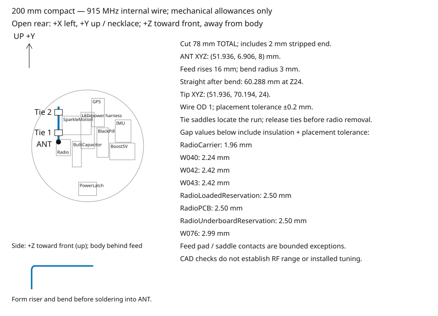

# Narrow removable-cell digital prototype

The pattern menu also offers **Rainbow • dark sectors**, **Rainbow • dark
spirals**, and **Rainbow • dark diagonals**. Both viewers use the same
position/time functions. The [shared pattern guide](../../demo/README.md#rainbows-with-moving-dark-regions)
defines the equations, directions, eight-second repeat, 0.36-phase black width,
0.08-phase edge width, 640 ms edge duration, and Rust parity checks. Every ring,
including each outside row, uses its mounted XY angle and unit radius. The side
switch still controls both outside rows. Pause freezes pattern time. This viewer
keeps its existing fixed illustrative glow charge.

`preview-check` runs shared numerical checks through this viewer's real adapter,
including per-row cycle-average RGB comparisons at 1/64 s intervals. To run only
these calculations without CAD import or a GPU, prepare the shared scripts and
use an absolute metadata path:

```sh
python3 -c 'import sys; sys.path.insert(0,"designs/stacked"); import run; run.prepare_preview()'
godot --headless --path designs/stacked/.build/preview --script res://check_patterns.gd -- "$PWD/designs/stacked/exports/scene.json"
```

The automated preview check exercises all three styles, both side rows, the top
seam, pause/resume and output switches. The main viewer's GPU checks cover Glow
and Silver. Numerical RGB results remain LED-output proxies. Preview images and
smooth equations cannot prove electrical savings, runtime or physical flicker.
Black LEDs consume idle current; stored glow can obscure dark LED intent. Human
viewing is not a completion gate.

This is the selected enclosure. The original250mm design remains an inactive
archive in `hardware/enclosure`; it is not a build dependency. The narrow body
is200mm wide and58.6mm deep. Complete closed projections and the continuous
service envelope come from [the generated census](exports/parts.json). It
uses the original 166 mm Fibonacci256, the original Evil Genius Labs stencil,
a 2 mm coated black LED acrylic rear mirror, a full-face 14 mm mirror cavity,
a 70-LED inward ring,
and two 70-LED outside strips behind one continuous 20 mm side diffuser. The GPS footprint rotates 90 degrees; all
component envelopes keep their original dimensions.

From front to back: front two-way mirror, empty cavity with inward ring, rear
coated black LED acrylic coupling mirror, 1 mm air gap, original stencil, LED
board, electronics
and one protected removable XTAR21700 cell. A separate captive door and keeper
provide cell access with the rear, optics and necklace attachments fitted. The body and cavity frame form one printed
part. The separate front bezel uses six M2 × 6 countersunk screws and captive
M2 nuts with side insertion; the rear cover remains independent. The rear coating transmits the cell light
into the cavity and reflects returning light. Both coatings face the cavity.
The inward ring has 6.17 mm nominal clearance from the full 166 mm source.
Both mirror sheets are 187 mm in diameter; the front opening is 179 mm.
The strip loops move outward by 5.31 mm from the 190 mm design. The optical envelope stays unchanged. The opaque carrier and upper frame use
full mounting lands and a ribbed0.8mm rear skin. Native checks retain
the mirror bearing faces and every module mounting interface. Print strength
and supplied fit remain unmeasured. The original board sits atZ31mm; selected
source module fixtures set the actual component positions.
The 20 mm side band spans Z=14 to 34 mm. Its two 10 mm strips sit side by side
across the case depth, with LED rows at Z=19 and 29 mm. The case stays
200mm wide and58.6mm deep. One side-band switch controls both rows; the
preview blends their emitted light through the full sleeve and blends stored
afterglow without tripling it. The outside sleeve has its own broad axial scatter
profile; the inner mirror ring keeps its narrow profile. The outside model
conserves each row's integrated source light as it spreads. Its assumed maximum
RMS scatter scale is 7.5 mm, scaled by the diffusion control. This is an
unmeasured material assumption, not a prediction for the printed sleeve.
The outside rows form one 140-LED side chain. The CAD keeps the board clips
inside that chain; actual jumper routing and fastening still need physical checks.
The rear body ring, side diffuser, front barrel and bezel share one 100mm outer
radius. The structural outer walls are 1.35 mm thick, reducing to1mm across the
hollow cavity section. A separate1mm inner wall keeps the inward LED strip's
original backing radius. Both walls join the full mirror collars and nut-pocket
floors above and below that section. The inner mirror supports,
six front nut seats, rear clamp columns and boost-input relief backing remain.
The six front nut-loading passages and the fitted cable/strap openings remain
accessible. Controls and textile attachments retain their functional projections.
Native checks require a continuous outer skin apart from the declared nut
passages before the fitted cable and strap channels are cut. They also reject
new opaque material inside the glow band. The actual fitted assembly then passes
the complete collision, cable, bearing and service checks. The rear ribs are 2.25 mm wide, with the full mounting islands and outer rim retained.
The battery cradle keeps its 1.35 mm side walls, contact supports, four mounting
flanges, hinge and latch. Four shallow roof pockets retain a continuous 1 mm
insulating skin, full edges and 3 mm cross ribs. The door pockets retain 1.35 mm
skin and full hinge/latch ends. Printed strength and physical fit remain unmeasured.

Both mirror sheets now use a 2 mm fabrication target. Each retains its continuous
edge seat. The 14 mm optical cavity, original source board and stencil remain.
The front 2 mm sheet is commercially available, but its finished coating split
needs confirmation. The coated black rear sheet is a custom fabrication target.
The retained 70/30 front and 70/9 rear optical values are simulation assumptions
for these thin sheets. They do not establish supplier tolerances or thin-sheet
flatness. Inspect reflection distortion and clamping on a physical sample.

## Build and view

Use the same installed FreeCAD, Godot 4 Forward+/Metal and FFmpeg tools as the
first design. Run from the repository root:

```sh
python3 designs/stacked/run.py test
python3 designs/stacked/run.py build
python3 designs/stacked/run.py check
python3 designs/stacked/run.py preview-check
python3 designs/stacked/run.py preview
```

Edit `parameters.json`, then rebuild. All mirror and black acrylic coefficients come
from `hardware/enclosure/acrylic-optics.json`, shared with the first design. The saved CAD spreadsheet records the
inputs; the JSON owns regeneration. The build checks native solid collisions,
original stencil volume, runtime GLB meshes, pixel identities, bounded mirror
transport against an independent unfolded-ray calculation, and movie timing.
It publishes all checked outputs together and records source/export hashes.
Publication keeps a durable backup of every replaced export and manifest. A
pending transaction rejects freshness; the next build restores the preceding
generation before taking its source snapshot. The shared native publication
tests inject export/manifest failures and process death.
The commit-time staged check is `python3 designs/stacked/run.py check --staged`.
The root `just cad`, `cad-check`, `print-check`, `demo` and `demo-check` commands
operate on this narrow design. The commit hook checks this complete generation.
The archived wide exports retain their original hashes.

Open [the native FreeCAD model](exports/stacked-fibonacci.FCStd) or
[the assembled STEP](exports/stacked-fibonacci.step).

## Compare the separate renders

Open matching files in two windows. Each design has its own files; no image
combines both designs. The first design remains at its original paths.

| View | Compact design | First design |
| --- | --- | --- |
| Full pose | [Night mannequin](exports/night-mannequin.png) | [Night mannequin](../../hardware/enclosure/exports/night-mannequin.png) |
| Rainbow | [MP4](exports/infinity-rainbow.mp4) · [GIF](exports/infinity-rainbow.gif) | [MP4](../../hardware/enclosure/exports/infinity-rainbow.mp4) · [GIF](../../hardware/enclosure/exports/infinity-rainbow.gif) |

Additional separate stills show [front](exports/night-front.png),
[angled](exports/night-angled.png), [side](exports/night-side.png),
[inner ring off](exports/night-inner-off.png), [all LEDs off](exports/night-leds-off.png)
and [exploded layers](exports/exploded.png).

The playa backdrop, body pose, camp lights, world camera positions, source
brightness, exposure, 38-degree field of view, gradient formulas and 16-second camera sequence match the first
design. The final webbing segments meet the compact rear anchors. The compact
pendant keeps its actual size; the camera does not enlarge it to fill the frame.
`exports/comparison.json` records the settings and shared asset hashes.

The preview provides separate cell, inward-ring and side-band switches, five
patterns, mirror reflection/transmission controls, orbit/zoom and exploded view.
At a head-on angle the repeated cell images overlap. Angled views show the depth
and shifted copies; the circular wall clips rays that leave the cavity.

## Evidence boundary

This is a digitally validated prototype with fit samples and print-service
files. It does not establish physical print or assembly acceptance. Check the
[native fit](exports/installed-fit-check.json), [loom](exports/loom-check.json),
[source census and raw mass](exports/parts.json), and [service guide](exports/service-guide.svg).
All seven electrical/thermal qualification outcomes remain unmeasured. Renders
do not establish brightness, runtime, insulation, strength or wearing safety.

The outer clear acrylic mirror uses nominal 70% reflection and 30% transmission
from [Two Way Mirrors](https://www.twowaymirrors.com/acrylic/). The inner mirror
combines the black cover and rear mirror in one 2 mm nominal sheet. Its coating
faces the cavity. No separate clear rear mirror or black filter remains.

The coated black sheet uses an **engineering estimate**, requested by Bryan:
70% reflection, 9% transmission and 21% absorption from the cavity. From the
black substrate side, the estimate is 10% reflection, 9% transmission and 81%
absorption. [Chemcast Black LED acrylic](https://www.tapplastics.com/product/plastics/cut_to_size_plastic/black_led_sheet/668)
has about 29% transmission without a coating. Combining that with the clear
mirror specification and clear acrylic's roughly 92% transmission gives
0.30 × 0.29 / 0.92 = 9.46%, rounded to 9%. This assumes a similar coating;
no published measurement establishes the custom coated black sheet.

The first cell image passes both mirrors: 0.09 × 0.30 = 2.7% before other losses.
The black-mirror value already includes substrate absorption; applying 29%
again would count it twice. The inner ring bypasses the black substrate. The
source brightness stays fixed. The case is 200mm wide and58.6mm deep, with
1 mm between the original stencil and coated black sheet. The default mirror gap is 14 mm. The continuous outside band is 20 mm.

A mirror coating does not diffuse the LEDs. Scattering remains a qualitative
flat central profile with soft falloff because the black-sheet supplier gives no haze or
angular scatter data. Thin-sheet transport omits refraction and substrate
ghosting. Glow colour and stored emission also remain estimates. CAD and the
preview do not establish physical fit, brightness, optical flatness or thermal
performance.

The original stencil, attribution and source remain in
`hardware/enclosure/vendor/evilgeniuslabs-fibonacci256`. The compact model uses
the exact source contours and volume, including the open perimeter cells.


## Depth and mirror-gap input

Set `mirror_gap` in `parameters.json` in millimetres, then rebuild. The front
mirror, cavity, frame, bezel and total body depth follow that value. The board
and electronics do not move when you change the gap. With the PCB atZ31,
12, 14, 16 and 20 mm gaps give 56.6, 58.6, 60.6 and 64.6 mm body depths.
The default 14 mm allows 2 mm clearance at each side of the 10 mm inner strip.
A 20 mm gap is an appearance choice, not an optical optimum proven by data.

The source radio and controller fixtures replace the old generic shelves.
The cell cradle roof is atZ26.5mm, leaving4.5mm below the PCB for the selected
fixed loom. The extra3mm depth permits actual wire and insulated-splice routes.
Every PCB, component, clamp, wire and terminal has its own source dimensions or
explicit fabrication target. No supplied tolerance is inferred from a picture.
The wire cut list includes one continuous negative lead through the fixed conduit.


The capture uploads the current LED colour field before each saved frame.
Both designs load `demo/patterns.gd` for their eight-second rainbow cycle.
The GPU check disables automatic updates and checks actual central cell RGB
at a fixed camera angle. Both captures use the same closed figure-eight camera path, crossing the
centre head on twice. The pointing-hand side stops at +20°; the clear side
reaches −50°, with −20° to +20° elevation. The mannequin and curved 3D playa remain fixed in world space;
only the camera moves. The movie check registers the actual CAD source locations
through those views and requires two spatial rainbow turns on both the Fibonacci
board and outside ring. A frozen ring, slow hue drift, wrong direction or uniform
colour cycling fails.


The native build also captures glow-material dark sectors, spirals and diagonals
using shared `demo/patterns.gd` (Narrow IDs 5/6/7; Wide IDs 10/11/12).
Run `just cad` to regenerate the active narrow generation. The wide clips remain
an archived optical reference and do not require a new wide build. The three additional
`exports/infinity-rainbow-dark-{sectors,spirals,diagonals}.mp4` files use the same
16-second, 1280 × 720, 24 fps worn night figure eight, scenery, camera,
brightness, exposure and actual pendant size. Masked clips check registered
brightness masks and the cycle join separately from canonical hue rotation.
The build updates the source/export freshness manifest with all generated media.

## Internal radio antenna (concept)



The78mm insulated wire solders directly to ANT on Adafruit3072 at
(51.936,6.906,8)mm in the selected source-board placement. The riser reachesZ24;
a3mm bend leads to the uncoiled+Y run. Two restrained saddles join the actual
radio carrier. The native checks preserve2mm spacing to conductors and0.5mm
spacing to unrelated plastic. Supplied wire/insulation and RF performance remain
unmeasured. The diagram uses the actual native path and source obstacles.

Follow the shared [datum, allowances, service and retrofit instructions](../../hardware/enclosure/antenna-placement.md).
Rear/radio maintenance requires the cell removed and captive door at its open
stop. Desolder or unclamp every bridging external wire at both ends; remove loose
wires, joint insulation and boots before rear/radio extraction. Fixed PCB-backed
splice carriers stay fitted. Ordinary cell service leaves the complete loom fitted.
Release the three carrier screws and withdraw radio/carrier/antenna toward-Z;
support the assembly by hand. Release ties before board replacement. Before closure check seating, gaps, an unloaded joint, clear screws
and seals. If closure catches, reopen and reseat; never force it. Compare with
the diagram before altering the antenna. RF range and tuning remain unmeasured.

## Fixed loom assembly

Use the [fixed loom assembly guide](../../hardware/enclosure/harness-assembly.md)
and the generated cut list. The service ZIP includes the source component
instructions and the actual circuit, route and splice records. Inspect the
specified narrow START-wire passage before physical acceptance.

## Cell service and mass

The [print layout](print-layout.json) selects the bed poses and temporary
build-plate supports for the specified structural parts and their samples. Both optical
rings and their samples stay upright without supports. The delivered projects
must retain the source mesh and settings and slice without warnings. Their
toolpaths must include supports exactly where the selected profile requires them.

Remove supports and brims before assembly or weighing. Inspect bearing faces,
bores, contact guides and every wire or lacing channel. Do not cut retaining lips,
thin walls or integrated fixtures. Stop if features are incomplete or damaged.
Print the samples first. Physical support removal, fit and strength remain
unmeasured. The service ZIP includes these instructions and the print layout.

Use [the six-pose service guide](exports/service-guide.svg) and
[the complete prototype package](exports/prototype-service.zip). Support the
pendant, put S1 fully OFF and remove external power. Open the captive door, hold
the cell, release its independent keeper, then use the ribbon to extract it.
Insert one compatible protected XTAR21700 6000mAh button-top to the permanent
polarity marks. Close keeper and door, inspect the catch, select ON and press START.
Keep the free necklace span above the supported pendant and clear of controls.

No timed reset is qualified. Rapid replacement can retain electronic state.
Light output does not establish GPS, radio or navigation readiness. Remove the
cell for USB5V service. Charge removed cells off-body; no pendant charging.

[The generated inventory](exports/inventory.md) reports each material variant's
complete worn estimate, raw range, installed cell, necklace and margin. The raw
upper limit is1133.980925g; the separate50g margin is a target. No component or
finished worn mass is physically measured. Brims, samples, stock, spares and
charger are excluded. Do not install both alternative ring materials.

Use one 1,100 mm tape. Thread each folded end directly through its rounded
shell eyelet and sew it back to itself. There are two sewn returns and no
intermediate loops. Use the stock and seam settings in
[`necklace.json`](../../hardware/enclosure/necklace.json). Print the eyelet
samples first. Check threading and edge finish, then test seam and anchor
strength with the pendant supported off-body. Keep the free span clear during
cell service.

Print `BoostInputRelief` on its flat tangent face with90degree X rotation.
The print generator applies that orientation. Fit the specified curved1mm
VHB5952 pad to the inner case wall and tie W006/W044 to the relief with the
selected LC134 blank. The source-backed geometry retains the actual module
components. Bond strength, tie force and supplied fit remain unmeasured.
See `end-support-check.json` in the generated service package.
