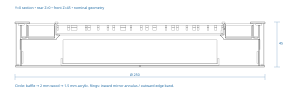

# Round compass pendant

## Get the CAD and media assets

Install Git LFS before you build or open the assets:

```sh
brew install git-lfs
git lfs install --local
git lfs pull
just install-hooks
```

Git LFS stores the binary CAD, mesh, image, video and archive content. The
working files keep their usual formats. The commit hook checks the full staged
content, and the push hook uploads the LFS objects. A pointer file is not a
usable CAD or media asset; run `git lfs pull` if the content is missing.

## Send to a print service

Choose one material package for the assembly:

- [Glow PETG print-service ZIP](exports/smart-compass-glow-print-service.zip)
- [Silver PETG print-service ZIP](exports/smart-compass-silver-print-service.zip)

Ask the service to unzip the selected package and open **START-HERE.html**.
Each contains the 13 samples, 16 held full parts, exact quantities, materials,
print settings, references and acceptance checks. Quote both stages and print
samples first. Release a full order only after that material's samples pass.
Both versions use opaque black PETG for all structural parts and their fit samples.
The service must identify the black filament brand and grade. Check that the
production-wall samples block visible LED light at the permitted power limit.
Reject light transmission through the black parts. A black slicer preview does
not prove opacity.

Both versions use the same strong 2.0 mm outside wall and the same light shields.
The silver candidate is Extrudr PETG Silver. Its transmission through these walls
is unqualified. Do not thin the outside wall to copy a small PLA diffuser.

The loose `exports` folder also contains laser-cut files and preview media.
Use the selected ZIP for a print-service handoff. Run `just cad` to regenerate
both packages and all checked CAD outputs; freshness covers both ZIPs.

Open [smart-compass.FCStd](smart-compass.FCStd) in FreeCAD. The front is one
250 mm black LED acrylic sheet with an uncoated LED centre, a 25 mm two-way
mirror annulus on the cavity side, and an opaque rim and cut edge. Use the EGL
3 mm nominal thickness and measure the actual stock before the final cut.
Ordinary opaque black acrylic will block the LEDs. The supplier must confirm
the black LED stock, mirror film adhesion and optical performance with a sample.
The custom coated front is not a finished 70/30 mirror: its model uses an
estimated complete-sheet cavity R70/T9/absorption21 and reverse R10/T9.
The 9% transmission already includes black-sheet absorption. Published data do not establish this custom coating
assembly. The rear uses a finished 70/30 two-way mirror model and a
separate thickness input. The three light rings are whole printed PETG parts. Select either Prusament
PETG Ultraglow Green or the Extrudr PETG Silver sample candidate. The glow option has a pale daytime appearance, green afterglow, and partial
loss of LED colour. The silver option has no afterglow. Both need physical
review of production-wall samples.

The reflecting planes stay at Z=25.5 and 36.7 mm, 11.2 mm apart. The collar
top follows the measured front sheet and compressed washer height. The saved
spreadsheet owns the dimensions after the first build. Do not approve a full
print order until supplier fit samples and actual hardware pass.

[Glow rainbow GIF](exports/infinity-rainbow.gif) ([MP4](exports/infinity-rainbow.mp4)) · [Silver rainbow GIF](exports/infinity-rainbow-silver.gif) ([MP4](exports/infinity-rainbow-silver.mp4)) · [Green afterglow](exports/glow-afterglow.mp4) · [Ocean](exports/infinity-ocean.gif) ·
[Sunset](exports/infinity-sunset.gif) · [Godot video](exports/amulet-demo.mp4) ·
[Explode and reassemble](exports/exploded.gif) ([MP4](exports/exploded.mp4))

All demo videos and GIFs come from Godot. The lighting loops use smooth spatial
gradients and slow, seamless side-to-front sweeps. The exploded loop separates
the current layers, pauses, and reassembles them. All main circles stay whole.
The [demo guide](../../demo/README.md) lists controls and unmeasured optical assumptions. Its alternative full-mirror coating
uses the same mechanical assembly. The saved CAD defines the selected black LED centre design.


## Fewer parts and separate service access

| Printed part set | Previous | Selected design |
| --- | ---: | ---: |
| Deck, barrel and rear | 12 quarters | 3 whole parts |
| Loose seam straps | 12 | 0 |
| Centre snap rim | 1 | 0 |
| Rim spacers | 3 | 3 |
| Replaceable necklace brackets | 2 | 2 |
| Vent guards | 4 | 4 |
| USB service cover | 1 | 1 |
| Whole glow rings | 0 | 3 |
| Original EGL centre baffle | 0 | 1 |
| **Printed pieces** | **35** | **17** |

The three flat front acrylic pieces become one sheet. Integral ring shoes
replace six adhesive locating pads. The original printed EGL baffle replaces the generated plywood grid. There is
no second physical cell grid. Its 2 mm source profile stays one connected print. The large printed parts have no glued quarter seams.
**Keep every main circle whole.** Stack the deck, barrel and rear along their
axis; do not split any of them into arcs to fit a smaller printer. The checks
require full-size, connected circular parts. The front sheet and printed EGL baffle also
remain one piece each.

Use a **300 × 300 mm printer or print service**. Keep each complete part, brim and skirt inside the actual usable bed. Do not scale the model to fit a
smaller bed: that changes the optics, electronics pockets, and fasteners.

Six M3 through-bolts at the original 233 mm bolt circle retain the front and
frame. Their rear washers/nuts bear on the barrel or necklace brackets. The rear
cover has 10 mm access clearances around these nuts. **Do not loosen these six
bolts for battery or board service.** Six separate M3 screws at radius 112.5 mm,
starting at 0° and spaced by 60°, attach the rear to captive nuts in the barrel.
The nut-loading slots face the open electronics compartment.

Remove only the rear screws to lift the rear and its electronics. Eight integral
barrel seats hold the outside ring while the rear is off. The two independent
necklace screws retain the brackets. Support the pendant during all service.
Use unplugged connectors and service slack; do not hang the rear from wires.
The small rear hatch still provides USB access. Full rear removal provides
battery, board, SWD/reset, nut and wiring access.

## Print settings and orientation

Open the supplied part `.3mf` projects in [exports](exports). Use a service
printer with at least a 300 × 300 mm bed. The [print specification](print-spec.json)
defines the delivered orientations and effective settings. The reference
projects omit machine heater settings and start/end G-code. The print service
must use its actual qualified printer and material presets.

| Parts | Material and nozzle | Layer / paths | Orientation |
| --- | --- | --- | --- |
| Structural parts | Opaque black PETG, 0.4 mm nozzle | 0.2 mm; 0.45 mm nominal path; 5 perimeters, 25% gyroid | Delivered bed face |
| Necklace brackets | Opaque black PETG, 0.4 mm nozzle | 0.2 mm; 6 perimeters, solid fill | Flat |
| Original EGL baffle | Opaque black PETG, 0.4 mm nozzle | 0.1 mm; 0.4 mm paths; 2 perimeters; 100% rectilinear; 10 top/bottom layers | Flat |
| Optical deck | Opaque black PETG, 0.4 mm nozzle | 0.1 mm; 10 top and bottom solid layers | Floor down |
| Halo and inner rings | Selected PETG variant; non-high-flow 0.4 mm nozzle; abrasion-resistant for Ultraglow | 0.2 mm; two 0.5 mm nominal paths | Upright on circular bottom edge |
| Outside ring | Same selected PETG and nozzle | 0.2 mm; four 0.53 mm nominal paths; 0.46 mm first-layer paths | Upright on circular bottom edge |

The outside profile accounts for overlap between adjacent extrusion paths.
Its first-layer width also accounts for the 0.15 mm elephant-foot compensation.
Inspect all four paths on every layer; do not infer solid walls from the
perimeter setting alone.

Use a 5 mm brim and no supports. Keep the barrel deck-joint face down, rear
skin down, vent guards roof down, and brackets flat. Inspect the actual slicer
paths for both ring walls and the deck solid skins before release. Prusa
provides 0.4 mm Ultraglow profiles but recommends 0.6 mm to reduce clogging;
the 0.4 mm selection requires the supplier's production-path inspection.
[Prusa Ultraglow guidance](https://prusament.com/materials/prusament-petg-ultraglow/).

Run `just print-check` on the delivered 3MF projects. It checks project and
G-code settings and rejects support-dependent or empty toolpaths. It does not
prove bed adhesion, strength, dimensional fit, or optical output. Print the
fit pieces and three curvature arcs with production settings before a full
order.

## Print the fit samples first

Print [FitDeck](exports/FitDeck.3mf), [FitBarrel](exports/FitBarrel.3mf),
[FitRear](exports/FitRear.3mf), [FitOptics](exports/FitOptics.3mf), and
[FitService](exports/FitService.3mf). Print the [right bracket](exports/FitSuspensionBracket.3mf),
[left bracket](exports/FitSuspensionBracketLeft.3mf),
[frame seat](exports/FitSuspensionFrame.3mf), and
[rear clearance](exports/FitSuspensionRear.3mf),
[controller mount](exports/FitController.3mf), and the
[halo](exports/FitRingHalo.3mf), [inner](exports/FitRingInner.3mf), and
[outside](exports/FitRingOutside.3mf) ring arcs, plus the whole
[original stencil](exports/FitFibonacciBaffle.3mf). These fourteen disposable
samples do not enter the 17-part assembly or worn mass.

Use actual M3 and M2 fasteners, plain nuts, metal washers, 0.020 inch
Stockwell SG-30 GP silicone, finished acrylic stock, the supplied Sparkle
board, and LED strips. Check free screw passage, full nut insertion and
engagement, driver access, both bracket arrangements, front-sheet retention,
ring seat engagement at maximum lift, and independent rear removal. The
front sheet has six 7.0 mm holes around 6 mm collars. The 9 mm OD × 6.4 mm
ID soft washers should compress to about 60% of measured free thickness.
The 9 mm OD metal washers must bear on the collars while the soft washers
retain the sheet. Record the usable tightening limit from the physical sample.

Print the outside arc with its four-path, 2.0 mm wall. Inspect it for voids,
cracks and layer separation. Check handling during repeated installation and
removal. A full-size ring must also pass handling and assembly checks; an arc
cannot establish whole-ring strength. Reject cracking or permanent distortion.

Print the selected material’s ring arc samples at all three curvatures with the production wall
and path widths. Review LED patterns at the permitted power limit. Record
visible afterglow immediately and at 1, 5 and 15 minutes for the glow option.
For silver, check white, red, green, blue and moving rainbow patterns through
both production wall thicknesses. Stop the silver order if transmission or
diffusion is unacceptable. Stop the full order
if any sample fails; correct the cause and repeat its fit test.

Cut trial sections from the [halo](exports/halo-light-shield.svg),
[inner](exports/inner-light-shield.svg), and
[outside](exports/outer-light-shield.svg) light-shield contours in 0.06 mm
tesa 7160 black PET tape. Apply them to the printed ring arc samples with
adhesive only on the ring end face. Keep the release liner below each free
span. Fit actual LEDs and the front-sheet sample. Reject visible bare LED
edges or light leaking above the ring at the permitted power limit. Test
adhesion, sag, sheet clearance, and clean removal with the ring.

The outside ring grows outward from the unchanged 246 mm inside diameter.
At the conservative 0.434 mm centre offset, its edge can project slightly
past the 250 mm front sheet. CAD checks a continuous 1.5 mm band of the
nominal ring below the sheet at every offset. Allowing a further 0.20 mm
radial size error leaves at least 1.3 mm of that band for retention. Check
actual ring and sheet dimensions during assembly acceptance.
The opaque shield covers the ring end face. Inspect this exposed edge and
shield during the full-size light-leak and handling tests.

## Assemble the whole circles without juggling them

Work with the barrel upright on a flat padded surface. Align the recessed
**TOP** marks on the deck, inner barrel wall and inside of the rear. The marks
identify the same top sector. Align the deck's wire exits with the barrel's
exit. Insert two opposite body bolts loosely to guide the circles while you check the remaining holes. Keep all six bolts loose until
they pass freely. Then remove the temporary bolts as needed to install the optics.
The bolts guide the parts; they must not pull a distorted ring into position.

Dry-fit the rear and its six separate screws before wiring. Load the captive nuts
with the electronics compartment open. A short screw can hold a loose nut during
handling. Keep connectors unplugged and add service slack before closing the rear.
Tack the three tiny rim spacers to the printed EGL baffle before installing that grid, so
you handle one subassembly. Keep the original printed stencil aligned to the PCB with
the supplied registration overlay.

Keep each printed ring whole. Seat its circular bottom edge on the specified
locating stations. Do not split a ring into arcs or heat-form an acrylic band.
Check the closed-ring internal lead passages before fitting the strips.

## Original centre stencil and black front

The [original EGL source](vendor/evilgeniuslabs-fibonacci256/SOURCE.md) supplies
all physical stencil walls. Jason Coon released it under Creative Commons
Attribution. The supplied STL is 2 mm thick; the native CAD uses its matching
STL boundary profile without scaling XY. It keeps the original open edge cells.

The circle PCB rear now sits at Z=29.0 mm. Its LEDs end at Z=33.6 mm; the
stencil starts at Z=34.2 mm and ends at Z=36.2 mm. This keeps 0.6 mm LED
clearance and 0.5 mm front-sheet clearance with the original 2 mm stencil.
The 3 mm LED-height envelope is provisional. Measure the actual supplied
packages and adjust PCB Z to retain the required gap before final fabrication.
Three separate spacers bear on checked wall locations. They support the
stencil and restrain the PCB; they do not carry the bolt clamp load. Tack them
to the stencil for handling. Do not add guessed board holes.

Print `FitFibonacciBaffle.3mf` with the production baffle settings. It contains
the whole original stencil, so the service can check thin paths, handling and
registration on the actual board. Use 0.1 mm layers, a 0.2 mm first layer,
0.4 mm paths, two perimeters and 100% rectilinear infill. Print flat with a
brim and no supports. Inspect every source wall and the small opening.
Stop the order if walls are missing, cracked or distorted. Keep the three
small spacers separate so the thin stencil prints flat without long legs.

The 3 mm black LED acrylic is a nominal starting stock choice from
[EGL](https://www.evilgeniuslabs.org/fibonacci256). A
[TAP black LED sheet](https://www.tapplastics.com/product/plastics/cut_to_size_plastic/black_led_sheet/668)
is a candidate, with about 29% visible transmission. Confirm available stock
and measure its thickness. The centre remains uncoated; mirror film spans
radii 85.5–110.5 mm on the cavity side. The demo's full-mirror finish is a
comparison with film over the centre too. Check the complete black sheet and
film stack: it will reduce brightness and can blur the reflected pattern.

## Optical stack and load paths



The reflecting surfaces stay at **Z=25.5 and 36.7 mm**, with **11.2 mm separation**.
The useful front mirror annulus spans radii 85.5..110.5 mm. Keep opaque supports
outside the useful paths. The circle remains a floating island on its hidden seat.

The front sheet has six 7.0 mm holes over 6 mm locating collars. Six 8 mm
bearing lands support it. The six 9 mm OD metal washers bear on collar tops;
soft 9 mm OD × 6.4 mm ID washers retain the acrylic below them. The collar
height derives from front-stock thickness and the target 60% washer
compression. Measure actual stock and clamp retention. Bolt load travels
through the collars and frame. Do not use the baffle or LED packages as stops.

The original printed EGL baffle uses its **2 mm source thickness**, with **0.5 mm sheet clearance** and
**0.6 mm nominal LED clearance**. Three rim spacers contact clear PCB edge areas.
Tack the spacers to the baffle rim so they lift with it. Use light, compliant rim
pads to restrain the grid below the sheet; keep them off the cell openings.
Measure stock and fitted gaps before assembly. The larger gaps need a physical
light-leak check; the demo is not a scattering simulation.

The halo and inner printed rings start at Z=25.6 mm and stand 10.6 mm high.
Their inside diameters are 177.02 and 215.47 mm, with 1.0 mm walls. The
outside ring starts at Z=3.2 mm and stands 33.0 mm high; its inside diameter
is 246.00 mm and its wall is 2.0 mm (250.00 mm nominal outside diameter).

The [Adafruit arcade-button cap STL](https://www.printables.com/model/7148-neopixel-arcade-buttons/files)
has a 1.5 mm main cylindrical wall and a 1.5 mm transmitting end face,
measured from its mesh. The 2.0 mm outside ring exceeds that reference
thickness for handling. The different material and larger diameter still
require production-wall optical samples and full-size handling tests.

Eight integral locating stations retain
each ring. All stops provide 1.2 mm locating height and 0.20 mm nominal radial
seat clearance. The circular contact geometry limits sideways movement to less
than 0.217 mm nominally and 0.434 mm with the combined 0.20 mm radial
error budget assigned to the locating clearance. Package corners and this
amplified movement allowance leave at least 0.53 mm LED clearance. The front
lands keep at least 8 mm² of sheet bearing area per station; their outward edges clear the continuous shields.
The front sheet leaves 0.5 mm nominal clearance above the rings.
Measure 0.2–0.8 mm after assembly. Require at least 0.5 mm actual LED-to-ring
clearance after dimensional errors and movement. The 0.20 mm budget is
combined across fits, ring profiles, shields and strips; it is not a separate
allowance for each part. Reject actual assemblies below 0.5 mm clearance.
The cavity remains at least 18 mm wide radially. Lift the rings from the front
for mirror service.

Die-cut three opaque PET light shields from the supplied SVGs. Bond each
shield only to the top end face of its printed ring. The 0.06 mm film
covers the exposed LED upper edge and the glow ring end face. Keep its
release liner on the free span above the LEDs; do not bond it to the strip,
front sheet, or frame. The nominal film-to-sheet clearance is 0.44 mm.
Check that the film stays flat at every permitted ring position. Lift each
ring with its shield attached during service. The supplier lists visible
transmission below 0.005%; the assembled light seal still needs a dark-room
sample test. [tesa 7160 specification](https://www.tesa.com/en/files/download/12213622,0,medium-12213622.pdf).

| Output | Direction | Pixels | Strip length |
| --- | --- | ---: | ---: |
| Fibonacci circle | Front | 256 | PCB |
| Halo | Radially outward | 64 | 533.3 mm |
| Inner ring | Radially inward | 84 | 700 mm |
| Outer ring | Radially outward | 90 | 750 mm |

The three strips use 120 LED/m and one top seam each. Each carrier supports the
strip back. Bend the strip in its normal plane, not sideways into a flat ring.
Route independent leads through the top exits, with slack and removable seals.
Bond the outer strip only to the barrel below the Z=22.65 mm deck joint. Its
upper margin rests against the deck without adhesive. All outer LED packages
sit below that joint, so the deck can lift past the strip during repair.

The internal LED-to-ring gap starts at 1.0 mm. The printed rings transmit and
scatter light by an unmeasured amount. Approve their daytime colour, LED
pattern and afterglow from production-wall samples at the permitted power
limit. Do not substitute another material or relax a fit requirement without
a new design decision.

## Assembly and repair

1. Measure the boards, pack, LED strips and sheet stock. Set the saved spreadsheet.
   Rebuild. Cut the front sheet and keyed rear mirror. Print the original EGL baffle flat. Use
   `front-coating.svg` only as a coating map, not a cut file. Apply kerf once in CAM.
2. Pass all fourteen fit-sample checks, then print the 17 pieces in their exported
   orientations. Check flatness, nut slots,
   strap passages, bores, collars and ring seats. Fit-test hardware first.
3. Load the captive nuts, including fourteen M2 nuts for the hatch, vent guards, and controller.
   Fit the two necklace brackets and their independent
   screws. Use washers and full nut engagement. Smooth the rounded webbing slots.
4. Fit the LED strips and rear mirror. Seat both cavity rings in their shoes.
   Fit the whole outside ring on its eight barrel seats.
5. Seat the circle PCB, three attached rim spacers and the single printed EGL baffle.
   Check all LED clearances. Fit the front sheet, soft washers and metal washers.
   Tighten the six body bolts against the stops. Check that the grid stays free
   of bolt preload. Select bolt length with the actual washer/nut stack.
6. Fit electronics and the padded protected pack to the rear. Use both battery
   straps. Install rated wiring, fuse, switch and connectors. Fit the covered
   controls, vent membranes/guards, USB cover/gasket and battery-entry blank.
7. Connect service leads, fit the rear with its six separate screws and seal the
   removable joints. The body nuts remain accessible through the cover clearances.
8. For battery or board repair, switch off, support the frame, remove the rear
   screws, and disconnect service leads. Leave the optical-stack bolts tightened.
   For optical repair, remove the front bolts and lift the sheet, grid/spacers,
   rings and mirror. Replacement parts do not require breaking frame glue joints.

The rear holds Sparkle Motion at (47,20), BlackPill, GPS, IMU, RF95, the divider,
and the Pololu boost at (72,-28) mm. Board envelopes remain provisional. The
protected 80 × 65 × 20 mm pack sits at (0,-33), with insulating padding, two
10 mm straps, a left lead exit and 2.5 mm top reserve. Disconnect it for external
charging. Use one factory pack at a time. The four-hour bright-pattern target
and provisional 1.25 A total 5 V current cap remain unchanged and unmeasured. See [battery and power details](battery-options.md).

The optional belt pack moves the candidate pack's 190 g off the neck. Its lead
uses the reinforced, capped 12 mm rear port at (43,84), follows the necklace, and
needs separate cable restraints. The lead must carry no necklace load. The gland,
cable, belt carrier and strain relief remain fit tasks.

The replaceable 5 mm PETG brackets have 12 × 4 mm rounded slots for 10 mm webbing.
Each uses the main body bolt and an independent M3 anchor. Use closed, deburred,
nonmagnetic metal rings and sewn loops. Replace a bracket or webbing without
replacing the frame. Keep spares. Check magnetic effects of all actual hardware.

Four covered 6 mm vents use nominal 16 mm adhesive ePTFE membranes and
screw-removable guards. Seal the side seam, lips, rear joint, bolt access clearances,
controls, hatch and lead exits with suitable removable seals. These vents provide
breathing; they do not prove adequate cooling or dust exclusion. The model has
no tested dust or IP rating.

Each guard uses two M2 screws, replacing the bonded feet. Its 1.5 mm stand-off
keeps the roof clear of the membrane. The roof prints flat on the bed. Two M2
screws also retain the thicker USB cover; its screws now enter replaceable metal
nuts rather than plastic pilot holes. The ten side-loaded nut pockets are
integral with the rear, so the printed part count stays **17**. This change adds
eight vent screws and ten nuts. Use the same M2 nut type throughout. Select screw
length with the actual gasket, cover and nut stack; tips must clear electronics.

Load the nuts with the rear removed. Their side mouths face +Y (toward TOP).
The roof and floor trap each nut along the screw axis; a loose nut can still
slide from its loading mouth during handling. A temporary screw holds it during
assembly. For membrane service, remove the two guard screws and lift the guard.
Keep the membrane's sealing face and screw passages sealed with replaceable
seals. A damaged nut can slide out after removal of the rear; no heating or
frame replacement is required.

## Ordering a print from a service

Supply all seventeen whole printed parts and their fourteen fit samples. Require a
300 mm printer, the specified opaque black structural PETG and selected ring filament, the
orientations above, and an agreement to inspect functional fits. The supplier
must print the samples with production settings and inspect the actual ring
paths before a full order.

After the full parts cool, reject cracks, incomplete walls, distortion and
lifted edges. Dry-assemble the full set on a flat reference. Require joint
gaps no greater than 0.3 mm, free screw passage, full nut engagement,
retained rings, specified optical gaps, and independent rear removal. Do not
use bolts to flatten parts. Weigh the completed assemblies. Repeat the
suspension, sustained-load, cyclic-load and service tests below. Keep thermal
and dust acceptance separate from print and assembly approval.

## Sources, exports and checks

The saved `Parameters` spreadsheet owns dimensions. `parameters.json` supplies
initial values. Run `just cad` after editing and closing the master. It rebuilds
CAD, checks collisions/removal paths and meshes, slices all printed parts and
fit samples, then
renders Godot media. It publishes only after all stages pass. `just cad-check`
and the commit hook reject missing, stale or extra generated outputs.

`exports/parts.json` lists assembly pieces, separate fit samples, solid volumes,
optical dimensions and
mass terms. `front-sheet.svg` is the sheet cut file. `front-coating.svg` marks
coating boundaries. `rear-mirror.svg` comes from the keyed native contour, with
at most 0.02 mm polygon chord error. `assembly-section.svg` cuts actual solids.
`amulet.glb` is the sole assembled Godot asset, in metres; STLs are print-bed parts.

## Current weight estimate

The [complete build parts list](../../design-v2.md#complete-build-parts-list-and-mass-estimate)
reports pendant, necklace and total worn mass, with an explicit allowance range.
The [component inventory](component-inventory.json) supplies the linked parts,
installed and purchase quantities, mass basis and unresolved fit/supply facts.
The build generates the same totals in [parts.json](exports/parts.json) and
Godot scene metadata. Populated boards count once. Only installed strip and wire
lengths enter worn mass. Brims, fit samples, unused stock, spares and the charger
do not enter worn mass.

Structural PETG uses net CAD solid volume at 1.27 g/cm³. Glow PETG uses
Prusa’s published 1.5 g/cm³ density;
its range allows for infill and print variation. Acrylic uses 1.19 g/cm³.
The original printed baffle uses the structural PETG density. Its sample and brim do not enter worn mass.
Slicer material estimates include brims and have a separate label in `parts.json`.
CAD display bounds can differ slightly from exact circular dimensions. Use the
nominal cut contours and specified stock for fabrication.
No physical mass has been measured. Weigh the finished components and assemblies
before releasing the suspension.

## Service inspection and suspension release

Use the selected plain nuts from the inventory: M3 DIN 934, 5.5 mm across flats
and 2.4 mm thick; M2 DIN 934, 4 mm across flats and 1.6 mm thick. Every captive
pocket uses **0.4 mm total across-flats allowance and 0.3 mm thickness allowance**.
Thus M3 pockets are 5.9 mm across flats × 2.7 mm; M2 pockets are 4.4 × 1.9 mm.
Every loading mouth has the same width and height as its pocket. These are
starting fit-test dimensions. Do not force a nut or substitute a taller locknut.
The [selected nut dimensions](component-inventory.json) define the CAD
screw, nut and washer envelopes. Standard M3 washers are 7 mm OD; the six
front metal washers are 9 mm OD. M2 washers are 5 mm OD. The six soft front
retention washers are 9 mm OD × 6.4 mm ID, cut from 0.020 inch
[Stockwell SG-30 GP silicone](https://www.stockwell.com/data-sheets/sg-series-solid-silicone.pdf)
using the [washer template](exports/soft-front-washer.svg). Target 60% of
measured free thickness when compressed. Test the front clamp limit with
actual stock and hardware.

Print both bracket arrangements, their frame seat, and their rear clearance
samples listed above. Use the finished M3 body bolt from 45 mm stock,
M3 × 12 mm anchor screws, nuts, washers and webbing. Finish each body bolt to the under-head
length in the generated inventory after measuring the actual front sheet and
washer stack. The baseline length is 40.329 mm, with 0.30 mm projection past
the rear nut and a 0.15 mm chamfer. Deburr and smooth the cut end. Reject a
bolt that catches fabric or lacks full nut engagement. Do not install uncut
45 mm body bolts. Check the 5 mm thick brackets and 14 mm main
webs, rounded slot lips, separate anchors, 0.4 mm side clearance, and rear
removal. The slot centres are at (±84,64) mm; the left routed hub is at
(-99,59.5) mm. Check protected vent and hatch nut bosses remain intact.

Keep the main circles whole. The continuous 1 mm rear skin and 1.8 × 2 mm ribs
remain. Internal foot windows remove plastic under board bearing lips; end ribs,
tie lands, bearing tops and the outer support walls remain. Quarter-round roots
join the skin to ribs and clamp lands. The optical deck stays separate. These
changes reduce abrupt thickness changes; they do not prove that a 250 mm print
will remain flat. See [Protolabs Network's thickness guidance](https://www.hubs.com/knowledge-base/dfm-tips-for-3d-printed-parts-with-thin-walls/)
and [Xometry's FDM guidance](https://xometry.pro/en-uk/articles/fdm-design-tips/).

Give the print service these inspection requirements:

- Remove brims and loose material. Reject cracks, lifted edges and incomplete walls.
- Dry-stack deck, barrel and rear on a flat reference. Joint faces must seat
  without rocking or a gap greater than 0.3 mm. **Do not use bolts to pull the circles flat.**
- Check all six collar heights: the saved collar stop height from the assembly rear datum, within
  0.2 mm; check that each washer stops on its collar before it loads the acrylic.
- Pass the selected screws through every aligned hole by hand. Check all nut
  loading mouths, full nut seating, flat washer contact and thread engagement.
- Check the 0.5 mm baffle-to-sheet gap, at least 0.5 mm LED-to-baffle clearance,
  11.2 mm nominal mirror separation, ring seats and independent rear removal.
  Reject optical contact, forced fits or a blocked service path.

**Defer compression sleeves in this revision.** A sleeve would need to span the
full clamped joint. A bracket-only sleeve would leave other plastic in compression;
full-joint sleeves also conflict with the limited optical-post space. Correct
bearing surfaces, hardware fit and retention first. See
[SPIROL's joint design guidance](https://www.spirol.com/assets/files/cmpl-compression-limiter-design-guide-us.pdf).

Keep the existing **100 N per side for 60 seconds** off-body suspension test in
both hanging and pull-out directions. Test the complete frame, brackets, webbing,
rings and fasteners. Use the generated **upper total-worn mass bound** until an
actual mass is available. With `W = mass_kg × 9.81 N`, also test each side at
`2W` for 24 hours and at `0..3W` for 10,000 repeated cycles at 0.5 Hz. These are
provisional engineering test targets, not a certified load rating. Record fixture,
load, ambient temperature and initial fastener positions. Inspect after each test
for cracks, permanent movement, washer indentation, nut rotation, clamp loss and
webbing damage; reject any slip, crack or joint gap increase above 0.2 mm. Repeat
fit and rear-removal checks. Set snag/drop tests after measuring the assembled
mass and selecting the final necklace fittings.

Physical printing, flatness, static strength, sustained/repeated load and clamp
retention remain **unverified**. Do not treat CAD or slicing as release evidence.

**SC-ENCLOSURE physical TODOs:** verify actual materials, stock, kerf, circle
registration, whole printed rings, coating, diffuser uniformity, cell light leakage,
fit, nut retention, washer compression, sealing, connector access, thermal limits,
magnetic effects and four-hour runtime. Test complete suspension off-body at the
existing provisional 100 N per-side static target for 60 seconds in hanging and pull-out
directions. Use the sustained/repeated-load procedure above, then repeat with
measured mass. Set snag and drop checks after measurement.
These are acceptance targets, not a load rating or proof of a successful print.

## Filament evidence and model limits

[Adafruit’s arcade button](https://learn.adafruit.com/neopixel-arcade-button/3d-printing)
uses ColorFabb glowFill PLA/PHA. The
[tactile button guide](https://cdn-learn.adafruit.com/downloads/pdf/3d-printed-neopixel-tactile-switch-buttons.pdf)
preferred glow PLA over white ABS. These support testing glow diffusers.
[Christopher Parrott’s experiment](https://zodiusinfuser.uk/blog/2018/06/08/experimenting-with-3d-printed-light-diffusers/)
used 0.4 mm Rigid.ink silver PLA, darker Prusa silver PLA dividers, and pearl
PLA for cube edges. Those results do not establish transmission through our
1.0/2.0 mm PETG walls. The [Extrudr PETG Silver](https://www.extrudr.com/en/inlt/products/petg/)
version is a sample candidate. Keep it separate from the glow order and stop
its full order if optical samples fail. The renderer uses neutral silver
absorption and zero stored emission; its coefficients are unmeasured assumptions.
