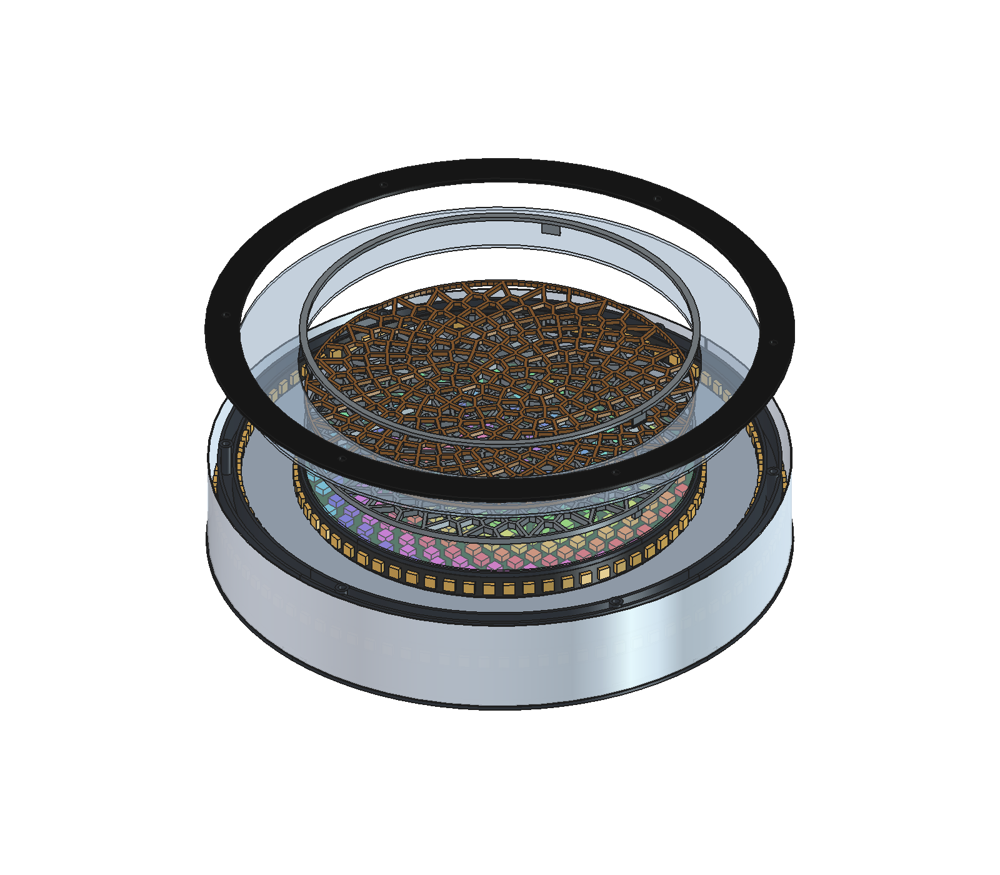

# Round compass pendant

Open [smart-compass.FCStd](smart-compass.FCStd) in FreeCAD. The editable model now uses **250 mm outside diameter × 45 mm depth**, for the optical body. Rear vent guards add 2.85 mm; modeled depth is 47.85 mm before screw heads and necklace fittings. The inner strip faces the Fibonacci circle. A new 64-pixel circle halo faces outward into the mirror gap. One outer LED row sits at the center of a broad diffuser that covers almost the whole outside depth.

The infinity mirror occupies the annular gap around the circle. The circle keeps its shaped wood mask and central acrylic diffuser. Dimensions remain provisional. Physical checks stay deferred in [design-v2.md](../../design-v2.md).



## Model and exports

| File | Use |
| --- | --- |
| `smart-compass.FCStd` | Native master. Its `Parameters` sheet owns dimensions after the first build. |
| `Build.FCMacro` | Rebuild geometry and exports from saved spreadsheet values. |
| `parameters.json` | Initial seed; it does not override saved sheet values. |
| `fibonacci256-layout.json` | Published indexed pixel map, with source attribution. |
| `exports/smart-compass.step` | Assembly in millimetres for another CAD program. |
| `exports/*.stl` | One connected printed part per file, translated onto Z=0. Four quarters form each optical deck, lower barrel, and rear support. Board mounts and seam straps have separate files. |
| `exports/parts.json` | Generated STL list, solid volumes, and optical dimensions. Volume is not slicer mass or finished pendant mass. |
| `exports/wood-fibonacci-mask.svg` | Nominal laser paths: 166 mm outline and 256 circle cells. No ring windows. |
| `exports/front-acrylic.svg` | Nominal central diffuser outline. |
| `exports/outer-black-acrylic.svg` | One-piece opaque black outer front border: outer/inner circles and six M3 clearance holes. |
| `exports/front-mirror.svg`, `rear-mirror.svg` | Nominal annular acrylic outlines. The rear mirror includes a top wire notch. |
| `exports/edge-diffuser.svg` | Flat cutting template for the wrapped PET side band. Use a knife or a process approved for the selected sheet. |
| `exports/circle-alignment-overlay.svg` | Print at 100%. Check the 166 mm outline, 100 mm scale, and LED centres. The 196 mm sheet fits A4. Disable fit-to-page. Do not laser-cut this inspection overlay. |
| `exports/assembly-section.svg` | Actual solid section at Y=0 with diameter and depth dimensions. |
| `exports/front.png`, `assembly.png`, `exploded.png`, `electronics.png`, `edge.png`, `rear.png` | Native CAD views. These show geometry, not simulated light. |

## Light stack and ring directions

Body coordinates are X right, Y top, and Z toward the front viewer. Rear Z=0. The table describes the current seed.

| Part or surface | Z position, mm |
| --- | --- |
| Covered rear skin | 0–1.6 |
| Four rear vent guards | -2.85–0 |
| Rear service cover and gasket | -1.70–0 |
| Battery envelope | 3.1–27.1 |
| Controller/sensor PCB lower faces | 5.6 |
| Thin annular optical floor | 27.65–29 |
| Rear mirror; reflecting surface at its front | 29–30.5 |
| Halo and inward strip bodies, 10 mm wide | 31.1–41.1 |
| Outside strip body, centered at Z=22.4 | 17.4–27.4 |
| Circle edge seat, sloping underside | 28.5–32 |
| Circle PCB | 32–33.6 |
| Circle LED packages | 33.6–36.6 |
| Circle baffle; three rim feet extend to PCB | 36.8–39.7; feet 33.6–36.8 |
| Circle wood | 39.7–41.7 |
| Central diffuser and separate two-way mirror annulus | 41.7–43.2 |
| Black acrylic outer front border and printed circle snap rim | 43.2–45; tongues reach 37.2 |
| Full-height wrapped side diffuser | 1.6–43.2 |

The circle has one opening per pixel. Its inset Voronoi cells follow the published Fibonacci map, with a nominal 1.6 mm wood web. A matching opaque baffle separates the light below the wood. The wood sits directly behind the central diffuser. Neither part extends across the mirror gap.

The **outermost front border is opaque black acrylic**, without mirror film. It is one sheet ring: **250 mm outside diameter, 221 mm inside diameter, 14.5 mm radial width**, and **1.8 mm nominal thickness**. Six **3.4 mm clearance holes** on a **233 mm bolt circle** match the body bolts. Measure the supplied sheet and set `Parameters.front_bezel_thickness` before rebuilding. This part has no printed quarter seams or splice straps. It captures the mirror's outer edge and the side diffuser's front lip. The mirror remains in the separate 25 mm gap around the circle.

The published map gives 8-bit XY values, not measured millimetres. The model sets the outermost LED centre radius to **79.5 mm**. Scale, mirror settings, and rotation remain editable. **TODO: SC-ENCLOSURE — Check the alignment overlay against the actual circle before cutting the mask.**

| Ring | Direction | Pixels | Nominal strip length | Pitch-line diameter, including 3 mm seam gap |
| --- | --- | --- | --- | --- |
| Circle halo | Radially outward from the circle into the mirror | 64 | 533.3 mm | 170.7 mm |
| Inner | Radially inward toward the circle | 84 | 700.0 mm | 223.8 mm |
| Outer | Radially outward toward the edge diffuser | 90 | 750.0 mm | 239.7 mm |

All three strips use **120 LED/m**. Each carrier supports the strip's back. Ordinary strip wraps around the cylindrical carrier in its normal bend plane. Do not bend it sideways to make a front-facing flat ring. All seams start at the top, with independent rear lead exits and slack for service. Pixel positions include the one seam gap; they do not distribute that gap between every LED.

The inward LED faces sit about **26.7 mm outside the circle edge**. The circle halo LED faces sit at radius **87.5 mm**, about **22.2 mm** from the inward LED faces. Each ring has a separate carrier and lead path.

The rear mirror carries full mirror film on its front surface; the partly reflective front annulus faces rearward. Their reflecting surfaces have **11.2 mm separation**. The two 10 mm cavity strips have 0.6 mm end clearance. The visible front annulus now spans radii **85.5–110.5 mm**, or **25 mm radial width**. Keep those faces parallel and free of wood, opaque radial supports, and diffuser film. This follows [Adafruit's two-mirror arrangement](https://learn.adafruit.com/make-it-glow-neopixel-and-led-diffusion-tips-tricks/infinity-mirrors); it does not prove the selected materials' effect.

The circle appears as an island. Its load travels through the hidden seat and annular floor behind the mirror. The halo carrier wall is nominally 1.21 mm thick. The front snap rim is **3 mm wide**, with outside radius 85 mm. A **0.5 mm radial gap** separates it from the front mirror. Three 6 mm long, nominal 0.6 mm snap tongues retain the face without visible screw bosses. The outward halo lights the island's edge and mirror repetitions. It does not put another strip on the circle's front. Snap fit, release force, light leakage, and the perceived floating effect require later physical checks.

The outer row centers at **Z=22.4 mm** behind a **41.6 mm tall frosted side wrap**, bounded by the 1.6 mm rear skin and 1.8 mm front bezel. The structural barrel sits behind the strip. No button peg or service window interrupts the outside surface. The nominal 0.5 mm PET sheet wraps at 123.5 mm inside radius. Seal its top seam and both lips with removable clear tape. The LED package fronts remain about 1.5 mm behind it. This gives a broad external surface; it does not establish equal brightness across its full height. Frost, transmission, hot spots, and reflected light need an optical sample.

**TODO: SC-RING-GEOMETRY — Measure cut intervals, length, width, coating/thickness, LED depth, bend limits, pads and fitted seams for the 64/84/90 strips. Replace provisional pitch diameters 170.7/223.8/239.7 mm. Keep at least 20 mm clear mirror view and center the outside row. Record each output's part, protocol, order, timing, seam and direction.**

## Low mass and home printing

The model uses thin printed supports and sheet optics. The generated [parts manifest](exports/parts.json) records current printed solid volume; this is not slicer mass or finished pendant mass. A continuous **1.6 mm rear skin** replaces the open lattice to reduce dust entry. The case keeps **1.35 mm inner/outer strip and barrel walls**, a **1.8 mm printed circle rim**, **2 mm wood**, and **1.5 mm central acrylic/mirrors**. The outer front border is a separate 1.8 mm nominal black acrylic sheet. The rear vent guards and service cover also use 1.35 mm skins. The battery cradle retains its open center inside the covered body.

The optical deck and lower barrel print as separate levels. Each level and the rear support split into four quarters. The deck prints floor-down; a 45-degree underside supports the circle seat. The baffle exports face-down with its feet up. The circle rim exports face-down with its snap tongues up; vent guards export roof-down. Their butt seams use separate bonded splice straps; the barrel straps follow the inner wall. The black acrylic front border cuts as one piece. Assemble and bond each printed set on a flat surface. Keep adhesive off optics, strip pads, bolt holes, and the removable rear joint. The whole rear cover still separates from the frame for service. These are provisional bonded joints; the CAD does not establish suspension strength.

The generator checks every exported STL against a **220 × 220 mm bed**, including 5 mm margin on each side. Each file contains one connected part and starts on the print bed. Keep the exported orientation on the bed. Check the snap beads, guard feet, screw pilots, and short internal wire passages in the slicer. The centre baffle and retainer fit without splitting. The one-piece laser-cut optical sheets remain larger than some print beds; they are not printed parts.

Start with a 0.4 mm nozzle and 0.2 mm layers. The 1.35 mm wall target is approximately three extrusion paths for a common 0.45 mm line width. Check actual paths in the slicer; nozzle diameter alone does not define wall width. Use extra perimeters around necklace eyes, screw posts, and joints. Thin skins need continuous paths, not a low infill setting that removes them. The provisional print basis follows [Prusa's wall guidance](https://help.prusa3d.com/article/modeling-with-3d-printing-in-mind_164135). Choose an opaque material that suits the measured temperature. Physical print, joint, and load checks remain deferred.

## Electronics, battery, and suspension

The rear holds Sparkle Motion, BlackPill, GPS, an IMU breakout, an RF95 carrier, and a small battery-divider board. Sparkle uses published Rev D hole positions. Other boards use open-ended rails and straps, without invented PCB holes. Bond their feet to the rear skin after checking supplied boards. Component boxes are clearance references, not detailed board models.

The old two side pegs were Mode/Action actuator placeholders. The old rectangular side holes reserved USB/power, radio, physical switch, and ventilation. They are removed. The current model has:

- Rear Mode and Action controls at X=-35/+35, Y=100 mm, under 16 mm flexible covers. A third covered control at X=35, Y=-100 reserves the latching physical power switch. It is not a firmware power latch.
- One **38 × 18 mm rear service opening** centered at (48,54), covered by a **46 × 26 mm plate**, two M2 screws, and a nominal **0.35 mm compressed gasket**. Route a retained USB extension to it. The actual extension and switch remain measured-part work. Keep the cover closed during dusty use.
- An internal insulated RF antenna baseline. An external antenna would need a designed sealed feedthrough. Remove the full rear for BlackPill SWD/reset and board replacement.

All coordinates use the body frame above. Rear controls do not project from the side. Exact switch travel, flexible covers, connector access, GPS angle and antenna retention remain fit TODOs. Keep paired LED supply/return away from the IMU.

## Breathing and playa dust

The continuous rear skin has **four 6 mm vent holes** at X=±95, Y=±30 mm. Each uses a nominal **16 mm adhesive membrane patch**, with 5 mm radial overlap beyond the hole. Choose a particulate-blocking ePTFE part and its approved bonding surface. The 0.2 mm thickness is a placeholder, not a selected product.

Each separate **20 × 20 mm rear guard** stands 1.5 mm off the rear. It protects the patch and gives two turned air paths at its ends. Air still must cross the membrane. Bond the guard's two feet, leaving the other two sides open. The patches remain serviceable from those ends after guard removal. Do not substitute ordinary mesh and claim fine-dust exclusion.

Bond and seal all quarter seams. Use removable clear tape around the rear/side-sheet joint, diffuser lips/top seam and bolt penetrations. Seal the service cover and control-cover perimeters. Keep the optical cavity's wire exits closed with removable opaque sealant. Replace a damaged or clogged membrane.

These vents provide breathing and pressure equalization; they do not establish enough cooling for bright patterns. The Fibonacci manufacturer reports closed-enclosure heat problems. Measure heat with the intended current cap later. Sound pickup through the covered case also needs a check. The model has no tested dust or IP rating. [Burning Man dust/electrical guidance](https://burningman.org/black-rock-city/preparation/camping-tips/electrical-safety/), [membrane vent guidance](https://www.gore.com/products/protective-adhesive-vents-electronic-outdoor-enclosures).

The battery placeholder remains **154 × 74 × 24 mm**. It represents an insulated pack, with two 10 mm hook-and-loop straps. It does not select cells, topology, protection, charger, or regulator. Its 24 mm height limits further depth reduction. Sparkle powers BlackPill; PA4 senses the protected/switched battery through the separate divider specified in the design.

The target remains **six hours of bright animated patterns**. Measure average input watts with all services and the intended patterns/current caps, then multiply by six hours and add reserve/aging. At the illustrative 5 V × 2.5 A load, six hours uses 75 Wh at the output, or 88.2 Wh at an assumed 85% efficiency. These are sizing examples, not measured consumption or a runtime claim. **TODO: SC-BATTERY-THRESHOLDS — Select the pack and power hardware, then set the sense circuit, voltage profile, final envelope, and mass.**

Two integral 6 mm necklace eyes remain at X=±82 mm, Y=62 mm. Six perimeter M3 bolts transfer load into the frame. The three hidden snap tongues retain the circle face independently. The service cover uses two M2 screws. Keep loads off PCBs and wires. Use nonmagnetic hardware near the sensor. Eye strength, bonded seam strength, strap, print orientation, and full pendant mass remain physical validation tasks.

## Assembly sequence

1. Check the circle overlay and measured sheets/strips. Set the outer border's stock thickness in the master and rebuild. Cut the one-piece black acrylic ring from `outer-black-acrylic.svg`; apply laser kerf once in CAM. Print and inspect a snap-fit coupon before the full circle rim.
2. Print the quarters, seam straps, baffle, snap rim, cradle, board mounts, four vent guards, and service cover. Inspect bed fit, layer paths, beads and screw pilots.
3. Bond each set of deck, barrel and rear quarters as separate subassemblies. Seal the rear/barrel seams. Keep the rear-to-body joint removable.
4. Fit board mounts, the insulated battery and straps. Retain wiring and the USB extension. Fit actual controls under the rear membranes; install the hatch gasket and cover.
5. Apply the selected vent patches to prepared rear lands. Bond guard feet outside their adhesive lands. Keep both guard ends open.
6. Fit the rear mirror, reflective face forward. Fit the inward strip and outward circle halo between the mirrors. Fit the outside strip at the center of its carrier. Route all top-seam leads rearward and seal the optical lead gaps.
7. Fit the circle on its hidden seat, then the baffle, wood and central diffuser. Check actual packages and pads. Engage the three snap tongues; do not force an untested fit.
8. Fit the front two-way annulus, reflective face rearward. Wrap the broad side diffuser. Fit the one-piece black acrylic outer border and six M3 through-bolts with flat washers under their heads. Select actual length for the 45 mm body, washers/nuts and engagement. Check sheet clamping during physical fit. Seal sheet seams, lips, rear joint and fastener penetrations with removable clear tape.
9. Fit necklace hardware. Support the face when removing the rear. To service the center, remove the outer face/mirror and release its three snap tongues with a plastic tool. Keep physical fit, suspension, dust, optics, heat, magnetic and six-hour runtime checks deferred.

## Edit and rebuild

Use the Homebrew FreeCAD app at `/Applications/FreeCAD.app`, version **1.1.4** or a compatible later version. The model contains native spreadsheet, sketch, extrusion, primitive, and Boolean objects. It needs no persistent Python feature proxy.

1. Edit `Parameters` in `smart-compass.FCStd` and save.
2. Run `Build.FCMacro` from FreeCAD's Macro menu. Set `SC_CAD_DIR` to this directory only if the runner does not expose the macro file path.
3. Inspect the rebuilt assembly and generated outputs. The macro checks connected solids, all 256 cell openings, part/PCB/battery and LED-body collisions, and each radial light path. It rejects an obstructed mirror gap or an oversized print part.
4. Keep the master and its generated exports together. Do not edit STL/SVG copies as a second dimensional source.

The macro closes the saved document and creates its replacement. Some native expressions update immediately; computed cells, ring positions, splitting, and exports require the rebuild. Fix a rejected layout rather than disabling checks.

For a headless build, use `/Applications/FreeCAD.app/Contents/Resources/bin/freecadcmd Build.FCMacro` with `SC_CAD_DIR` set. GUI builds also regenerate PNG views. Require `CAD BUILD PASS`; exit code alone does not prove a FreeCAD script succeeded.

Run `Check.FCMacro` to reopen and verify the saved model and exports. It tests a sheet expression without saving that test edit. Save and close any edited master first. Run host geometry checks with:

```sh
python3 -m unittest discover -s hardware/enclosure -p 'test_*.py' -v
```

## Sources and remaining measurements

- [Fibonacci256 specifications and map](https://www.evilgeniuslabs.org/fibonacci256): 166 mm circle, 1.6 mm PCB, indexed XY layout. Jason Coon / Evil Genius Labs supplied the map.
- [Adafruit Sparkle Motion Rev D PCB](https://github.com/adafruit/Adafruit-Sparkle-Motion-PCB): 50.8 × 33.147 mm outline and mounting holes.
- [Adafruit CAD parts, item 6100](https://github.com/adafruit/Adafruit_CAD_Parts/tree/main/6100%20Sparkle%20Motion): component-envelope reference.
- [WeAct V3.1 hardware](https://github.com/WeActStudio/WeActStudio.MiniSTM32F4x1/tree/master/Hardware): nominal BlackPill envelope.
- [FreeCAD 1.1.4](https://github.com/FreeCAD/FreeCAD/releases/tag/1.1.4): native model runtime.

**TODO: SC-ENCLOSURE — Measure component revisions, circle registration, rim contacts, battery, controls, strips, and sheet materials, including black acrylic stock thickness and bolt clamping. Finish GPS angle, internal antenna strain relief, USB extension, wiring retention, snap fit, mirror flatness/retention, broad-sheet fit/uniformity, membrane part/adhesive, rear seals and mounting transforms. Keep physical printing, assembly, load, dust, optical, thermal, magnetic, and six-hour runtime evidence deferred. CAD checks do not establish those results.**
